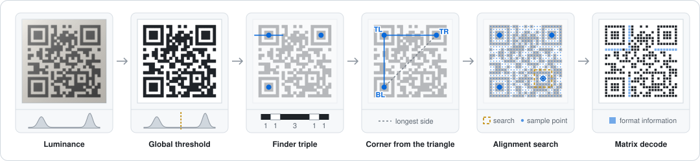
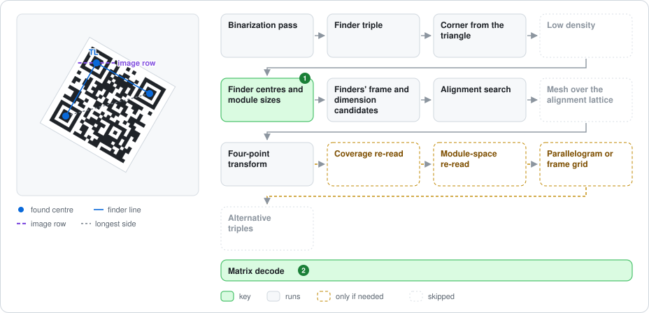
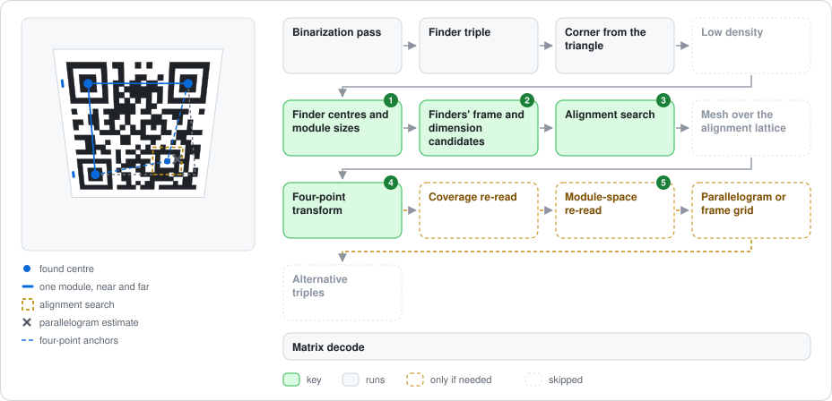
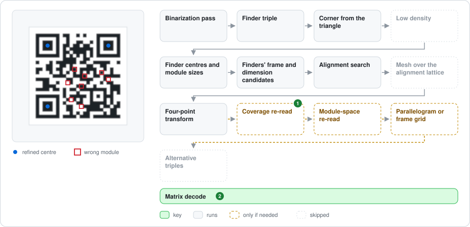
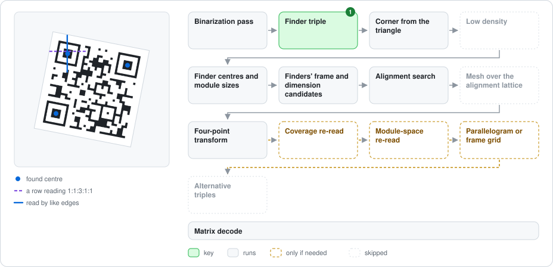
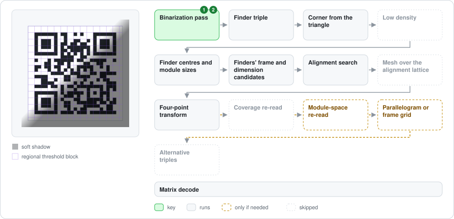
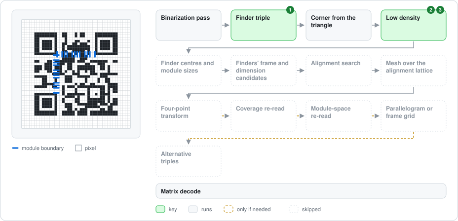
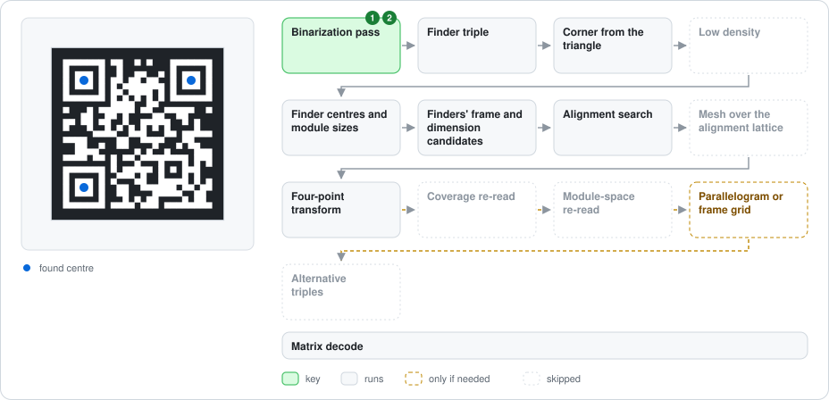
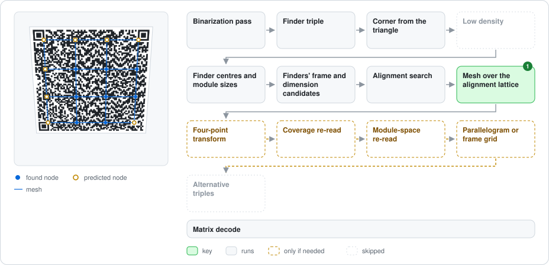

# Standard QR Decoder

This is the design record for the Standard QR decoder (`QRCodeDecoder`): what it does, why it is scoped this way, and what implementing it taught. Implementation details are in code comments (see the [spec-to-code map](standardqr-spec-map.md)). Micro QR and rMQR have their own records, [Micro QR Decoder](microqr-decoder.md) and [rMQR Decoder](rmqr-decoder.md), and what the three share is in [QR Symbology Architecture](qrcode-symbologies.md).

---

## What

`QRCodeDecoder` decodes QR codes back into text at two levels.

### Matrix level

The input is `QRCodeData` or a byte-per-module span, the format `QRCodeGenerator.Create(Span<byte>)` produces.

The decoder runs the inverse pipeline: format info → unmask → codeword extraction → deinterleave → Reed-Solomon correction → bit stream parsing. The `Span<char>` overloads allocate nothing in steady state.

### Image level

The input is `SKBitmap` or a grayscale luminance span.

Before the matrix pipeline come binarization, finder pattern detection, orientation resolution, bottom-right alignment search (version 2+) and projective grid sampling (4-point perspective transform). Binarization is Otsu, plus a regional pass, in either polarity, when the global threshold reads nothing and gives no verdict on the content. The [spec-to-code map](standardqr-spec-map.md#image-level) draws the stages in order.

When nothing reads at full size and no verdict comes, an image with grey levels is read again halved, each pixel the mean of the two by two block above it, through the same passes, and halved again until its shorter side would be under 64 px. A pyramid of halves adds a third to the pixels searched, where a 2× bilinear upsample of a failed image, measured on 2026-09-20 and rejected, added four times and cost 2.5 to 18 times on unreadable images. The mean takes out what is finer than a module, sensor noise and a screen's pixel grid among it, which breaks a finder's runs at full size. A symbol read at a level reports its corners in the pixels of the image given ([Decisions](#decisions), Reduced-scale search).

The alignment pattern is searched for where the finders' frame puts it, along the frame's grid axes there. That frame is the projective map fixed by the three finder centres and the module sizes at both ends of the two finder lines: a flat symbol in perspective foreshortens along each line, so one plane fits the centres and both size changes. A finder is a candidate when every cross-check line reads 1:1:3:1:1 on its own scale, so a finder drawn up to three and a half times as tall as wide, by strong perspective or on a card tilted steeply away, is still found. When the row through the refined centre does not read but still measures five runs of the scanned row's length, a row a quarter of the centre square above or below it is read in its place, from 4 px a module, and the finder must then read along both diagonals: a hole or a worn stretch of the ring on the centre row is not the ring. A finder whose falling diagonal does not read is a candidate when the rows a module above and below its centre and the columns a module either side of it all read, from 2 px a module: a ring drawn as four bars, without its corners. Where the frame foreshortens, each finder line's module count uses the geometric mean of its two end sizes, the count the frame implies. A cross-check line whose dark runs are all longer or all shorter than their modules (ink spread, a thin print, a blurred ring) is read by the distances between same-polarity edges, and its finder must then also read along its rising diagonal.

If the triple, decoded from the corner its shape names, neither reads nor gives a verdict on the content, each other corner is decoded once its timing patterns read. If the triple still gives neither and more than three candidates were found, up to two other triples are decoded once each, ranked by the height in modules over which their least confirmed finder was confirmed, each from the first of its corners (the shape's included) whose timing patterns read through its own frame.

The strided scan returns its triple without the rows between when it was selected with no once-seen candidate set aside. When that triple and its alternatives fail, the rows between are scanned after all in two cases, and the completed list is selected from again and its triple and alternatives decoded: when the stride could not have confirmed the triple's finders (a finder's 3-module centre band shorter than two strides is crossed once or not at all, so a 4 px/module symbol in a 4,000 px image is selected on counts that say nothing; a candidate under 2 px/module, smaller than any finder the scan reads, counts as 2 px, so an image under 944 px tall is never undersampled), and when the list is crowded, two symbols' worth of confirmed candidates, six. On a crowded list, after those fail too, the well-shaped triples of confirmed candidates are walked most compact first and each is asked whether its timing patterns read, the gate an alternative passes before it costs a decode, and the first four that do are decoded: where symbols of one size stand side by side, the three finders meeting at a corner of three symbols form a triple as well shaped, as confirmed and smaller than any symbol's own, which no shape tells apart and the timing patterns do ([Decisions](#decisions), Selection among many).

When no triple reads, or fewer than three candidates were found, and the scan has read every row, a third finder is inferred from two. Two candidates that share an edge of a symbol put its third finder at the perpendicular of their edge from either of them, on either side; two on the diagonal put it half the perpendicular from their midpoint, on either side. Of the candidates confirmed on more than one row, the four seen over the most rows are paired, and each pair's six constructions are searched a module at a time to two modules out and then a quarter module within half a module for the centre whose two timing patterns read best through the frame; the two constructions whose timing patterns read under an eighth wrong are decoded, best first. The inferred finder is neither measured nor refined on the image, and the two lines through it are taken flat ([Decisions](#decisions), Inferred third finder).

When nothing anchors the fourth corner (version 1, or no alignment pattern found), the global grid is the parallelogram of the finder centres, followed by the finders' frame when the frame foreshortens. The timing match reads the timing patterns through the frame. Version 7+ also builds a mesh over the full alignment-pattern lattice: every node is measured on the image around where the finders' frame puts it, moved by what the nodes beside it were off the frame by, and a module is placed through three nodes a side, so the mesh follows a lens or a bend where no plane does ([Decisions](#decisions), Mesh that follows a lens). A mesh with under half its interior nodes found is not used, and the global transform is always sampled as well, so the mesh never reads less than that transform. Last, when the parallelogram and the frame have failed, the fourth point is measured on the image: the bottom-left finder's top edge and the top-right finder's left edge, each the ring's outer edge found on the finder's centre line and followed across the finder at half-module steps, are fitted as lines and intersected where the symbol's row and column 7 from the far corner meet, and the grid through the three centres and that point is sampled ([Decisions](#decisions), Fourth point from the edges). After that, below version 7, each finder is taken as a shape: its inner outline, the square five modules a side its dark ring encloses, is measured, and the plane that best fits the twelve corners of the three outlines is sampled ([Decisions](#decisions), Plane fitted to the finders' outlines).

If a global transform anchored on the bottom-right alignment pattern fails, the decoder falls back to the parallelogram of the three finder centres, which are resolved much more finely at low density. On a grey-level image it is also read by coverage. The resample is decoded only when it samples different modules, and not at the runner-up dimension, which is a guess. Below version 7 the planes fitted to the finders' outlines follow it: first the plane of the twelve outline corners and the anchor as a thirteenth point, then the plane of the twelve alone.

A grid that has failed every way above is read once more in module space, where the reading has a grey image: the image itself when it holds grey levels, and at the regional pass the image the binarization was made from, which the pass is handed with its polarity. Each module's luminance is the mean of nine samples over its middle, and the module is dark when no lighter than the mean of the modules around it. The threshold and the coverage read split every module at one level, and the regional binarization sets its scale in pixels and is read one pixel a module; this read measures in modules, so blur and noise average out of a module and the level it is split at follows the light across the symbol. It runs only on a grid whose timing row and column alternate, read the same way, which refuses a grid at another dimension or from other marks on two lines of it, and it follows the first grid of a dimension, after the mesh, and each parallelogram, frame and fourth-point grid ([Decisions](#decisions), Module-space re-read).

From version 7 the symbol states its version beside its two far finders, and that is read first. The finders' frame asks both copies for the estimate's dimension, and where both state it the estimate stands. Otherwise each copy is read through its own finder's measured outline, which holds whatever the dimension turns out to be. Where it names another dimension than the estimate, that dimension is sampled ahead of the estimate's ([Decisions](#decisions), Version read at the finders). When the estimated dimension fails, the two timing patterns are counted (their dark runs give the version directly), and a version 7+ symbol's version information is read from that sampling. The dimensions these name are tried in that order, then the timing match's, then the estimate's runner-up. An estimate past the version range is not treated as proof of a wrong finder triple: the dimension read at the finders is sampled, then the timing patterns are counted, and a count both lines agree on is sampled, or else the timing match's.

On success the result carries the symbol's four corners in image coordinates (`QRCodeDecodeInfo.Corners`, contract in [qrcode-symbologies.md](qrcode-symbologies.md#public-api-direction)) from the mapping that decoded, which on the global path is the 4-point transform. The mesh path runs from version 7 when nothing anchored the fourth corner or the anchored grid did not read, so its corners come from a transform anchored on the three finder centres and the mesh's diagonal-last lattice node (at its last grid coordinate). That node is normally a detected alignment pattern. When the pattern was missed, it stands where the frame and its neighbours' offsets put it. On the mesh as first built, anchoring on the nearest node the mesh detected gave byte-identical corners on every version and tilt measured, the erased pattern included, so the simpler form shipped, and bilinear extrapolation of the outer mesh cell, tried first, left the top-left corner 0.6 to 0.75 module short.

Version 1 has no alignment pattern. Under perspective, whenever the parallelogram grid decodes, its bottom-right corner is the parallelogram estimate the sampler also uses, and error correction lets that grid decode under a few percent of keystone. So the corner tests check a version-2+ keystone to half a module but version 1 only flat and rotated (v1 measured within 0.18 module over a full rotation sweep, so its gap is keystone alone). Past that keystone the parallelogram fails and the finders' frame decodes, so the corners are the frame's (within half a module on the keystoned version 1 renders of `KeystoneFrameDecodeTest`).

The parallelogram fallback is not limited to version 1. `BuildGridTransform` reaches it on any version once all three `allowance` windows miss the bottom-right alignment pattern, and a review round measured that one erased module there is enough. The symbol still decodes through error correction but reports that corner up to about a module and a half out (v2 at 2 % keystone: 0.82 module in either direction. It used to read a little further in one keystone direction only, see the pixel-convention lesson). `SymbolCornersTest` holds that corner to a module and a half, and also to more than half a module, because the upper bound alone passes even if the erase stops working (0.31 module intact against 0.59 to 1.00 erased). From version 7 the rest of the alignment lattice anchors the mesh first and the corners come from it: the v10 at 0.75 % that measured 0.83 module off through the parallelogram reports 0.07 through the mesh in either direction (`SymbolCornersTest` checks it to half a module).

The corners are also accurate to half a module only from about 8 px/module up, because the alignment centre is resolved to a whole pixel: its error stays near 4 px at 6, 8 and 12 px/module (4.09, 3.63, 3.94), 0.68 module at the coarse end and 0.33 at the fine one. Both facts are in the public contract. On a grey-level image the alignment centre is now refined to a fraction of a pixel (the centroid lesson below), and these corner figures were not measured again. On a two-level image it is still resolved to a whole pixel.

### Image decode figures

These figures show how the image decoder reads each kind of input. [decode_figures.cs](../../../tools/decode_figures.cs) draws them from the library's own symbols and decodes every rendered input through the public API, so every figure shows a real read. Rerun it when the pipeline changes.

#### Stage by stage

This figure shows a clean symbol on the main path.

- Luminance: a grey image comes in.
- Global threshold: one Otsu split of the histogram separates ink from paper.
- Finder triple: each finder reads 1:1:3:1:1 along a line through its centre.
- Corner from the triangle: the top-left finder is the one opposite the longest side.
- Alignment search: the pattern is searched for where the finders' frame predicts it and anchors the four-point transform that samples the grid.
- Matrix decode: format information, unmasking, deinterleaving and Reed-Solomon give the text.

#### Reading the input figures

Each figure shows the input, with the decoder's findings drawn over it, beside its path through the [image-level stages](standardqr-spec-map.md#image-level). Every binarization pass runs this path: the global threshold, then the inverted image, then the regional pass (see [image decode passes](qrcode-symbologies.md#image-decode-passes)). The matrix decode at the bottom reads every grid, and reads it again transposed unless the first read decodes it or gives a verdict on the content.

Green and grey boxes run for this input. Green marks the stages it depends on.

- Key (green): without this stage the input would not read, or would read only after more grids fail than with it. A grid is one sampling of the symbol. Reading it again transposed, by coverage or in module space is the same grid.
- Runs (grey): the stage runs as it does for any input.
- Only if needed (dashed): the stage runs only when the grids before it fail.
- Skipped (faded): the stage does not run for this input.

Numbers on the boxes match the numbered notes under each figure.

#### Clean

The input is a screenshot, a render or a flat scan: upright, crisp and flat. The first grid decodes.

With only two grey levels, one global threshold splits ink from paper and the grey-level stages stay off. The strided row scan crosses each finder's centre band, and the column, the row again and the falling diagonal confirm each candidate. The top-left finder is opposite the longest side, and the cross product tells the other two apart. In whole pixels the module sizes agree at both ends of each finder line, so the finders' frame is the parallelogram of the centres. The alignment pattern is found where the frame predicts it and anchors the fourth corner.

#### Rotated or mirrored

The symbol is at any angle, mirrored or not.

1. Finder centres and module sizes: sizes are measured along the finder lines, because an image row crosses a turned finder on the slant and reads it up to √2 too long.
2. Matrix decode: a mirrored capture has the same finders but a transposed grid, so a grid that neither reads nor gives a verdict on the content is decoded again, transposed.

A finder reads 1:1:3:1:1 along any line through its centre, so the row scan finds it at any angle. The longest side of the centres' triangle is still the diagonal, so the corner does not depend on the angle. The transform includes the turn, so sampling works as it does upright.

#### Keystone distortion

A flat symbol is tilted away at the bottom, so near modules look larger than far ones.

1. Finder centres and module sizes: along a finder line that runs into the distance (here the left one), the module size differs at its two ends.
2. Finders' frame and dimension candidates: the frame is the one plane that fits the three centres and both lines' size changes.
3. Alignment search: the frame predicts where the alignment pattern sits and how the grid turns there. The parallelogram of the centres drifts away from it as the tilt grows.
4. Four-point transform: the three finder centres and the alignment centre anchor a four-point transform, which samples the grid.
5. Parallelogram or frame grid: if the anchored grid fails, the parallelogram grid is tried. With no alignment pattern found, the parallelogram comes first and the frame after it.

Perspective also makes a finder taller or shorter than it is wide, as here. The column cross-check accepts that stretch within a window relative to its row, and beyond it only if the rising diagonal also reads 1:1:3:1:1, which a steeper tilt needs. Whenever the frame foreshortens, each finder line's count uses the geometric mean of its end sizes. On a version this small the plain mean snaps to the same size, and on a large one it would come up short. Here every finder column stays within its row's window, the shape's corner is right, and only three candidates are found.

#### Grey edges and wrong modules

The edges are anti-aliased or resampled, and a few modules read the wrong way.

1. Coverage re-read: if the grid fails, it is read again by coverage, which interpolates each module centre and splits it halfway between the two levels.
2. Matrix decode: Reed-Solomon corrects the wrong modules, up to each block's capacity.

Grey edge pixels fall between the histogram's two levels and turn on the grey-level stages. Each finder centre moves to the centroid of its centre square's darkness, a fraction of a pixel, and the module sizes are measured again to sub-pixel edges. Here the grid reads without the refined centres and sizes. At a lower density, a finder whose runs just miss 1:1:3:1:1 is measured again from the grey levels before it is rejected. Heavy blur and heavy damage are out of scope.

#### Thin or thick rings

A thin print, ink spread or a blurred ring cut by one threshold moves every dark edge the same way, here inward.

1. Finder triple: through a finder's centre every dark run is shorter than its modules and every light run longer, so the column, the row again and both diagonals miss 1:1:3:1:1. Each is read again by its same-polarity edge distances, which a uniform shift of the dark edges leaves at 2, 4, 4 and 2 modules, and the finder must then also read along its rising diagonal, as a closed ring does.

The row scan still accepts only 1:1:3:1:1 and finds each finder on an off-centre row that reads that ratio. A finder whose edges moved by a quarter of a module or more, or that no row reads as 1:1:3:1:1, is not found (see [Input envelope](#input-envelope)). The first grid then reads.

#### Uneven lighting

A soft-edged shadow covers part of the symbol. The global threshold falls between lit and shadowed paper, so shadowed paper reads as ink.

1. Binarization pass: when no single threshold splits ink from paper, the global passes read nothing and the regional pass runs, comparing each pixel with the mean black point of the blocks around its own.
2. Binarization pass: the regional pass binarizes the positive image first and runs the same path on it. Here that reads, so the negative is never binarized.

The result has only two levels, so the grey-level stages stay off: the centres are not refined and no grid is read by coverage. A grid that fails there is still read again in module space, from the grey image the binarization was made from. The regional pass is skipped in three cases: after a global pass gives a verdict on the content, for an image too small for one neighbourhood of blocks, and for a polarity it would binarize exactly as the global threshold did. A hard-edged shadow is out of scope.

#### Low density

A crisp render near one pixel per module has modules one or two pixels wide.

1. Finder triple: the runs come out in whole pixels, one or two per module, too coarse for a ratio check. A crisp finder is accepted when the row above or below repeats its runs pixel for pixel and all 49 of its modules read through the edges its row and column measured.
2. Low density: for an upright or right-angle symbol, the module boundaries are read off the two timing patterns, finder to finder, and off the finders' own lines. The grid is sampled between them, each module wherever its edges fell.
3. Low density: both timing lines must read as timing patterns of the same dimension, which names the version.

This path is tried first for every corner. When it reads, nothing after it runs.

#### Light on dark

The modules are light on a dark background, as on a dark-mode screen.

1. Binarization pass: in the positive image the finders' rings do not read 1:1:3:1:1, so the global positive pass reads nothing.
2. Binarization pass: the inverted pass decodes the inverted image, mirroring the histogram instead of counting it again, and runs the same path.

From the finder triple on, the path is the clean one.

#### Large version

The symbol is version 14 or up, in perspective, with the bottom-right alignment pattern lost, so the rest of the alignment lattice anchors a mesh.

1. Mesh over the alignment lattice: nothing anchors the four-point transform's fourth corner, so the mesh is decoded first. Without it, the parallelogram and its coverage re-read fail, and the frame grid reads after them.

An intact symbol reads through the anchored four-point transform, as in the keystone figure: a flat symbol in perspective is one projective map, which four correct points fix, while the mesh only interpolates between measured nodes. When the alignment search anchors the transform, the mesh runs after the transform and its coverage re-read, for what they do not read: a symbol bent off the plane, or a fourth anchor found on another mark.

From version 7 the alignment patterns form a lattice of 3 × 3 positions or more, whose row and column at coordinate 6 lie on the timing patterns. Every node is measured on the image. The three corner nodes have no pattern: each sits three modules inside a finder's centre and is placed by that finder's own outline. The patterns on the timing lines are searched outward from the top-left corner, then the interior ones row by row, each around where the finders' frame puts it, moved by what the nodes already placed beside it were off the frame by. The frame is one plane, and a lens or a bend moves the lattice off any plane, but by little from one node to the next. A node not found keeps that prediction, and the mesh is kept when half the interior nodes are found.

A module is placed through three nodes of its lattice line, the two of the cell it falls in and the one beyond the nearer of them, so a line of modules carries the curvature its nodes measure: straight cells are neither a lens, whose lines bow, nor perspective, whose modules shrink along a line. A 3 × 3 lattice, versions 7 to 13, is one such cell over the whole symbol.

### Support tiers

"Tier" is this project's shorthand for image-input difficulty, not standard QR terminology. The tiers were the implementation stages. Tiers 1 and 2 have a measured envelope that tests hold. Tier 3 is measured against other readers and has none:

| Tier | Input class | Status |
|---|---|---|
| Tier 1 | Clean images: screenshots, rendered QR codes, flatbed scans, arbitrary rotation, mirroring, reflectance reversal, a shading gradient or a soft-edged shadow over part of the symbol (limits under Lighting below). No meaningful perspective distortion | Supported |
| Tier 2 | Tier-1-clean images in perspective (keystone): a 4-point homography anchored on the alignment pattern the finders' frame predicts, that frame itself where nothing anchors the fourth corner, plus the piecewise mesh for version 7+ | Supported within the measured envelope, see [Input envelope](#input-envelope) |
| Tier 3 | Camera photographs: strong perspective, hard-edged shadows, blur, glare, a curved or damaged symbol, a symbol on a screen | Read as the sets under [Photographs](#photographs) show, with no envelope promised (see [Why](#why)) |

Matrix-level decoding takes an exact module matrix as input, so the tiers apply only to the image level.

### Supported

| Area | Coverage |
|---|---|
| Versions | 1–40 |
| ECC levels | All |
| Segment modes | Numeric, Alphanumeric, Byte, Kanji (JIS X 0208, written by the generator for text JIS X 0208 holds) |
| ECI | ISO-8859-1, UTF-8, Shift_JIS (ASCII, JIS X 0201 half-width katakana and the JIS X 0208 cells Kanji mode reads) |
| Text handling | UTF-8 BOM, multi-segment streams, and a Byte segment with no ECI header read as UTF-8, Shift_JIS or ISO-8859-1 by its bytes ([Decisions](#decisions), Byte-mode charset heuristic) |
| Structured Append | The header is read wherever it sits in the stream and reported as `QRCodeDecodeInfo.StructuredAppend` (0-based index, count, parity). Each symbol yields its own part of the text, and the caller reassembles the parts (rules on `QRStructuredAppend`). A header past its count, a second header, or a truncated one is `InvalidBitstream`. A part is text, not bytes, so if a set's encoder cut the byte stream inside a multi-byte character, the decoded text shows it: where the symbols declare UTF-8, U+FFFD appears at both edges of the cut, and where they declare nothing, the Byte segment on each side is read by its own bytes (the charset is resolved per Byte segment, and one that is not valid UTF-8 is read as ISO-8859-1, or as Shift_JIS where the guess holds). Both are the byte-segment decoder's own behaviour, checked by `ByteSegmentAndEciBoundaryTest` (`DeclaredUtf8_WithInvalidBytes_SubstitutesRatherThanFallingBackToLatin1`, `InvalidUtf8_FallsBackToLatin1`, and `UnspecifiedCharset_IsResolvedPerByteSegment` for a valid and an invalid segment in one stream). This library and the pinned encoder oracles cut between characters. Returning a part's bytes would be new public surface, added on a request rather than ahead of one |
| FNC1 | Both modes are read and reported as `QRCodeDecodeInfo.Fnc1` (`Fnc1Mode`: `IsFirstPosition` for GS1 data, `IsSecondPosition` with `ApplicationIndicator`, the 8-bit codeword, for an AIM industry format). The text is the element string: each separator is U+001D, whether it came as `%` in an Alphanumeric segment or as 0x1D in a Byte segment, and `%%` in an Alphanumeric segment is one `%`. No symbology identifier or application indicator is put in the text, and the remarks of `Fnc1Mode` show how to build the standard's transmission. FNC1 is accepted once, before the first data segment, with the ECI and Structured Append headers on either side of it in whichever order the writer put them. An indicator after a data segment (an empty one included), a second indicator, or an application indicator outside 00-99, 165-190 and 197-222 is `InvalidBitstream` |
| Image transforms | Arbitrary rotation, mirroring, reflectance reversal (light-on-dark) |
| Lighting | A shading gradient, or a soft-edged shadow (its edge a few modules wide) over part of the symbol, on images at least 33 px a side (measured limits under Lighting below). It is read through a regional binarization, tried after both polarities fail on the global threshold (see [Lessons Learned](#image-detection-and-sampling)) |
| Perspective (Tier 2) | Keystone to 40 % at 3-6 px/module and to 20 % from 2 px/module in every version, see [Input envelope](#input-envelope) |

### Unsupported

These are detected and reported, never misdecoded:

- Other ECI charsets

### Input envelope

The envelope covers the Tier 1 and 2 inputs above, with perspective limited to the measured keystone envelope below. Photographs are measured apart, under [Photographs](#photographs). Reflectance reversal (light-on-dark) costs one inverted retry. Non-square modules from thermal printers and laser markers decode within the envelope shared with the other symbologies ([qrcode-symbologies.md](qrcode-symbologies.md)).

A crisp render (every pixel wholly dark or light, the symbol along the image axes) reads from 1 px/module, whole or fractional. Anti-aliased or resampled edges read from about 1.5 px/module, and rotated or keystoned symbols from about 2. One exception was seen and not rechecked: a crisp, evenly lit version 1 at exactly 1.95 px/module failed at levels L, M and Q (2026-09-23), while 1.93, 1.94, 1.96 and 1.97 read.

This table compares this library with other readers on the same images from the [image decode sweep](qrcode-test-fixtures.md#image-decode-sweep) (2026-09-28). The sweep has 400 cases, ten per version at a random level, with numeric, alphanumeric or URL-like payloads longer than the version below holds. Six libraries encode each case (four have an image writer, the last row), and each is drawn once per kind. zxing-cpp 0.5.2 and ZXing.Net 0.16.11 read the same grayscale buffer.

| Kind, px/module | This library | zxing-cpp | ZXing.Net |
|---|---|---|---|
| Crisp nearest-neighbour, random offset, 1.0-1.25 | 2,400 of 2,400 | 561 | 111 |
| Crisp, 1.25-1.5 | 2,400 | 2,076 | 759 |
| Crisp, 1.5-2 / 2-3 / 3-6 | 2,400 each | 2,370 / 2,387 / 2,400 | 1,896 / 2,185 / 2,346 |
| Anti-aliased path, 1.0-1.25 | 356 | 41 | 6 |
| Anti-aliased path, 1.25-1.5 | 2,371 | 1,655 | 445 |
| Anti-aliased path, 1.5-2 / 2-3 / 3-6 | 2,400 each | 2,328 / 2,399 / 2,400 | 983 / 1,669 / 2,226 |
| Bilinear upscale of a 1 px/module image, 1.5-2 | 2,400 | 2,213 | 549 |
| Bilinear upscale, 2-2.5 / 2.5-3.5 | 2,400 each | 2,393 / 2,385 | 1,319 / 1,648 |
| Downscale of an 8 px/module image, 1.5-2.5 / 2.5-4 | 2,400 each | 2,394 / 2,399 | 1,440 / 1,998 |
| Right-angle turn / mirrored, crisp, 1.5-3 | 2,400 each | 2,400 / 2,394 | 2,053 / 2,058 |
| Supersampled at any rotation, 2-3 / 3-6 | 2,400 each | 2,354 / 2,400 | 1,143 / 1,922 |
| Supersampled, keystone up to 6 % (2-6) / 6-20 % (3-6) | 2,400 each | 2,400 each | 1,466 / 865 |
| JPEG quality 50-90, crisp, 2-4 | 2,400 | 2,394 | 2,160 |
| Each encoder's own image writer | 1,600 of 1,600 | 1,595 | 1,298 |

zxing-cpp reads 18 renders this library does not, all anti-aliased at 1.0-1.25 px/module, below the envelope. This library reads 3,607 that zxing-cpp does not. On the first baseline (2026-09-21, seven encoders) zxing-cpp read 2,002 of 63,600 renders this library did not, nearly all in five kinds: anti-aliased edges at 1.25-1.5 and at 1.5-2 px/module, bilinear upscales at 1.5-2, any rotation at 2-3 and keystone 6-20 %. The lessons below record what closed each. On the real images the gap was 28 reads of 548 then and is 22 since 2026-10-12, each with a recorded cause ([qrcode-test-fixtures.md](qrcode-test-fixtures.md#where-the-gap-stands)).

When rings print or read thicker or thinner than their modules (ink spread, a thin print, blur), a finder is found as long as every dark edge moved by under a quarter of a module and some row through it still reads 1:1:3:1:1. Symbols whose dark edges all moved by 0.1, 0.15, 0.2 and 0.24 of a module read 590, 560, 408 and 144 of 600 (versions 1-10, 3-6 px/module, turned 0-60°, grey or binarized).

The next table is the measured keystone envelope (Tier 2). The keystone shortens one edge of the symbol by its share of the width, and the symbol is drawn with 2 × 2 supersampling at any turn. Each cell holds ten payloads of each version from 1 to 40 and counts the renders read, with zxing-cpp 0.5.2 (`TryHarder`) on the same images in brackets:

| Keystone | 3-6 px/module | 2-3 px/module |
|---|---|---|
| Up to 6 % | 400 of 400 (400) | 400 (388) |
| 6-20 % | 400 (399) | 400 (376) |
| 20-30 % | 400 (397) | 390 (327) |
| 30-40 % | 400 (242) | |
| 40-50 % | 397 (29) | |

The three renders still failing at 40-50 % are at 48-49 % keystone. Each selects a triple holding a false candidate, and the drawn triple, next in line, is not verified. Two were first blamed on a count further from the dimension than the timing match searches, but a 2026-09-28 re-measurement over 40,000 envelope renders found no drawn triple's count that far off. The 47 drawn triples left unverified (each the first or second alternative, its estimate within 4.5 modules) fail because their timing patterns do not read through their own frame. At 20-30 % and 2-3 px/module, eight of the ten failures miss a finder at about 2 px/module whose falling diagonal does not read 1:1:3:1:1, a low-density limit of the finder that reading rings by their like edges did not move.

On the same one-axis renders (2026-09-25), ZXing.Net and CodeGlyphX (given 1 s an image) read:

- 3-6 px/module: 296 and 106 up to 6 %, 142 and 7 at 6-20 %, 35 and 0 at 20-30 %, 8 and 0 at 30-40 %, and none at 40-50 %.
- 2-3 px/module: 155 and 25, 69 and 1, 9 and 0.

Mean times per image (one thread, wrappers included) for this library / zxing-cpp (`TryHarder`) / ZXing.Net were 0.30 / 2.06 / 5.3 ms up to 6 %, 0.34 / 2.23 / 7.6 at 6-20 % and 0.97 / 1.90 / 9.4 at 30-40 %.

The next table tilts the plane about both axes, turning the narrowing from the symbol's own vertical to any direction or toward a corner (45° off an axis). It was measured on another payload set, where renders narrowed at the top edge read 400, 400, 399 and 398 at 3-6 px/module and 393 at 2-3, and renders narrowed at any of the four edges read 400, 400, 399, 395 and 391. The renderer tilts the plane about any axis with the same depth ratio, 1/(1 − k), and with no tilt draws the old path's image bit for bit. Every module centre, mapped through the transform the renderer reports, lands on the module's colour. Where zxing-cpp reads a render, its corners lie a median 0.15 to 0.3 module from the drawn ones.

| Keystone | Tilted in any direction | Toward a corner |
|---|---|---|
| 6-20 %, 3-6 px/module | 400 (398) | 400 (400) |
| 20-30 % | 399 (400) | 400 (396) |
| 30-40 % | 399 (302) | 400 (237) |
| 40-50 % | 398 (137) | 398 (107) |
| 20-30 %, 2-3 px/module | 393 (366) | 394 (363) |

At 3-6 px/module the full sweep's candidate list holds every drawn finder of 9,600 but one (at 6-20 %, in a render that reads), so the triple fails, as along an axis. In four renders the drawn triple is an alternative past the two that are verified, in one it is the first alternative and does not read, and in one the stride pass left a finder out of the list. At 2-3 px/module seven drawn finders of 2,400 are not candidates because, as along an axis, the falling diagonal or the row again refuses them at about 2 px/module. Five renders select the drawn triple, count it right and fail after it, and one has the drawn triple fifth.

Lighting was measured on symbols printed with ink at 30 and paper at 220 (about 7:1), cropped to the symbol and its quiet zone, with a shadow edge three modules wide and light from eight directions. The symbols are Standard QR versions 1-5 at every level, and Micro QR M2-M4 and rMQR R7x43, R11x27 and R13x43 at both levels, at varied sub-pixel placements. Only renders that read under even light are counted (a turned symbol near its density limit can fail at some placements unlit, which is geometry, not light).

Every sweep held to the bounds below. A single placement often reads further, so they are measurements, not a contract. For the same reason the README and the public remarks carry no number: each number put there kept needing a condition it did not state (density, anti-aliasing, rotation, contrast, margin). They say "a shading gradient or a soft-edged shadow over part of the symbol", and the limits are here:

- Under a linear ramp that takes 80 % of the light across the image, a crisp symbol at 4 px/module reads in every direction, except rMQR R7x43, which loses 2 of 8.
- A crisp symbol along the image axes reads under a 40 % shadow from 2.6 px/module, and from 2 in all but a few renders in a thousand (a render that is exactly the grid and its quiet zone reads to 42 % and first fails at 43-44 %, on small Standard QR versions).
- A crisp turned symbol reads under a 40 % shadow from 3.6 px/module, except Standard QR version 1 turned near 45° with the light along the diagonal, which loses up to about 1 render in 200 from 38 % (none at 36 %).
- Anti-aliased edges, turned or not, read the same from 4.5 px/module, and from 3.5 in all but a few renders in a thousand. Micro QR M4 turned near 220-225° with the light toward 45° also loses a few in a thousand at 40 % (none at 36 %). Below that density losses start early: from 30 % at 3 px/module turned, and at 2 px/module from about 4 % at some sub-pixel placements.
- Lower contrast holds less: ink at 60 on paper at 200 holds to about 30 % and ink at 100 on paper at 170 to about 17 %, and from there to 37 % and 23 % a few turned renders in a thousand are lost.
- A margin wider than the quiet zone makes the global threshold split lit paper from shadowed paper instead of ink from paper. The regional pass reads most of what that loses, but turned version 1 symbols lose renders from 36 % with 2 extra modules, other symbols from about 27 % with 12 or more, and from 26 % at 8 px/module, where the modules line up with the blocks (below).
- Micro QR M1 holds the same 40 % shadow. Of 10,000 renders that read evenly lit, it reads 9,987 crisp along the axes from 2.6 px/module, 9,996 crisp turned from 3.6 and 9,998 anti-aliased from 3.5. The global threshold alone read 3,265, 101 and 0 (the regional pass refused M1 until its grids had to justify their corrections, see [microqr-decoder.md](microqr-decoder.md#lessons-learned)).

Deeper shadows read at some scales and not others. At 4 and 6 px/module, whole pixels along the axes, they read everywhere to about 54 %. Where the modules line up with the 8 × 8 blocks (8 and 16 px/module, whole pixels), every block is flat and takes its black point from the lit blocks above and to its left. Once the global threshold stops reading (between 45 and 48 % for the version 3 symbol tested, earlier for small versions), the regional pass reads only the directions whose shadow falls away from those blocks (4 to 7 of 8 from 48 to 60 %), as ZXing's own hybrid binarizer does.

At 4 px/module and 75 %, every reader measured here reads the version 3 symbol in only some directions (zxing-cpp and ZXing.Net included: 2 of 8). At 85 % none reads it, because its modules on either side of the shadow's edge share one neighbourhood. Larger versions and rMQR still read in some directions there. Reading past half on block-aligned modules is open. zxing-cpp reads none at 8 px/module.

On the same renders (2026-09-23, not measured since), this library read at least as many as zxing-cpp at 4 px/module at every depth and symbology probed (Micro QR shadow at 65 %: 5 of 8 directions against 1, and rMQR at 80 %: 5 against 0). At 3 px/module zxing-cpp read a few more Micro QR and rMQR renders (Micro QR shadow at 50 %: 8 against 6, and rMQR ramp at 80 %: 7 against 5), a class the sweep's kinds do not draw. An image under 33 px a side has no 5 × 5 neighbourhood of blocks and is read with the global threshold only.

#### Photographs

Camera photographs have no envelope. They are measured against zxing-cpp, image for image, on two sets and on photograph-like renders. The tables are in [qrcode-test-fixtures.md](qrcode-test-fixtures.md#where-the-gap-stands) (2026-10-12):

- ZXing's 179 QR photographs: 171 read against zxing-cpp's 165. One that zxing-cpp reads is an image failure here, a card bowed past what a flat grid reads, and seven reads are this library's alone. Eleven of the 171 carry Shift_JIS in Byte mode with no ECI header. The sweep counts 170, because the set's expected text for `qrcode-2/13` lacks a letter the symbol holds. Before the plane fitted to the finders' outlines it read 168, and before the module-space re-read 165.
- BoofCV's 536 photographs: 456 against 392. This library is level or ahead where the symbol is close, turned, on a monitor, among many, under uneven brightness (27 against 27), at a high version (32 against 32), in perspective (28 against 22), blurred (34 against 30), shadowed (14 against 13), on a curved surface (38 against 34) or in the nominal category (62 against 61), and ahead under bright spots (25 against 13), glare (33 against 21), damage (21 against 9), on the drawn symbols of the set's `pathological` category (18 against 11) and on its `noncompliant` ones (16 against 11). It is behind in no category. Before the finder cross-checks were loosened (the wider column window, the row beside the centre row, the ring without corners) it read 447, before the mesh that follows a lens 443, before the plane fitted to the finders' outlines 427, before the module-space re-read 415, before the mesh's measured edge nodes 413, before the fourth point from the edges 406, before the selection stages 400, before the inferred third finder 371, and before the reduced-scale search 322, with 7 of the 17 on a monitor.
- go-qr, run in its own harness over the same grey images (its lines of 2026-10-11): 412 of BoofCV's photographs against this library's 456, 5 that only it reads and 49 that only this library reads. It is ahead on the `pathological` symbols (19 against 18), and behind in eleven categories, most under bright spots (18 against 25), glare (28 against 33), uneven brightness (21 against 27), damage (16 against 21) and at a high version (22 against 32). On ZXing's set it reads 165 upright against 170, one that this library does not, and this library reads six that it does not. Before the module-space re-read the totals were level, 412 against 416, with 23 and 27 either way; of those 27 gap photographs, 8 were lost at the finders and 19 at the grid, and 21 read since.
- Renders through a pinhole camera: tilt to 55°, blur of 0.25 to 0.45 module, noise to 30 grey levels and a small symbol in a scene read as zxing-cpp reads them or better, and a bow of 1 to 4 modules reads 400 of 400 against 396. Through a lens, which was where this library fell behind from about version 10, the phone mix reads 397 of 400 against 328 and barrel distortion of 5 to 20 % reads 264 against 86, since the mesh that follows a lens (2026-10-12): 129 of the 132 renders at 5 to 10 %, 103 of 134 at 10 to 15 % and 32 of 134 at 15 to 20 %.

No read on either set returned a text other than the expected one, or one another reader contradicted. Before the Shift_JIS guess of 2.0.0, the eleven Shift_JIS photographs came back as their ISO-8859-1 reading. The reduced-scale search took BoofCV's gap from 77 photographs to 40, the inferred third finder to 28, with the reverse from 20 to 37, the selection stages to 22, the fourth point from the edges to 18, the mesh's measured edge nodes to 16, the module-space re-read to 13, the plane fitted to the finders' outlines to 11, the mesh that follows a lens to 8, and the loosened finder cross-checks to 5, with the reverse at 69. Of the 77, 69 read as a grid through zxing-cpp's corners, so what is left is mostly a symbol not found or not framed, not one that cannot be read.

The techniques other readers use for photographs, which this decoder did not have on 2026-10-10, are each a row of [Decisions](#decisions): a search at reduced scale; a third finder inferred from two; a plane fitted by least squares to many points, here the finders' outlines below version 7; a grid that follows curvature, here the mesh measured node by node, where the cubic lens term go-qr fits in its place was not tried; and a module read as the mean of nine samples, here as a second read of a failed grid. Several symbols an image is the one left out, since it needs a result type of its own. The codes themselves are within reach: called again with each read symbol painted over, the one-symbol call reads 1,071 of BoofCV's 1,232 codes against zxing-cpp's 977 (2026-10-14, [qrcode-test-fixtures.md](qrcode-test-fixtures.md)), and an internal entry returns the same count in one call ([Decisions](#decisions), Several symbols of one image). What either other reader still reads and this library does not is seven of BoofCV's photographs with six causes between them and one of ZXing's, named in [qrcode-test-fixtures.md](qrcode-test-fixtures.md#where-the-gap-stands). None is a class, and five of the seven are capture conditions rather than symbols: an over-exposure, a symbol 70 px across in 12 megapixels, a reflection over a finder, a tilted and blurred card and a version 40 at 5 px a module.

The README and the API docs name no other reader for the photographs this decoder does not read. That choice is the caller's.

---

## Why

- Tiers 1 and 2 are promised and photographs are measured. An input class joins the envelope when a set shows it reads and a test can draw it, which is how the decoder was built: stage by stage, against images another reader reads. Until 2026-10-10 this record called photographs out of scope without having measured them. One sentence about photographs is wrong whichever way it leans: that day the decoder read 162 of 179 on one set and 322 of 536 on the next. So the records give the sets and the classes, the README names the classes without numbers, and each symbology's scope sentence is written from what was measured for it (rMQR has no photograph set, and its XML doc says tilted, blurred or noisy images and does not say photographs). The library stays dependency-free and auditable, so it uses no learned detector.
- The decoder is built on the encoder's own tables, so the two sides cannot drift apart. It reads the encoder's per-version placement tables (`ModulePlacer.GetLayout`, built by the reference function-pattern painters) for its blocked-module map, and the format-information decoder matches against patterns from the encoder's `GetFormatBits`. Codeword extraction also reads the encoder's placement runs. The cost is that a round trip can no longer catch a wrong table, because both sides would be wrong together and only another reader would fail. So the per-module zigzag walk stays in the assembly as the reference: it reads neither `Ops` nor `Index`, and `QRMatrixDecoderExtractParityTest` checks the run walk against it for every version and mask.
- Round-trip testing strengthens the encoder. Every `Create` output can be verified in-process (`encode → decode == input`) without ZXing. With the ZXing-decodes-our-output and ours-decodes-ZXing-output tests, both directions are cross-validated against an independent implementation.
- Decoding fails closed, because a wrong decode is strictly worse than a failed one. Reed-Solomon correction re-verifies syndromes after applying corrections, and format decoding requires Hamming distance ≤ 3 (the BCH(15,5) correction bound).
- Decoding allocates nothing in steady state. Matrix decoding uses stackalloc below 512 working bytes and `ArrayPool` above. Codeword extraction shares the encoder's per-version placement tables (built once per version used) and adds only one 1,152-byte mask table for all 40 versions, none per version or mask. The `Span<char>` overloads complete with no heap allocation (verified by a Release-only test).

---

## Decisions

| Decision | Choice | Revisit when |
|---|---|---|
| Version | On the matrix path the size gives the version exactly. On the image path the dimension estimate snaps to the nearest valid size, and the version information blocks (version 7 and up) are also read. They were first judged to matter only on heavily damaged symbols, wrongly: clean anti-aliased renders at 3 to 4 px/module put the estimate two or more versions off, and the blocks let them read (see [Image detection and sampling](#image-detection-and-sampling)) | - |
| Codeword extraction | Walk the encoder's placement runs, chosen for memory rather than speed. On x64 the per-module walk took 104 to 150 µs at versions 39 and 40, and three table forms were measured against it. The fastest, the encoder's stream-order index with a cached mask stream per version and mask, took 9.0 to 9.5 µs, but its mask streams stay resident and grow with every version and mask seen (29.6 KB at version 40, 441 KB at worst), and each decode streams 59 KB of index. The run walk took 10.2 to 11.1 µs, reads 6.5 KB of ops per decode and adds 1,152 bytes in total, because the mask bits under one output byte depend only on the pattern, the walk direction and the row and column phase. Reading `QRCodeData`'s packed bits directly to skip the unpack took 14.9 to 15.1 µs against 11.3 for the byte walk behind a vector unpack, and would be a second kernel to keep in parity, so it was not taken. ARM64 refuted it too (Apple M2, 2026-09-21: 1.18x to 1.28x slower end to end at version 40, 1.07x to 1.10x at version 1, faster nowhere, with the x64 kernel figures reproduced within a few percent). The browser is unmeasured, and no ordering is claimed there | - |
| Matrix decode performance | Stopped once further gains would no longer show when reading an image. After the extraction, reader and ARM syndrome changes, a version 40 Byte symbol decodes in 15 µs on x64 (extraction about 10.5, deinterleave 1.8, Reed-Solomon 1.3, the rest under 1.5) and 16.7 µs on an Apple M2 (10.2, 2.5, 2.5), down from 170 µs when the round started. Extraction is 60 to 70 % of it. Three candidates remained: a bit-plane extraction kernel as in rMQR (estimated 6 to 8 µs with PEXT on x64. A 177-row column needs 8-row bands, and ARM64, having no PEXT, would have to gather rows that sit a row apart in memory), five Numeric groups per window load (about 2 µs on one payload kind), and the deinterleave loop (never opened). Reading a version 40 symbol from a clean synthetic image takes 380 to 480 µs on x64 and a version 6 one 11 to 23 µs, and the matrix decode is 3 to 4 % of either, so each candidate is worth 1.5 % of a read or less. They were closed on that measurement, not on their own merits. They matter only to callers that decode a `QRCodeData` or a module matrix directly (the verify-what-I-just-encoded path, already 11x faster). For any other caller the next microsecond is in the image path | Such a caller turns up with a profile |
| Image path performance | Stage by stage, under one rule (the same result, bit for bit), until the profile ran out of stages. Between 2026-09-21 and 23 the threshold fill, the inverted retry, the piecewise mesh sampler and the finder search (its cross-check walks, their bounds and the row kernel) were each rewritten, each time keeping the replaced stage as the reference: the same threshold and grey levels, the same candidates, the same sampled pixels, and so the same text, status and corners on every fixture. Nothing resident grows with the images seen (the finder's edge buffer and the ARM64 histogram lanes are one rental per call), and the not-found path got faster on both machines. Each verdict was taken per input class, because hard-edged, fractional-pitch, soft and rotated renders stress different branches of the same stage. A version 40 symbol from a clean render at 3 px/module went from about 527 to 94 µs on x64 (`QRCodeImageDecodeEndToEnd`, span entry, BenchmarkDotNet means) and from 782 to 115 on an Apple M2 (stage harness). A 740 × 740 image with no symbol went from about 2,700 to 1,400 and from 3,827 to 1,756, and a smooth gradient from 1,776 to 322 and from 2,274 to 321. Version 6 moved less (20.6 to 10, and 34 to 11.6), because the stages that got a vector form never dominated a small image | What is left, each sized so the next round starts from a number. On an image with no symbol, three quarters of the row kernel's time is the coverage measurement on near misses (5,228 per polarity on 740 × 740 noise on the M2). Every kernel pays it, and no round has looked at it. The `SKBitmap` conversion is 6 to 13 % of a bitmap decode at 3 and 4 px/module and 13 to 28 % at 8 px, although its kernel was already made 14x to 30x faster. An image whose two values are not 0 and 255 (a symbol drawn #222 on #EEE) never takes the histogram's counted path and costs what it did before. Version 20 rotated at 3 and 4 px/module decodes on its second attempt, about 45 µs of a 140 to 200 µs decode, which is a question for the retry order rather than any stage's speed. The matrix decode is 2 to 4 %, closed in the row above. The browser is unmeasured. No test in this repository catches three planted faults in the row kernel that only over-report windows, because the cross-checks refuse what those faults send |
| Format decoding | Only 32 patterns are valid, so they are matched exhaustively by Hamming distance instead of BCH syndrome decoding, which is simpler, branch-free and gives the minimum-distance decision directly | - |
| Failure diagnostics | When an image does not read, each level of the search reports its main path's attempt (the selected triple, the corner its shape names, the grids from the finders, the estimated dimension, the grid through the transform, the grid as sampled), unless another attempt reads or gives a verdict on the content. It does not report the failure that got furthest, which Micro QR and rMQR report. The format word names no version, so a grid sampled at a guessed dimension gets past it by chance and then fails at Reed-Solomon with its own dimension's version. Tried on 2026-09-30, the furthest rule reported symbols whose format information was destroyed as `DataUncorrectable`, one version too small ([qrcode-symbologies.md](qrcode-symbologies.md#internal-organization), the result rule) | A signal of its own that a grid lies on the symbol, such as a format word read with no bit corrected (by chance about 1 word in 1,000), measured the same way |
| Reduced-scale search | When no pass settles at full size, an image with grey levels is halved, each pixel the rounded mean of a two by two block, and read through every pass again, then halved again until its shorter side would be under 64 px. Measured on 2026-10-10 against the build before it. BoofCV's 536 photographs: 322 to 371 read (zxing-cpp 391), all 17 on a monitor where 7 read, and none lost. 51 photographs read at a level, 38 at half scale, 11 at a quarter and 2 at an eighth, 23 through the level's global pass and 28 through its regional pass, none through a negative. ZXing's set: `qrcode-2/12` and `13`, which neither other reader reads at full size. The sweep: 7 more camera renders of 57,600, no read lost, no text other than the expected one. What it costs (the same photographs timed in turn on both builds): nothing on the 322 that read before (736 and 734 ms), 1.28 times on the 51 gained, and 1.53 times on the 163 that still fail (median 1.54, 90th percentile 1.72, worst 2.02). The set takes 2.8 s where it took 2.2 s, and zxing-cpp 5.9 s. On 740 px images with no symbol: uniform noise 1.65 times, blurred noise 1.80, a ramp 1.49. On an Apple M2, with every read as on x64: 1.64, 1.68 and 1.53, and 1.61 on a 12-megapixel scene; with the halving on its vector tier 1.63, 1.66, 1.43 and 1.54. Most of a failing photograph's time is outside the symbol passes at any scale (on one 12-megapixel photograph the histogram took 4.6 ms, each regional binarization about 8 ms, and a symbol pass 0.9 ms), so the search costs what its levels' image-wide steps cost plus the halving, which has vector tiers since 2026-10-11 (Lessons learned, the halving): 0.4 to 0.6 ms for 12 megapixels on x64, where a word at a time took 1.6 and a byte at a time 3.7. The set timed again with three builds in turn (the build before the search, the word loop, the tiers, each photograph at its faster of two runs) put the 163 failing photographs at 1.59 and 1.58 times the build before, and the 322 that read at full size, which the halving never touches, 6 % apart between the last two: the tiers' share of a failing photograph, about 4 %, is under what this method resolves, and the kernel pairs are where their gain is read. An image of only 0 and 255 is left out: with the search its failures cost 2.4 to 2.9 times (a damaged symbol drawn crisp), 1.7 (another symbology's symbol) and 3.1 (two-level noise), since a level costs such an image about what full size did, the decode of what is found not shrinking with the pixels, and all it gained were two of BoofCV's drawn `pathological` symbols. The floor is the smallest level a read was measured at (`qrcode-2/13` at 64 px), about a version 1 symbol with its quiet zone at 2 px a module. Micro QR and rMQR do not have the search: switched on, their sweeps gained 11 of 21,600 and 3 of 34,560 renders and their failures on 740 px noise cost 1.4 to 2.4 times | A photograph set for Micro QR or rMQR. The negative passes of a level, which no measured photograph needed and which are kept so that a light-on-dark symbol under texture reads as a dark-on-light one does. The two `pathological` symbols, if drawn images with altered finders matter more than what a failing rendered image pays. On that photograph the histogram cost five times the symbol pass, which no round has looked at |
| Inferred third finder | When a symbol pass selects no triple that reads, or finds fewer than three candidates, and every row has been scanned, two confirmed candidates imply the third: at the perpendicular of their edge from either of them, on either side, or half the perpendicular from their midpoint when they are the diagonal. The four candidates confirmed over the most rows are paired, each pair's six constructions are searched a module at a time to two modules out and then a quarter module within half a module for the centre whose two timing patterns read best through the frame, and the two whose timing patterns read under an eighth wrong are decoded, best first, the inferred finder neither measured nor refined on the image and its two lines taken flat. The constructions are go-qr's, whose own gate on them, a fit score over the timing and alignment patterns, was read and not copied: here the timing patterns through the frame choose the centre. From the true third centre 11 of the 12 two-finder photographs read, from the construction alone 6, and from the searched centre 10. Measured on 2026-10-11 against the build before it. BoofCV's 536 photographs: 371 to 400 read (zxing-cpp 391), 29 gained and none lost (9 under glare, 10 of the drawn `pathological` symbols, 3 damaged, 2 curved, 2 `noncompliant`, 3 others), the gap 40 to 28 and the reverse 20 to 37. ZXing's set: `qrcode-4/19` upright and at 180°, `qrcode-2/12` at 90° and 270°. The corpus: `qrcode-3/30` at 270°, `qrcode-2/12` at 0° and 180°, `qrcode-4/14` at 180°. The sweep: 46 more anti-aliased renders at 1.0 to 1.25 px/module, below the envelope, and nothing else moved. No read lost and no text other than the expected one anywhere. On the test's version 3 at 6 px/module it reads to 0.20 keystone and not past 0.25, where the lines through the inferred finder, taken flat, no longer follow the symbol; a size ratio for those lines, searched together with the position, changed no envelope and no corner and was not kept. The corner reported at the inferred finder is where the flat line extrapolates it: within half a module flat, up to 2.6 modules out at 0.18 keystone. What it costs (the photographs timed on both builds, each call the fastest of five, two rounds): nothing on the 371 that read before (median 1.00, their sum 0.94 to 0.97), 0.64 to 0.67 on the 29 gained, which now read at full size where every pass and level ran before, and 1.01 to 1.04 on the 136 that still fail (median 1.02 to 1.04, 90th percentile 1.17 to 1.21, worst 2.6 on a 550 px photograph of two symbols, 0.7 to 1.7 ms). The set takes 2.5 s where it took 2.5 to 2.6 s, and zxing-cpp 5.7 s. On 740 px images with no symbol, noise and a ramp: 1.00 and 1.01. Without the quarter-module search the set reads 394, and 617 of 720 blanked-finder renders over every turn and keystone to 0.22 against 661 (every finder, turn at 15° steps, keystone 0.04 to 0.22, and 2 read only without it) | A way to measure the lines through the inferred finder, since their foreshortening is what bounds the keystone; a photograph set where the two decodes a pass allows are too few; two planted faults no test catches: the every-row condition inverted (one photograph alone has a triple that fails on a complete list) and the handedness of the diagonal construction (the mirror retry reads the transposed symbol) |
| Selection among many | The strided scan's triple, returned without the rows between, is believed only until it fails. Then the rows between are scanned in two cases, and the completed list selected from again, its triple and two alternatives decoded: when a finder's 3-module centre band is shorter than two strides, so the stride crossed each of the triple's finders once or not at all and selected on counts that say nothing (a 4 px/module symbol in a 4,000 px image, stride 16; a candidate under 2 px/module is taken at 2, since noise at the smallest stride was undersampled on every pass and doubled 740 px noise), and when the list holds six or more confirmed candidates, two symbols' worth (nine, three symbols' worth, until 2026-10-12, Finders the cross-checks refused below). On such a crowded list, after those fail, the well-shaped triples of confirmed candidates (selection score to 0.5) are kept most compact first, 256 at most, and walked through the timing-pattern gate an alternative already passes, 64 at most; the first four that pass are decoded. Shape and confirmation cannot choose among symbols of one size side by side: the three finders meeting where three symbols touch form a right isosceles triangle as well shaped, as confirmed and smaller than any symbol's own, and the compactness that picks a symbol's own triple on a photograph of sixty symbols picks the crossroads on a keystoned grid of nine, measured on the way to this design; the timing patterns pass none of the crossroads triples and every symbol's own. Measured on 2026-10-11 against the build before it. BoofCV's 536 photographs: 400 to 406 (zxing-cpp 391), the gap 28 to 22, the reverse 37, nothing lost: four `brightness` scenes of 3 to 4.5 px/module symbols in 12 megapixels (25 of 28 against 27) and both `lots` scenes of 58 and 60 symbols (7 of 7). ZXing's set, the corpus and the sweep unchanged, no text other than the expected one anywhere (without the 2 px floor the sweep had read 49 more anti-aliased renders at 1.0 to 1.5 px/module, below the envelope, at the price of the noise shape). What it costs (the photographs timed on both builds, each call the fastest of five, the build before in two rounds within 1 % of each other): nothing on the 400 that read before (median 1.00 to 1.01, their sum 0.99 to 1.00), 0.37 to 0.42 on the six gained, which read at full size where every pass and level ran before, and 1.07 to 1.09 on the 130 that still fail (median 1.02 to 1.03, 90th percentile 1.32 to 1.37, worst 1.8 on a 1.3-megapixel texture whose list is crowded on every pass and 1.5 on a 12-megapixel scene whose small texture candidates the stride of 17 rows undersamples on every failing pass). The set takes 2.9 s as before, and zxing-cpp 6.7 s. On 740 px images with no symbol, noise and a ramp: 1.01 and 1.01 | A strided list of exactly three candidates, which is taken unscored and not completed when it fails, being neither undersampled nor crowded (`high_version/image024` at the global pass, which reads at the regional one); a photograph set where the crowded list's four decodes are too few; the comparison that keeps or drops a triple once 256 are kept, which two photographs alone reach and no test holds |
| Fourth point from the edges | When nothing anchors the fourth corner and the parallelogram of the finder centres and the finders' frame have both failed, the fourth point is measured on the image: the bottom-left finder's top edge and the top-right finder's left edge, each the ring's outer edge found on the finder's centre line by the dark-light-dark walk and followed across the finder at half-module steps by a half-pixel walk out of the ring's middle to the first light pixel, 13 points with the corners left out and at least 6 found, fitted as lines by their principal direction and intersected where the symbol's row and column 7 from the far corner meet; the grid through the three centres and that point is sampled and read, by coverage too on a grey image. A symbol bent round a cylinder and seen at a tilt is the case: its centres measure within a fifth of a module, the parallelogram's and the frame's fourth point land 0.7 to 1.6 modules out, and the edges' within a fifth, measured on BoofCV's four curved version 1 photographs and on the camera renders built to the same geometry. Such a symbol is read by a flat grid at the edge of its correction (the true fourth point moved a tenth of a module reads 2 to 8 of 8 directions on the photographs), so the point has to be measured, not placed. The bowed renderer's sine sag is another shape, on which the edges extrapolate 0.5 to 3 modules out and the parallelogram is better; that renderer's symbols read as before, through the mesh from version 7 and through the parallelogram below it. The lead is zxing-cpp's sampling of a symbol with no alignment anchor, which traces the ring edge facing the interior at its inner and outer crossings and takes the midpoint. The outer edges alone land 0.02 to 0.13 module from the truth on the curved photographs. Measured on 2026-10-11 against the build before it. BoofCV's 536 photographs: 406 to 413 (zxing-cpp 391), the gap 22 to 18, the reverse 37 to 40, seven gained and none lost: the four curved version 1 symbols and `curved/image018`, `nominal/image042` and `shadows/image011`, which neither reader read before; the curved category 35 of 50 against 34. ZXing's set and the corpus unchanged; the sweep one more bowed camera render of 66,800, nothing lost, no text other than the expected one. What it costs (the photographs timed on both builds, each call the fastest of five, one round): nothing on the 406 that read before (median 0.99) nor on the 123 that still fail (median 1.01, 90th percentile 1.47, worst 1.6 on a 12-megapixel glare scene, 27 to 43 ms), 0.16 on the seven gained, which read at full size where every pass and level ran before. The set takes 3.0 s as before, zxing-cpp 7.1 s. On 740 px images with no symbol, noise and a ramp: 1.03 and 0.98 | A grid that follows the bend rather than a flat one through four points, below version 7 where no lattice measures it; the floor of 6 found crossings of 13 along an edge, which no render tells from 13 |
| Mesh that follows a lens | A lens draws a symbol's corners nearer its centre than a pinhole would, so its rows bow and no plane fits its lattice. The sweep's phone mix carries up to 10 % of it and was the largest gap left on any set, 239 of 400 against zxing-cpp's 328. On the 137 renders of that kind and of the barrel kind that zxing-cpp read and this library did not, 132 read with the lens term taken out, the three finder centres were the drawn ones on 136, and the grid sampled where the camera drew each module read all 137: the grid lost them. At versions 7 to 13 the mesh found its four interior nodes and read none of 55, because the plane that placed its coordinate-6 row and column left them 0.8 module out, and through the drawn nodes two nodes a side read 43 where three read 55. From version 14 it found 829 of 1,685 interior nodes: the first was predicted from the finders' parallelogram, up to 5.6 modules out and past the starter window on 16 of 81 renders, and every later one from it, where the same node from its drawn neighbours is 0.1 to 1.6 out. So the mesh is one builder for every version from 7 (`TryBuildLatticeMesh`), and it measures every node. The three corner nodes, three modules inside the finders' centres, are placed by each finder's inner outline. The alignment patterns on the timing lines are searched outward from the top-left corner and the interior ones row by row, each within four modules of where the finders' frame puts it moved by what the nodes already placed were off the frame by: the node before it on a timing line, left + above − diagonal inside. A node not found keeps that prediction. A module is placed through three nodes of its lattice line, the two of its cell and the one beyond the nearer of them, so a line carries the curvature its nodes measure; every tier of the sampler was rewritten for it and is held to the per-module reference pixel for pixel as before. Measured on the way, each piece alone: the offset not carried along the timing lines, 83 barrel renders and 9 of the phone mix fewer and the corpus's `high-res-1` not read; the corner nodes carried from their two neighbours' offsets and not measured, 56 and 5 fewer; the corner's outline not measured again along its own axes, one BoofCV photograph fewer; a tight window of 2.5 modules ahead of the wide one, one photograph fewer and no render more; two nodes a side through the same nodes, in the prototype, 320 of 340 phone-mix renders against 339 and 263 of 340 at tilt 35 to 55° against 340. Measured on 2026-10-12 against the build before it, with the version read at the finders (below). The sweep: the phone mix 239 to 397 of 400 (zxing-cpp 328), barrel distortion of 5 to 20 % 72 to 264 (86), the bowed card 395 to 400 (396), nothing lost on any of the 66,800 renders and no text other than the expected one. BoofCV's 536 photographs: 443 to 447 (zxing-cpp 391), the gap 11 to 8, the reverse 63 to 64, four gained and none lost, all in `high_version`, 31 of 33 against 32. The corpus: 491 to 493 of 548. ZXing's set unchanged. Against go-qr: 447 to its 412, the gap 8, the reverse 39 to 43. What it costs (BoofCV's photographs timed on both builds in three rounds each, in turn, each photograph's fastest round compared): nothing on the 443 that read before (their sum 1.00, median 1.00, 90th percentile 1.02, worst 1.33 on `high_version/image024`, 1.7 to 2.2 ms), 0.33 on the four gained, and nothing on the 89 that still fail (their sum 1.00, 90th percentile 1.02, worst 1.11). The set takes 2.3 s on both builds. On 740 px images with no symbol, noise and a ramp: 1.01 and 1.01. On an Apple M2 the photographs time as on x64 (1.00 in sum on the 443, worst 1.29 on the same photograph), and the report project's bowed shapes, which read through the mesh, run 6 to 7 % more instructions, the builder first and the sampler's third node second (Lessons learned, Performance) | A lens past 10 %: the barrel kind reads 129 of 132 renders at 5 to 10 %, 103 of 134 at 10 to 15 % and 32 of 134 at 15 to 20 %, where zxing-cpp reads 86 of the 400; the corner nodes, 0.1 to 0.15 module out on the test shots where the other nodes are within 0.02; the mesh's grid read in module space, 4 more renders in the prototype; the corner outline's second measurement, held by one photograph and no test; which three nodes a coordinate is taken through, the cell's two and the one beyond its nearer end, which no test tells from always the one before; a cubic lens term on top of the measured nodes, kept when the fixed patterns read back better, which go-qr fits and which was not tried once the mesh read, nor go-qr run on these renders; the builder's cost at version 40, where the interior alone costs what the builder it replaced cost in all |
| Module-space re-read | A grid that fails by the threshold, by coverage and through the mesh is read once more in module space, the way go-qr reads every grid: each module's luminance the mean of nine samples over its central 30 % (the pixel each falls in under 3 px/module, where interpolation mixes in the neighbours), the module dark when no lighter than the mean of the modules within four of it, or an eighth of the dimension where that is more. A threshold splits every module at one level, the coverage read too, and the regional binarization sets its scale in pixels and is read one pixel a module; this read measures in modules, so blur and noise average out of a module and its level follows the light across the symbol. It is a re-read and not the first read: from another reader's corners two photographs of 27 read by the threshold and not in module space. It needs a grey image, which is the image itself at a global pass and at each reduced level, and at the regional pass the image the binarization was made from: every decoder's regional pass is now handed that image with its polarity, and Standard QR alone reads it. It runs after the mesh on the first grid of a dimension and after the coverage read on each parallelogram, frame and fourth-point grid, only on a grid whose timing row and column alternate when read the same way (a quarter of their modules at most against the pattern), and is decoded only when it changes a module. Measured on the way, each on BoofCV's set, ZXing's and the corpus: without the gate, 740 px noise took 1.32 times as long and one photograph that already read 3.6 times; on the first grid alone, one photograph fewer; a window of three modules instead of four, one photograph and three ZXing reads fewer, and five and seven the same reads with the sweep trading one render to eight either way; samples over the central half of the module instead of 30 %, two photographs and 13 other reads fewer; the gate at an eighth, the same reads; a least reach of two modules, the dimension over 4 for over 8, samples over 20 %, always interpolated and always the nearest pixel, one or two reads either way; the regional pass without the grey image, seven photographs and five ZXing reads fewer, measured in a scratch build before the shared pass was changed. Measured on 2026-10-12 against the build before it. BoofCV's 536 photographs: 415 to 427 (zxing-cpp 391), the gap 16 to 13, the reverse 40 to 49, twelve gained and none lost, under blur, bright spots, damage, glare and shadow, on curved surfaces and in the nominal category, seven of them at the regional pass. ZXing's set: 657 to 672 of 716 (zxing-cpp 660), the gap 12 to 4. The corpus: 474 to 484 of 548 (zxing-cpp 489). The sweep: 213 more of 66,800, nothing lost, no text other than the expected one anywhere: 207 anti-aliased renders at 1.0 to 1.5 px/module, below the envelope, one blurred, one with barrel distortion and four of the phone mix. Micro QR's and rMQR's sweeps unchanged. Against go-qr: 428 to its 412, the gap 23 to 18. What it costs (BoofCV's photographs timed on both builds in three rounds each, in turn, each photograph's fastest round compared): nothing on the 415 that read before (their sum 0.98, median 1.01, 90th percentile 1.03, worst 1.5 on a 0.4 ms photograph), 0.66 on the twelve gained, and 1.04 on the 109 that still fail (median 1.02, 90th percentile 1.22, worst 1.46). The set takes 2.4 s on both builds. On 740 px images with no symbol, noise and a ramp: 1.04 and 1.01 | The window's least reach, four against three, which only photographs tell apart; the mesh's grid read in module space, which the re-read does not follow; a first read in module space where the threshold is known to fail, if a class of images shows the threshold read to be the wasted one |
| Plane fitted to the finders' outlines | Below version 7, when every grid through the three finder centres and one more point has failed (the alignment anchor or the parallelogram's corner, the finders' frame, the fourth point from the edges), each finder is taken as a shape and not a point. Its inner outline, the square five modules a side its dark ring encloses, is measured from the frame's axes at the finder and again along its own (`FinderOutline`, built for rMQR's finder), and the plane that best fits the twelve corners of the three outlines by least squares is sampled, by the threshold, by coverage and in module space. A grid through three centres leans on its fourth point for everything the centres do not say, and a fifth of a module there is a module at the far corner; an outline's four corners carry the perspective where the finder stands, so the far corner is fixed from three sides and nothing is extrapolated from one point. Where the alignment search anchored, two planes are sampled, the twelve corners with the anchor as a thirteenth point and then the twelve alone: each reads symbols the other does not. No plane is fitted when an outline cannot be measured, as on a finder drawn round or an inferred one. The lead is go-qr's fit, which traces the corners of each finder's three nested squares, 36 points, and weights each alignment pattern three times; here one outline a finder is enough, and the anchor counts once. Measured on the way, each on BoofCV's set, ZXing's and the corpus: the anchor counted three or six times, two photographs fewer than once or twice; the anchored plane alone, 15 ZXing and corpus reads fewer (two photographs of the `qrcode-4` set at their turns, read by the twelve corners alone); the twelve corners alone, three photographs under glare fewer; the outlines without their second measurement, two photographs fewer; and with no bound on the version, the same photographs, 25 more renders of the sweep (22 anti-aliased at 1.0 to 1.25 px/module from version 7 up, below the envelope, and 3 of the phone mix) and a `high_version` photograph that already read taking 1.78 times as long, 4.7 ms more, for two more samplings of a large grid three ways. Measured on 2026-10-12 against the build before it. BoofCV's 536 photographs: 427 to 443 (zxing-cpp 391), the gap 13 to 11, the reverse 49 to 63, fifteen new reads and none lost, five of them damaged symbols, four under glare and three `noncompliant`, and one more counted because a second photograph now confirms its text. ZXing's set: 672 to 681 of 716 (zxing-cpp 660). The corpus: 484 to 491 of 548, past zxing-cpp's 489. The sweep: 15 more of 66,800, nothing lost, no text other than the expected one anywhere. Against go-qr: 443 to its 412, the gap 18 to 8. What it costs (BoofCV's photographs timed on both builds in three rounds each, in turn, each photograph's fastest round compared): nothing on the 427 that read before (their sum 1.00, median 1.00, 90th percentile 1.04, worst 1.24), 0.53 on the sixteen gained, and 1.04 on the 93 that still fail (median 1.01, 90th percentile 1.13, worst 1.31). The set takes 2.5 s on both builds. On 740 px images with no symbol, noise and a ramp: 1.00 and 1.00 | The other two nested squares of each finder as more points, if a class of small symbols still fails with the outline measured; the bound at version 7, if photographs of larger symbols show a read the mesh does not give |
| Finders the cross-checks refused | Three rules of the finder's cross-checks loosened where photographs showed a real finder refused, each with a second condition on what it lets in, and one bound of the selection (2026-10-12). The column's window: a finder's column may be 2/7 to 7/2 of its row where it was 5/12 to 12/5. A card tilted steeply away is not a keystone, one of its axes is drawn at the cosine of the tilt at any distance, and the finders of three photographs measure 2.5 to 3.1; a column outside the row's own 40 % still needs the rising diagonal. At a factor of three, the bound of go-qr's cross-check, two of the four photographs the window gains are lost. The row beside the centre row: when the row through the refined centre does not read, a row a quarter of the centre square above or below it is read in its place, from 4 px a module, and the finder then has to read along both diagonals and is never taken as a ring without corners. On the photographs the ring is holed or worn where the centre row crosses it, over a pixel on one and over the upper half of the centre band on another. The ring without corners: when the falling diagonal does not read, the finder is a candidate if the rows a module above and below its centre and the columns a module either side each read 1:1:3:1:1 within 40 % of the centre's own row and column, from 2 px a module. A ring drawn as four bars is crossed by no diagonal through its centre. The selection: a list is crowded from six confirmed candidates, two symbols' worth, where it was from nine; three symbols cut by glare and by the frame's edge leave eight, and their triples span symbols as a fuller grid's do. Measured on the way: the row beside the centre row asked at any size lost a version 32 render of the sweep at 1.18 px/module; asked from 2 px a module it read that render and, on 540 images of block noise (300 px, blocks of 1 to 6 px, two levels), raised the full sweep's candidates from 391 to 483 and the images yielding a triple from 42 to 58; held to the column within the row's 40 %, to no line read by like edges and to the centre's share on the diagonal as well, 441 and 53; asked of both rows, above and below, 397 and 43, with all three photographs the rule gains lost, their rings worn on one side of the centre; from 4 px a module, 421 and 46, with the photographs the same (8-bit noise: 603 and 92 before, 632 and 96). The ring without corners is 3 of those candidates and one of the triples. Measured against the build before it. BoofCV's 536 photographs: 447 to 456 (zxing-cpp 392, one more of its reads confirmed), the gap 8 to 5, the reverse 64 to 69, nine gained and none lost: `perspective/image013`, `029`, `030` and `031` by the window, `brightness/image020`, `damaged/image036` and `high_version/image010` by the row, `damaged/image029` and `pathological/image009` by the ring, and `brightness/image020` needs the crowded list from six as well. ZXing's set, the corpus and the sweep unchanged; Micro QR's sweep unchanged and rMQR's five renders more of the 30,501 that 400 cases draw with three encoders, since the scan is shared; no text other than the expected one anywhere. Against go-qr: 456 to its 412, the gap 8 to 5, the reverse 43 to 49. On renders: a version 2 to 5 symbol at 8 to 10 px/module tilted 64° to 71° reads on 288 of 288 where 16 read before, on 19 of 36 at 72° and on none from 73°; symbols whose rings have no corners, at 2 to 8 px/module under a keystone to 20 %, read on 152 of 162 at a turn of 0°, 3° and 6° where 86 read before, on every one from 9° to 30° as before, and on 17, 5 and 5 of 54 at 39°, 42° and 45° as before, where the row scan itself crosses the corners. What it costs (BoofCV's photographs timed on both builds in three rounds each, in turn, each photograph's fastest round compared): 0.97 in sum on the 447 that read before (median 1.00, 90th percentile 1.03, 99th 1.26, worst 1.73 on `curved/image044`, 1.4 to 2.4 ms, and the most in time on `bright_spots/image027`, a 12-megapixel scene, 13.2 to 20.4 ms, both by the row beside the centre row), 0.51 on the nine gained, and 1.03 on the 80 that still fail (median 1.00, 90th percentile 1.14, worst 2.03 on `curved/image017`, 2.7 to 5.4 ms, a photograph of two symbols whose list is crowded from six). The set takes 2.4 s before and 2.3 s after. On 740 px images with no symbol, noise and a ramp: 1.01 and 0.99 (noise 1.03 with the row asked from 2 px a module). On an Apple M2 the photographs time the same way (0.99 in sum on the 447, worst 1.74 on the same photograph, and 1.02 on the 80 that fail), and the report project's reading shapes, which no photograph timing covers, run 1 to 3 % more instructions on a clean version 25 or 40 symbol and 4 % more on an R17x139 at 8 px a module: the row beside the centre row is 63 to 87 % of that, walked for candidates among the data whose column's centre run is 12 px or more (Lessons learned, Performance). Since 2026-10-13 the row beside the centre row is read only where the refused centre row still measured five runs within 40 % of the scanned row's length. A hole or a worn stretch leaves them, and data beside a hit does not. Counted on the report project's shapes, a decode of the clean version 40 symbol at 3 px a module had 39 centre rows ask for the row, walked 66 rows beside them and took 21 on to the diagonals, for no candidate: 26 of the 39 had a side run past its cap, 9 a centre run out of bounds, 1 a total out of the window, and 3 held five runs in the window. Those 3 are the ones still asked, 5 rows walked. The five unbowed shapes of version 25 and up walk 5 to 17 rows where they walked 44 to 87, the two bowed ones 15 and 14 for 38 and 49, and the R17x139 at 8 px a module none for 10. Counted on an Apple M2, the condition alone takes back 47, 43, 28, 64 and 27 thousand instructions a decode of the 52, 54, 37, 81 and 41 the row cost those five shapes, and all 18.5 on the R17x139 (Lessons learned, Performance). On the block noise the full sweep keeps 397 candidates and 43 images yield a triple (8-bit: 609 and 93). BoofCV's photographs, ZXing's set, the corpus and the three sweeps read the same images, none gained and none lost. Timed on x64 together with the version read's condition (below), on the .NET 10 JIT, both builds in turn and the fastest of seven processes: 0.944 and 0.954 on the clean version 40 shapes, 0.968 to 0.980 on the turned, the soft and the keystone ones, 0.987 and 0.998 on the bowed ones, 0.965 on the R17x139, and 0.995 to 1.009 on the six others. BoofCV's photographs in three rounds each, in turn: 0.987 in sum on the 456 that read (median 1.00, 90th percentile 1.02, 99th 1.07, worst 1.15 on `high_version/image025`, 1.75 to 2.01 ms, which is level when its category is timed alone, 1.78 and 1.79 ms), 0.986 on the 80 that fail (worst 1.06) and 0.984 on the 12-megapixel ones. The condition gives up a finder whose centre row lost its runs while the rows beside it and both diagonals read: a ring open across its whole width, both light rings filled, or runs that end a pixel past the centre. No photograph or render of a set is one. The total it reads is the one a refused cross-check reports. The reference walk the parity tests compare against measures past the limits the bounded walk stops at, so it is held to them and both report the same total | A card tilted past 72°; a ring of which only the corners are drawn, which no row or column through the centre crosses (`pathological/image010`), or a centre drawn as a star (`pathological/image017`); the thin rings an over-exposure leaves, a third of a module wide at 18 px/module on `brightness/image012`, which the like-edge reading fits once its shift may pass half a module and which the row scan, taking the strict ratio alone, never proposes; a finder whose centre row lost its five runs or their length while the rows beside it and both diagonals read, which the row beside the centre row is not asked for; a photograph set where the crowded list's four decodes at six candidates cost more than they read; the 40 % window on a line beside the centre of a ring without corners, which no render or photograph tells from none and which refuses 2 of 423 candidates on the block noise |
| Version read at the finders | From version 7 the dimension the symbol states is the first candidate where it differs from the estimate. Each copy of the version information is read beside its far finder through that finder's own frame, the centre and axes of its inner outline (`FinderOutline`, seeded with the finder lines' directions at the module size measured on that finder): 18 modules within seven of the centre. The two copies are matched to a codeword together, up to three bits out, as the sampled grid's are. Through a lens the finders, at the symbol's corners, measure a module smaller than the symbol's mean, and the estimate lands versions high. On the sweep's renders from version 7 the drawn dimension was 0.89 to 1.00 of the estimate on the phone mix and 0.72 to 0.97 with barrel distortion of 5 to 20 %; the estimate, the timing count and the timing match, all taken along lines the lens bends, named it on 95 of 340 and 3 of 340. Read at the finders it is named on 340 and 338, one wrong, and on every one of the 1,020 tilted and bowed renders beside them; with the finder lines' directions for axes and no outline, on 302 and 88 with 3 and 28 wrong. It is asked when the estimate is at version 7 or above, or refused: below version 7 data stands where the copies would, and 18 random bits are within three of a codeword one time in eight a copy. An estimate past the version range takes it ahead of the timing count. Measured on 2026-10-12 with the mesh above in place: the sweep's barrel renders 124 to 208 and the phone mix 365 to 392, and the corpus's `high-res-1`, a version 34 on curled paper at 2.2 px/module, read at 0° and 180°; BoofCV's photographs unchanged. Where the estimate is in range, the version information of the grid it samples names the dimension on most renders one failed sampling later: of the 15 test shots 2 read only with this candidate ahead. The outline measured again along its own axes named the same dimensions on every set and was left out. It costs 45 to 57 thousand instructions a decode from version 7 (an ARM64 NativeAOT build, the piece run twice so that the read keeps its path), 1 to 2 % of a clean version 25 or 40 read, paid ahead of the estimate's grid whether or not the estimate was right. Since 2026-10-13 the outlines are not measured where the symbol already states the estimate's dimension: both copies, read through the finders' frame at that dimension, are the dimension's own codeword bit for bit (`StatesDimension`, 36 pixels and nothing measured). The outlines would name the estimate again. On the seven report shapes from version 7 the frame says so on each, and the outlines are measured on none where each measured them once: counted on an Apple M2, 42 to 52 thousand instructions a decode fewer by this condition alone. On 740 px noise it is asked on 5 of the 6 triples, the sixth's estimate being refused, says so on none, and the outlines are measured 6 times as before. Both copies and every bit are asked because a wrong yes keeps the outlines from being read. On renders of versions 7 to 40 the frame says so for the drawn dimension and for neither neighbouring version, and on four lens renders whose estimate lands a version or more high it says no. Every set and sweep reads the same images. The 15 test shots read in 0.66 to 0.96 of their time with the row's condition (Finders the cross-checks refused), 0.68 to 0.97 by that condition alone. Asked only once the estimate's grid has failed, as this row named before, no clean symbol measured the outlines either and the 15 test shots took 1.15 to 3.26 times as long, each paying a failed sampling first. Not built | The outlines' cost where the frame cannot say so, on a photograph a lens or a bow bends and on triples that are no symbol; a symbol that states the estimate's dimension through the frame where the estimate is wrong, which no render or photograph showed; a symbol whose far finders' outlines are not measured, which keeps the estimate and its candidates; the two lowest versions with version information, 7 and 8, which no render or photograph needed it for; a pincushion lens, which would put the estimate low |
| Several symbols of one image | An internal entry, `QRImageDecoder.DecodeSymbols`, writes every symbol of an image into a span the caller lends, each once with its text and its corners, and allocates only the texts. No public call exists yet. The entry reads the image in the one-symbol call's passes, and no read ends them. Each pass scans its rows once into one list. A read symbol's candidates leave the list by its outline, and the same stages select again from what is left, so each symbol is found as the one-symbol search finds it in an image the earlier symbols are gone from. The stages read the first 32 candidates of the list, as the one-symbol search does. A head they give up on leaves the list when more is behind it, so symbols that do not read cannot hide the ones scanned after them. The passes are run a second time only when a later read took candidates out of a list an earlier pass had given up on and a triple's worth is left there. The search ends when the caller's room is full, so with room for one it is the one-symbol call and costs what that costs. Measured on BoofCV's photographs (2026-10-14): 1,071 of the 1,232 codes against zxing-cpp's 977, and 765 of the 864 on the photographs of more than one, which is what a caller reads by painting each read symbol over and calling again. Every read is agreed and inside a labelled outline, none is a second read of a code, and the photographs read are the one-symbol call's 456. It takes 2.5 times the one-symbol call over the set, where painting and calling again takes 4.5, and 59 to 150 ms on a photograph of 60 codes, where that takes 400 to 820 and zxing-cpp 40 to 43. With one round and no head leaving the list it reads 1,038, with heads leaving 1,061, and with the second round 1,071. A symbol is returned once: its candidates are gone from every later list, and a read whose four corners lie within a quarter of a side of a held symbol's is dropped. A symbol whose content gives a verdict is left out and the search goes on. The one-symbol call's code is not touched, and it compiles to the instructions it had ([Measuring and verifying a hot-path change](#measuring-and-verifying-a-hot-path-change)). Not read: a symbol drawn inside another once the outer one is read (`qrcode-2/16` gives one symbol where zxing-cpp gives both), and Micro QR and rMQR, which have the one-symbol call only | A ruling on a public call and its result type. A set that holds symbols inside symbols. A Micro QR or rMQR set of several symbols |
| Byte-mode charset heuristic | A Byte segment with no ECI header is read as UTF-8 if it validates (strict RFC 3629), since UTF-8 payloads are common. Otherwise it is Shift_JIS if the bytes are well formed Shift_JIS, hold no control character but tab, CR and LF, and hold either three half-width katakana in a row or a byte from 0x80 to 0x9F, which ISO-8859-1 text never holds. Otherwise it is ISO-8859-1, the standard's default. ASCII decodes the same in all three, so the rule can change only high-byte payloads. The Shift_JIS step came in 2.0.0: it changes what an encoder writes by default (Micro QR, which has no ECI, writes UTF-8 where its ISO-8859-1 bytes would read as another text), which only a major release takes. Japanese encoders write Shift_JIS in Byte mode with no ECI header (eleven of ZXing's 179 photographs), and those used to come back as their ISO-8859-1 reading. It is zxing-cpp's rule without three clauses that turn ISO-8859-1 text into Japanese (three double-byte characters in a row, exactly two half-width katakana, a tenth of the bytes being Latin-1 symbols), and with tab counted as text. A lowercase accented letter before another letter is a well formed pair, and French puts three in a row (`générée`, `Télémétrie`). Measured on the .NET SDK's messages, written by ZXing.Net with no ECI header (2026-10-10): none of 24,555 ISO-8859-1 messages in French, German, Spanish, Italian and Portuguese reads as Shift_JIS, where the three-in-a-row clause read 13 French ones so and zxing-cpp returns another text for 19. Of their 25,995 lines and 7,156 words none and one read otherwise, the word `é`, a no-break space and `»`, whose bytes are valid UTF-8 and read so before the guess. Not taken, all go-qr's and none needed by a measured symbol: a model that scores each candidate reading by how character classes follow each other, one charset for every undeclared Byte segment of a symbol, and a Kanji segment beside the Byte one as the mark of a Japanese encoder. All 7,375 Japanese messages, their 7,995 lines and their 11,705 runs between ASCII characters read as written. A guessed pair with no JIS X 0208 cell fails the read with `UnmappedCharacter`, as in Kanji mode, rather than return a text nobody wrote | The rule has three known costs. ISO-8859-1 text with three characters from 0xA1 to 0xDF in a row (`ÄÖÜ`, `¼½¾`) reads as half-width katakana. Windows-1252 text is not ISO-8859-1, and its typographic apostrophe before a letter is a Shift_JIS pair: of 1,866 such messages 345 (338 of them French) stop reading one character a byte and read as Japanese, 21 of them refused, as zxing-cpp reads them. Kanji whose bytes are all ISO-8859-1 letters keep the ISO-8859-1 reading when no kana or commoner kanji stands in the segment (`薔薇`). A segment that declares its charset is never guessed. Revisit on a request to read Windows-1252 or the CP932 vendor rows, or on a measured symbol the rules misguess, which is what a scoring model would be for. Reading Windows-1252 would not help the 345: the apostrophe pair is well formed Shift_JIS under either choice. An exception for a lone pair that begins 0x84 or 0x91 to 0x94 and ends in an ASCII letter would, at the cost of a lone kanji with those bytes, which is not measured |
| Structured Append | `Index` is 0-based, as on the wire, so `Index < Count` holds directly. A 1-based index invites an off-by-one `<=`. The header is accepted anywhere in the stream, because refusing one after its ECI would refuse symbols other readers accept and gain nothing. The encoder writes it first. `Index >= Count` is `InvalidBitstream`, the same class as a character count that overruns the stream. A set of one is accepted, though the encoder never writes one. The caller reassembles by four rules. Every symbol reports the same `Count` and `Parity`. Each index `0 .. Count-1` appears once. Texts are joined in index order. `Parity` identifies the set and is not a checksum to recompute, since a reader cannot know which charset the encoder XORed. No combine helper ships, because the policy it would fix (a missing symbol, a duplicate, a parity mismatch) could not be removed later | A request for a combine helper |
| Kanji mode | Decoded, because Japanese-market encoders emit it and a decoder that rejects those symbols leaves callers no way to read them. Since 2.0.0 the generator also writes it for text JIS X 0208 holds ([When Kanji mode is written](qrcode-symbologies.md#when-kanji-mode-is-written)), which changed nothing on this side. The Shift_JIS conversion uses a generated 16 KB JIS X 0208 table rather than `System.Text.Encoding.CodePages`, so no dependency is added. The mapping is JIS X 0208, not CP932 (they differ on seven cells). See [QR Symbology Architecture](qrcode-symbologies.md) | - |
| FNC1 | Decided in [fnc1-support-plan.md](../plans/fnc1-support-plan.md) (decisions 1 to 6) until that plan is folded here. One value type, `Fnc1Mode`, unprefixed like `EciMode` because rMQR reports it too, with the application indicator as an `int?` holding the codeword: `null` tells first position and no FNC1 from the indicator 00, and `default` is a symbol without FNC1, and the encode half (2026-10-12) added `None` and the construction members `FirstPosition` and `SecondPosition`. The `%` rule is read left to right within one segment, `%%` first, which is how zxing-cpp, ZXing.Net and CodeGlyphX read it (the standard does not say), so GS GS and GS `%` cannot share an Alphanumeric segment. A late or repeated indicator is `InvalidBitstream` where zxing-cpp accepts a late first-position indicator: the mode changes how every Alphanumeric segment reads, and no probed writer puts it late. The destination is checked per character written under the rule, because the text only shrinks and a destination sized for the text as it reads has to do | A writer that puts FNC1 after a data segment |

---

## Lessons Learned

### Image detection and sampling

- Module size from a horizontal scan breaks under rotation. The finder detector's row runs grow by √2 at 45°, so the dimension estimate misses by a whole version step (the first implementation returned `NotDetected` for every 45° input). Module size must be measured along the finder-to-finder lines (dark-light-dark runs through the pattern centers), which rotation does not affect. The row-scan value is only a fallback for when those runs leave the image.
- The light-dark-light alignment signature matches every isolated dark data module. A dark module with light neighbors on all four sides is extremely common in data areas and passes both the horizontal triple and the vertical cross-check. One such false positive shears the sampling transform until ~50% of the modules are sampled wrong. Only the 5×5 dark border ring distinguishes the real pattern: all eight ring samples at ±2 modules must be dark.
- Ring validation must follow the grid axes. Along the image axes, the ±2-module ring corners land outside a rotated pattern and reject the true alignment pattern. That is how the fix that rescued keystone-only inputs broke rotation+keystone combinations, until the ring samples were taken along the grid axis vectors derived from the finders.
- Coordinate-6 lattice lines lie on the timing patterns, whose 1-module alternation floods the light-dark-light alignment signature with false candidates, so edge lattice nodes are never searched, only derived.
- Pixel-quantized module sizes bias the dimension estimate one whole version low. The dark-light-dark runs walk in 1-pixel steps and originally returned the first light pixel, which rounds the boundary up and overestimates the module size by a systematic +0.07..+0.25 px, so the finder distance divided by it undershoots the module count by several modules at small pixels-per-module. On a fixed 512 px canvas, version 14 (6.32 px/module) read as 13 and versions 17+ one lower, while 15/16 (near-integer px/module) happened to survive. That non-monotonic pattern looked style-dependent but reproduced with plain black-and-white renders. The fix reports run boundaries at step − 0.5, centering the quantization error, and keeps the second-nearest valid dimension as a one-shot retry when the primary fails. A regression test decodes versions 12–25 on a fixed 512 px canvas.
- The finder triple is chosen by shape, because module size cannot tell a false finder from a real one. Data around the alignment pattern can form a 1:1:3:1:1 cross that passes every cross-check (its ring, a light module and two dark data modules. The vertical run is 1:1:5:1:1, inside the 50 % tolerance), and from 5 px/module up the row scan confirms it on more than one row.

  The selection used to score only neighbours in module-size order, by `spread / count`. At a whole number of pixels per module every candidate measures the same size, so the score was zero whatever the count and the tie went to scan order, leaving the real bottom-left finder out of both windows scored. The same tie mixed finders from two symbols of the same density in one frame.

  Every triple is now scored by its distance from a right isosceles triangle (from the squared sides, so rotation and mirroring do not matter) plus the relative module-size spread, with the confirmation count breaking ties. Nothing accepted before is rejected. A tie is anything within 0.05 of the best score, found in a second pass so small differences cannot chain. The first tolerance, 1e-3, was sized on exact renders: under keystone a false candidate at the square's fourth corner (any three corners of a square form a right isosceles triangle) scored 0.016 better than the real triple while confirmed on under a third of the rows. A differential sweep of 20,000 renders (flat, rotated, keystoned, two symbols) lost nothing and gained 364.

  The cost is cubic in the candidate count, but three candidates, the ordinary success path, return before any scoring. A full list of 32 with no good triangle takes about 41 µs with the two passes, and no noise image measured produced such a list.

- A count taken under a row stride is an undercount, so a poor triple chosen without the once-seen candidates is not an answer. At about 1.9 px/module a finder's 3-module band is 5 rows tall and the stride of 3 can hit it once, while a false candidate in the data is hit twice. Dropping candidates seen on one row left exactly three, returned unscored, and the symbol failed as `DataUncorrectable` on a bottom-left "finder" 15 modules from the real one.

  The selection now reports when it dropped such candidates and its triple scores past 0.25 (skew plus module-size spread. Flat real triples score up to 0.11, a triple holding a false candidate 0.33 and up), and the scan then covers the skipped rows, as when no triple is found. Crossing the bound only triggers a sweep, because keystoned real triples score past it too (up to 0.88 at 20 % keystone). The rows that confirm its finders also confirm false candidates inside the symbol, one of which can close a better triangle over one side, so the sweep's triple replaces the stride's only when confirmed over at least as much height in rows divided by module size (a false candidate of twice the module size is confirmed on as many rows as a real finder). Scoring the once-seen candidates directly, measured first, lost keystoned renders.

  Builder renders (versions 1-40, four levels, every size from 1.5 to 3 px/module) rose from 103,037 to 103,040 of 103,040, and 4,000 supersampled renders with keystone up to 20 % read identically, at 1.8 % more decode time on that set and none on flat renders.

- A finder in perspective is not square, so the column's window is set by the widest finder the envelope draws. Past 30 % keystone nearly every failing render failed because the finder at the wide edge was never a candidate (118 of 124 at 30-40 % and 3-6 px/module). A plane at keystone k stretches that finder by 1/(1 − k), 1.56 at 36 %. Each of its lines reads 1:1:3:1:1 on its own scale (a row of 33 px against a column of 49), but the column was refused for being 40 % or more from the row, a bound ZXing.Net, CodeGlyphX and go-qr share.

  Stretched along its own axes, a finder's column is at most that factor from its row at any turn, 2 at 50 %. Stretched off its axes it can be further, up to 2.31 at a stretch of 2 for any affine image of the rings. That needs no two-axis tilt: the keystone's slanted sides turn a corner finder's stretch 8-9° off its axes, and one-axis renders at 40-50 % drew columns up to 1.08 times the stretch. Over every tilt direction and turn at 50 % (version 40 with a 4-module quiet zone), the renderer's plane draws at most 2.24 along an axis and 2.27 in any direction. Whole-pixel runs on that finder at 3-4 px/module measure 2.33, and it stays a candidate, its rising diagonal reading.

  The column's window was set at 5/12 to 12/5, that factor plus a fifth for whole pixels, 3 % above the worst measured. The finder is taken on whichever row of its centre band passes, so the window need not reach the ratio at the centre. Over 3,234 renders near that geometry (versions 32, 36 and 40 at 48 and 50 %, tilted 96-108°, 3-4 px/module), narrowing the window to 2 loses a drawn finder in 565 renders, to 2.1 in 2, and to 11/5 in none. The row again, the same line through a refined centre, keeps 40 %. Since 2026-10-12 the window is 2/7 to 7/2, for a card tilted steeply away: no keystone, one axis drawn at the cosine of the tilt ([Decisions](#decisions), Finders the cross-checks refused).

  The bounded walk is derived for each window, so a refused column still stops at the first run no accepted cross section has. `FinderRunBoundsTest` checks both sets of bounds against the verdict. zxing-cpp allows 5 between any two of its four lines and walks up to four times the row with no early stop. With this window alone switched off, 30-40 % falls from 400 to 282 of 400 and 40-50 % from 397 to 189. The corpus's three `qrcode-2` gains come from it.

- A wider cross-check window admits noise, and a fourth line through the finder removes it. The wider window alone raised the candidates a full sweep keeps on 540 two-level noise images from 444 to 609, and the images yielding a triple from 60 to 84, each one more failed decode on an image with no symbol (20 8-bit noise images: 128 to 159 candidates). A plane-stretched finder is still an affine image of concentric squares, so every line through its centre reads 1:1:3:1:1, the rising diagonal included, while a texture cross fitting the ratio on its row, column and one diagonal rarely fits a fourth line. So a column outside the row's own 40 % is accepted only when the rising diagonal also reads. One inside it is judged as before, so no flat render can change. Noise came back to 474 candidates and the same 60 images with a triple, image for image (8-bit: 130, 14 as before). Keystone gained (40-50 %: 396 → 397, two more binarized keystone renders, and a flat binarized one no longer lost), because fewer false candidates mean fewer wrong triples.

- The dimension divides each finder line by its own two ends' sizes. A mean over both lines is wrong in two ways. Under the frame's model, the module count between two finder centres is exactly their distance over the geometric mean of the sizes at the two ends. The mean of the four sizes is larger by (w + 1/w)/2 on a foreshortened line: 13 % at a size ratio of 3, five versions at version 40, further than the timing match searched. An earlier round built this, saw it change nothing on sets where the stretched finder was never found, and removed it. Behind the wider window it gains 20 renders at 40-50 % (377 → 397 of 400).

  Its first form divided a line the frame takes as flat by the mean of all four sizes, and 15 of 4,000 binarized keystone renders that had read then failed: one line's whole-pixel runs were all one size, the other line's far end was 40 % larger, and that end, inside the flat line's mean, put a version 40 two versions short. Each line now divides by its own sizes whenever the frame is not the parallelogram, and by the mean of four only where it is, so every flat render stays as it was. The timing match searches around the same count. When shipped it lost one binarized render of 4,000, a version 28 at 2.3 px/module whose whole-pixel runs are ±9 % of the size, where neither estimate is the dimension (the mean says 134, the lines 138 and 134, the symbol is 129).

- Past 30 % keystone a triangle's shape cannot pick the triple, but the number of rows confirming each finder can. With every finder found, the selection failed: the stretched finder's row-scan size is up to twice the others', so the size spread that keeps false triples out penalized the real triple more than a false candidate inside the symbol, which also makes the better triangle with two real finders. The drawn triple ranked anywhere from second to 142nd.

  A finder's centre band is three modules tall whatever perspective does to its shape, and few rows repeat a false candidate. Ordered by the height (rows over module size) over which their least confirmed member was seen, the drawn triple came first after the selected one in every failing render. That order cannot replace the selection (three well-confirmed finders from two symbols are its best triple), so its first triple is decoded only after the selected one fails, and only once its two timing patterns read through its own frame. Through their frames the drawn triples read no timing module wrong. Triples holding a false candidate read 20 to 49 % wrong.

  Where the stride pass selected and returned, the list counts each finder on a third of its rows, once or twice, so the order is coarse. Three renders in 1,600 needed the second triple, so a failed decode verifies two. Verifying eight or 64 read none more. Sweeping the skipped rows before ordering made the first triple enough but doubled the benchmark's 740 × 740 noise (3.1 to 6.2 ms), as every failing attempt then paid for a sweep. The 512 × 512 noise it was first timed on, from another generator, did not show this. zxing-cpp keeps up to 256 triples in order of their longer leg and decodes each in turn.

  With this alone switched off, 30-40 % falls from 400 to 392, 40-50 % from 397 to 383 and 20-30 % at 2-3 px/module from 390 to 382. It also gave the four grey keystone renders of 4,000 gained below 20 %.

- A triangle's shape names the corner only while its hypotenuse is its longest side. The timing patterns always name it. Tilted about both axes toward the top-left finder, a plane draws that finder nearest and the finderless corner farthest, and past about 43 % keystone a leg of the image triangle outgrows its hypotenuse (1.10 times it at 50 % on version 40. Along an axis the leg never passes 0.82 of it). The vertex opposite the longest side, the rule every reader in `.references` uses, is then another finder, and every size, dimension and grid after it is built on the wrong corner. Toward a corner at 40-50 % keystone, 24 of 400 renders failed this way, each of which reads through its drawn grid. The count did not fail: from the wrong corner the estimate stayed within 3.2 modules of the dimension, and the timing patterns read in none of the 37 renders tilted toward a corner or in any direction. zxing-cpp weighs each side by the ratio of its two finders' sizes, its repair for a sample of this kind. With the near finder at the corner, both legs have the large end, and they grow.

  Three centres cannot identify the corner, since a projective map can put a triangle's right angle at any vertex. Only the true corner has both timing patterns running from it: from either other vertex one line crosses the data, and on flat symbols of versions 2, 25 and 40 neither reads. So when the shape's corner neither reads nor gives a verdict on the content, each other corner is decoded once its timing patterns read through its own frame, and an alternative triple picks its corner the same way, the shape's corner first. A read from the shape's corner costs nothing more.

  Toward a corner, 40-50 % went from 373 to 398 of 400, and in any direction from 385 to 398. The corpus's `qrcode-2/fix-finderpattern-order.webp` reads at all four turns, and no other envelope cell, sweep or corpus image moved. Switching off the selected triple's other corners alone loses all of the envelope's gain and the photograph. The alternatives' corner reads 19 more of 2,000 renders tilted toward the top-left finder at 40-50 % (10 at 2-3 px/module). Without the timing check first, every failed triple would pay two more decodes, 70-80 % on a failure.

  A content verdict from the shape's corner ends the triple, as a read does. Decoded from their two wrong corners, the drawn triples of 116,948 renders (versions 1-40, flat, keystoned to 30 % and tilted 44-50 % toward the top-left finder) gave 233,896 failures and nothing past Reed-Solomon. So a verdict there needs the same event that would give a read, and guarding the verdict alone would add a path nothing reaches.

- Whole-pixel runs cannot hold the 1:1:3:1:1 ratio on grey edges at about 2 px/module, and loosening the ratio is the wrong repair. An anti-aliased or resampled edge leaves a grey pixel, and whichever side of the threshold it falls on, the run is a pixel off its module. A 2.1 px light module covering 0.55 + 1 + 0.55 of three pixels reads 1 px under a threshold of 144 (Otsu puts it there because the edge greys fall into the dark class and raise its mean), outside the half-module tolerance, so the symbol is `NotDetected`. This hit all three symbologies and the builders' own anti-aliased rounded and circular finder shapes.

  Two other repairs were measured. A tolerance floor of 1.5 px reads those renders, but on 1-2 px noise it filled the candidate list (5 candidates to the cap of 32) and made the single-finder symbologies' failure paths 2-4x slower. Retrying the failed image at twice the size read slightly more and cost every unreadable image 2.5-18x.

  The shipped repair keeps the ratio and changes the measurement. Runs that fail by less than 1.5 px (the same budget on each of the five) are measured again from grey levels, in the row scan and all three cross-checks: each edge moves off its pixel boundary by the coverage of the pixels beside it, and the runs are held to the same half-module tolerance. The dark and light levels are the means of each threshold class's outer half, since the inner halves are the edge pixels being measured. An image with no pixel between the two levels would measure as its whole pixels did, so the second look is off for it, and two-level noise and crisp renders scan as before, candidate for candidate. From about 2.9 px/module the outer runs' half-module tolerance is the wider, so a finder there is never re-measured. On the three-module centre run the strict tolerance is wider at every supported density, so a window failing the strict check on its centre is never re-measured.

  The remaining cost is on grey texture with no symbol (blurred 1 px noise at 512 px: 1.1 to 2.1 ms `NotDetected`). It comes from the near-miss test on every window, not the measurement, and two restructurings did not move it.

  The near-miss tolerance is an absolute number of pixels, so the centre run gets the same budget as the outer ones, not three times it. Scaling it by run width, as the strict check scales its per-module tolerance, made a 1:1:1:1:1 run a near miss, and the review round measured it admitting a cross whose two axes read 1:1:3:1:1 and whose diagonal does not. The cross was still admitted afterwards, mostly not by the second look but by the diagonal's own ratio (next item).

- A finder's centre is the same share of every line through it, and the falling diagonal is held to that. A cross whose row and column carry the finder's runs and whose falling diagonal has a one-module centre passed the ratio on that diagonal: equal runs miss the tolerance by a tenth of a module on the centre, and the 45° walk adds the corner pixels beside it to the run. Over 10,496 anti-aliased renders of that cross at 2 to 4 px/module, 256 sub-pixel offsets each, the whole-pixel scan made it a candidate in 4,050 and the grey levels in 4,468. From 2.25 px/module up the two agreed. Below it the grey levels added 418, mostly through the axis cross-checks, which read the cross's bars correctly, and through the diagonal's coverage only at 2.0 px/module. The review's reading, that the coverage measurement admitted it by crossing module corners, held only for that last slice.

  The rising diagonal now also has to read when the falling diagonal's centre is under four fifths of the mean share the row's and column's centres are of their lines, on rows of 2 px modules or more (`IsDiagonalCentreShort`). Every line through concentric squares, or through an affine image of them, crosses the rings in the same proportions, and a thin or thick print moves every line's centre alike. The cross went from 4,468 candidates to 44. No read moved over 624 real images and the image decode sweep (54,400, 18,400 and 29,440 renders). The rule fired on 51 of 14,400 renders of a lone finder printed up to a fifth of a module thin or thick, or turned, and the rising diagonal read every one. Two-level noise went from 459 candidates to 439, and from 62 images yielding a triple to 59. 8-bit noise did not change.

  These were measured and not taken:

  - The rising diagonal on every candidate: noise down to 76 candidates, but three real images lost.
  - A fixed share instead of the axes' (a falling diagonal centre under 2.5 of its 7 modules): the cross down to 13, but two renders of a finder printed a fifth of a module thin lost.
  - The axes' share without the 2 px floor: four anti-aliased renders at 1.0-1.25 px/module lost, outside the envelope.
  - Refusing a candidate whose two diagonals both have a centre under 2.5 of 7 modules: the cross with both diagonals dotted from 4,505 to 22, but five anti-aliased renders of a real finder lost.

  A cross with both diagonals dotted still passes in 3,470 of 10,496 renders, because its rising diagonal reads as its falling one does. Like the one-diagonal cross, it stays a candidate and does not become a read:
  - Drawn alone at 2 to 4 px/module, neither cross was read by any of the three decoders, and neither was a lone real finder (0 of 336 renders each).
  - Beside a symbol, past its quiet zone (to the right, below, off the corner) at 2.5 to 5 px/module, every symbol read correctly with either cross there, as with a real finder there or nothing (720 Standard QR, 360 Micro QR and 360 rMQR renders per shape).
  - Inside a symbol's data it was not measured on its own. Random data with three planted finders kept every triple right.

- Between 1 and 1.5 px/module a crisp symbol holds all its information, but nothing built on ratios or finder centres reads it. A crisp render at a fractional scale, the builders' own or any nearest-neighbour resize, draws each module 1 or 2 px wide, a whole pixel or more, but two things the decoders rely on stop working. A run is up to a whole module off, so the 1:1:3:1:1 check's half-module tolerance refuses most finders (`NotDetected` on 57-73 % of crisp renders), with no grey to measure instead. A sample has (pitch − 1) / 2 to spare, an eighth of a pixel at 1.25 px/module, while finder centres are good only to half a pixel, so every grid extrapolated from a centre fails in the data. Both repairs read edges instead of measuring sizes.

  The finder is accepted as a whole pattern: its runs must have the shape a small crisp finder leaves (four runs of 1 or 2 px around one of 3 to 5), repeated pixel for pixel on a neighbouring row, and then all 49 modules are read through the six edges the row and column measured. That is exact where three ratios are not, and over 18 two-level noise images it admits no candidate the ratio scan did not. The shape test checks the centre run first because on fine noise it runs on every window, and the row comparison keeps noise from reaching the cross-checks. A render that passes the ratio is still accepted the old way, on three lines through the centre, so a finder with one ring module wrong is refused only where the ratio fails it. The column is held to the same window as in the ratio path, but the rising diagonal is not asked of a whole pattern: the 49 modules include every light-ring module that diagonal crosses. Asking it anyway refused no broken ring more, and lost real stretched finders at 1.25 × 1.6-1.75 px, where a whole-pixel walk at 45° crosses module corners.

  The grid is not fitted (`ModuleBoundaryReader`, shared by the three symbologies). A timing pattern crosses every module boundary past the finder, and a finder's centre line crosses four of its own. The two boundaries inside a three-module run (a finder's centre square, an rMQR alignment or corner pattern on the timing row) show in the modules in line with it, because a crisp module has no edge inside it. Each module is read at the middle pixel of the cell its boundaries frame, however wide it came out. A least-squares fit fills only the boundaries nothing crossed, and a line that does not read as a timing pattern refuses the whole table. While a module is at most 2 px, run lengths classify a run: one module is 1-2 px, three are 3-6, seven are 7 or more. So the single-module bound is 1.2 times the finder's module size, not the 1.6 of the fitted timing lines (at 1.6 a three-pixel alignment run on an rMQR timing row counted as one module, and the width came out two short). A least-squares grid through the same boundaries, tried first, left about a tenth of the renders below 1.25 px/module unread. The table leaves none.

  The table applies below 1.75 px/module, measured at the finder, on symbols along the image axes (any right angle, mirrored or not). For Standard QR and rMQR it comes before the fitted grids there (Micro QR tries its fitted frames first, and their corners held in every builder render): where both read, the table's corners are the symbol's own edges while the fitted grids' are extrapolated to within a module, and for rMQR the perspective search could otherwise spend the whole attempt budget first. The table does not read anti-aliased input at this density, where a module centre covers well under half of any pixel. The coverage reading through the grey-level frame (below) reads some of it, 356 of 2,400 sweep renders at 1.0-1.25 px/module where 36 read before, and it stays outside the envelope.

- Measure between edges of the same polarity. The module size used to be the finder's outer-to-outer span through its center (7 modules), but grey edge pixels on one side of the threshold move a dark-to-light and a light-to-dark edge in opposite directions, so that span included both shifts. One pixel of ink spread at 3 px/module is +4.8 %, 4.8 modules over a version 24 span, and v20-v37 read one or two versions low (lighter edges read them high). The error is an asymmetry, not noise, so averaging more such spans does not remove it. The dark ring's inner edge on one side and outer edge on the other are 6 modules apart whatever the bloom. Pairing them twice per line took the mean error from +0.4..+1.4 % to within ±0.3 %. It does not narrow the spread from pixel quantization along a rotated ray (still about 5.6 % at 3 px/module), which is why the version information is also read.

- A ring printed or read too thick or too thin keeps the distances between its like edges, and the cross-checks read them. Ink spread, a thin print, a blurred ring cut by one threshold, and a screen's glow read inverted all move every dark edge of a finder the same way, so its dark runs are all longer or all shorter than their modules and the line's own 1:1:3:1:1 check refuses it, most often on a diagonal (3, 7, 13, 6, 3 px at 5 px/module). The distance from each edge to the next same-polarity edge stays 2, 4, 4 and 2 modules. A cross-check line the ratio refuses is read by those four distances, each held to half a module (the ratio's own margin), with the fitted shift under half a module a run and a module of at least 2 px.

  Candidates on 540 two-level noise images changed as the conditions were added:

  - Read this way on every line, the row scan included, with the shift allowed up to a whole module and no floor: from 442 to 1,220.
  - With the bound and the floor, the row scan keeping the ratio (so the same windows reach the cross-checks), and a line's shift held to the row's sign (one print or one blur moves a finder's edges one way): 518.
  - With a finder any of whose lines needed like edges also reading its rising diagonal (a real ring is closed): 459.

  The walk's side cap allows these lines the largest ratios their conditions permit: a side run under 16/19 of the centre and a third of the total, which on the column never passes the ratio's own cap. A correct but looser cap, 25/19 of the centre, made successful reads 4 to 5 % slower. The tight one costs about 3 % at most. The centre bound did not grow: these lines' centres are 0.28 to 0.57 of the total up to 90 px, inside the ratio's 0.21 to 0.64.

  Against the decoder before it, the results were:

  - Real images: 391 to 401 of 548, none lost.
  - The synthetic sweeps: identical, but for one render gained.
  - Symbols whose dark edges all moved by 0.1 to 0.24 of a module: 1,260 to 1,702 of 2,400, one lost.
  - Binarized renders, flat, keystoned to 20 % and tilted to 50 %: +110, +127 and +127 of 4,000 each, with 3 tilted ones lost.
  - At 40-50 % keystone: +1 and −2 of 800, one of them traced to a false candidate in the data that now completes a better triangle.

  These were not taken:

  - The runs corrected by the fitted shift and held to the ratio (16 more real-image reads, 1,270 noise candidates).
  - The distances held to half a module per module of distance (+10 net, 8,659 noise candidates).
  - A 2.5 px floor (loses `qrcode-3/30`).
  - Separate caps for light and dark side runs (16/19 and 4/13, 5/7 and 1/3, no faster than the one cap).
  - The like-edge module size for the candidate (no read moved).

  The rising diagonal costs one read, `qrcode-3/30` at 270°.

  A finder whose every row misses the ratio, as a uniform spread along the image axes draws it, is still not found. With the row scan also reading like edges, the shifted symbols read 1,841 of those 2,400 instead of 1,702, but noise gave 471 candidates, failures ran 11 % slower on the same row kernel, and a knife-edge photograph was lost, so it is a lead whose cost in the edge-list kernel is to be measured first. The ring's closure, which another reader checks once its run tests pass, was the lead for a finder lost near 2 px/module. The corpus had none, and it was not taken.

- A symbol's stated version beats an estimate of it. Versions 7+ carry their version twice, BCH(18,6)-protected, each copy within 7 modules of a finder, and since the grid is anchored on the finder centers, a matrix sampled at a dimension several modules off still reads them (4 modules off at version 27 moves them a quarter of a module). The image path reads them from the failed sampling and tries the dimension they name before the runner-up. Near the axis at 3 px/module the estimate was measured up to 9 modules off. The snap is clamped to versions 1-40, because an estimate just past 177 modules used to round to 41 and come back `NotDetected`.

  Reading the blocks through the first transform before sampling, to verify a triple, was analysed and closed without being built (2026-09-28). Through a grid anchored on the finder centres, a dimension Δ modules off moves a block about 7·Δ / (dim − 7) modules, a whole module at Δ = 16 near version 30, so that read misses where the count is far enough off to need it. The blocks are 5 to 7 modules from their nearest finder, whose own axes and sizes would place them. The case it was for, a drawn triple whose count lies outside the timing match's ±16 modules, occurred in none of 40,000 envelope renders and none of the corpus gap, and the 47 renders whose drawn triple is not verified also read their version blocks right through the first transform, so a dimension-independent read would add nothing. As a triple check it is weak: a copy within 3 errors of a codeword is about 13 % of random 18-bit words. Rejecting a triple whose version disagrees with its count was not taken either, because `TimingPatternsRead` already refuses false alternatives and a real symbol whose version blocks alone are damaged still decodes through the timing dimension.

- The alignment checks had been calibrated on the biased module size. Correcting it turned 11 rotated renders from reading to failing, all in the alignment search, whose result changed when the module size moved by under 1 %. Three defects stacked:

  - The search took the first hit in scan order, so a false pattern to the left won while the real one sat 0.1 px from the prediction on the same row.
  - It compared each run with the plain module size, although at 45° a row's run through a module is √2 times longer.
  - Each run on its own gained or lost the bloom pixel: at 3 px/module and 45° a light run measured 2 px against an expected 4.2.

  The search now keeps the hit nearest the prediction and re-centers it on its own row (row hits near the pattern's edge cut its center short and lean toward the prediction), derives the expected run length per scan direction from the grid axes, and checks each light run plus the dark center as a pair (same polarity again). It requires the light ring at ±1 module as well as the dark ring at ±2, because data around a real pattern was measured passing everything else 1.8 modules from it. On three sweeps the strict light ring beat both requiring at least 6 of 8 and requiring none.

- An anchor's resolution must be weighed against how far the transform extrapolates from it. At about 2 px/module the alignment pattern's centre is the midpoint of a 1-2 px run, resolved to a third of a module (found at 44.00 against a true 43.64), while the finder centres, 7 modules across, were within 0.14 px. The four-point transform reads that third of a module as perspective and extends it across the bottom-right block, putting 17 to 22 modules wrong on flat level-L renders that the three finders' parallelogram sampled with none wrong. So an alignment-anchored global transform that fails to decode is retried through the finders alone, only on the failure path. A keystoned symbol still decodes through the alignment anchor first.

  A failure-path cost must still be measured on failures. As first shipped, the fallback made the finder-found failures it was measured on 15-40 % slower (damaged data at 2-4 px/module, v2 to v40), because it decoded again where it could not help: at the true size a flat symbol samples identically through both anchors, and at the runner-up the grid is the wrong size either way. Skipping those two cases brought it within 10 % of the decoder without the fallback. This was measured, not reasoned: the first explanation, modules drawn 1 px wide, could not be right, because a non-antialiased fill covers a pixel whose centre lies inside the module, so flooring a true module centre always lands inside it.

- The parallelogram after an anchored grid is also read by coverage, as the four-point and frame grids are. It had been read only one pixel against Otsu, with no measurement behind the difference. A photograph of round finders and small round modules, its alignment pattern drawn as dots, anchors a fifth of a module off. The parallelogram through its finders fails one pixel against Otsu and reads by coverage with no correction, at every right angle. Nothing else in the corpus moved, 13 anti-aliased sweep renders at 1.0-1.25 px/module now read that neither reader read before, and nothing was lost. The cost is one coverage reading on a failing grey-level image whose anchored grid failed (measured 2026-09-28).

- Below 2 px/module a grey-edged symbol fails in its frame, not its pixels, and the grey levels place the frame. Sampled through the geometry they were drawn with, using the decoder's own reader (one pixel against Otsu), anti-aliased renders at 1.25-1.5 px/module read 2,388 of 2,400, where the decoder read 1,367. Its finders were a median 0.22 modules and up to half a module off, because a centre from thresholded runs is good to half a pixel, and the grid extrapolates that error across the symbol.

  A grey edge pixel's level is the share of it the module covers, so the darkness-weighted centroid of a finder's centre square is exact where a run is not (`ConcentricCentroid`). The window runs along the symbol's axes, ± 2 modules, ending inside the light ring, so its edge pixels are light and weigh nothing wherever the edge falls. This cut the error to a median 0.044 modules, and the three finders' parallelogram read 2,261 of the 2,400. The same centroid refines the alignment patterns and mesh nodes (± 1 module), for another 17 anti-aliased reads at 1.25-1.5 px/module and 35 keystoned ones from the mesh nodes, measured before the refinement was limited to grey-level images.

  Three details each cost reads when wrong:

  - The window's scale is each finder's own module size along the finder-to-finder lines. A finder's row runs grow by up to √2 under a turn, and a window scaled by them reached the dark ring and lost 427 turned and keystoned renders. One size for all three lost keystoned renders whose far finder measures 45 % larger than the near one (12 against 5).
  - The centroid takes two passes, the second centring the window. Below 1.6 px/module the light ring is under two pixels, and an off-centre window takes in more of the dark ring on one side (one pass left 11 of 36 test placements more than a tenth of a module off).
  - The module size the dimension estimate divides by is measured again from the refined centres, since the runs are read outward from them (keystone 6-20 %: 2,180 → 2,210 of 2,400).

  The centroid runs only on a grey-level image: on a two-level image the centroid of whole pixels is no finer than the runs, and on a camera-binarized photograph (`qrcode-3/04`) it moved a blobby centre square by 0.85 px and lost the image at all four turns. Binarized images, the regional pass's included, keep their run centres. Refining them too gained 12 real-image reads and 12 keystoned renders but lost that photograph at every turn and another through the regional pass, while refining only grey images loses nothing.

  These were refuted:

  - The whole finder as the window (± 4 modules, the dark ring's edges averaged in), a median 0.073 modules off against 0.044, and 2,096 of 2,400 reads against 2,261.
  - Darkness scaled linearly from the image's extremes instead of the class levels, 0.043 against 0.044, so the levels are not what limits it.
  - The dark area as the module size (√(area / 9)), within 2 % on anti-aliased renders but 15 % either way on crisp ones, where a square in whole pixels is not 9 modules.

  The refined frame costs grey version 40 reads 5 to 6 % (rotated and soft renders).

- One pixel against Otsu is the wrong reader for a grey edge, and the right reader runs as a second reading, not a new first one. On a blurred image Otsu sits above the midpoint of the two levels, because edge greys fall into the dark class, so a light module between dark ones reads dark. The coverage reading (`LuminanceSampler`) compares the luminance interpolated at the module's centre with the midpoint of the two levels. Through the true frame it read 2,399 of 2,400 bilinear upscales at 1.5-2 px/module, against 2,338 for one pixel against Otsu, and through the refined frame 2,399 of the bilinear and 2,367 of the anti-aliased renders at 1.25-1.5 px/module, against 2,336 and 2,261.
- A module is the unit to split light from dark in, where the light changes across the symbol. A threshold over the image, global or regional, is set in pixels, and one level, the coverage read's too, splits every module of the symbol at once. Read in module space (2026-10-12), each module against the mean of the modules around it, the same grids read twelve more of BoofCV's photographs, fifteen more of ZXing's reads and ten more of the corpus's with none lost, and 207 anti-aliased renders at 1.0 to 1.5 px/module, where the read is one pixel against its neighbours' mean. It stays a second reading, as coverage does: the threshold reads two photographs it does not.
- The regional pass had thrown the grey image away. It binarizes to find a symbol the global threshold cannot see, and then read the symbol from that binarization, one pixel a module, as if the grey levels were gone. Handing the pass the image it binarized, with its polarity, lets the grid it places be read from grey levels: seven of the twelve photographs, among them two symbols at 2.3 to 2.4 px/module, `nominal/image004` and ZXing's `qrcode-2/5`, recorded before as anchor precision and as not detected. The gain was measured before the shared pass was touched, with the grey image passed aside in a scratch build, and the interface changed only once it had counted.
- What a probe names is a floor. With another reader's corners as the truth, the decoder's own first grid read three gap photographs in module space; the stage read one of the three as built (`qrcode-4/09`), the second with a window of four modules for three (`curved/image034`), the third only with the grey image at the regional pass (`shadows/image013`), and ten photographs the probe had not named, seven of them outside that reader's gap.
- A finder is a shape, and three shapes fix a plane where three points and a guess do not. The centres of the photographs this stage was built on measured within 0.35 module, and every grid through them and one more point left the far corner 0.4 to 1.5 modules out; the plane fitted to the twelve corners of the finders' inner outlines (2026-10-12) reads fifteen more of BoofCV's photographs, nine more of ZXing's reads and seven more of the corpus's, with none lost. The measurement already existed, for rMQR's single finder, and so did the least-squares plane, for the small mesh: the stage joins the two.
- Another reader's corners are not the truth. On `damaged/image009` the fitted plane put the far corner 0.9 module from go-qr's reported corner and read with 2 to 7 corrections, where the grid through this library's centres and that reported corner did not read. A reader reports where its own model puts the corners, and for a damaged symbol that is an extrapolation like any other; a probe that takes them for the truth measures agreement, not error.
- An anchor helps one symbol and hurts another, so both planes are tried. With the anchor in the fit three photographs under glare read that do not without it; without it two photographs of ZXing's `qrcode-4` set read, fifteen reads over the set and the corpus, that do not with it. The weight the lead gives the anchor, three, read two photographs fewer here than one or two: a constant copied with a technique is measured like the technique.
- A test that reads is not a test of the call it was written for. The first shot chosen for the anchored plane read with that call removed, through the unanchored branch, since blur had hidden the alignment pattern at the pass that read it; six photographs depended on a call no test held. Each call site is switched off alone before its test is believed, and here that found the bent shots for the anchored plane and two real captures for the plane without the anchor.

  It re-reads a grid that failed on a grey-level image, and the result is decoded only when it changes a module. A crisp image has no grey levels and one pixel reads it exactly, and a symbol that reads pays nothing. The limit is the failure path's cost in grids: Micro QR sends about 19,000 grids a failing image through Reed-Solomon, half with a format word within 3 bits, and reading all of those again took 8-bit noise to 1.78x and another symbology's image to 2-5.6x. A real symbol's format modules sit next to its finder, where the frame is best, and texture reads an exact word about 1 time in 1,000, so Micro QR reads a grid again only when its format word read exactly, which keeps 8-bit noise at 1.05x, for 6 of the 284 reads it gained at 1.25-2.5 px/module.

- Once the frame is accurate enough to sample the timing modules, they give the dimension. Blur and a turn break both ways of finding it: the finder runs measure the module size up to about 6 % off (a bilinear version 40 at 1.95 px/module measured 1.83), putting the estimate a version or more out, and at version 40 past the range, while under a turn at 2-2.5 px/module the counted timing runs can stop reading. So through the refined finders the grid of each dimension within four versions of the estimate is sampled along both timing lines, and the dimension leaving under an eighth of their modules wrong is tried where the estimate is refused and the count fails, and after the version information when the estimate's grid fails. The eighth tolerates a few damaged timing modules (four of a version 40's 322 painted over still reads) but not a broken line (a quarter painted over is `NotDetected`, as before). Two versions either way was not enough for the version 36-40 bilinear renders at 1.87-1.94 px/module.

- A blurred finder can be invisible at the global threshold, and the midpoint of the two levels finds it. A 1 px/module image scaled up bilinearly to about 2.45 px/module leaves the finder's light ring as one bright pixel (149, 252, 155 on a Micro QR M1). Otsu at 163, pulled up by the edge greys, makes the ring 1 px wide (runs 3:2:8:1:4), so no candidate is found and the symbol is `NotDetected`. At the midpoint, 146, the runs are 3:2:7:3:2. Micro QR and rMQR scan once more at the midpoint, last, after the regional pass, for each polarity whose strided scan and sweep found no candidate on a grey-level image.

  Both conditions were measured. Gated on no grid reading its format information, the scan ran on every other symbology's image, whose finders are found and fail (rMQR on a Micro QR image up to 2.9x). Gated on no candidate, it costs those images nothing. Placed inside each attempt, it ran on every symbol whose finder a shadow hides from the global threshold, before the regional pass read it (an M1 under a 55 % shadow 11.2 → 14 µs). After the regional pass it costs those nothing either, and the blurred finders it is for were `NotDetected` on `main`, regional pass included. Standard QR has no such scan: its sweep reads 4,799 of the 4,800 bilinear renders at 2-3.5 px/module without it, and the one left fails as it did on `main`.

- Count the modules where the symbol marks them, and measure only where it does not. A renderer that snaps each module to whole pixels draws them 2 or 3 px wide at 2.13 px/module, and a finder that lands on 2 px modules measures 2.0, 6 % off the symbol's pitch: two versions at version 29, too far for the version information to be read. The timing patterns alternate one module at a time between the finders, so their dark runs number 2v + 3 whatever width each module was drawn, and the two lines (row 6 and column 6) must agree. A line whose runs are not all about a module long refuses rather than miscounts, which a single painted-over timing module triggers. The count is a fallback, taken only once the estimate's sampling fails: tried first, it cost every successful decode 8 % for rare renders.

  A fallback must also be reachable from every early exit before it. The estimate refuses a dimension more than four modules past version 40, snapped finders at versions 39-40 measure a few percent small, which put a 177-module symbol there, and the refusal returned before the count ran.

- Use one pixel convention everywhere: integers are pixel edges, and the pixel containing a point is its floor. The finder centres were always in that convention (a run's end index is exclusive), but every sampler, in all three symbologies and both kernels, picked its pixel with `(int)(x + 0.5f)`, which reads half a pixel right of and below each module centre. Two anchors had the opposite half-pixel error and partly cancelled it: the alignment pattern's vertical centre (`+ 0.5` where the run's midpoint needs `+ 1`) and rMQR's sub-finder refinement. At 2.5 px/module and up the offset stays inside the module, so it went unseen. At 1 px/module it reads the neighbouring module every time (Standard QR 0 of 2,560 clean renders, rMQR 4 of 256, Micro QR 41 of 109), and at 1.5-2.2 px/module, where the builder's fixed-size renders land, it reads module edges (288 of 676 fixed-size renders across the three symbologies decoded). After the fix every 1 px/module render reads, and 666 of the 676. The rest were the builder's whole-pixel module snapping, covered by the timing-pattern lesson above.

  The offset also had an effect it should not have had. It points the same way as the finders-only corner's error when the top edge of a keystoned symbol is shorter, so version 1 past its 2 % envelope, and version 2+ with a missing alignment pattern, read further in that one direction (on a 20,000-render sweep, flipping the keystone turned `main`'s 19,871 into 19,721). A version 2 with its alignment pattern erased read at 3 % only with the top edge shrinking. Corrected, the two directions read alike.

- A symbol under a lighting gradient has no global threshold, and the second binarization is an added attempt, not a new first one. On photographs with a shading gradient across the symbol, a light module on the dim side is darker than a dark module on the bright side, so one threshold reads a whole side as one class and the finders there as solid. Every image of one real-image corpus set failed that way, as `NotDetected`.

  A regional binarization reads them (`LocalBinarizer`, the hybrid scheme of ZXing: an 8 × 8 block's black point comes from its mean, or from its neighbours when the block is flat, and each pixel is compared with the mean of the 25 around its block). Replacing the global threshold with it lost 14 reads elsewhere in a probe: it has no grey levels to give the finder's second look, and a block-local threshold moves edges the global one had right. Three binarizations were probed as that fallback on the real images:

  - A local mean over a tenth of the image, 8 % under it.
  - One over an eighth, 5 % under it.
  - The hybrid scheme, which read the most (359 of 548 against 353 and 356) at about half the cost and needs no integral image.

  It matched an independent port of ZXing's `HybridBinarizer` on 20,000 random cases in three SIMD configurations.

  So it runs after both global polarities have failed, in both polarities (`RegionalRetry`), each binarized from its own pixels. The flat-block rule reads a block as paper, and the paper of a light-on-dark symbol is dark, so inverting the positive's regional output reads 2 of 48 such renders, where binarizing the negative reads 44.

  A polarity is decoded only when its regional binarization moves a pixel out of the class its own global threshold put it in. An image of only 0 and 255 is not binarized at all, because every regional threshold then lies in [0, 251], so neither polarity can differ. Both 0/255 noise and a black-and-white crisp symbol that failed on its data pay nothing more. The skip is exact, not tuned. The share of pixels a regional binarization moves does not separate reads from costs: reads range from 0.5 % on Micro QR photographs to 51 % on `qrcode-5`, and inside that range lie 8-bit noise at 0.6 %, another symbology's image at 0.02 to 2.3 % and a textured ramp at 40 %. A count of blocks with a quarter moved does not separate them either, and any bound would have lost reads or kept the cost.

  Any other image pays up to two binarizations, plus a decode for each polarity whose binarization moves a pixel. A binarization takes about 0.09 ms at 512 × 512, and the negative's is skipped once the positive's decode reads. Both are read from the positive, the negative complemented as it loads, and written into the one buffer the inverted retry rented. (Binarized into a second rented buffer, the negative allocated an image-sized array on every failing large image where the shared pool stops at 1 MB: .NET Framework, .NET Core 5 and earlier.) Noise of two levels more than 24 apart moves no pixel, since every block holds both levels and its threshold falls between them. Two levels closer than that make every block flat, which reads the lighter level as paper, and the darker one too unless it is 0. A large flat area of the darker level on the top or left edge, or of a level more than half the lighter one, can also move pixels.

  Against `main` before it, the results were:

  - The real images: 295 → 359 of 548 Standard QR reads (2 of them by the negative) and 60 → 64 of 64 Micro QR, none lost.
  - The synthetic sweep: +400 Standard QR reads (bilinear upscales at 1.5-2 px/module +154, anti-aliased edges at 1.25-2 +103, keystone past 6 % +74), +45 Micro QR (42 of them bilinear at 2-2.5), of which a refusal of regional M1 reads cost 36, leaving 9, until the evidence rule replaced it, and +11 rMQR.

  Gains on evenly lit images come from the same difference: a block-local threshold places grey edge pixels differently, so a symbol one threshold misses by a few edges can read at the other.

  Micro QR's regional pass at first refused, by level, what texture passed as: any M1 read, an empty read that needed correction, an M3-M or M4-M read at its limit. Each refusal cost real reads and left texture landing on the next level. The Micro QR evidence rule replaced them ([microqr-decoder.md](microqr-decoder.md#lessons-learned)): every grid, in every pass, uses only the corrections its structure justifies.

  The cost is up to two more decodes, one per polarity, on a failing image with grey in it: blurred noise, a gradient, another symbology's image, an anti-aliased symbol past correction. The multiple was largest where the global threshold fails cheaply. One threshold splits a ramp with ±20 noise and no symbol into two solid halves in 0.2 ms at 256 px, but under the regional pass the ramp became finder-like specks and cost Micro QR and rMQR 16 to 41 ms (80 to 200 times). ±8 noise leaves every block flat and costs nothing more. A textured ramp holding no symbol went 0.32 → 1.80 ms for Standard QR, and 21 → 88 ms and 25 → 113 ms for Micro QR and rMQR, whose every attempt is a strided finder scan followed, when that fails, by a full sweep.

  The regional attempts keep the sweep, because a strided scan misses a finder whose band falls between the rows it visits. A cut that skipped the sweep there lost 30 to 47 of each 880-render set of unevenly lit Micro QR and rMQR renders at 1.5-2 px/module to their position alone, although every measured set had shown no loss. The synthetic sets that turn a symbol or offset it by fractions of a pixel are evenly lit, so the global attempts, which keep the sweep, read those renders before the regional attempt runs. The unevenly lit set was axis-aligned, and no real image in the corpus had the case. Eight or more finder-like marks are a second case: they outrank the real finder in the strided list, which tries eight (1,254 of 12,288 renders with ten decoys read only with the sweep).

  The finder search's contract is that a decoder's envelope is never narrower than a full sweep's, and cost is not a reason to break it. The single-finder scan departs from it in one place, recorded as a residual: after a read too long for the destination it runs no sweep, so a call probing for its buffer size costs what a sized one does ([single-finder candidate scan](qrcode-symbologies.md#single-finder-candidate-scan)). The failure-path work addressed the cost instead, making failing Micro QR decodes on noise-like images 1.5 to 2.6 times faster and rMQR ones 4.8 to 7.3 times faster, with every result unchanged ([Micro QR](microqr-decoder.md#lessons-learned), [rMQR](rmqr-decoder.md#lessons-learned)).

- Under keystone the fourth anchor fails in its prediction, not its search, and the finders already show how far the symbol is from flat. Every keystoned render that failed at 6-20 % and 3-6 px/module read when sampled through the geometry it was drawn with, finder centres refined to within a tenth of a module. The parallelogram of the three centres put the bottom-right alignment pattern 17 to 30 modules off at versions 31-40, and the widening search anchored on the pattern one lattice step in. Version 1, with nothing to anchor, was sampled through that parallelogram and missed its far corner by up to 2 modules.

  Along each finder line a plane in perspective changes the module size: the size at one end over the size at the other is the square of the ratio of the two ends' projective weights. So the three centres and the four sizes at the ends of the two lines fix one plane (`FinderFrame`, exact to a hundredth of a module on any plane in `FinderFrameTest`). The frame is refused in favour of the parallelogram when the weights would put the vanishing line across the symbol. zxing-cpp reaches the same corner by intersecting lines fitted to the finders' ring edges, extrapolating seven modules of edge across the symbol. ZXing.Net corrects the parallelogram linearly and searches 4, 8 and 16 modules around it, CodeGlyphX searches one window at whole pixels and then by brute force, and go-qr samples affine only. None of them uses the change of size across the whole line between two finders, which the frame measures.

  Switching each part off alone when it shipped (2026-09-25) measured its worth: the prediction at the frame gave 130 of the sweep's 190 keystone reads gained and half the corpus's 34, the frame as the last grid 47 of the 190, and the timing match through the frame 47 of 400 at 40-50 %. Before the frame, the mesh seeded from the parallelogram had found 0 to 2 of its 16 to 36 nodes in all but two of the failing large renders. The mesh's first-row seeds from the frame changed nothing and were removed.

- A measurement's resolution decides where it may be used. The frame is only as good as the change of size it reads. Whole-pixel runs give sizes in twelfths of a pixel, a median 2 % off and up to 7 % on 400 keystoned renders, which put the frame's prediction up to 8 modules off at versions 31-40. Midpoint crossings of the luminance interpolated along the line give 0.5 % and up to 2 %, 2 modules at worst, well inside the lattice step. Darkness integrated along the line gave 1.3 % and up to 5 % (6.5 modules at worst), because it depends on the levels' calibration, while a crossing depends only on their midpoint. The centre refinement keeps its runs: sub-pixel sizes there too moved flat renders (anti-aliased at 1.0-1.25 px/module +49 −6), a lead for low density rather than keystone.

  So grey images measure crossings. A binarized image, whose edges are always whole pixels, uses the change its runs show only when it exceeds their resolution (more than four twelfths of a pixel between the two ends). Unbounded, two flat binarized renders at 2.6-2.8 px/module that had read before failed, among 4,000. A bound of two thirds of a pixel cost about 50 binarized keystone reads, and a bound of exactly a third let float rounding decide on the twelfths lattice (2 losses in 4,000 renders against none). Weighing a binarized image's runs at all is its whole keystone gain (323 of 4,000 when they shipped).

  The two ends of a line are compared at one resolution: when either end's crossing walk does not finish, both sizes on that line come from runs, and the other line keeps its crossings. The frame predicts where to look but samples only as the last grid. Used first where nothing anchors the corner, it lost flat anti-aliased renders at 1.25-1.3 px/module, where sizes 1-2 % off read as perspective.

- The stages in front of the frame, not the frame, were the limit. With true sizes the frame predicts the alignment pattern within 0.15 module at every version, and at 40-50 % keystone, given the true dimension, the anchored grid of every render whose finders were right lay within 0.16 module of the drawn one. When the frame shipped, every render still failing at 20-30 % keystone and 3-6 px/module either had no three finders found or had a false candidate in the chosen triple, and each read through its true geometry. At 40-50 %, five more had the drawn finders and the wrong dimension. The stages were then counted one at a time (the full sweep's candidates against the drawn finders, the triple chosen, the dimension, and the grid at the true dimension), and each repair went to the stage the counts pointed to: the column's window, the rising diagonal, the dimension from each line, the alternative triples and the corner from the timing patterns, above.

- A third finder inferred from two is a search, not a construction. The construction (the perpendicular of a pair's edge, or half of it from the diagonal's midpoint) is exact on a flat symbol and 1.5 to 1.9 modules out on the glare photographs, past the 0.75 the centre refinement reaches. The probe that settled the design (2026-10-11) decoded each photograph with two finders among the candidates three ways: from the true third centre, 11 of 12 read; from the construction, 6; from the centre searched on the timing patterns to two modules out, 10. The search is what ships, with the rule that on a tie the centre nearer the construction wins, because the exact construction of a flat symbol was wandering off its own centre to another position reading no module wrong.
- A model wrong in one way is not repaired by a parameter for another. The lines through the inferred finder are taken flat, since its end cannot be measured, and that was expected to bound the keystone; a size ratio for those lines, searched together with the position, moved neither the envelope (0.20 keystone before and after, version 3 at 6 px/module) nor the corner reported, and was removed. A ratio at a fixed position never improved the timing share either: the two are coupled, and the best position at one ratio is not the best at another.
- A stage that reads more moves the premises of other tests. Three of the uneven-lighting ramps, pinned to the regional pass, now read at the global threshold: the threshold loses the dark corner's finder and keeps the other two, which is the inference's case. They are listed with the cases the global threshold reads, and the shadows still pin the regional pass.
- A cue that holds on the photographs can fail on the render built to test it. On the two `lots` photographs the symbol's own triples were the most compact of the well-shaped ones (ranks 0 to 5 of 291), so a compactness tie rule in the selection read them; on a keystoned grid of nine the most compact well-shaped triple is the crossroads of three symbols, eleven modules a leg against a symbol's fourteen, and under 0.15 keystone the own triples score outside the tie band altogether. The tie rule was removed before it was measured on a set, and the cue kept only as an order of the triples the timing patterns gate, where a wrong order costs a gate and not a read.
- A grid at the edge of its correction is decided by where its fourth point sits within a tenth of a module. On the four curved version 1 photographs the finder centres are within a fifth of a module of the truth and the symbol reads with 4 or 5 corrections through the true fourth point, so the parallelogram's point, a module out, was the whole gap; a probe that moved the true point a tenth of a module read 2 to 8 of 8 directions. The point measured from the finders' edges lands within a fifth, and one pass or level of each photograph reads. The renderer that reproduces this is the camera's cylinder seen at a tilt about the columns' axis, not the bowed renderer's sine, on which an edge followed over seven modules extrapolates 0.5 to 3 modules out.
- Where a strided triple failed, the question is whether the stride could have confirmed it at all. The five 12-megapixel scenes of 3 to 4.5 px/module symbols were selected from three to six candidates seen on a row or none, with the real triple in the full sweep's list in every one, and four read from that list's own selection; what cost a full sweep on every failing image before (3.1 to 6.2 ms on 740 px noise) costs it only on lists the stride cannot have confirmed, which noise at 740 px (stride 3, a 2 px band) never is.

- Reading every symbol of an image is the one-symbol search repeated, and three things that search could leave alone decide how many it reads (2026-10-14, BoofCV's photographs). The passes have to go on after a read: of the 202 later reads on photographs of two to four codes, 30 came from a pass the first read had ended. A pass has to get past what it cannot read: the stages read 32 candidates and then give the pass up, so the finders of eleven symbols that do not read there hide every symbol scanned after them. And a pass that gave up has to be asked again once another pass has read what stood in its way. With the passes going on and nothing else the entry read 1,038 codes, with a head of the list leaving it once the stages give up on it 1,061, and with a second round 1,071, the count of painting each read symbol over and calling again. A second round whenever the first read anything costs 4.4 times the one-symbol call over the set. Asking first whether a later read changed a list that was given up on costs 2.5, and two rounds read all that four do.
- A sheet of 60 codes does not fit the one-symbol search's candidate list. That list holds 32 candidates, ten symbols' finders, and the scan fills it from the top of the image. The entry that returns every symbol scans into a list of 256, doubled when a scan fills it, and hands the stages its first 32, which are the candidates the one-symbol search holds (`FinderKeptListParityTest`). In a scratch build with the search's own list at 256, the seven 60-code photographs put 151 to 182 candidates in it.

### Piecewise mesh (version 7+)

- The piecewise mesh must not trust any single upstream estimate. Every naive seeding strategy failed measurably before the shipped design was found:

  - (a) Predicting all lattice nodes through the global transform fails when the mesh is needed, because its fourth anchor has the parallelogram error (≈ 2·keystone-shrink, ~9 modules at v20/4%).
  - (b) A finder-only affine seed drifts up to ~1.5 modules mid-edge, because projective foreshortening makes lattice spacing non-uniform.
  - (c) Linear extrapolation of the prediction-only edge nodes fails for the same reason: lattice points are collinear, but their spacing along the line is projective (measured 12 px off where quadratic Lagrange left 1 px).
  - (d) Wide search windows turn data-area false positives into cascading mesh corruption, because the wavefront passes every accepted node on into later predictions.

  The design shipped then combined wavefront parallelogram prediction from processed neighbors, tight (2.5-module) windows with a wider window only for starters, iterated homography refinement anchored on the farthest detected node, and the single transform, always tried as well, so the mesh never reads less than that transform. Since 2026-10-12 each node is predicted by the finders' frame and the offsets of the nodes beside it, and searched within four modules of that (below).

- A plane in perspective is one projective map, so an anchored transform reads every flat symbol the mesh reads. Over the keystone envelope (versions 14 to 40, 20 payloads a version, 540 renders a cell), the sweep (54,400 renders) and the real images, no read changed with the mesh switched off. Inside the envelope the mesh read 3,647 of 6,480 renders, and the anchored transform read each of them at the same attempt with corners as close or closer. In most cells at 3 to 6 px/module it needed no corrections, where the mesh needed up to 696.
- The mesh is needed where no one transform fits. With the bottom-right alignment pattern painted over, only the mesh read 398 of those 6,480 renders (401 with only its centre module flipped), and on the renders it read, its corners were a median 0.01 to 0.13 module off per cell, against 0.32 to 0.50 through the grid that reads without it (0.57 against 2.02 at worst). On a symbol bowed off the plane, its rows sagging 1 to 4 modules at the middle (versions 14 to 40, 2.2 to 5 px/module, 525 renders), nothing else read any of the 519 that read. At a sag of 0.5 to 0.75 module, nothing else read 101 of 210. A painted-over pattern can still anchor the transform on another mark: 70 of 525 such renders read only through the mesh after it.
- So the anchor decides the order. The mesh comes first only when the alignment search found nothing. Otherwise it runs after the anchored transform and its coverage re-read. Every read stayed the same on every set above. Over the 9,720 intact envelope renders the mesh grid was decoded 12 times instead of 4,515, and a sample of them decoded in 0.88 of the time. End to end, the benchmark's version 25 in perspective and turned version 40 took 0.89 to 0.93, its blurred and fractional version 40 0.96 to 0.98, and the rest 1.00. Lost-alignment renders took 1.01. Putting the mesh after the transform unconditionally also keeps the reads, but then a nearly flat symbol with its pattern lost reads through the parallelogram first, its far corner past half a module on 104 of 525 renders, and lost-alignment decodes took 1.13. This was measured on 2026-09-27 by switching grids off in a probe build.

- Versions 7 to 13 bend too, and their lattice is too small for the large one's rules. Bowed as the tests draw it (rows sagging 0.5 to 3 modules at the middle), versions 14-20 read 640 of 700 through their mesh, while versions 7-13, with no mesh, read 191 of 1,400, all with sags under 1.5 modules. zxing-cpp read 1,393. A 3 × 3 lattice has two interior nodes per line, too few to extrapolate an edge line through, and four nodes give a wavefront nothing to pass on. So each interior node was searched where the finders' frame put it, and the plane that best fitted the three finder centres and the found nodes placed the rest (the coordinate-6 row and column, and any interior node not found), until the one builder of 2026-10-12 measured those too (below). The mesh is kept when half the searched nodes are found, and it runs where the large one does.

  Versions 7-13 now read 551 and 561 of 1,400 on two seeds, binarized ones 118 → 512, and the photograph `qrcode-3/22` reads at every right angle. A version 10 whose bottom-right alignment pattern is painted over, which had fallen back to the parallelogram, reads through the mesh with its far corner 0.07 module off. Nothing was lost on the sweep (54,400), the envelope (24,000), the corpus or these sets.

  Each node was searched in a tight window first, then a wider one, until 2026-10-12 (one window of four modules since, below). The tight window alone misses the nodes a 3.5-module sag moves out of it (545 of the 551). The wide window alone reads fewer dots drawn off their module centres (777 of the 783 in 900, and on one it finds none of the four nodes the tight window finds) and fewer binarized bows (509 of 512). The dotted symbol of `SmallLatticeMeshDecodeTest` read under nudges of ±0.05 px/module, ±0.5° and ±0.02 module of shift, and with the wider window alone it failed at 8 of those 9. The remaining failures are bows past 1.5 modules, 26 of 841: the plane puts the edge nodes flat where the arc is steepest, while the larger lattices extrapolate them along it. Placed after the parallelogram when nothing anchored, the small mesh read the same, which is why it runs where the large one does. Below version 7 there is no mesh, and bowed versions 2 to 6 read 196 of 700.

  It slowed failures. Failing damaged versions 7 to 13 took 2 to 6 % longer, and because it also runs when a wrong dimension of 45 to 69 is retried, two failing photographs (`qrcode-3/03`, `high-res-1`) took about 10 % longer. An anchor found by correlating the 5 × 5 pattern around the frame's prediction read 2 of 7 photograph turns tried, so it is not a lever (measured 2026-09-28).

- A curled large symbol fails at its edge, so the edge is where to measure. The corpus's `high-res-1` is a version 34 on curled paper at 2.2 px/module, and its mesh keeps 13 to 24 of 25 nodes. At 0° the interior cells read no function module wrong, while the bands along the extrapolated coordinate-6 row and column read about half of theirs wrong. Only the version read beside a finder names version 34: the decoder samples 145 and 149 and drops the version the 149 grid names, and 153 fails too. The lead there is the dimension from that finder-local read; the edge nodes are measured since 2026-10-11 (below), which did not read it, and the version read at the finders since 2026-10-12, which reads it at 0° and 180°.
- The coordinate-6 nodes are measured, not extrapolated, since 2026-10-11. On BoofCV's `high_version/image020`, a version 30 on bent paper at 7.9 px/module whose 25 interior nodes are all found, the extrapolation along each lattice line, from three nodes a cell apart over a cell and more, carries the found nodes' noise several times over: the mesh read with 271 corrections and its outer bands sampled 45 to 50 % of their modules wrong against 7 to 15 % in the interior. The edge nodes between the corners are alignment patterns like the interior ones, on the timing lines, and the search that finds the interior ones finds every one of them within a module of the extrapolation, in a window of 2.5 modules, with no false hit on the timing modules (the row scan's light-dark-light runs are everywhere on a timing line, and the column cross-check and both rings refuse them). With them measured and the three corners interpolated from each finder's centre and two found nodes a cell in (the local affine of three measured points, exact in perspective over the three modules and following a bend), the mesh reads with 20 corrections and the bands sample 0 to 17 % wrong. Two other corner rules were tried and refuted on the way: the finders' frame's own axes at each finder place the corner within 0.1 module where the frame is measured and 0.6 out on a 0.15 keystone render, and the plane that best fits the three finder centres and every node found puts the corners a module out on the bent photograph (bands 38 to 53 %) and breaks the bowed renders, whose columns are straight and whose extrapolation is exact: no one plane fits a bend, a local measurement does. The lattice is not symmetric about the symbol's centre (the first gap, 6 to the second coordinate, is shorter than the others), so the corner is not on the diagonal from its finder's centre to the diagonal node, which the first interpolation assumed and the top-right band showed, 52 % wrong. On the sweep the measured edge nodes read 72 more camera renders (barrel distortion 47 to 71, bowed 390 to 394, the phone mix 191 to 235) at no cost on what read (1.00 in sum, worst 1.12; noise 1.00, a ramp 0.98). Since 2026-10-12 the corners come from each finder's outline and every node is searched within four modules of its prediction (below): this is the record of the builder that one replaced.
- A lens moves the lattice off every plane, and by little from one node to the next, so since 2026-10-12 the mesh predicts how far a node is off the finders' frame, not where it is. A probe drew the 137 renders of the phone mix and the barrel kind that zxing-cpp read and this library did not, and measured each stage against where the camera drew every module. 132 read with the lens term taken out, the finders were right on 136, and the grid at the drawn positions read all 137. From version 14 the mesh had found 829 of 1,685 interior nodes: its first node came from the finders' parallelogram, up to 5.6 modules out, and every later one from that; the same node from its drawn neighbours is 0.1 to 1.6 out. The pattern search was not at fault: from the drawn position it found 1,505 of 1,669 patterns with the finders' axes and all of them with the local ones. The frame carries the perspective, the neighbours' offsets carry what the frame cannot hold, and the window only has to cover what changes between two nodes: on those renders the rebuilt mesh finds every pattern on a timing line and all but 3 of 1,905 inside. A window of 2.5 modules ahead of the wide one, which the first mesh needed because a wide window let a wrong node into every later prediction, now reads one photograph fewer and no render more: the prediction was what had been wrong, not the window.
- What stands nearest the finders is measured first. The patterns on the timing lines and the corner nodes were the last placed and the least exact, extrapolated from the interior or placed by a plane. Searched first and outward from the finders, each with the offset of the node before it, the timing lines' patterns are all found, and the interior follows from them. Without that carried offset 83 barrel renders and 9 of the phone mix are lost. The corner nodes have no pattern, and three rules were measured for them: on the frame, 296 of the phone mix's 340 in the prototype; with their two neighbours' offsets in proportion, 334; from each finder's own outline, 339. In the decoder the outline took the barrel kind from 208 to 220, and measured first, so that the corners' offsets feed the timing lines, to 264.
- Straight cells are neither a lens nor perspective. Through the drawn nodes two nodes a side read 43 of the 55 gap renders at versions 7 to 13 and three a side all 55; through the measured ones, 320 of 340 phone-mix renders against 339, and 263 of 340 at tilt 35 to 55° against 340. A 3 × 3 lattice is then one curved cell over the whole symbol, and the one builder serves every version from 7: the wavefront, the refinement rounds, the edge extrapolation and the fitted plane of the two earlier builders are gone.
- The symbol states its version where a lens does not hide it. Every way the dimension was found ran along lines a lens bends or used sizes it shrinks: on the barrel renders from version 7 the estimate, the count and the match named the drawn dimension on 3 of 340. The two copies of the version information stand within seven modules of a finder, and that finder's measured outline is a frame for them at any dimension: 338 of 340, one wrong. The corpus's `high-res-1`, whose lesson of 2026-10-11 named this lead, reads at two turns.
- A simplification the tests allow is measured on the sets before it is taken. Seven planted faults survived the first round, four of them a piece of the stage that could be taken out. Taken out together they lost 83 barrel renders, 9 of the phone mix and two corpus reads. One at a time, one was the whole loss (the offset carried along the timing lines), one cost a photograph (the corner outline's second measurement), one gained a photograph (the tight window ahead of the wide one) and one changed nothing (the version outline's second measurement). The two that lost nothing were taken out, and the one the renders need got test shots that fail without it.

### Matrix and format decoding

- A placement rule the code lacks cannot be cited as a precedent. The FNC1 placement rule was planned "as a misplaced Structured Append header is", and the Structured Append header is read wherever it sits, with two tests pinning that. FNC1 is the decoder's first placement rule, kept for its own reason.
- A writer's output is not evidence of a reading rule. Two of the three FNC1 writers return a different text for some input (one never doubles a literal `%`, one writes the separator pairs into one segment), and the readers agree on what those symbols say. The `%` rule was pinned on reader behaviour and on zxing-cpp's unit test vectors, and the fixtures of those symbols carry the reader's text with the writer's input beside it ([qrcode-test-fixtures.md](qrcode-test-fixtures.md)).
- A mirrored matrix does not reliably fail at the format stage. The transposed format bit sequence can land within BCH correction distance of a different valid format pattern, so a mirrored image can surface as `DataUncorrectable` (the wrong mask garbles everything downstream) instead of `FormatInformationInvalid`. The mirror retry (transpose + re-decode) must therefore trigger on any failure, not just format errors.
- Testing "corrupted format info" needs care for the same reason. Flipping all 15 format bits gives the complement, which may be close to another valid codeword, so the negative test searches for a pattern with distance > 3 from all 32 candidates instead of assuming any corruption is rejected.
- A rule enforced by one conditional needs a test that fails without it. The Structured Append header is attached only on `Success` and needs 16 bits after its mode indicator. Deleting the first conditional, or loosening the guard to 15 bits, left the whole suite green: the stream tests called the bit-stream decoder directly, every fixture decoded, and the seeded fuzz test reached the header only with a multiple of four bits left. Every matrix fixture is now also decoded into a one-character destination and must come back without the header, and four hand-built streams sit at 15 to 18 remaining bits. A fixed seed covers only the branches it happens to reach, so boundaries are written by hand.
- The RS decoder's convention must be read off the encoder, not assumed. QR uses generator roots α^0..α^(n-1) (b = 0), which puts an X_k factor in the Forney formula that b = 1 conventions omit. Deriving it from `EccBinaryEncoder`'s documented generator polynomial made the round trip pass on the first run.

### Performance

End-to-end numbers are in `src/FeatherQR.Benchmark`. `QRCodeDecodeEndToEnd` covers the matrix (scenarios mirroring the encode ones), correctable damage and a version 6 image. `QRCodeImageDecodeEndToEnd` covers large and no-symbol images, with a fractional pitch, a rotation and a soft render beside the hard ones, because a shape at a whole number of pixels per module measures an alignment as much as a stage. Every change to the shared threshold and finder scan is also measured on the Micro QR and rMQR image classes.

- Codeword extraction was 78 % of a large matrix decode, and the benchmark had misattributed it. A stage profile of `TryDecode(QRCodeData)` at versions 39 and 40 (x64, 2026-09-20) gave extraction 115 to 140 µs of 150 to 178, the bit stream reader 28 to 36, and everything else under 5 %. The per-module walk paid a blocked-bit test, a stream-end test, a data-dependent branch and a memory OR per module (3.8 ns a module at mask 0), and the mask predicate on top made the cost depend on the mask: 114 µs at mask 0, 147 to 154 at masks 5 to 7. `QRCodeStructuredAppendDecode` showed that as a 1.26x "header cost", because its two arms re-encode the content and are free to pick different masks. Two arms are comparable only when the stage under them does not depend on something they choose differently. With the run walk the ratio is 1.00 on every shape. End to end, a version 40 symbol went 170 → 43 µs, and version 10 15 → 4.4 µs.
- Two expected wins in that kernel measured nothing, and one expected loss was real. Replacing the per-run division with a reciprocal multiply was inside the noise, so the division stayed. The bounds-checked form of the walk measured about 28 % slower, so the unchecked one shipped behind two entry checks (mask pattern in range, matrix at least size²). The unpack in front of it (`QRCodeData.GetCoreData`, 3.8 µs) looked like a stage worth designing around, until it turned out to be one call away from the encoder's vector bit expansion, which writes the same layout in 0.4 µs. Check whether a stage is slow or just unoptimized before removing it.
- The bit stream reader took one bit per call, and after the extraction change it was two thirds of a large decode. `BitReader.Reads` looped over a bounds-checked single-bit read, about 1.2 ns a bit. It now takes a field out of a 64-bit window (one big-endian load, two shifts. The last seven bytes of a stream are assembled bytewise). A Byte segment is read in one call, a copy when the payload is byte aligned and a shift of eight bytes a step otherwise. On net8.0 and later the Byte segment's text is one pass of the framework's transcoder, which checks validity as it writes, replacing a hand-written validator followed by a count and a transcode. The version 40 bit stream stage on x64 went Byte 27.8 → 0.1 µs, UTF-8 behind an ECI 28.4 → 1.8, mixed 36.2 → 2.0, Numeric 31.3 → 7.0, and end to end 43 → 15 to 22 µs a symbol (4.4 → 1.7 at version 10). The reader is shared, so Micro QR and rMQR decode through it too. A failed read now throws before it consumes anything, where the bit loop first consumed what was left.
- One transcoder pass has to answer "too small" before it knows whether the text is valid. Undeclared bytes are UTF-8 only if every sequence is well formed, and ISO-8859-1 otherwise, and a one-pass transcoder meets a short destination before it has seen the rest. Reporting `DestinationTooSmall` is safe either way: UTF-16 units never outnumber UTF-8 bytes, substitutions included, so a destination too small for the UTF-8 reading is too small for the char-per-byte one. The same fact makes the explicit return an equivalent mutant of falling through to the ISO-8859-1 size check. It stays so a reader need not know the inequality to see that UTF-8 text is never widened. The Shift_JIS guess narrowed it: a Shift_JIS reading needs a character a pair, fewer than its bytes, so the early answer is given only for a segment that is valid UTF-8 or that the guess rules out, and a guessed segment is counted by its own reading. The strict validator stays for the older targets and for the Micro QR generator's mirror of this rule. `ByteSegmentCharsetParityTest` checks both implementations and the mirror against an oracle that uses neither.
- Two loop rewrites of the numeric and alphanumeric payloads measured nothing or worse, and a third was not worth its path. Keeping the output index in a local and dropping the per-group bit check (the payload check above the loop already covers it) left Numeric at 7.0 µs and slowed the mixed shape from 2.0 to 3.7 µs, because a slice per segment costs more on a plan's short runs than the local saves on a long one. Five 10-bit groups per window load were estimated at 7 → 4.8 µs, about 10 % of a pure-numeric version 40 decode, at the price of a second decode path and a peek API in the shared decoder, and were deferred. After this phase extraction is the largest stage again (about 11 of 15 µs on Byte).
- With the mask and the reader fixed, the Structured Append ratio shows alignment. A version 10+ set symbol's header (20 + 4 + 16 bits) leaves its Byte payload byte aligned and the plain symbol's (4 + 16) does not, so the set takes 0.94 of the plain symbol's time. Behind a 12-bit ECI header it is the other way round, 1.05. Both are the copy against the shift in `ReadBytes`, under 1 µs.
- Damage on a large symbol shows end to end only when it reaches most blocks. A clean symbol exits after its syndromes, so `QR_*_Corrected_Decode` flips modules and keeps a draw only when the decoder reports exactly that many corrected errors, because a flip on a function pattern carries no codeword. Version 1-L with 2 errors went 302 → 526 ns. Version 40-H with 6 errors measured the same as clean (21.65 and 21.63 µs), since at least 75 of its 81 blocks stayed clean and the corrections were inside the run-to-run noise. With 81 errors, about one a block, it went 21.66 → 38.68 µs (x64, 2026-10-02).
- For a large symbol the image path is 25x the matrix decode, and its largest stage is the histogram. The same x64 measurement (2026-09-21, hard-edged synthetic renders at 3, 4 and 8 px/module, one decode attempt) gave Otsu 120 to 220 µs, finder search 65 to 150, dimension estimate plus mesh plus sampling 120 to 180, and matrix decode 14.5. The Otsu figure does not rise steadily with the pixel count (184 µs for 555² against 122 for 740²), because the fill's uniform-group fold needs eight equal pixels in a row, which 3 px/module almost never gives. So the most common module sizes take the per-pixel path, on the two-valued input that path handles worst. That lead shipped. See the histogram entry below.
- A short kernel can finish measuring before the JIT has promoted it. With warmup by iteration count, the first shape of a process measured 2x to 8x slow for the fast kernels but correctly for the 100 µs reference. Warming up by time removed the error.

- The syndrome pass dominates steady-state cost. Every decode pays it (clean blocks exit early after it), and Berlekamp-Massey/Chien/Forney run only on blocks that contain errors. A GFNI kernel (net10.0+ x64, `EccBinaryDecoder.X86.cs`) measured ~284× per version-40 block, and end-to-end version-40 matrix decode dropped 369 µs → 131 µs, so decode is now faster than encode. An AdvSimd kernel (net8.0+ ARM64, `EccBinaryDecoder.Arm64.cs`, 2026-08-20) closes the same gap on ARM: 11-61× the scalar log-domain kernel as a four-byte step, 61× per version-40 block, and Standard QR v1 matrix decode 1,586 → 1,103 ns on Apple M2.

  The ARM kernel is not a port of the GFNI design. GF2P8MULB is hardwired to the AES polynomial, so the x64 design is built around a field isomorphism that lets it borrow that instruction. PMULL has no fixed modulus, so ARM pays for the reduction mod 0x11D (by nibble-split table lookup) and reads the per-byte data terms from 24 KB of lazily built tables. A 3 KB nibble-split alternative to those tables was measured and lost by 20-78 %, a verdict from a core with a 128 KB L1D, which is also why the scalar fallback is kept fast. The reduction tables are hoisted into locals: the JIT does not CSE `Vector128.Create` over a static array across the loop body, so left inline every reduction pays two extra loads, worth up to 20 % of the kernel. The same round improved the scalar tier, which netstandard2.0/2.1 runs, to four syndromes per pass (2.2-2.9× on large blocks). That tier keeps the Horner multiply in log domain: the multiplier's log is the constant i, so a step is one zero-check, one log load and one exp load, measured 0.84-0.90x of the `GaloisField.Multiply` form.

  Every build without the 256-bit GFNI tier runs a 128-bit kernel (`EccBinaryDecoder.Vector128.cs`, 2026-10-01): x64 without AVX, x64 on a CPU without GFNI, .NET 8 on x64 (GFNI is a .NET 10 API, so .NET 8 ran the scalar pass even with AVX2), and WebAssembly. It is the AdvSimd kernel's structure on portable vectors, and does the multiply that `PMULL` does, by each lane's constant K (a fixed power of α), through linearity. a·K is the XOR of K·x^b over the set bits b of a, so a multiply is eight rounds of a sign-bit mask, an AND with a plane of K·x^b and an XOR, from 768 bytes of planes and with no reduction. It runs the pass in 0.06 to 0.18 of the scalar time on a default NativeAOT publish, 0.06 to 0.23 on WebAssembly AOT and 0.14 to 0.36 interpreted (148-, 45- and 24-byte blocks). Version 40 matrix decode takes 0.21, 0.25 to 0.32 and 0.33 of its time before. Berlekamp-Massey/Chien/Forney stay scalar on every target.

- The ARM syndrome kernel was bound by its carried chain, and the fix was re-association, not a split. With a four-byte Horner step, the AdvSimd kernel's chain (acc → PMULL → UZP → TBL → EOR, about 14 cycles a step on Apple M2) was the whole cost: Reed-Solomon took 5.4 µs of a 19.6 µs version 40 decode there, against 1.7 of 15 on x64 behind GFNI, and halving the vector work had gained only 20 %. An earlier attempt, never shipped, split the accumulator chain four ways across the codeword. It measured −21.5 % at 149 codewords but lost at rMQR sizes (no rMQR block exceeds 68 codewords), because a split's combine multiplier depends on the block length and its fixed cost does not shrink with the block.

  Re-associating Horner instead takes eight bytes a step: the multiply that joins two four-byte data terms depends on data alone, so it falls off the chain. This form has no length-dependent term and won at every block shape the three symbologies use, measured through `TryCorrect` on the M2 (2026-09-21):

  - 0.53x to 0.54x at version 40's 145- to 153-byte blocks.
  - 0.75x to 0.83x over rMQR's 25- to 68-byte blocks (54 shapes, 0.45x to 0.98x).
  - 0.76x to 0.81x at Micro QR M3 and M4, level at M2, and 1.07x (5 ns) at M1's five-byte block.
  - On the syndrome pass alone, 0.44x at 148 bytes and 0.59x at 45.

  The sixteen-byte tree tied at 148 and lost 10 % at 45, because from eight bytes on the loop is throughput-bound (about 100 instructions a step). Two throughput hypotheses were refuted in the same round (immediate-offset row pairing lost 10 %, pre-split multiplier halves tied), and work on the loop stopped there. Version 40 Byte matrix decode went 19.5 → 16.7 µs on the `QRCodeData` entry and 19.1 → 16.2 on the span entry. Version 10 went 2.07 → 1.84 and version 1 0.28 → 0.26. The kernel is still shared by all three symbologies.

- A flat ns-per-iteration across sizes means one kernel is the whole cost. Before the AdvSimd tier, ARM matrix decode ran at a constant 3.07-3.15 ns per syndrome inner-loop iteration across a 50x size range, which proved the syndrome pass was nearly all of it. The same item was already under 1 % on x64 after GFNI, so ARM was still at the pre-GFNI position. Re-run that ratio before assuming a component still dominates.
- The syndrome destination is 32 bytes wide, not `eccCount`. Every vector tier keeps every syndrome in lanes and stores whole registers, so `ComputeSyndromes` requires an `EccBinaryDecoder.SyndromeLanes`-length span regardless of the ECC count, and lanes past `eccCount` hold meaningless syndromes of unused roots. This is a caller contract across symbologies. A caller sizing the span to `eccCount` throws on x64 (the GFNI store is bounds-checked) but silently corrupts memory on ARM64, so x64 CI cannot catch the ARM failure mode. Each kernel has a test of its own store width (`GfniKernel_WritesExactlySyndromeLanes`, `AdvSimdKernel_WritesExactlySyndromeLanes`, `Vector128Kernel_WritesExactlySyndromeLanes`).
- The isomorphism root matters. β = 0x03 makes φ its own inverse, so one matrix constant serves both directions. The ×4 unroll measured 29 % over unroll ×2 and 47 % over the plain recurrence. Unrolling beyond ×4 stalls, because the loop moves from latency-bound (accumulator chain) to bound by GFNI-port throughput. Pre-mapping the whole codeword to remove the in-loop affine measured slower: that affine was off the carried dependency chain, so removing it saved nothing, while the extra pass cost real time.
- The large symbols had stopped using the sampler that was vectorized for them. Version 14 and up then sampled through the piecewise mesh first, and that loop had stayed scalar: a cell walk, a division, two lerps and a scattered load per module, 94 to 137 µs at version 40, half of a clean 3 px image decode once the threshold was fast. It became cheap through where things are computed, not only through vector width. The cell a column falls in and the fraction across it are the same for every row, so they go in a table once a call and the division leaves the module loop (0.78 on its own. This step is portable, and it is what the netstandard builds run. Every .NET build class has had a vector tier since, below). A cell's start and span are taken once a row, and an 8-module vector step is built from them by broadcast. Only the steps that straddle two cells need a select, and the version alone decides which those are. Version 40 sampling went 114 → 19 µs, version 20 33 → 6.3, and 135 → 28 on a 3.5 MB rotated image where the loads were expected to be the limit. It is now cheaper than the global transform's vector rows on the same grid, which cannot hoist their division out of the loop.
- A sampler is right only when it picks the same pixel, and three things decided that. The multiply and the add stay separate, because fused they can differ by an ulp and truncate into the next pixel. The float-to-int conversion has to match the reference's, whose cast differed by runtime: before .NET 9 it was the raw x64 conversion (INT_MIN for NaN and for anything out of range, 0 after the clamp), from .NET 9 it saturates, and on WebAssembly it differs again between interpreted and AOT-compiled code. The tier at first had a form for each .NET, found only because the parity test runs on net8.0 as well as net10.0. The kernel search had run on one. Since the 128-bit tier (2026-09-30), the reference takes each coordinate through `PixelIndex.Clamp`, which clamps to the far edge before the conversion and gives the same pixel on every runtime, and every tier has one form. The upper clamp is a float minimum with the limit as the first operand, so a NaN lane passes through, converts to INT_MIN and becomes 0 at the integer maximum, where the reference puts it. The other operand order turns NaN into the far edge of the image. None of these show on a symbol inside its image with finite nodes, so the test scenes are built from what can go wrong: every mesh version, bent meshes, nodes off their predictions, symbols pushed past all four image edges, and nodes that are NaN, infinite or past int range.
- Several variants were refuted on the way, each for a reason worth keeping.
  - Spreading a start and a span to all 177 columns every row, to get the cell index out of the loop, cost more in stores than the indirection it removed (77 → 102 µs). The first vector form built on it measured 0.72 and nearly closed the question, because a variant whose parent was refuted also measures the parent's cost.
  - Branchless clamps gained nothing, since a symbol inside its image never takes those branches.
  - An AVX2 gather lost 9 % to eight scalar loads, and would have read past the last pixel.
  - Removing a register spill by interleaving the per-cell arrays lost 5 to 10 %: a spill that is one load is not worth a more expensive address.
  - Two mutants survived the first planted-fault run, and both were the tests' fault: a y clamp against the x limit (every test image was square), and `<` for `<=` on the threshold (every pixel was 0 or 255). The scenes are now non-square, with pixels on either side of the threshold.
- Perspective sampling SIMD helps only large symbols. An AVX2 kernel (net8.0+) achieved 2.7× at version 40 (79 µs → 29 µs), with a scalar row-hoisted fallback elsewhere. The loop is not division-bound: module computations are independent, so out-of-order execution hides division latency (halving the division count measured no gain), and the cost was scalar conversion, clamp and branch overhead. Sampling is ~0.8% of a typical (version 4) image decode, so the win matters for large symbols only. The overhead finding transfers to 128-bit lanes. A Vector128 kernel (two independent 4-lane chains per iteration plus a 4-lane cleanup tail, with exactly the scalar op sequence so lanes stay bit-identical) gave Apple M2 1.84–1.93× across versions 4–40. The two-chain unroll and the cleanup tail are each worth only 2–5%, which confirms fdiv latency is mostly hidden even at 128 bits and the win comes from amortizing fixed per-iteration work. frecpe reciprocal estimate and FMA are excluded by contract, not cost: both break the SIMD-equals-scalar byte identity that keeps the fallback testable.
- Alignment search cost is dominated by the failure path. The expanding window sweep (4→8→16 modules) runs to completion when no pattern exists, up to 4× per failed decode (secondary dimension × inversion), and was a baseline ~40% of an image decode. An AVX2 kernel (32-px SIMD dark-mask classification + tzcnt run walk × a ⌊moduleSize/2⌋ row stride) achieved 23× on the not-found sweep. On that sweep the row stride measured 4×, and the vector classify with the tzcnt run walk 6.4× on x64. The vertical cross-check recenters exactly, so striding gives identical results. The finder scan's walk-vs-build split (below) transfers intact to this kernel's much shorter windows (65–257 px vs full rows): the same NEON 64-px fold + portable 16-px tier gave Apple M2 1.4× at the prediction, 3.8× at 3 modules off and 5.8× on the not-found sweep. The same caveat applies: the walk restructure alone slows the happy path, because a single ~65 px row scan is too short to repay the mask setup without the vector classify. Successful-decode E2E is unmoved (alignment is <1% of `Image_Url_M`). The gain lands on failed decodes of non-QR input.
- Finder scan striding must be envelope-safe, not based on module size. The finder scan reuses the SIMD mask-walk kernel shape, but its row stride cannot come from the module size, which is unknown before detection, so the bound comes from the worst case. The 1:1:3:1:1 band is 3 modules tall for an axis-aligned symbol. (Under rotation the surviving band narrows: the rMQR follow-up measured a floor of 5 rows at 3 px/module, which is why `TryFind` relies on its complementary pass rather than on this arithmetic.) A version-40 symbol filling the frame has the smallest possible modules, so stride 3·height/(4·177) still hits every supported symbol's band several times. A failed stride pass rescans only the skipped rows, keeping its candidates. The union covers exactly the rows of a full scan for one sweep of total work, so detection can never regress (a naive full-rescan fallback measured 0.87×, a regression, in the scalar variant). The best-3 selection before that fallback must run on a copy, because it compacts and sorts the candidate list in place. Together these gave 9.6–11.4× on the scan, and image E2E (`Image_Url_M`) 309 µs → 132 µs (−57%). The SIMD walk alone is bit-identical to the scalar walk and parity-tested.
- The finder scan's SIMD split is walk-vs-build, and only the build is per-ISA. The tzcnt run walk is platform-neutral, and the ~15-line dark-bitmask build is the only ISA-specific piece (AVX2 vpmovmskb / NEON / portable 128-bit `ExtractMostSignificantBits`, gated on `Vector128.IsHardwareAccelerated`, since Vector256 acceleration implies it). NEON has no movemask. Folding 64 pixels into one mask word (4 unsigned compares AND per-byte bit weights + 3 pairwise adds, the simdjson bulk-movemask shape) beat per-16 `ExtractMostSignificantBits` by 8–11% and the scalar walk by 3.3–4.1× on Apple M2. The walk restructure alone (scalar mask build) gave only 1.1–1.4×, so the win comes from the vector classify. Byte-lane `Vector128.LessThan` is already an unsigned compare (cmhi), so the x64 `min(v, t−1) == v` trick is unnecessary on the 128-bit path. Image E2E (`Image_Url_M`, M2) went 129 µs → 76 µs (−41%).

- On a large symbol the finder search is mostly refused cross-checks, and their walk paid for its generality. Once the threshold and the mesh sampler were vector code, the search was 56 to 66 % of a rendered version 40 decode. Such a symbol has 7,800 to 12,200 dark runs on the strided rows, where 280 to 800 windows pass the row's 1:1:3:1:1 check, 6 to 9 % of those pass the column's, and 6 to 21 become candidates. Every other one is a data module, refused after a walk of 30 to 90 pixels that chose its axis per pixel, read each pixel through a checked two-dimensional index, and counted its runs in a stack buffer.

  `FinderPatternFinder.MeasureRuns` is one walk for the column, the row and the diagonal. The distance between two pixels of the line and the pixels on each side of the centre are worked out once, the loops count down, and no reference is formed outside the image. The pixels read, their order and the verdict on the runs are unchanged. The loops it replaced are its reference, run by `TryFindScalar`. `FinderRunWalkParityTest` compares the runs themselves, from every pixel of non-square images, because on most centres the verdict is a refusal whatever the runs were.

  On x64 the finder search took 0.83 to 0.92 of its time on rendered symbols (version 40 at 4 px/module 110 → 97 µs, at 8 px 158 → 140), 0.84 to 0.95 photo-like and 0.89 to 0.99 rotated, and was level on noise, where a walk is 11 pixels long and most windows never reach one. Image decode took 0.83 to 0.95 on rendered symbols, 0.89 to 0.98 photo-like and 0.94 to 1.00 rotated, with the no-symbol inputs level. Fewer than one hit in ten reaches the row or the diagonal walk, so nearly all of that gain is the column's.

- A check that is replaced has to be replaced by evidence as strong, and block noise shows whether it was. A row beside the centre row, read when the centre row fails, takes the finder a hole or a worn ring leaves. From 2 px a module it also let texture through: the row a pixel or two from the scanned row reads whenever the scanned row did, and the check it stood in for was the one that refused. On 540 images of block noise the full sweep's candidates rose from 391 to 483 and the images yielding a triple from 42 to 58. More conditions on the same finder took back under half of it (441 and 53). Both rows, above and below, took back nearly all of it (397 and 43) and lost every photograph the rule gains, whose rings are worn on one side of the centre. A row three pixels off, from 4 px a module, left 421 and 46 with the photographs the same. BoofCV's photographs told the two floors apart by nothing: 456 at either.

- A fallback's cost is what follows it, and counting its events says what to ask first. The row beside the centre row was priced as 1 to 3 % of a clean high-version read and left there. Counted, a version 40 symbol at 3 px a module sent 39 refused centre rows to it, 66 rows walked, 21 of them on to the diagonals, and none became a candidate. What tells a hole from data had been measured and dropped: the refused centre row's five runs and their total. A hole leaves them, and 36 of the 39 had lost them. Asked for them first, the row is walked for 3 (2026-10-13).

- A value read after a refusal has to be the same through the reference. No caller read the total of a refused cross-check, so the bounded walk left it 0 where the reference walk, the one the parity tests compare against, had measured past the bounds and reported it. The row's condition reads it. The reference walk is held to the bounded walk's limits, and the parity test compares the total on a refusal too.

- The prototype promised 0.37 to 0.52 on that walk and the search got about two thirds of it, for the reason the histogram benchmark had already shown. Both arms of the prototype were functions of eight and nine arguments, while the shipped loops had been inline in the cross-check and paid no call, so the copy standing in for them was slower than the code it stood for, and the new walk had to pay for a call the old one never made. As a plain call it was level, to within 2 %, with inlining it into its two callers. The inlined form was ahead on most rows and is the one kept. The same run showed how little one reading is worth here: four passes of one binary on one input spread from 56 to 66 µs, and a gradient with no cross-check at all read 24 against 25.

- A refused cross-check stops walking as soon as it is refused, and the centre run decides that. The false hits on a large symbol are ordinary data: side runs of about two modules around a centre of about three, in a window of about nine. Nothing in them runs long, so tightening the cap on a side run, the original plan, cut the pixels read by 15 %. The accept conditions do give an order:

  - The strict ratio puts three totals below fourteen centres and fourteen side runs below three totals, so a side run is shorter than the centre run.
  - The near-miss ratio ties a side run to a third of the centre.
  - The total is inside its window (within 40 % of the row for the row again, 2/7 to 7/2 of it for the column, see the finder in perspective above) and below fourteen thirds of the centre.

  `FinderPatternFinder.MeasureRunsBounded` therefore measures the centre run first, in both directions. It gives up the walk at the first run that exceeds what is left of those budgets, and an empty side run is a refusal too. A cross section with a centre of one module is refused once its first side run reaches one module. The small crisp runs of the whole-pattern check lie inside the same bounds, so both modes of the axis cross-checks use it. The diagonal has no expected total and walks as before. Pixels read per hit fell to 0.55 to 0.60 on a symbol and 0.67 on noise.

  Exactness is a property of the verdict alone: no run vector outside a bound may be accepted. So `FinderRunBoundsTest` checks `AxisRunBounds` against the ratio checks themselves, over every vector for expected totals up to 40, four hundred thousand more at the tolerance edges up to 400 px/module, and every centre of every total of the window up to 200. The last set is needed because vectors drawn around the nominal shape never land on the corners of the total window, where a bound one step too tight refuses a cross section the verdict accepts. `FinderCrossCheckParityTest` compares the cross-check through both walks bit for bit, grey second look included.

  Both tests were sized against hand-planted faults, every term of the bounds and the walk tightened by one. Ten times as many draws at the tolerance edges caught no fault that 400,000 miss, except three that the exhaustive or the window-corner walk catches, and a second seed of the crisp scenes caught nothing the first misses. Six tightenings survive both tests at their full sizes, and none is a fault the tests miss:

  - Two change no bound (the near-miss floor on the centre is never the lower of the two floors, and the near-miss side cap rounds the same with either constant).
  - One changes only an expected total of 10, which the exhaustive walk covers.
  - Three tighten the like-edge caps where no like-edge cross section reaches them. Summed, the pair and shift conditions keep nineteen side runs at least two below sixteen centres, and three side runs at least two below the total, which every like-edge vector up to twelve modules of 1,200 px bears out.

  Against the unbounded walk (x64, median of six alternating passes), the finder search took 0.91 to 1.01 at version 40 and 3 px/module, 0.81 to 0.86 at 4 px, 0.81 to 0.87 at 8 px, and 0.94 on noise, the first gain of this work on an image with no symbol. With the walk above, against the loops both replaced, it took 0.71 to 0.92 at version 40, image decode 0.78 to 0.98, and no-symbol noise 0.92 to 0.93. A label-sized symbol at 3 and 4 px/module gives a third of the previous gain back (the search 1.03 to 1.06 against the unbounded walk, 0.90 to 0.99 against the old loops), because a fifth of its hits are real finders, walked in full either way, and the bounded walk costs more to enter. Leaving the centre check out did not recover it.

- The row walk was bound by its branches, and a branch-free kernel is worth more inside a decode than on its own. The mask walk judges a window at the end of every dark run with up to fifteen compares, each of which may leave early, and a search judges ten thousand windows on a large symbol and forty-five thousand on an image with no symbol, nearly all refused. With 256-bit vectors or ARM64 AdvSimd, rows of 32 to 4,095 pixels now go to the edge-list kernel (`FinderPatternFinder.RowEdges.cs`). Every 64 pixels become one word, which is never stored, and the word's rising and falling edges fill an array of run starts and one of run ends. Sixteen windows a step (eight on ARM64) are classified without a branch by the same three integer checks (strict ratio, near miss, small crisp runs). Only flagged windows run scalar code, in row order, through the same follow-ups and cross-checks.

  The strict ratio is checked in integers and gives the float form's verdict on every input (they can differ only where total / 7f is inexact, and equality needs a total divisible by 14, where it is exact). Both ratio checks share one difference per run, total − 7·run, written so nothing leaves a sixteen-bit lane, which bounds the row width. Targets with neither instruction set, and wider rows, kept the mask walk. A scalar edge list measured level with it, so the portable tier did not change then (every 128-bit target has taken the kernel since, three entries below). The numbers below are for the x64 tier the kernel was first measured on. ARM64 took the same kernel on 128-bit vectors two entries below.

  The row pass alone on x64 took 0.36 to 0.58 of the mask walk's time on symbols and 0.20 on noise, the ordering unchanged with AVX-512 disabled. In `QRCodeImageDecodeEndToEnd` (span entry, against the walks above), version 40 at 3 px/module went 112 → 85 µs, at 3.4 px 127 → 96, rotated 4 px 421 → 276, soft 4 px 298 → 239, the version 6 URL 10.7 → 9.3, no-symbol noise 2,427 → 1,408, and a gradient stayed level. Allocated was unchanged. In the rotated decode the kernel saved three times what it saved on its own (145 µs against 45), because in isolation the old walk's branches are learnt from one row sequence repeated, and in a decode they are not. That is the 1.4× to 1.7× the phase's profile had measured between the two.

- A row kernel that reports a window too many changes no result, so candidate parity cannot test it. The cross-checks judge the same row again with the scalar checks and refuse what the row stage should not have sent. Twelve of twenty-two planted faults in the kernel survived a test that compared candidate lists bit for bit, and every one over-reports or sits in a stage whose output matters only when accepted. So the kernel's two stages became functions of their own. `ExtractRowEdges` is checked against a pixel-by-pixel scan at every length around the vector and word sizes, and `ClassifyWindows` against the scalar predicates themselves, for every run vector up to 14 pixels and three million at the tolerance edges up to the width limit (`FinderRowEdgesTest`). Three faults still survive, all over-reporting by construction: the near-miss flag kept while the grey levels are off, which sends a window the mask walk never measures to the coverage check, and two follow-ups skipped after a flag.

  One class of over-report is visible to candidate parity, and `FinderRowKernelParityTest`'s scene list has the scene that shows it. A finder flush against the right edge, whose ring is light on one row, leaves that row a window short, and because the edge buffer still holds the row above, a lane read past the last window makes a candidate the scalar walk never makes.

- The edge-list kernel also runs on ARM64, built from what that machine makes cheap. After the histogram tier, on the mask walk, the search was 10 to 50 % of a version 40 decode on an Apple M2 and 46 % of a no-symbol noise image. The kernel above now also takes 128-bit vectors:

  - The row's word comes from the NEON fold the mask walk already used (there is no movemask).
  - Eight windows are classified a step (`ClassifyWindows8`. Sixteen as two halves lost 5 to 30 % on the last step of every row).
  - A step's three verdicts become bits (`LaneBits`: narrow, one weight a lane, add across, since `ExtractMostSignificantBits` is a sequence there) only after one add across their OR says a lane is flagged.
  - A word's rising and falling edges are written by one loop, one of each per iteration, so their two two-cycle bit-clear chains overlap (0.78 to 0.92 of two loops in a row on symbols).

  x64 takes the same loop. Its bit clear is one `blsr`, so there is no chain to overlap, and the extraction alone measured level, but the loop branches half as often, and the whole row pass measured 0.85 to 0.97 of two loops on version 40 symbols and level on noise and on a label-sized symbol. End to end that is inside the noise (±3 %), as expected for a few percent of a stage that is a fifth of the decode. It stays because one form on both machines also puts the ARM64 loop under x64 CI. The windows are judged by the same integer arithmetic throughout, and `FinderRowEdgesTest` and `FinderRowKernelParityTest` run on ARM64 unchanged but for the lane count.

  On the M2 the row pass alone took 0.13 to 0.19 of the mask walk's time on rendered version 40 symbols, 0.25 on a label-sized one and 0.37 on noise, where three quarters of what is left is the coverage measurement on near misses, which every kernel pays. In the image decode stage harness, version 40 at 3 px/module went 270 → 138 µs, 3.4 px 300 → 164, 8 px 441 → 302, 4 px rotated 757 → 550, 4 px soft 520 → 326, no-symbol noise 740 × 740 3,377 → 1,778, and a gradient stayed level. In `QRCodeImageDecodeEndToEnd` (span entry) the figures were 269 → 137, 307 → 161, 756 → 549, 530 → 334, the version 6 URL 15.4 → 11.6, noise 3,308 → 1,723, Micro QR M4 6.3 → 5.9 and rMQR R17x139 34.5 → 25.1. Allocated was unchanged.

  The kernel's gate also found a separate bug, filed apart: `GreyLevels.FromHistogram` computed the light mean in float, and past 2²⁴ in the weighted sum it rounded above 255 and enabled the grey levels on a two-valued image. The scan bounds are now integers (see the grey-levels entry below).

- Every other 128-bit target also takes the edge-list kernel. x64 without AVX (a default NativeAOT publish) and WebAssembly had kept the mask walk. On them the row's word is four 16-byte compares with a movemask each, and the rest is the ARM64 form: eight windows a step, and the OR of the three verdicts becomes bits first, so a step that flags nothing makes bits once. Against the mask walk (version 40 at 3 px/module and 740 × 740 noise), the row pass alone took 0.43 and 0.54 on default NativeAOT, 0.25 and 0.49 on WebAssembly AOT, and 0.28 and 0.47 interpreted. Image decode took 0.58 to 0.96 on default NativeAOT, 0.36 to 0.80 on WebAssembly AOT and 0.38 to 0.94 interpreted, the gain largest on the version 25 keystone and smallest on the rMQR keystone and the bitmap entries. Those builds never run the test suite, so `--parity` checks the kernel's candidates against the scalar walk's on each of them, and on the JIT with AVX off in CI.

- The mesh sampler had an ARM64 tier, and four lanes gave half of what eight gave. `SampleGridPiecewiseAdvSimd` was the AVX2 tier's step on 128-bit vectors. It ran two steps a loop body and packed their eight pixels into one word for one compare and one store. The tables were read through hoisted references, because a bounds check a step measured 3 to 6 % of the kernel, and the pixel index took one integer multiply-add. The float operations were the same, in the reference's order, so it picked the same pixel. Its clamp had one conversion form where the AVX2 tier needed two, because the scalar cast on ARM64 has always been the saturating fcvtzs. For the same reason its row tail kept the plain cast, where the other tiers' tails use `PixelIndex.Clamp`, which ILC for ARM64 compiled with the limit converted inside the loop. The tier was removed on 2026-10-13: the portable 128-bit tier written after it is the same loop and ran no slower on that machine (the next entry).

  Against the column-table tier on Apple M2 it measured 0.46 to 0.51 at versions 14 to 40, upright and rotated, and the search for a faster form ended there: the loop issues eight to nine instructions a module at about four a cycle. Variants that swapped one instruction for another (cell parameters kept as vectors, pixels loaded straight into lanes) measured level, and an index vector stored and reloaded as words lost 20 % to partial store forwarding. The AVX2 tier reaches 0.24 of the same column-table tier on x64. This ISA has no wider form.

  In the M2 image decode stage harness, version 40 at 3 px/module went 141 → 115 µs, 8 px 293 → 266, 4 px rotated 544 → 521, 4 px soft 325 → 304, and version 20 at 3 px 42 → 34. In `QRCodeImageDecodeEndToEnd` (span entry) the figures were 139 → 114, 161 → 137, 545 → 525 and 326 → 303, with the version 6 URL and the no-symbol inputs level. Allocated was unchanged. `SampleGridPiecewiseParityTest` enters the tier where it enters the AVX2 one. Two planted faults survived, and both were examined. One was the minimum's operand order, which `Avx.Min` cares about and `Vector128.Min` does not. The other was in a four-lane leftover loop, since deleted: odd versions leave five modules after the eight-module steps and do enter it, but the scalar tail after it samples the same pixel from the same floats, so no output could tell the two apart.

- Every other 128-bit target also has a mesh tier. x64 without AVX and WebAssembly sampled the mesh through the column table. `SampleGridPiecewiseVector128` is the ARM64 tier's step on portable vectors, taking each coordinate to its pixel through `VectorCast.ToPixel`. On ARM64 itself it was level with that tier: 0.98 to 1.00 of its cycles through three nodes and 0.96 to 1.00 through two, on both JITs of an Apple M2 (2026-10-12). As NativeAOT code, each tier entered directly, it runs 0.98 of the ARM64 tier's instructions and cycles at versions 14, 25 and 40 (2026-10-13), 728 thousand instructions a version 40 sampling against 744, four fewer a pass of eight modules: `VectorCast.ToPixel` converts unsigned (fcvtzu), so no maximum with zero follows, and ILC keeps one more constant in a register. The ARM64 file bought nothing, so it was removed that day and ARM64 takes the 128-bit tier. Through the dispatch the sampler then takes 0.98 on NativeAOT and on the .NET 10 JIT, a bowed version 40 read runs 15 thousand instructions fewer of 11 million, and a read that runs no mesh the instructions it ran. The mesh runs only when nothing anchors the grid or the anchored grid fails. On a bowed symbol it was 9.8 % (version 25) and 11.4 % (version 40) of a WebAssembly AOT decode. Against the column table (version 40 at 3 px), the sampler alone took 0.50 on default NativeAOT, 0.30 on WebAssembly AOT and 0.41 interpreted. Bowed decodes at versions 25 and 40, with the histogram's 128-bit tier, took 0.84 and 0.89, 0.72 and 0.76, and 0.92 and 0.93.
- Three nodes a side cost the sampler a third more than two on x64, and a half to three quarters more on ARM64. In Newton's form a coordinate is start + along × (slope + past × curvature): one more multiply and add an axis than the two-node lerp, two more broadcasts a step and one more column table, with the run of columns that shares its three nodes in place of the cell (a run is 22 modules or more on every lattice, so a step still touches two at most). The AVX2 tier at versions 13, 20, 30 and 40 takes 5.0, 8.2, 16.5 and 26.8 µs against 3.6, 5.9, 11.9 and 20.1 through two nodes, and the column-table tier 10.8, 20.7, 41 and 68 against 9.0, 17.6, 37 and 61 (2026-10-12, one x64 machine, sampling only). The lattice's spacings enter as reciprocals tabled once a call and the reference takes the same reciprocals, so the tiers stay identical to it: the divisions a row were 8 % of the column-table tier and 2 % of the AVX2 one. The ARM64 tier was rewritten by the same edit and run on an Apple M2 the same day. It picks the reference's pixel on the JIT, with `DOTNET_EnableArm64Dp=0`, on a default NativeAOT publish and on one for `armv8-a,-dotprod`, and no multiply and add is fused on either JIT or on ILC, which the parity needs. On .NET 10 it takes 21.0, 34.0, 68.0 and 110.8 thousand cycles a call at versions 13, 20, 30 and 40 against 14.6, 22.4, 41.8 and 71.4 through two nodes (6.6, 10.6, 21.2 and 35.3 µs against 4.3, 6.6, 12.3 and 21.0): 1.44 to 1.63, with 1.59 to 1.78 on .NET 8 and 1.56 at version 40 on NativeAOT. Against the column-table tier it takes 0.43 to 0.52 on .NET 10 and 0.48 to 0.65 on .NET 8, the column table itself costing 1.63 to 1.69 times its two-node form on .NET 10 and 1.28 to 1.30 on .NET 8 and NativeAOT. Part of what ARM64 pays over x64 is in the loop's registers. Its body of eight modules is 156 instructions where it was 114, and thirteen of its values are loaded from the stack frame each pass where four were, eleven table references and two vector constants at two instructions each: 18 of the 42 instructions the third node added (25 loads against 10 on .NET 8). One run of the sampler is about 4 % of a bowed version 40 read, so a tier that held its tables behind fewer references is bounded near 1 % of that read, and none was built.
- The photograph stages of 2026-10 cost a clean symbol up to 9 % in instructions, and the photographs did not show it. Each stage was timed on the photographs that read before it (0.94 to 1.00 in sum, a median of 1.00) and on two images with no symbol. The report project's reading shapes were timed only when the whole chain was, on an Apple M2 on 2026-10-12: a default NativeAOT publish of each stage's commit, and the instructions a call from the process's own count (`/usr/bin/time -l` over a long loop less a short one), which repeat to four digits where the cycles of two builds running the same instructions moved by up to 5 %. From the build with the reduced-scale search to the one with the finder cross-checks:

  | Shape | Mesh and version read | Finder cross-checks | All stages | All, cycles |
  |---|---|---|---|---|
  | `image/qr-v40-3px` | 1.020 | 1.030 | 1.051 | 1.06 to 1.10 |
  | `image/qr-v40-3.4px` | 1.019 | 1.034 | 1.054 | 1.08 |
  | `image/qr-v40-4px-rot17` | 1.012 | 1.011 | 1.023 | 1.03 |
  | `image/qr-v40-4px-soft` | 1.008 | 1.016 | 1.024 | 1.04 to 1.05 |
  | `image/qr-v25-4px-keystone15` | 1.015 | 1.014 | 1.029 | 1.03 to 1.04 |
  | `image/qr-v6-4px` | 1.000 | 1.011 | 1.012 | 1.01 to 1.02 |
  | `image/qr-v25-4px-bowed` | 1.067 | 1.006 | 1.086 | 1.10 to 1.11 |
  | `image/qr-v40-3.5px-bowed` | 1.057 | 1.003 | 1.073 | 1.08 to 1.09 |
  | `image/micro-m4-8px` | 0.998 | 0.999 | 0.999 | 1.00 |
  | `image/rmqr-r7x43-8px` | 1.000 | 0.999 | 0.999 | 1.00 |
  | `image/rmqr-r17x139-8px` | 1.000 | 1.040 | 1.040 | 1.04 |
  | `image/rmqr-r17x139-4px-keystone15` | 1.000 | 1.000 | 1.000 | 1.01 |

  The stages before those two left every shape's instructions as they were, but for the two bowed ones where the mesh's edge nodes were first measured (1.011 and 1.012) and Micro QR's (1.002). On the .NET 10 JIT the chain is 1.13 in cycles on the version 40 symbol at 3 px a module and 1.16 and 1.12 on the bowed ones.

  By piece, in thousands of instructions a decode. The mesh and the version read, each piece run twice so that the read keeps its path: the version read at the finders is 45 to 57 on every shape from version 7, and the whole step where no mesh runs. On the bowed version 25 shape the builder takes 406 where the one it replaced took 227, and the sampler 365 where two nodes took 245; at version 40, 860 for 570 and 744 for 494; the version read 50 on both. The builder at versions 25 and 40 is the three corner outlines, 157 and 144, the patterns on the timing lines, 73 and 175, and the interior, 185 and 560, so at version 40 the interior alone costs what the old builder cost in all. The finder cross-checks, each piece switched off alone: of the 71, 87, 52, 108 and 52 the stage adds on the five unbowed shapes of version 25 and up, the row beside the centre row is 52, 54, 37, 81 and 41, the wider window 5 to 21, the ring without corners under 18 and the crowded list nothing; on the R17x139, 18.5 of 21.2. That row is read when the row again fails and the column's centre run is 12 px or more, which on a clean symbol is a candidate among the data (a finder's own centre is 9 px at 3 px a module), walked along two more rows before it is refused. Since 2026-10-13 the row is read only where the centre row kept five runs of the scanned row's length, and the outlines of the version read are measured only where the symbol does not state the estimate ([Decisions](#decisions)). Counted on x64, the five unbowed shapes walk 5 to 17 such rows a decode where they walked 44 to 87, the R17x139 none for 10, and no shape from version 7 measures the outlines.

  Counted again on the Apple M2 that day, the same way: the build before the two conditions against the one with both, and against each alone. In thousands of instructions a decode, with the whole chain's ratio once both are in and the cycles of the build with both over the one before, two runs:

  | Shape | The stages added | Version read's condition | Row's condition | Both | All stages, with both | Both, cycles |
  |---|---|---|---|---|---|---|
  | `image/qr-v40-3px` | 115 | 42 | 47 | 88 | 1.012 | 0.94 to 0.96 |
  | `image/qr-v40-3.4px` | 136 | 45 | 43 | 89 | 1.019 | 0.95 to 0.98 |
  | `image/qr-v40-4px-rot17` | 105 | 52 | 28 | 81 | 1.005 | 0.98 |
  | `image/qr-v40-4px-soft` | 161 | 51 | 64 | 116 | 1.007 | 0.96 |
  | `image/qr-v25-4px-keystone15` | 104 | 50 | 27 | 77 | 1.007 | 0.98 |
  | `image/qr-v6-4px` | 2.9 | 0 | 0.5 | 0.5 | 1.010 | 0.99 |
  | `image/qr-v25-4px-bowed` | 456 | 51 | 16 | 69 | 1.073 | 0.97 |
  | `image/qr-v40-3.5px-bowed` | 753 | 44 | 22 | 66 | 1.066 | 0.99 to 1.01 |
  | `image/rmqr-r17x139-8px` | 21 | 0 | 18.5 | 18.5 | 1.005 | 0.97 |

  The version read's condition takes back 42 to 52 of the 45 to 57 the read cost, and the row's 47, 43, 28, 64 and 27 of the 52, 54, 37, 81 and 41 the row cost the five unbowed shapes, the rest being the rows still walked, and all of it on the R17x139. The chain is 0.5 to 1.9 % of an unbowed read from version 25 where it was 2.3 to 5.4 %, and what it leaves the bowed shapes is the mesh. Micro QR, the R7x43, the keystoned R17x139 and both images with no symbol run the instructions they ran, within 0.03 %. The chain's last build and the one before the conditions, FNC1 and the GS1 layer between them, ran the same instructions on every shape.

  On images with no symbol the chain is 1.127 in instructions on 740 px noise (the fourth point from the edges 1.095, the module-space re-read 1.025, the mesh 1.005, the rest level), where the mesh's 580 thousand are the builder run on triples that are no symbol, and the same instructions on a ramp at every stage. Both costs on a clean symbol were taken back on 2026-10-13 by a condition each (the two rows of [Decisions](#decisions)), counted and timed on x64: on the .NET 10 JIT the clean version 40 shapes read in 0.944 and 0.954 of their time, the turned, soft and keystone ones in 0.968 to 0.980, the bowed ones in 0.987 and 0.998, and the shapes that paid neither cost are level. The first table and the pieces are from before it, and the second table from after it. The photographs timed on the same machine agree with x64 stage for stage and keep a median of 1.00: most are small versions that never reach the version read. Not timed: the chain on the JIT but at its two ends, .NET 8 but on the sampler, and linux-arm64 and win-arm64, which CI builds and tests.

- On WebAssembly the photograph stages cost what they cost on x64. Only the halving had been timed there, and AOT-compiled it had needed a shift of its own. So the report's 14 image shapes were timed on 2026-10-13 on the commit before the stages (c73392ad) and on main after both costs were taken back (18747ec9): each shape in its own process, the two builds in turn, and each build's fastest process of 11 (15 interpreted, 7 on the JIT). The later build's time over the earlier one's:

  | Shape | x64, .NET 10 JIT | x64, default NativeAOT | WebAssembly AOT | WebAssembly interpreted |
  |---|---|---|---|---|
  | `image/qr-v40-3px` | 1.03 | 1.02 | 1.01 | 1.04 |
  | `image/qr-v40-3.4px` | 1.03 | 1.02 | 1.01 | 1.03 |
  | `image/qr-v40-4px-rot17` | 1.02 | 1.04 | 1.01 | 1.02 |
  | `image/qr-v40-4px-soft` | 1.01 | 1.01 | 1.01 | 1.02 |
  | `image/qr-v25-4px-keystone15` | 1.02 | 1.01 | 1.01 | 1.04 |
  | `image/qr-v6-4px` | 1.01 | 1.02 | 1.02 | 1.01 |
  | `image/qr-v25-4px-bowed` | 1.10 | 1.10 | 1.10 | 1.13 |
  | `image/qr-v40-3.5px-bowed` | 1.20 | 1.10 | 1.08 | 1.10 |
  | `image/none-noise` | 1.83 | 1.83 | 1.80 | 1.87 |
  | `image/none-gradient` | 1.40 | 1.40 | 1.42 | 1.44 |
  | `image/micro-m4-8px` | 1.01 | 1.02 | 1.00 | 1.01 |
  | `image/rmqr-r7x43-8px` | 1.00 | 1.01 | 1.00 | 0.98 |
  | `image/rmqr-r17x139-8px` | 1.02 | 1.01 | 1.00 | 1.01 |
  | `image/rmqr-r17x139-4px-keystone15` | 0.98 | 1.00 | 1.00 | 1.01 |

  No shape's WebAssembly ratio is more than 4 % over either of its x64 ratios, and 10 % was the bar for bisecting the stages. A default NativeAOT publish runs 128-bit tiers as WebAssembly does. Against its ratios the AOT-compiled shapes are at 0.98 to 1.01 and the interpreted ones at 0.97 to 1.04, highest on the bowed version 25 symbol. The images with no symbol read alike on the four builds, 1.80 to 1.87 on noise and 1.40 to 1.44 on the ramp, where the reduced-scale search alone cost x64 1.65 and 1.49 when it was built. The JIT's 1.20 on the bowed version 40 symbol is 99 µs added to 507, where NativeAOT adds 79 to 814 and WebAssembly AOT 57 to 705. Both WebAssembly builds pass the report's `--parity` on both commits, and no tier was added.

  The mesh sampler was also timed alone, at version 40 and 3 px a module, because its third node had been timed on x64 and ARM64 only. Through three nodes the 128-bit tier takes 1.46 times its two-node time AOT-compiled (55 µs against 38) and 1.59 interpreted (327 against 206). On default NativeAOT it takes 1.34 (42 against 31), and the JIT's AVX2 tier takes 1.42 (28 against 19). It still beats the column table on both WebAssembly builds, at 0.34 of its time AOT-compiled and 0.45 interpreted, where two nodes took 0.30 and 0.38. What the interpreter pays over NativeAOT's ratio is 51 µs a run of the sampler, about 1 % of an interpreted bowed version 40 read (5.3 ms), so no other form was tried.

- The Otsu histogram never sends a rendered symbol's two values through memory. `histogram[value]++` serializes on store forwarding when consecutive pixels hit the same bin, and a rendered symbol is two values in long runs. The first fix folded eight equal pixels into one `+= 8` (8–10× on the images it was measured on, while the textbook multi-lane fix managed ~2.4×), but those images were 8 px/module in a width that is a multiple of eight, the one layout where every group of eight is uniform. The same two-valued symbol at 8.4 px/module cost 6× as much a pixel, 3 px/module almost never folds, and a smooth gradient, where neighbours share a bin, ran at 1.56 ns a pixel against 0.09.

  The 256-bit tier (net8.0+, `Binarizer.FillHistogramVector256`) compares 32 pixels against 0 and against 255, counts the two masks in registers, and sends only the other pixels to the bins, so a two-valued block costs the same wherever its boundaries fall. A block that is mostly other values goes to the scalar groups, and after two blocks in a row with neither counted value, the next 31 are taken without the test. The x64 threshold stage at version 40 went 274 → 14 µs at 3.4 px/module, 442 → 22 at 4.4 px, 1,209 → 83 at 8.4 px, 193 → 75 in the 8 px aligned best case, 357 → 115 rotated at 4 px and 844 → 249 on a no-symbol gradient. Image decode went 549 → 204, 797 → 241, 1,594 → 392, 463 → 337, 716 → 523 and 1,741 → 555 µs. Every bin is identical on every tier (`OtsuHistogramParityTest`, each tier entered directly), so the threshold and the grey levels are too.

- That tier was 8 to 11 % slower on photo-like images, which an end-to-end A/B found after the kernel benchmark had shown the opposite. The benchmark's baseline was the shipped loop copied verbatim but taking the histogram as a span parameter, where the library's is a `stackalloc int[256]` in the same method. The JIT knows that length and drops the bounds check of every `histogram[(byte)v]`, while the copy paid the check per increment. So the copy was slower than the real code on noise (1.15×) and faster on gradients and two-valued images (0.25× to 0.73×), because the check spaced out same-bin increments. Every "against the shipped code" ratio from it was wrong in one direction or the other. Only the order between candidates held. A faithful copy is one whose disassembly matches, not one whose source does. The repair was the untested stretch above:
  - With the test in front of every block, a photo-like threshold measured +8 to +11 %.
  - With 7 untested blocks, +2 to +3 %.
  - With 31, level (0.97 to 1.03 over two runs, inside the harness's spread).
- These were measured and left out of that kernel.
  - Splitting the dense blocks' increments over 4 or 8 sub-histograms, four ways: a gradient gains 8 to 12 %, and noise and photo-like images lose 5 to 20 % to the extra L1 footprint.
  - A dense cut-over other than 12 (a block with more than 12 of its 32 pixels neither 0 nor 255 goes to the scalar groups): 20 measured the same, and 6 sent blocks rich in the two counted values back through memory and lost a third on resampled images.
  - A fast path for blocks that are wholly 0 and 255 gained 27 to 35 % on two-valued images and lost 4 to 17 % on resampled ones. It was unstable between runs, because the JIT lays the three paths out differently under each workload's profile, which C# cannot steer.
  - A 512-bit tier halved the 256-bit one's time on two-valued images. It was not shipped, because no CI runner is sure to execute it and it would be the library's only 512-bit tier.
  - In a 128-bit tier at 16 pixels a step, a gradient ran 1.85× slower than the scalar walk, with a dense path whose disassembly matched the 256-bit tier's instruction for instruction. Only keeping the 32-pixel cadence (two loads, paired masks) fixed that, and it was still 8 % behind on gradients. It would run on ARM64 and WASM, where the mask extraction costs something else entirely. ARM64 has had its own tier since (two entries below), and x64 without AVX and WebAssembly have run it since 2026-09-30, measured on those builds (below).
  - The scalar tier is the old walk through unchecked references: level on photo-like input, 0.24× to 0.72× on gradients and on resampled and unaligned two-valued images, 1.04× on the aligned best case. These are all x64 figures, for a tier x64 does not run. On ARM64 it measured 0.99 to 1.01 of the loop before it on every input.
- Where no other histogram tier runs, the 128-bit one does. x64 without AVX (a default NativeAOT publish) and WebAssembly counted in scalar. They now run the 256-bit tier's 32-pixel blocks on two 128-bit loads, with a movemask for each compare (`Binarizer.Vector128.cs`). The x64 JIT result above did not carry over. Against the scalar tier, the histogram alone on default NativeAOT, WebAssembly AOT and interpreted took 0.11, 0.09 and 0.16 on rendered version 40 at 3 px, 0.48, 0.31 and 0.51 rotated at 4 px, 0.93, 1.11 and 0.99 on a gradient, and 0.99 to 1.01 soft and on noise, except WebAssembly AOT at 1.04 and 1.07. Image decode, each shape in its own process, took 0.57, 0.60 and 0.79 at version 40 and 3 px, 0.99, 1.02 and 1.01 soft, and 1.01, 1.02 and 1.00 on the no-symbol gradient, inside each run's spread. WebAssembly keeps the tier for that. Moving the dense blocks' group walk out of the vector method lost: a call per dense block cost noise 24 to 35 %, and a call per untested stretch cost soft and noise 9 to 10 %.

- The halving has a tier for each build, and WebAssembly needed its own shift. `LuminanceHalver` (2026-10-11) reads each row's bytes as 16-bit lanes, so a lane holds a horizontal pair, the two rows add, and the means narrow back to bytes: 64 pixels of each row a step on 256-bit vectors, 32 on 128-bit ones, and four in a 64-bit word on the scalar tier, which also ends every row. The scalar tier alone over 12 megapixels: 1.6 ms on x64, where the first cut, a byte at a time, took 3.7. Each tier against the scalar one, the kernel alone on 740 px of noise and on 12 megapixels (the fastest of five, a quiet machine): x64 JIT with AVX2 0.16 and 0.23, without 0.18 and 0.21, a default NativeAOT publish 0.19 and 0.28, `x86-64-v3` 0.17 and 0.31, WebAssembly AOT 0.24 and 0.25 and interpreted 0.11 and 0.14. The 12-megapixel runs vary by a fifth to a half between their fastest and their median on x64, the buffers being larger than the cache of whichever core the process lands on, where the 740 px pair holds within 7 % on every build but the JIT with AVX2 (22 %). The portable 128-bit tier measured first on WebAssembly: interpreted 0.15 of scalar, compiled ahead of time 4.4 times scalar (268 µs against 60 at 740 px). Three copies with one operation each swapped for the platform's instruction found the shift: `Vector128.ShiftRightLogical` on 16-bit lanes compiles to a lane walk there, `PackedSimd.ShiftRightLogical` to the instruction (16.4 µs), and the narrowing swapped as well gives 14.4. So WebAssembly runs `LuminanceHalver.Wasm.cs`, the same step on the platform's shift and narrowing, dispatched ahead of the portable tier. The no-symbol shapes (740 px noise and a ramp), each build taken in turn with the build before, the fastest of eleven: 0.97 to 1.01 on noise and 0.89 to 0.97 on the ramp, the halving being about 8 % of the ramp. The search's own method compiles as before on every build read (the JIT on .NET 8 and 10 with and without AVX, ILC default and `x86-64-v3`: the same instructions, byte for byte on .NET 10), and the scalar tier's word loop is one instruction shorter than the shipped method's, its entry now a call. Seven faults planted in a copy were caught, one of them only once the tiers were held to their spans at a page end: a step one output pixel past the row wrote one byte past the destination and read two past the source, which no comparison of the halved image sees. The one not caught inverts the dispatch's first test, so an AVX2 machine runs the 128-bit tier: the output is the same, and the tier report takes a kernel's tier from the instruction sets and not from which method ran, the gap the 128-bit round recorded. On ARM64 (an Apple M2, the same day) the portable tier takes 0.21 to 0.22 of the word loop on the JIT of .NET 8 and 10 and on a default NativeAOT publish, 1.0 million cycles over 12 megapixels against the word loop's 4.7 million and a plain copy's 0.82, and its loop is the same 31 instructions on all three. At 2 % of a failing image there it is under the bar for a form on the platform's pairwise instructions, so none was built. The no-symbol images, counted in cycles with three builds in turn, take 0.93 to 1.00 of the word loop's, the gain the kernel pair predicts, where times between processes on that machine move more than the tiers do.

- ARM64 has its own histogram tier, built from what that core makes cheap. On an Apple M2 the scalar tier cost twice x64's per pixel wherever increments to one bin chain (1.47 ns on a 3 px render, 2.0 on a gradient), and the same on noise (0.31), which made the threshold 30 to 87 % of a version 40 image decode and the largest stage on every input. `Binarizer.FillHistogramAdvSimd` (net8.0+, `AdvSimd.Arm64`) keeps the 256-bit tier's blocks, on two 128-bit loads, and differs where ARM64 differs:

  - There is no movemask, and `ExtractMostSignificantBits` is a sequence here, four a block. A block's extremes are counted by one add across its two compare masks (each lane is 0, −1 or −2, so the byte sum is minus the count). The zeros accumulate in byte counters drained every 120 blocks. A mask of the other pixels, one bit a byte from a narrowing shift of the compare masked to 0x11, is built only for a sparse block that has any. The general-register popcount is a round trip through the vector unit on this core, and a block that is all 0 and 255 now takes none of these steps.
  - The dense blocks and the untested stretch count into four sub-histograms, pixel i of a group into lane i % 4. x64 refused this for its L1 footprint, but this core's 128 KB L1 holds it: lanes alone took a gradient to 0.22 and photo-like images to 0.82 of the scalar tier. Each lane is its own reference. Addressing lane k as one base plus 256·k made the JIT sign-extend the sum on the way to every load, and cost noise 14 %.
  - The lanes are rented from `ArrayPool` once a call: 4 KB is past the few hundred bytes the library allows on the stack.

  These were measured and refused: two and eight lanes (noise 1.14 at eight), a dense cut-over of 8 or 16 instead of 12, and the sparse walk spread over two lanes.

  The rental, a stack buffer and a 1.5 KB `ushort` form differed by 2 to 10 % in isolation, and by as much on inputs that never touch the lanes, so the difference was not the storage. The decode A/B below cleared the rental. The cause came out later (2026-09-23). The walk sits in its own method so the rental's try region does not reach the block loop, and under dynamic PGO the Tier1 caller inlined it back (4,168 bytes of code with the vector loop in it, against a call without PGO). Measured alone, that took noise to 1.33 and a soft render to 1.11 of the scalar tier. Switching PGO off, or giving the walk the same rental from another caller, put both back to 0.99 and 0.84. Inside a decode the caller is not profiled the same way, and the end-to-end numbers were level either way. The walk is marked `NoInlining`, because a method split meant to keep a loop out of a try region holds only if the JIT cannot undo it, and a FullOpts disassembly does not show what Tier1 does.

  Inside a decode on the M2 at version 40, the threshold stage went 455 → 14 µs at 3 px/module, 559 → 18 at 3.4 px, 2,110 → 103 at 8.4 px, 465 → 93 on the 8 px aligned render and 704 → 335 rotated at 4 px, took 0.79 to 0.88 photo-like, went 1,097 → 243 on a no-symbol gradient, and was level on noise. Image decode (stage harness, median of three alternating passes) took 0.19 to 0.54 at version 40 on rendered symbols, 0.49 to 0.85 rotated and 0.86 to 0.96 photo-like, 0.22 to 0.97 at versions 6 to 20 by the same classes, 1.00 on no-symbol noise, and 0.29 and 0.42 on the gradient. In `QRCodeImageDecodeEndToEnd` (span entry, two runs a side), version 40 at 3 px went 720 → 267 µs, at 3.4 px 859 → 306, rotated 4 px 1,139 → 754, soft 4 px 554 → 525, the version 6 URL 34.1 → 15.4, no-symbol noise 3,304 → 3,318 (level), and the gradient 1,127 → 317. Through the shared threshold, Micro QR M4 went 11.4 → 6.4 µs, rMQR R7x43 12.8 → 7.0 and R17x139 67.6 → 34.7, and rMQR no-symbol noise 8,012 → 7,677 and gradient 145 → 124. Allocated was unchanged, with the span rows at zero. `OtsuHistogramParityTest` enters the tier directly, with inputs long enough to drain the counters many times, and with a call after a noise image that would show lanes left uncleared.

- Whether the grey levels are enabled is a statement about the bins, and it is now made in integers. `GreyLevels.FromHistogram` disables the levels when no pixel lies strictly between the two class means, since every share is then 0 or 1 and says nothing the threshold did not. The scan for such a pixel was bounded by the float means, and a float loses a weighted sum's low bits past 2²⁴, which for a light class at 255 is 65,794 pixels. Past that the mean rounds to 255.00001, the scan reaches bin 255 itself, and whether a pure two-valued image gets the near-miss second look depends on its pixel count: a 555 × 555 render of a version 40 symbol at 3 px/module got it, and the same symbol at 3.4 px did not. A kernel benchmark's gate found this because its scenes reproduced it. The bounds are now the smallest bin above the dark mean and the largest below the light mean, from the integer sums (floor + 1 and ceil − 1), exact at any count. The levels, the scale and the minimum-range check keep their float form.

  `GreyLevelsEnableTest` covers two-valued histograms at seven level pairs and counts from 1 to 4 million, one pixel between at the same counts, the darkness readings and the range check. It also covers the bounds where they are tightest: a pixel in the bin next to either level or next to a class mean that is not a whole number, a class whose count reaches exactly half its weight, and levels exactly the minimum range apart. No decode fixture moved, because on a two-valued image the strict ratio finds the finders and the second look had nothing to add.

- The inverted retry does not count the negative. A pixel of value v is 255 − v in the negative, so the negative's histogram is the first polarity's with bin i at 255 − i. The image decode passes all three image decoders share (`ImageDecodePasses`) count once and, before the retry, reverse the bins in place (`Binarizer.InvertHistogram`). The threshold and the grey levels come from `ComputeOtsuThresholdFromHistogram` either way. The threshold is searched again on the mirrored bins, not mirrored itself, because the search keeps the first of equal splits and two values with nothing between them tie at every split, so on a rendered symbol, exactly that case, `256 − threshold` would be a different threshold. Only an image not read in its first polarity is affected. On x64 a no-symbol gradient went 530 → 287 to 309 µs at 740 × 740 and 1,863 → 1,045 at 1480 × 1480, noise 2,666 → 2,561 and 6,136 → 5,520 (the finder search is the rest), and Micro QR and rMQR on a 400 × 400 gradient 155 → 93. Decodes that succeed are level. The existing inverted-decode tests could not see the wiring, because on pure black and white the unmirrored bins give a threshold that also splits the negative. `OtsuInvertedHistogramTest` reads a light-on-dark symbol with modules at 150 on 25 through each decoder and checks the mirrored bins' threshold and grey levels against a per-pixel count of the negative.

- A scan holds one module buffer at a time, or the pool's shared stacks decide whether it allocates.
  - Each grid attempt used to rent its own buffer, so a dimension could have three buffers of one size out at once (the first sampling, another grid compared against it, and a coverage re-read).
  - The array pool keeps one array a size per thread, so the second and third came from per-core stacks every thread shares. With other tests decoding beside it, the failure path allocated 4,120 B in every round, in one of six runs on .NET 8. Alone it never did.
  - Since 2026-09-29 a scan rents one array of three grids for the largest dimension it has sampled (`ModuleWorkspace`), again only for a larger one.
  - `DecodeAllocationTest` checks the peak count of buffers out at once per image (`QRImageDecoder.ModuleBuffersPeak`). Before the change that count was 2 or 3 on the bowed symbol, the next triple and noise.
  - The inverted image's buffer is still out during the negative pass, and a module buffer of the same size bucket then still comes from the shared stacks.
  - The reads measured 0.3 to 1.3 % slower in the fastest of twelve alternating runs (version 6 at 4 px/module, 9.75 to 9.88 µs), the failing images within 0.6 %. Without the counters, and with the workspace renting one grid instead of three, the reads were still 0.5 to 1.0 % slower, so neither is the cause. It was not traced further.
- A workspace passed by `ref` beside spans must not be a `ref struct`. The compiler refuses a `ref ModuleWorkspace` argument next to a stack-allocated span, or next to an `ImageView` built from a local passed by `in` (CS8350), because a ref struct's fields could capture either.
  - The workspace holds only an array and a length, so it is a plain struct.

### Measuring and verifying a hot-path change

These lessons come from the matrix decode round of 2026-09-20 and 21 (codeword extraction, the bit stream reader, the ARM syndrome kernel) and the image round of 2026-09-21 to 23 (the threshold fill, the mesh sampler, the finder search, and their ARM64 tiers). None is about the decoder itself, and each cost a wrong conclusion or nearly did.

- Look for the inverse of an existing table before designing a kernel. Both tables that made extraction fast had been built by the encoder for the opposite direction, and the decoder was already loading them to read one field.
- A cache of something periodic is a table of its period. Asking what the mask bits under one output byte depend on turned a per-version mask stream, 441 KB worst case, into 1,152 bytes for every version.
- Sharing a table with the encoder removes the cross-check a round trip used to give, because both sides would be wrong together. The independent reference walk and the third-party fixtures replace it, and the reference must stay off the shared tables.
- Check parity on a dirty buffer. The reference walk ORs into a cleared buffer and the run walk stores, so a comparison on a buffer of zeros would have passed either way. Comparing on a buffer filled with 0xA5 allowed the clear in `DecodeMatrix` to go.
- An exit criterion is a claim about the format and is checked like one. "Level L and H end the stream in different places" sounded right and tested nothing, because data plus ECC is one total per version. The cut is driven by shortening the output instead.
- A prediction is not a reason. "The smaller footprint will win on ARM64" was written as the reason for a choice, but the measuring machine had less L1 than the target, and the target later reproduced the x64 ordering exactly. The choice rested on memory alone, which needed no second machine.
- A mutation run starts from a baseline that shows the expected count. A TUnit tree filter of the form `/*/*/(A|B)/*` matched no test and still printed `failed: 0`, so twelve planted faults looked like twelve survivors. The baseline line printing `succeeded: 0` gave it away. Run one class per invocation.
- When the red is a missing method, add it in the old style first, because a compile error says nothing about the tests around it. With `ReadBytes` added as a bit loop, the new tests ran against the old reader and split into new contract (seven) and characterization (the rest) by measurement rather than argument.
- An equivalent mutant is a question about the code, not a gap in the tests. The one survivor of the reader round was an explicit return that a later check also covers. It stayed, because seeing that takes an inequality the reader of the code should not need, and the decision is recorded beside the rule it concerns.
- Carry two arms of identical code. On the M2 their spread (0.0 to 1.6 %) made a 24 % gap conclusive, for the cost of one enum value.
- An isolated stage is a hint, and only one call site is real. The bit stream stage measured 7 and then 13 µs from two builds of one harness while the end-to-end figure did not move, and the shipped syndrome kernel measured 94, 148, 198 and 99 ns a block from four call sites. Ratios are compared between candidates on one call site. The quoted figure is the end-to-end A/B, built from an export of the committed tree against the working tree, with the binaries checked to differ.
- A capability-gated test is evidence only on a machine with the capability. `GetCoreData` was routed through a kernel whose AdvSimd parity test had been skipped on every x64 run of two phases. It first executed on the M2, a day after it shipped.
- A second back end changes what is left, not what won. ARM64 reproduced every kernel ordering, but a stage the x64 profile had ruled out of scope at 2 % became the second largest there, at 28 %.
- Open the file before writing the hypothesis. The plan contained a guess about the ARM syndrome kernel that one minute in the source refuted: the kernel's own comment named the real cost.
- Count what a change is meant to reduce before timing it. The run caps were planned on a measurement of 32 pixels walked for a 21 pixel window, taken to mean that walks ran long. Counted per run, the cap as planned saved 15 % and the centre-first walk that replaced it 40 to 45 %, both known before either existed as library code. The count of pixels read does not depend on the machine's load, and at 8 px/module, where every read is a cache line, it is the cost.
- The minimum over passes rewards the luckiest pass. One pass in six of one binary measured 118 µs where the other five measured 163 to 174, and the minimum made that arm look 1.15× better than the arm it lost to in every other pass. Rounds inside a pass share the machine's state. Passes do not. Across alternating passes the figure is the median, and three passes is the fewest that have one.
- Time the stages before the second hypothesis, not after it. The first vector form of the row kernel halved the walk. The two ideas for the rest (the extraction loop's branches, the classification's instruction count) were both wrong, and each took a full benchmark round to find out. Three probes that stop the kernel after each stage then measured 12 % mask, 29 % extraction, 36 % classification and 23 % hit handling. That split showed why a variant that halved the classification had gained nothing (its extraction had grown by as much), and every variant written from it was confirmed.
- Verify a code generation switch in the disassembly. The check that the kernel's ranking holds without AVX-512 first ran with `DOTNET_EnableAVX512F=0`, which .NET 10 ignores (it reads `DOTNET_EnableAVX512=0`). The run reproduced the previous round and would have passed for the answer. Counting mask-register instructions in the exported disassembly, 1,435 and then none, told the two runs apart.
- An isolated stage is a floor, and the sum of floors under-reads the whole. Seven stages of an image decode, each looped alone, summed to 328 µs against a decode of 442 (version 40, 4 px/module, x64), because a stage on its own runs with its part of the image in cache, and in a decode it does not. One arm that runs the stages back to back in one body measured within 3 % of the decode on 33 of 34 inputs. Shares are stated as shares of the decode, and a stage's own figure is a lower bound.
- A benchmark shape at a whole number of pixels per module measures an alignment. The threshold's uniform-group fold was fast only where module boundaries land on multiples of eight pixels, and the same two-valued symbol at 8.4 px/module cost 6x as much a pixel. Every image class now includes a fractional pitch beside the whole ones, and a variant is judged on the fractional, soft and rotated classes first and on the hard renders last.
- Ask the count first. The first question put to the image profile was how many times `SampleAndDecode` runs, and the answer was once on every input. Asking that first justified reading every other column as the cost of a decode rather than of a search. Had the answer been two, it would have ended the round.
- The end-to-end A/B per input class is a detector, not a confirmation. The first histogram tier measured 0.24x to 0.90x on every other class and +8 to +11 % on all nine photo-like inputs, which the kernel benchmark had shown as a win. One class with nine inputs, all of the same sign, separated it from noise, where a single "image decode" number would have averaged it away. The repair took three measured steps, and the first made it worse.
- A surviving mutant that tightens a bound is a statement about the bound. Three faults that lowered the cross-check's centre bound by one survived an exhaustive test of the bound against the verdict, so the derived bound has a pixel of slack. Asking the same question of the formula before the sweep found two terms that could never bind. The derivable bound was kept, at the cost of a pixel.
- A change that gains nothing can be what a gaining change needs. The edge list alone and the integer ratio alone measured level with the row walk, but the branch-free kernel could not be written without either. A variant's verdict is about that variant as an end point, so a series of variants keeps its refuted steps.
- The rows a change cannot reach show whether an end-to-end class can be trusted. One Micro QR run measured its PNG generation rows, identical in both trees, 1.5x slower on the changed side in both passes, and its decode row slower with them. Run again with the order reversed, everything was level. Those rows were looked at only because the decode row looked wrong. Now they are read first.
- A stage probe can miss what the stage does to its neighbours. The edge extraction alone measured level three times, while the row pass it sits in measured 5 to 15 % faster with the one-loop form. The change was one branch per pair of edges, and the classification and flagged-window loops of the same row share the branch predictor with it, so a branch change is judged inside the loop it shares the predictor with.
- A refutation belongs to the machine it was made on. Four sub-histogram lanes were refused four times on x64 for their L1 footprint, and they are the whole gain on gradients and photo-like images on a core with four times the L1. The movemask, the sixteen-window step and the bit extraction of the x64 row kernel each had to be replaced on ARM64, while its structure transferred whole. The record says why a variant lost, because the reason is what may not transfer.
- A warmup that is enough on one machine is not evidence on another. The stage harness's 60 ms had been enough on x64 but left the M2 at Tier0, where a version 40 decode measured 900 µs, and 715 once warmed for 300 ms. A stage figure that moves when the warmup doubles is not valid.
- Restoring a planted fault by moving a backup back keeps the faulted binary. `mv` restores the old timestamp, so the incremental build sees nothing to do. The run after the last fault stayed red until the file was touched. A mutation sweep has not ended until it ends with a rebuilt, counted green baseline.
- Two copies of the benchmark project build none. The benchmark host found a second copy under a worktree in `.claude/` and refused to build, and the first end-to-end pass wrote NA rows without failing its script. Both trees of an A/B are now exported outside the repository, and the script stops on a build refusal.
- Instructions a call name the change that added work, where cycles and time only suggest it. Between two builds that ran the same instructions a shape's cycles moved by up to 5 % on NativeAOT and 4 % on the JIT, the code landing elsewhere. Counted from the process, a short loop taken from a long one, instructions repeated to four digits and put every step of nine commits on the one that made it.
- A loop's registers are a budget, and an edit to a hand-written tier is read in its loop on each compiler, as its speed was when it was written. The mesh sampler's third node meant two more table references live across the loop. What does not fit the registers the JIT keeps on the frame and loads every pass, and on ARM64 those loads were 18 of the 42 instructions the edit added.
- A cost moved to another class is measured on that class. Asking for the version read at the finders only after the estimate's grid had failed took it off every clean symbol, and the 15 lens shots it exists for took 1.15 to 3.26 times as long, a failed sampling ahead of each. Asking the symbol whether it states the estimate, 36 pixels through the frame already built, took it off the same clean symbols and left the lens shots their path (2026-10-13).

- Code the decode path never runs can still slow the method it is written into. Holding the reference walk to the bounded walk's limits was one more condition in the cross-check's reference branch, which only the parity tests' entry takes, and BoofCV's photographs read 3 % slower in sum, 4.5 % on the 12-megapixel ones. In a method of its own, not inlined, they read 1.3 % faster than before the change, which is what the change itself was worth. The frame was not looked at.

- A conversion at a rarely run call is not inlined, and every call of the method pays for it. A build that added five cold calls, each converting `Span<byte>` to `ReadOnlySpan<byte>`, decoded a Standard QR Byte symbol 2.5 to 3.5 % slower with nothing new on its path: the bit-stream decoder's frame grew from 536 to 648 bytes and its prolog zeroed the frame in a loop. Converted once, where the bytes are read, the frame is 552 bytes and the times are back.
- A tier written for one architecture is checked against the portable one on that architecture. The 128-bit mesh tier was written after the ARM64 one, as its steps on portable vectors, and had only been timed on the builds with no other tier. On ARM64 it compiles to nearly the same loop and takes 0.96 to 1.00 of the ARM64 tier's cycles, 0.98 as NativeAOT code, so the ARM64 tier was removed (2026-10-13).
- Code written beside a hot path is held to the hot path's own listings, and the pools are part of them. The entry that returns every symbol is new files only, so that the one-symbol call runs the instructions it ran (2026-10-14). On the .NET 10 JIT for x64, the 446 library methods compiled while the report's image and matrix shapes decode came out instruction for instruction the same, the number of a string literal's token aside. On a default NativeAOT publish for x64, ILC's map file gives each method's length and hash, and all 9,171 methods of the build before are byte for byte the same in the build after. The first build was not: its candidate list was rented from a pool of its own element type, the runtime gained a pool, and `Rent`, `Return` and the thread's bucket setup of every other pool came out the same length with other bytes. The list is rented as bytes. ARM64 and WebAssembly were not compared.
- A probe times nothing until every operation in it has reached its last tier. Timed after its own warm-up alone, a probe's first operation read 630 ns in two trees against BenchmarkDotNet's 127, the methods it shares with the others still instrumented. All operations are warmed, then all are timed.

### Measuring an accuracy change

These lessons come from the rounds measured against other readers (2026-09-21 to 28, all three decoders, and 2026-10-10 to 12, Standard QR on photographs. The rules are in [qrcode-test-fixtures.md](qrcode-test-fixtures.md#image-decode-sweep)). Each cost a wrong conclusion or nearly did.

- Diagnose stage by stage from the input the decode had. A probe called `EstimateModules` and added the 7 modules the function already counts, giving round, plausible causes (a version or two off for two renders, 8 to 11 modules long for 24 others) that went into the record unchecked. Taken the decoder's way, the two counted within 1.2 modules of the dimension and the 24 within 3.2. A number a probe derives is a claim about the code only once the probe does what the code does.
- Switch each piece off alone on the final code, over every set. Two pieces that were exact in theory changed nothing and were removed (the dimension from each line's sizes, the frame's mesh seeds), and one that looked minor, the timing match through the frame, was worth 47 of 400 at 40-50 % keystone. A piece removed for changing nothing may have been hidden by a stage in front of it: the dimension from each line came back, worth 20 renders, once the stretched finder was found. After the last change to an order, the parts are measured again and the renders the tests check are chosen again.
- "Nothing lost over every set" is about the sets. A cut that removes a fallback needs the case the fallback exists for, built on purpose. Skipping the full sweep in the regional attempt lost nothing on any set measured, because the sets that turn or offset a symbol were evenly lit and the unevenly lit one was axis-aligned. On the purpose-built case it lost 30 to 47 of each 880. A renderer hides a stage the same way: none drew the top-left finder nearest until the two-axis tilt did, and the first thing that tilt broke was the corner, a stage nobody suspected.
- A regression render must keep needing its mechanism when nudged, and still read around the point. Renders chosen as red before and green after did not tell the centroid from the coverage reading, since either alone read many of them, so each case is chosen with its own mechanism switched off. An exact tie, such as a right-angle turn at a half-pixel offset, tests the rounding and not the geometry. A robustness claim states the grid it was checked on, or checks densely: a 20-nudge search passed renders that failed between its nudges. The grids the test renders were chosen on:
  - `KeystoneFinderDecodeTest`: every decode render was chosen from a search to fail on the commit before, to fail with its own mechanism switched off, and to hold under nudges of turn ±0.5°, density ±0.02 and keystone ±0.005. Two are exceptions. The second alternative-triple render reads at one nudge of seven with that piece off. The render whose first alternative is false holds its premise at its exact parameters only, as its assertions check.
  - `SmallLatticeMeshDecodeTest`: one bowed render a version, each failing on the commit before and reading under nudges of ±0.05 px/module, ±0.5° and ±0.05 module of bow.
  - `SpreadRingDecodeTest`: each render fails on the commit before and reads under nudges of ±0.05 px/module, ±0.5° and ±0.01 of a module.
- A test asserts its premises both ways: which pass reads the case, that the other attempts fail, and that the strided scan finds nothing. Without those, a later change that reads the case earlier leaves the test green and guarding nothing. When a premise becomes false because the change did its job, the test moves to a case whose premise holds. It is not loosened.
- A bound checked on the test's own symbol is a bound on that symbol. The first failure under a shadow sat two versions from the symbol tested. A reference written from the same description as the code shares its boundaries, so a parity test guards only a boundary its inputs sit on.
- Measure a failure-path gate in the unit its cost is paid in, on the benchmark's own images too. "A grid got past its format information" was rare on the renders a retry was for and true of half of all grids on texture. Completing the stride pass's list cost nothing on one noise generator and doubled the cost on the benchmark's, because the stride pass's early return depends on the texture. Where a fallback sits decides who pays: inside each attempt, the midpoint scan charged every symbol the regional pass reads, and last in the order it charges only the images nothing else reads.
- A fix proposed with a finding is a hypothesis of its own. The regional pass had no negative, and the repair suggested with that finding, inverting the positive's output, read 2 of 48 such renders, where binarizing the negative's own pixels read 44.
- One flag summarizing several measurements is the premise of every rule that reads it. Set by the first failed walk, it stopped describing the sizes measured before that walk. A test case that cannot tell the repair from the defect (crossings on half pixels, equal to the runs, at 0°) is found only by running the defect.
- Read a lead from another reader's code up to the call that gates it. A ring-closure check looked like a detector of its own, but it runs only after four run checks pass, both diagonals at a tolerance this decoder refuses below 2.25 px/module. A lead aimed at renders past the yardstick has to prove itself on real images, or as a check of shipped code.
- Work written from renders of an earlier commit must find them again before it is built. Reading the version through the first transform was written for renders from three changes earlier, and a classification of the failures on the day found none of that kind.
- A check that saves only cost is tested by what the decoder does. Trying other corners without the timing check first changes no result and doubled a damaged symbol's failure time, so a test sees it through a recording stand-in for the steps a corner is tried with.
- A surviving mutant whose substitution never applied looks like dead code. Two survivors of one round were a CRLF file the substitution missed and a pattern whose check matched another line. Re-run after checking that the file changed, one of them was the bound the tests needed most. Mutants and red checks run in a scratch copy of the tree.
- A correct bound can still be the cost. The first like-edge side cap, derived from one distance, was correct but let every column walk a third of the centre past the ratio's own cap, most of a 4 to 5 % read cost. The exact maxima of the conditions, from a small linear program, removed it. Switching one part off at a time found it where timing the whole change could not.
- A stage's cost on what already reads is measured on shapes that read, not only on photographs. Eight stages each recorded 0.94 to 1.00 in sum on the photographs that read before, and together they cost a clean version 40 symbol 5 % in instructions and a bowed one 9 % (Performance). Most photographs are small versions, which never reach the version read, and a dense clean symbol is where the data offers the row scan candidates. The no-symbol shapes were timed for every change to a failure path, and nothing for the other path.
- A piece that only refuses is measured by switching it off, and a piece of the read by running it twice. Switched off, the sampler or the mesh builder sends a bowed symbol down another path, and the difference is that path's. Run twice into the same spans it changes nothing but the count.
- A probe that carries another reader's rule says which of its techniques is the lead before anything is built. The module-space read written into a probe split 19 photographs three ways in one run, and a mesh prototyped in a probe against the camera's own positions chose its order, its prediction and its sampler as a line of counts over 2,720 renders in a minute.
- A probe that hands a method an optional argument changes what the method does. A trace gave the axis cross-check a buffer for its runs, which is how its small-crisp mode is asked for, and reported both rows beside a centre row as refused while the decoder read them.
- A planted fault has to be a fault at the sizes the tests draw. A window's least reach of one module changes nothing on versions 2 to 4, where an eighth of the dimension decides, and survived for that reason alone.
- A class is counted from the pass that holds it. Classified at the global pass alone, 17 of 40 gap photographs were short of a finder. Over every pass and scale, 14 of the 40 had the right triple and failed at the grid, which the first count hid.
- A photograph's grid is known from a corrected read, not from its text. Encoded again from the text read, a version 25 symbol matched the grid that read it on 71 % of its modules at every level, mask and segmentation, where a read with 80 corrections cannot be 5 % wrong.
- What a set does not hold, it does not show absent. No black-and-white render gained from the reduced-scale search, so such images were left out of it, and the photograph set had two.
