[](https://github.com/guitarrapc/FeatherQR/actions/workflows/build.yaml)
[](https://github.com/guitarrapc/FeatherQR/actions/workflows/release.yaml)

[](LICENSE)
[](https://www.nuget.org/packages/FeatherQR)
[](https://www.nuget.org/packages/FeatherQR.SkiaSharp)
[](https://www.nuget.org/packages/SkiaSharp.QrCode)

# FeatherQR

[Migration](docs/migration.md) | [Data Capacity](docs/data-capacity.md) | [Design Docs](.github/docs)

FeatherQR is a QR Code, Micro QR, and rMQR library for .NET. It provides allocation-free hot paths and supports trimming and NativeAOT. The core has no dependencies on .NET 10+ and uses only BCL compatibility packages on .NET Standard. Its assembly includes encoders, decoders, and SIMD implementations for all three symbologies.

Many existing QR code libraries rely on System.Drawing, which has GDI+ limitations and cross-platform issues. FeatherQR targets high performance and minimal memory allocation.

[Benchmarks](src/FeatherQR.Benchmark) compare FeatherQR with other libraries on .NET 10 using an AMD Ryzen 9 7950X3D CPU.

| 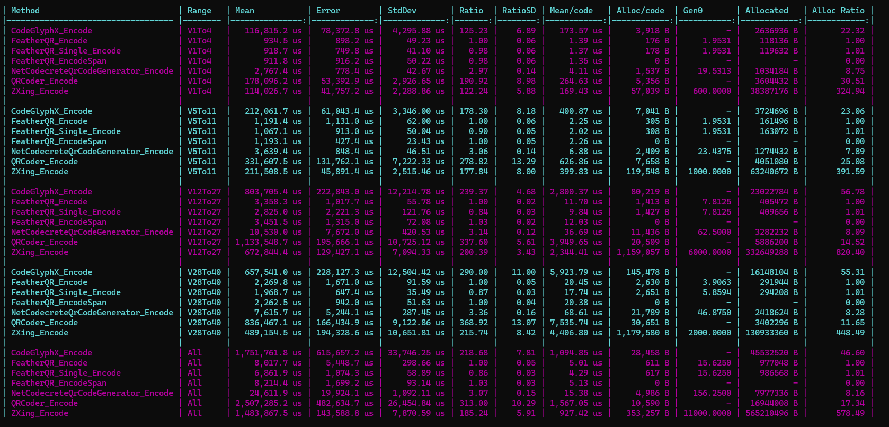 | 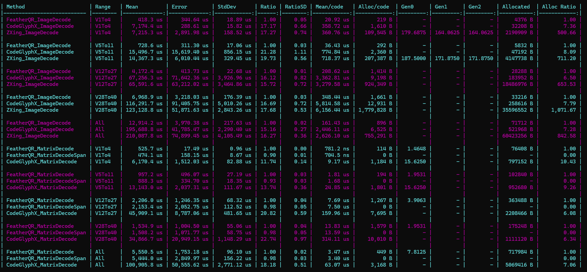 |
| --- | --- |

| 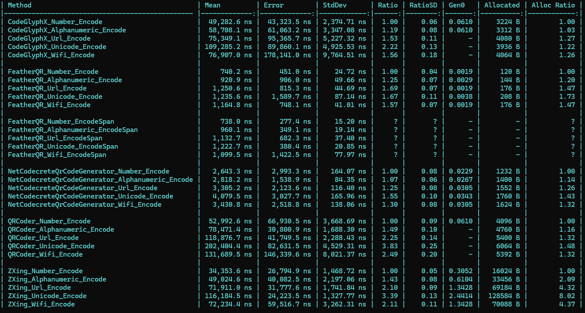 | 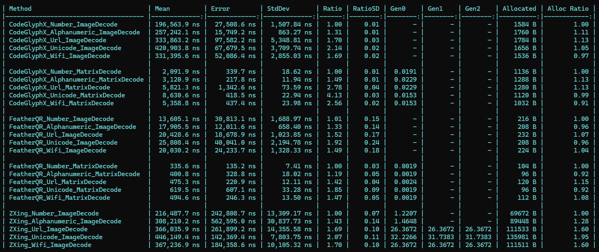 |
| --- | --- |

Create Standard QR, Micro QR, and rMQR images with a few lines of code.

|  | 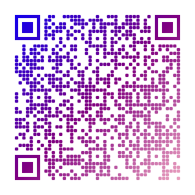 | 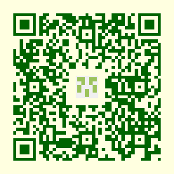 |
| --- | --- | --- |

| 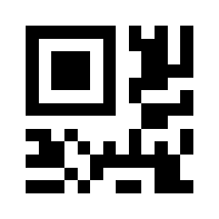 |  |
| --- | --- |

|  |
| --- |

See [samples/ConsoleApp](samples/ConsoleApp) for code examples generating these styles.

## Migration

2.0.0 renames the packages and namespaces: `SkiaSharp.QrCode` and `SkiaSharp.QrCode.Image` become `FeatherQR` and `FeatherQR.SkiaSharp`. See the [Migration Guide](docs/migration.md) for the 2.0.0 changes and for older versions.

## Overview

FeatherQR allocates memory for QR code data without additional allocations during processing. The core returns the dark modules as rectangles for your own renderer. It also writes SVG, PNG, raw pixels, and terminal text. SkiaSharp integration adds styled image rendering.

- **Generation**: Create a QR code with one method call and sensible defaults
- **Performance**: Designed for speed and minimal memory allocation
- **Symbologies**: Standard QR, Micro QR, and rMQR
- **GS1 Support**: GS1 QR Codes and GS1 Digital Link URIs
- **Binary Data**: Encode and decode bytes without text conversion, with any ECI assignment
- **Styling**: Gradients, icons, custom shapes, colors, and more
- **Cross-Platform**: Windows, Linux, macOS, iOS, Android, WebAssembly
- **Zero Dependencies**: No core dependencies on .NET 10+ (BCL shims only on .NET Standard)
- **No System.Drawing**: Avoids GDI+ issues and Windows dependencies
- **NativeAOT Ready**: Supports .NET Native AOT compilation

## Supported Symbologies

FeatherQR supports Standard QR, Micro QR, and rMQR. Examples use Standard QR unless noted otherwise.

| Symbology | Standard | Generate | Decode |
|---|---|---|---|
| Standard QR (versions 1–40) | ISO/IEC 18004 | ✅ | ✅ |
| Micro QR (M1–M4) | ISO/IEC 18004 | ✅ | ✅ |
| rMQR (R7x43–R17x139) | ISO/IEC 23941 | ✅ | ✅ |

| 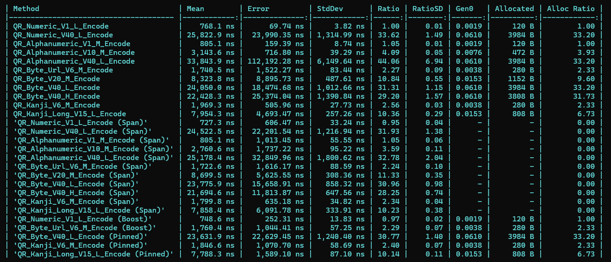 | 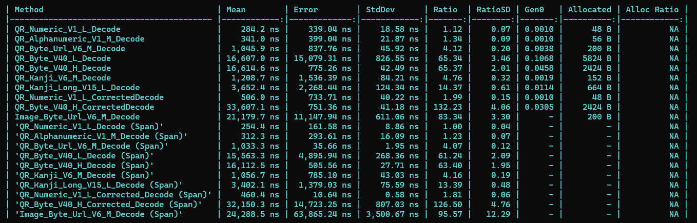 |
| --- | --- |

| 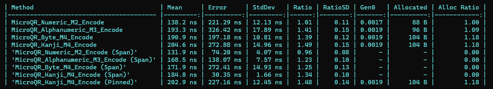 | 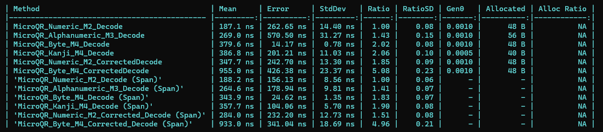 |
| --- | --- |

| 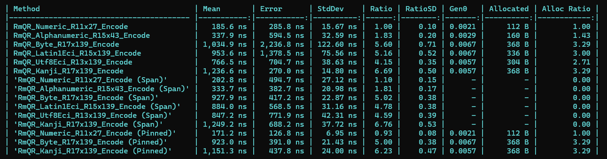 | 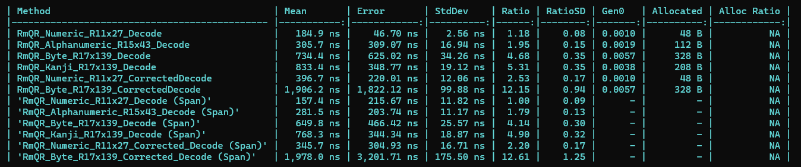 |
| --- | --- |

FeatherQR `SymbolImageWriter` is faster and allocates less than the FeatherQR.SkiaSharp.

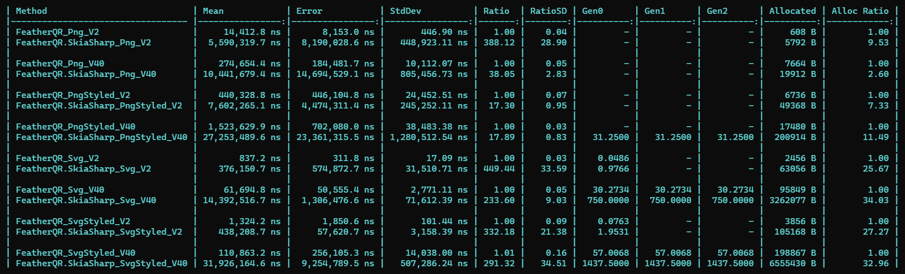

## Installation

FeatherQR provides four NuGet packages.

| Package | What |
|---|---|
| [FeatherQR](https://www.nuget.org/packages/FeatherQR) | Generates and decodes Standard QR, Micro QR, and rMQR module matrices. Writes SVG, PNG, raw pixels, and terminal text. No dependencies on .NET 10+ (BCL shims only on .NET Standard). |
| [FeatherQR.Gs1](https://www.nuget.org/packages/FeatherQR.Gs1) | Supports GS1 QR Codes and GS1 Digital Link URIs for Standard QR and rMQR. |
| [FeatherQR.SkiaSharp](https://www.nuget.org/packages/FeatherQR.SkiaSharp) | Renders styled images (shapes, gradients, icons, JPEG and WebP) and decodes image files with SkiaSharp |
| [SkiaSharp.QrCode](https://www.nuget.org/packages/SkiaSharp.QrCode) | Empty package that depends on `FeatherQR.SkiaSharp`, for upgrading existing projects |

```bash
dotnet add package FeatherQR

# If you need styled images or image file decoding with SkiaSharp
dotnet add package FeatherQR.SkiaSharp

# If you need GS1 support
dotnet add package FeatherQR.Gs1
```

`FeatherQR.SkiaSharp` requires platform-specific native asset packages on Linux and for NativeAOT. See [Platform-Specific Considerations](#platform-specific-considerations).

## Quick Start

Try [FeatherQR Playground](https://guitarrapc.github.io/FeatherQR/) in your browser without installing anything.

The playground runs FeatherQR as WebAssembly on a static GitHub Pages site. Adjust gradients, module shapes, finder patterns, and logos in real time. Download PNG or SVG images. Share settings through a permalink. The library decodes each generated symbol in the browser to check the result. The *Decode an image* panel reads one or all QR codes from an uploaded image.

The C# examples use .NET 10 and C# 14. Some examples omit repeated `using` directives and expect application inputs such as image files, streams, or an ASP.NET Core `app`.

### Simplest Example

Generate a QR code. Save it as PNG. See [Plain Images with FeatherQR](#plain-images-with-featherqr) for more examples.

```csharp
using FeatherQR;

var qr = QRCodeGenerator.Create("Hello", QREccLevel.M);
File.WriteAllBytes("qrcode.png", SymbolImageWriter.GetPngBytes(qr));
```

Use `FeatherQR.SkiaSharp` for styled images and SkiaSharp integration.

```csharp
using FeatherQR.SkiaSharp;

// one-liner save to file
File.WriteAllBytes("qrcode.png", QRCodeImageBuilder.GetPngBytes("Hello"));

// Or get bytes
var pngBytes = QRCodeImageBuilder.GetPngBytes("https://example.com");
```

### Common Use Cases

Both `FeatherQR` and `FeatherQR.SkiaSharp` generate images from a QR code symbol.

```csharp
using FeatherQR;

var qr = QRCodeGenerator.Create("https://example.com", QREccLevel.M);
var options = new SymbolImageOptions { Width = 512, Height = 512 }; // the builders' default size
```

Choose an output method:

| Output | `FeatherQR` | `FeatherQR.SkiaSharp` |
| --- | --- | --- |
| PNG | `SymbolImageWriter.GetPngBytes(qr, options)` | `QRCodeImageBuilder.GetPngBytes(qr)` |
| SVG | `SymbolImageWriter.GetSvgString(qr, options)` | `QRCodeImageBuilder.GetSvgString(qr)` |
| Stream | `stream.Write(SymbolImageWriter.GetPngBytes(qr, options))` | `QRCodeImageBuilder.SavePng(qr, stream)` |
| Stream, async | `await stream.WriteAsync(SymbolImageWriter.GetPngBytes(qr, options))` | `await QRCodeImageBuilder.SavePngAsync(qr, stream)` |
| Buffer writer | `SymbolImageWriter.WritePng(qr, bufferWriter, options)` | `QRCodeImageBuilder.WritePng(qr, bufferWriter)` |

Set the content and error correction level when creating the symbol. Both packages use the same symbol. Enable error correction boosting when reliability matters more than a fixed level, especially with an icon. Boosting selects the highest level that fits without changing the symbol size.

```csharp
// A WiFi network
var wifi = QRCodeGenerator.Create("WIFI:T:WPA;S:MyNetwork;P:MyPassword;;", QREccLevel.M);

// Request M as the minimum. Q or H may fit at the same symbol size.
var robust = QRCodeGenerator.Create("https://example.com", QREccLevel.M, new QRCodeGeneratorOptions { BoostEccLevel = true });

// Builders also accept content and an error correction level directly.
var pngBytes = new QRCodeImageBuilder("https://example.com")
    .WithErrorCorrection(QREccLevel.M)
    .WithErrorCorrectionBoost()
    .ToByteArray();
```

See [Advanced](#advanced) for more examples.

## API Overview

Use an image builder for most applications. All generators and decoders provide [zero-allocation APIs](#zero-allocation-apis) for caller-owned buffers. Web and GUI applications can use [async and stream I/O](#async-and-stream-io).

`FeatherQR` generates and decodes symbols and renders images using dark and light module colors.

| What | Standard QR | Micro QR | rMQR |
| --- | --- | --- | --- |
| Generate a module matrix | `QRCodeGenerator` | `MicroQRCodeGenerator` | `RmQRCodeGenerator` |
| [Get dark modules as rectangles](#module-rectangles-for-your-renderer) for your own renderer | `GetModuleRectangles` | `GetModuleRectangles` | `GetModuleRectangles` |
| Write SVG, PNG (1-bit, or 4-bit with a style), raw pixels (any `PixelLayout`), or terminal text| `SymbolImageWriter` | `SymbolImageWriter` | `SymbolImageWriter` |
| Decode a matrix or grayscale pixels | `QRCodeDecoder` | `MicroQRCodeDecoder` | `RmQRCodeDecoder` |
| Decode all symbol types from grayscale pixels | `SymbolDecoder` | `SymbolDecoder` | `SymbolDecoder` |
| Convert pixels (any `PixelLayout`) to grayscale for decoding | `LuminanceConverter` | `LuminanceConverter` | `LuminanceConverter` |

`FeatherQR.SkiaSharp` adds gradients, embedded icons, JPEG and WebP output, rendering to an `SKCanvas`, and decoding from `SKBitmap` objects and image files.

| What | Standard QR | Micro QR | rMQR |
| --- | --- | --- | --- |
| Create styled PNG, JPEG, WebP, or SVG | `QRCodeImageBuilder` | `MicroQRCodeImageBuilder` | `RmQRCodeImageBuilder` |
| Render a matrix to `SKCanvas` | `SymbolRenderer` | `SymbolRenderer` | `SymbolRenderer` |
| Decode an `SKBitmap` or an image file | `QRCodeDecoder` | `MicroQRCodeDecoder` | `RmQRCodeDecoder` |
| Decode all symbol types from an `SKBitmap` or an image file | `SymbolDecoder` | `SymbolDecoder` | `SymbolDecoder` |

### Image settings

Both packages use the same units for image settings. In `FeatherQR`, configure `SymbolImageOptions` for `SymbolImageWriter`. In `FeatherQR.SkiaSharp`, use builder methods.

| What | `FeatherQR` | `FeatherQR.SkiaSharp` |
| --- | --- | --- |
| Size, equal modules | `Width = 512, Height = 512` | `.WithSize(512, 512).WithModulePixelSize(n)` |
| Size, filled | `Width = 512, Height = 512, FillCanvas = true` | `.WithSize(512, 512)` |
| Modules | `ModuleStyle = ModuleStyle.Circle, ModuleScalePercent = 92` | `.WithModuleStyle(ModuleStyle.Circle, scalePercent: 92)` |
| Finder patterns | `FinderPatternStyle = FinderPatternStyle.Circle` | `.WithFinderPatternStyle(FinderPatternStyle.Circle)` |
| Colors | `DarkColor = new SymbolColor(30, 58, 138), LightColor = new SymbolColor(255, 255, 255, 0)` | `.WithColors(new SKColor(30, 58, 138), SKColors.Transparent)` |
| Icon | `IconSizeModules = 7, IconImage = File.ReadAllBytes("logo.png")` | `.WithIcon(IconData.FromImageByModules(logo, 7))` |
| SVG | `SymbolImageWriter.GetSvgString(qr, options)` | `.ToSvgString()` |
| PNG | `SymbolImageWriter.GetPngBytes(qr, options)` | `.ToByteArray()` |
| Raw pixels | `SymbolImageWriter.TryWritePixels(qr, buffer, PixelLayout.Rgba8888, out var width, out var height, options)` | `.ToBitmap()` |
| Read an image | `QRCodeDecoder.TryDecodeImage(gray, width, height, out string text, out _)` | `QRCodeDecoder.TryDecode(bitmap, out string text)` |

Render circular modules and finder patterns with either package:

```csharp
var qr = QRCodeGenerator.Create(url, QREccLevel.M);

// FeatherQR
var coreSvg = SymbolImageWriter.GetSvgString(qr, new SymbolImageOptions
{
    ModuleStyle = ModuleStyle.Circle,
    ModuleScalePercent = 92,
    FinderPatternStyle = FinderPatternStyle.Circle,
});

// FeatherQR.SkiaSharp
var skiaSvg = new QRCodeImageBuilder(qr)
    .WithModuleStyle(ModuleStyle.Circle, scalePercent: 92)
    .WithFinderPatternStyle(FinderPatternStyle.Circle)
    .ToSvgString();
```

With `FillCanvas = true`, both packages produce identical pixels for a 512 × 512 image with default colors and square modules. `WithModuleStyle` and `WithFinderPatternStyle` use the core's enums, whole-percent values, and defaults. Use `WithModuleShape` and `WithFinderPatternShape` for custom shapes.

Use `QREccLevel.H` for symbols with icons. The core embeds icons in SVG output. For PNG and raw pixels, it leaves a light area for the icon and returns its bounds through `GetIconRectangle`. The builder draws the `logo` bitmap into the image.

The core decodes grayscale pixels. Use `LuminanceConverter.Convert` to convert other pixel formats. `FeatherQR.SkiaSharp` decodes an `SKBitmap` or an image file.

The core requires no native library. Use `FeatherQR.SkiaSharp` for JPEG or WebP, gradients, custom shapes, icons rendered into raster images, or image file decoding.

### Generator options

Each generator method has an overload that accepts options to customize encoding.

```csharp
var qrData = QRCodeGenerator.Create("content", QREccLevel.M, new QRCodeGeneratorOptions
{
    EciMode = EciMode.Utf8,
    QuietZoneSize = 0,
});

var rmqr = RmQRCodeGenerator.Create("content", RmQREccLevel.M, new RmQRCodeGeneratorOptions
{
    Height = RmQRHeight.H9,
    Segmentation = RmQRSegmentation.Single, // Prefer speed over symbol size
});

// `Options.Default` and `default(Options)` are the same value, so these are equivalent:
QRCodeGenerator.Create("content", QREccLevel.M);                                  // short call
QRCodeGenerator.Create("content", QREccLevel.M, QRCodeGeneratorOptions.Default);  // same result

// Use `with` to copy and modify options
var house = new QRCodeGeneratorOptions { EciMode = EciMode.Utf8, QuietZoneSize = 7 };

var borderless = house with { QuietZoneSize = 0 };   // EciMode stays Utf8, house is unchanged
var pinned     = house with { Version = 20 };

// Override a default option
var opts = QRCodeGeneratorOptions.Default with { QuietZoneSize = 0 };   // default options without a quiet zone

// Conditional modification of an options instance
var options = new QRCodeGeneratorOptions { EciMode = EciMode.Utf8 };
if (noQuietZone)
    options.QuietZoneSize = 0;   // changes this variable only
```

Default option values:

| Option | `QRCodeGeneratorOptions` | `MicroQRCodeGeneratorOptions` | `RmQRCodeGeneratorOptions` |
|---|---|---|---|
| `EciMode` | `Default` (auto-detect) | — | `Default` (auto-detect) |
| `Utf8Bom` | `false` | — | — |
| `Version` | `Any` (1-40) | `Any` (M1-M4) | `null` (fit automatically) |
| `QuietZoneSize` | `4` | `2` | `2` |
| `BoostEccLevel` | `false` | — | — |
| `MaskPattern` | `null` (automatic, 0-7) | `null` (automatic, 0-3) | — |
| `FitStrategy` | — | — | `MinimizeArea` |
| `Height` | — | — | `null` (any height) |
| `Segmentation` | `Optimal` | `Optimal` | `Optimal` |
| `Fnc1` | `None` | — | `None` |
| `AllowKanji` | `false` | `false` | `false` |

> [!TIP]
> The default quiet zones follow the specifications. ISO/IEC 18004 requires 4 modules for Standard QR and 2 for Micro QR. ISO/IEC 23941 requires 2 for rMQR. The API accepts `0` for all three.

#### Version ranges

Standard QR and Micro QR accept a range of versions to set a minimum or maximum symbol size. The generator selects the smallest version in the range that fits the content. If none fits, `TryGetRequiredBufferSize` returns `false` and the `Create` overloads throw.

```csharp
var exact = new QRCodeGeneratorOptions { Version = 15 };                    // exactly version 15
var range = new QRCodeGeneratorOptions { Version = new(10, 20) };            // 10 to 20, inclusive
var minimum = new QRCodeGeneratorOptions { Version = QRVersionRange.AtLeast(10) }; // 10 or larger
int? configuredVersion = null;
var configured = new QRCodeGeneratorOptions { Version = configuredVersion }; // null means automatic
var automatic = new QRCodeGeneratorOptions();
```

> [!TIP]
> rMQR uses `FitStrategy` and `Height` instead of version ranges. Its 32 versions have no single size ordering: R7x43, R9x43, and R7x59 differ in width and height. To fill a fixed frame, see [Fit a frame](#fit-a-frame-largest-modules).

#### Mask pattern pinning

The generator scores the standard data mask patterns (eight for Standard QR, four for Micro QR) and applies the best one. Set `MaskPattern` to select a specific pattern when reproducing a symbol byte-for-byte or testing a scanner with every pattern.

`QRCodeData.EccLevel` reports the final error correction level, including any boost. `QRCodeData.MaskPattern` reports the selected mask. Both properties read the symbol's format information, add no generation overhead, and remain available after saving with `GetRawData` and restoring. `MicroQRCodeData` exposes both properties. `RmQRCodeData` exposes only `EccLevel`.

```csharp
// Reuse the decoded mask when encoding
QRCodeDecoder.TryDecode(scanned, out var text, out var info);
var identical = QRCodeGenerator.Create(text, info.EccLevel, new QRCodeGeneratorOptions { MaskPattern = info.MaskPattern });

// Set the mask on a Standard QR or Micro QR builder
var png = new QRCodeImageBuilder("content").WithMaskPattern(3).ToByteArray();
var micro = new MicroQRCodeImageBuilder("12345").WithErrorCorrection(MicroQREccLevel.L).WithMaskPattern(1).ToByteArray();

// rMQR has a single fixed mask (ISO/IEC 23941), so there is nothing to pin.

// Throws for a mask outside the valid range (0-7 for Standard QR, 0-3 for Micro QR).
QRCodeGenerator.Create(text, info.EccLevel, new QRCodeGeneratorOptions { MaskPattern = 10 });
```

#### Mixed-mode segmentation (smaller symbols for mixed content)

`QRSegmentation.Optimal`, the default since 2.0.0, splits content into Numeric, Alphanumeric, and Byte segments to minimize the bit count. This often reduces the required version. `QRSegmentation.Single` encodes all content in one mode, so adding a URL prefix to numeric data requires Byte mode for the entire payload.

```csharp
const string content = "https://example.com/item?id=123456789012345678901234567890";

// Default: Optimal (up to 1.2 times the encoding time of Single)
var optimal = QRCodeGenerator.Create(content, QREccLevel.M);
Console.WriteLine(optimal.Version); // 3 - Byte + Numeric

// Single mode
var single = QRCodeGenerator.Create(content, QREccLevel.M, new QRCodeGeneratorOptions { Segmentation = QRSegmentation.Single });
Console.WriteLine(single.Version);  // 4 - one Byte segment

// 5,500 characters overflow Byte mode at every version (40-L holds 2,953), but fit once split
var mixed = new string('x', 1000) + new string('1', 4500);
QRCodeGenerator.Create(mixed, QREccLevel.L, new QRCodeGeneratorOptions { Segmentation = QRSegmentation.Optimal }); // version 40
QRCodeGenerator.Create(mixed, QREccLevel.L, new QRCodeGeneratorOptions { Segmentation = QRSegmentation.Single }); // throws: too long

// The image builder takes the same option
var pngBytes = new QRCodeImageBuilder(content)
    .WithSegmentation(QRSegmentation.Single)
    .ToByteArray();

// Span overloads also respect the segmentation option
var option = new QRCodeGeneratorOptions { Segmentation = QRSegmentation.Optimal };
if (!QRCodeGenerator.TryGetRequiredBufferSize(content, QREccLevel.M, out var calculated, option))
    return;

var moduleBuffer = ArrayPool<byte>.Shared.Rent(calculated.BufferSize);
try
{
    QRCodeGenerator.Create(content, QREccLevel.M, moduleBuffer, option);
}
finally
{
    ArrayPool<byte>.Shared.Return(moduleBuffer);
}
```

> [!TIP]
> In v1.x, the default was to encode all content in a single mode.

#### Kanji mode for Japanese text

By default, generators encode Japanese text as UTF-8 in Byte mode. Set `AllowKanji` to `true` to enable Kanji mode. Kanji mode holds about 1.85 times as many characters. See the Kanji columns in the [Data Capacity Reference](docs/data-capacity.md).

Generators disable Kanji mode by default because some readers do not support it. The table lists results for tested readers.

| Reader | Kanji Mode Support |
|--------|------------------|
| Android (QR scanner, Google Lens, Android 17) | No |
| iPhone Camera | Yes |
| ZXing | Yes |
| zxing-cpp | Yes |
| Denso Wave | Yes |

Enable Kanji mode:

```csharp
// UTF-8 fits in version 2: 24 bits per kana or kanji, plus a 12-bit ECI header for compatibility
var utf8  = QRCodeGenerator.Create("日本語のテキスト", QREccLevel.M);
// Kanji fits in version 1: 13 bits per character, no ECI header
var kanji = QRCodeGenerator.Create("日本語のテキスト", QREccLevel.M, new QRCodeGeneratorOptions { AllowKanji = true });
// M3 instead of M4
var micro = MicroQRCodeGenerator.Create("こんにちは", MicroQREccLevel.L, new MicroQRCodeGeneratorOptions { AllowKanji = true });
```

With `AllowKanji` enabled:

```csharp
var kanji = new QRCodeGeneratorOptions { AllowKanji = true };

// Characters in JIS X 0208, including kana, kanji, Greek, Cyrillic, and symbols, use Kanji mode
QRCodeGenerator.Create("日本語のテキスト", QREccLevel.M, kanji);   // Kanji, version 1 (UTF-8 needs 2)
QRCodeGenerator.Create("Привет", QREccLevel.M, kanji);             // Kanji

// One character outside JIS X 0208 keeps the whole text in UTF-8
QRCodeGenerator.Create("日本語のテキスト😀", QREccLevel.M, kanji); // UTF-8, version 3: emoji
QRCodeGenerator.Create("日本語のテキスト①", QREccLevel.M, kanji); // UTF-8, version 3: ① is an NEC special character
QRCodeGenerator.Create("ﾆﾎﾝｺﾞ", QREccLevel.M, kanji);             // UTF-8: halfwidth katakana
QRCodeGenerator.Create("日本語～", QREccLevel.M, kanji);           // UTF-8: one Kanji cell reads as ～ on Windows (CP932) and 〜 in JIS X 0208, so neither is written

// Explicit encoding settings take precedence
QRCodeGenerator.Create("日本語のテキスト", QREccLevel.M, kanji with { EciMode = EciMode.Utf8 }); // UTF-8, version 2
QRCodeGenerator.Create("日本語のテキスト", QREccLevel.M, kanji with { Utf8Bom = true });          // UTF-8 with a byte order mark, version 3

// Single keeps this mixed text in UTF-8
QRCodeGenerator.Create("東京タワー333m", QREccLevel.M, kanji with { Segmentation = QRSegmentation.Single }); // UTF-8, version 2

// Default Optimal segmentation combines Kanji and ASCII segments
QRCodeGenerator.Create("東京タワー333m", QREccLevel.M, kanji); // Kanji + ASCII runs, version 1
```

#### Structured Append (one message across several symbols)

`CreateStructuredAppend` splits a message across up to sixteen Standard QR symbols for a reader to reassemble. It uses the fewest symbols within the specified version range, all with the same version. If the text fits in one symbol, it returns a single symbol.

```csharp
var symbols = QRCodeGenerator.CreateStructuredAppend(longText, QREccLevel.M, new QRCodeGeneratorOptions { Version = QRVersionRange.AtMost(10) });
// symbols.Length is 1 to 16. Render each symbol as usual.
```

Each symbol decodes to one part of the text. `QRCodeDecodeInfo.StructuredAppend` provides its index, count, and parity. See `QRStructuredAppend` for the reassembly rules.

### Zero-allocation APIs

All three generators can write a module matrix to a caller-provided `Span<byte>`. All three decoders can read a module span and write text to a caller-provided `Span<char>`. Use these overloads to pool or reuse buffers.

Size the generation buffer with `TryGetRequiredBufferSize`.

```csharp
using System.Buffers;
using FeatherQR;

// false means the content does not fit a QR symbol at this ECC level
// Invalid arguments (an undefined ECC level, a `Version` and `Height` that disagree, a negative quiet zone) always throw
if (!QRCodeGenerator.TryGetRequiredBufferSize("content", QREccLevel.M, out var calculated))
{
    Console.Error.WriteLine("Content does not fit a QR symbol at this ECC level.");
    return;
}

var buffer = ArrayPool<byte>.Shared.Rent(calculated.BufferSize);
try
{
    var written = QRCodeGenerator.Create("content", QREccLevel.M, buffer);
    var matrix = buffer.AsSpan(0, written);
}
finally
{
    ArrayPool<byte>.Shared.Return(buffer);
}
```

Pass the resolved version to `Create` to encode the same input without a length error:

```csharp
if (!RmQRCodeGenerator.TryGetRequiredBufferSize(userInput, RmQREccLevel.M, out var size))
{
    Console.Error.WriteLine("Content does not fit an rMQR symbol.");
    return;
}

var buffer = ArrayPool<byte>.Shared.Rent(size.BufferSize);
try
{
    // Reuse the resolved version to skip version selection.
    var written = RmQRCodeGenerator.Create(userInput, RmQREccLevel.M, buffer, new RmQRCodeGeneratorOptions { Version = size.Version });
    var matrix = buffer.AsSpan(0, written);
}
finally
{
    ArrayPool<byte>.Shared.Return(buffer);
}
```

### Decoders

Use the decoder that matches the expected symbol type. Each decoder in `FeatherQR` accepts generated data, a byte-per-module matrix, or a grayscale luminance span.

Image decoding supports screenshots, generated images, scans, and camera photographs. It handles rotated, mirrored, or tilted symbols, gradual shading, and soft-edged shadows. Glare, damage, blur, curved surfaces, steep angles, and strong lens distortion reduce reliability.

```csharp
using FeatherQR;

var qrData = QRCodeGenerator.Create("content", QREccLevel.M);
if (QRCodeDecoder.TryDecode(qrData, out var text))
{
    Console.WriteLine(text);
}
```

`FeatherQR.SkiaSharp` adds `SKBitmap` overloads through C# 14 extension members. On C# 13 or earlier, call `QRCodeDecoderExtensions`, `MicroQRCodeDecoderExtensions`, `RmQRCodeDecoderExtensions`, or `SymbolDecoderExtensions` directly.

```csharp
using SkiaSharp;
using FeatherQR;
using FeatherQR.SkiaSharp;

// Decode from an SKBitmap
using var bitmap = SKBitmap.Decode("qr.png");
if (QRCodeDecoder.TryDecode(bitmap, out var text, out var info))
{
    Console.WriteLine($"{text} (version {info.Version}, ECC {info.EccLevel})");

    // Corners use image pixel coordinates and names relative to the symbol,
    // preserving its rotation and mirroring.
    var corners = info.Corners;
    Console.WriteLine($"top-left at ({corners.TopLeft.X}, {corners.TopLeft.Y})");
}
```
For other image sources, such as a browser canvas or camera frame, convert pixels with `LuminanceConverter.Convert`. Then call `TryDecodeImage(luminance, width, height, ...)`. The converter accepts `Gray8`, `Rgba8888`, `Bgra8888`, `Rgb888x`, `Bgr888x`, `Rgb24`, or `Bgr24` with a row stride and writes width × height luminance bytes. It uses ITU-R BT.601 weights and composites transparent pixels against white to match the quiet zone. Pass existing luminance data directly to `TryDecodeImage`. A camera frame in NV12, NV21, or I420 carries luminance in its Y plane. Convert that plane as `Gray8` with the frame's row stride.

```csharp
using FeatherQR;

// Pixels from any source, here RGBA with rows of rowBytes bytes
byte[] rgba = ...;
int width = ..., height = ..., rowBytes = ...;

var luminance = new byte[width * height];
LuminanceConverter.Convert(rgba, width, height, rowBytes, PixelLayout.Rgba8888, premultipliedAlpha: false, luminance);
if (QRCodeDecoder.TryDecodeImage(luminance, width, height, out var text, out var info))
{
    Console.WriteLine($"{text} (version {info.Version}, ECC {info.EccLevel})");
}
```

Decode information includes a failure status when decoding fails. Successful image decodes also return `Corners`: the symbol's module-area corners, excluding the quiet zone, in continuous image pixel coordinates. `TopLeft` identifies the corner beside the symbol's top-left finder, regardless of its position in the image. The outline follows rotation, reverses winding for mirrored images, and forms a quadrilateral under perspective. Matrix decodes report `Corners.IsEmpty`.

See [samples/Dotfiles/DecodeCorners.cs](samples/Dotfiles/DecodeCorners.cs) for flat, rotated, mirrored, and perspective-distorted images with the reported outlines drawn over them.

Use `DecodeSymbols` to decode all QR codes from an `SKBitmap` or stream. Use `DecodeImageSymbols` for luminance data. Each decoder returns every successfully decoded symbol once, with its corners. Results exclude symbols that cannot be decoded as text and symbols inside an already decoded symbol.

The span overload of `DecodeImageSymbols` writes to your buffer and stops when it is full. Use the buffer size to limit the number of results. `MicroQRCodeDecoder` and `RmQRCodeDecoder` provide the same methods for Micro QR and rMQR.

Searching for all symbols takes longer than decoding one, even in an image with only one symbol. Micro QR and rMQR decoding fully tests every candidate finder pattern. Images with many other codes' finder patterns can take several times longer than decoding a single symbol.

```csharp
using SkiaSharp;
using FeatherQR;
using FeatherQR.SkiaSharp;

using var sheet = SKBitmap.Decode("sheet.jpg");
foreach (var result in QRCodeDecoder.DecodeSymbols(sheet))
{
    var corner = result.Info.Corners.TopLeft;
    Console.WriteLine($"{result.Text} at ({corner.X}, {corner.Y})");
}
```

Use `SymbolDecoder.DecodeSymbols` to decode all three symbologies from an `SKBitmap` or stream. Use `SymbolDecoder.DecodeImageSymbols` for luminance data. Each result includes `Symbology`, `Text`, and `Corners`. The matching `StandardQR`, `MicroQR`, or `RmQR` property contains the detailed result. The other two retain their default values.

`SymbolDecoder` decodes Standard QR first, then checks the remaining finder patterns for Micro QR and rMQR. This takes longer than decoding one symbology, especially when the decoder detects finder patterns but cannot decode any symbols. Use a symbology-specific decoder when you know the symbol type.

```csharp
foreach (var symbol in SymbolDecoder.DecodeSymbols(sheet))
{
    Console.WriteLine($"{symbol.Symbology}: {symbol.Text}");
}
```

### Binary data

The generators accept raw bytes, and the decoders return bytes without text conversion. Use these APIs for binary payloads, such as compressed data or keys, or for text in an encoding FeatherQR cannot generate directly.

```csharp
using FeatherQR;

byte[] payload = [0x00, 0x01, 0x7F, 0x80, 0xFF];
var qrData = QRCodeGenerator.Create(payload, QREccLevel.M);                         // no ECI header
var declared = QRCodeGenerator.Create(payload, QREccLevel.M, eciAssignment: 899);  // declared as binary data

if (QRCodeDecoder.TryDecodeBytes(qrData, out var bytes, out var info))
{
    Console.WriteLine($"{bytes.Length} bytes, ECI {info.EciAssignment?.ToString() ?? "none"}");
}
```

- `eciAssignment` sets the ECI header to a value from 0 to 999999, such as 899 for binary data or 20 for Shift JIS. Omitting it writes no header, as is usual for binary payloads.
- `RmQRCodeGenerator` provides the same overloads. `MicroQRCodeGenerator` omits `eciAssignment` because Micro QR does not support ECI. `CreateStructuredAppend` splits bytes across symbols. Decode each part as bytes and concatenate them in index order to recover the original payload.
- `TryDecodeBytes` accepts symbol data or a module matrix. `TryDecodeImageBytes` accepts luminance data. `FeatherQR.SkiaSharp` adds `TryDecodeBytes` for `SKBitmap`. These methods return Byte segments unchanged, digits and letters as ASCII, and Kanji as Shift JIS byte pairs. `info.EciAssignment` reports the declared ECI assignment, or `null`.
- Text decoding also reports `EciAssignment`, including when an unsupported encoding causes `UnsupportedContent`. In that case, decode the bytes and convert them with the appropriate `Encoding`.
- Using the text-only options `EciMode`, `Utf8Bom`, `AllowKanji`, or `Fnc1` with byte input throws.

> [!NOTE]
> Phone cameras may not display binary payloads. In tests, an iPhone camera recognized a binary code but displayed no content. A QR reader app failed to read the code. Both results occurred with and without ECI 899.
>
> Use binary payloads with readers your app controls. For general readers, encode the payload as text. Base45 in Alphanumeric mode adds about 3% overhead compared with raw bytes. Base64 in Byte mode adds 33%.

### Async and stream I/O

Every image-writing method that accepts a `Stream` has an async counterpart: `SaveToAsync`, `SaveToSvgAsync`, `SavePngAsync`, or `SaveSvgAsync`.

| What | Synchronous | Asynchronous |
|---|---|---|
| Write an image to a stream | `builder.SaveTo(stream)`, `builder.SaveToSvg(stream)` | `builder.SaveToAsync(stream, ct)`, `builder.SaveToSvgAsync(stream, ct)` |
| Write a code to a stream in one call | `QRCodeImageBuilder.SavePng(content, stream)`, `SaveSvg(content, stream)` | `QRCodeImageBuilder.SavePngAsync(content, stream, cancellationToken: ct)`, `SaveSvgAsync(content, stream, cancellationToken: ct)` |
| Read one code from a stream | `QRCodeDecoder.Decode(stream)` | `QRCodeDecoder.DecodeAsync(stream, ct)` |
| Read every code from a stream | `QRCodeDecoder.DecodeSymbols(stream)` | `QRCodeDecoder.DecodeSymbolsAsync(stream, ct)` |
| Read a stream with custom limits | `Decode(stream, limits)`, `DecodeSymbols(stream, limits)` | `DecodeAsync(stream, limits, ct)`, `DecodeSymbolsAsync(stream, limits, ct)` |
| Write to memory or a buffer writer | `ToByteArray()`, `ToSvgString()`, `SaveTo(IBufferWriter<byte>)`, `GetPngBytes(content)` and the other helpers | None, since there is no I/O to wait on |
| Read from memory | `TryDecode(bitmap, out text)`, `TryDecodeImage(luminance, width, height, out text, out info)`, `DecodeSymbols(bitmap)`, `DecodeImageSymbols(luminance, width, height)` | None, since there is no I/O to wait on |

Use async methods for stream I/O:

```csharp
// Render the complete image, then write it in one async call.
// Rendering failures leave the stream unchanged. Like SaveTo, this does not flush.
await builder.SaveToSvgAsync(file, cancellationToken);
await file.FlushAsync(cancellationToken);

// Read asynchronously from the current position to the end, leaving the stream open.
// SKBitmap.Decode(stream) disposes the stream instead.
// Like SKBitmap.Decode, this reads encoded pixels without applying EXIF orientation.
await using var photo = File.OpenRead("photo.jpg");
var result = await QRCodeDecoder.DecodeAsync(photo, cancellationToken);
// Single-symbol decoding returns a result even when no symbol decodes
if (result.Success)
    Console.WriteLine(result.Text);
else
    Console.WriteLine(result.Info.Status);   // why it failed, with Text empty

// Cancellation is handled via the provided CancellationToken
using var timeout = new CancellationTokenSource(TimeSpan.FromSeconds(5));
try
{
    // Cancellation is checked before rendering and during writing. A canceled write may leave partial output.
    await QRCodeImageBuilder.SavePngAsync(text, output, cancellationToken: timeout.Token);

    // Cancellation is checked before decoding, during reads, and between symbol attempts, not within an attempt.
    var symbols = await QRCodeDecoder.DecodeSymbolsAsync(input, timeout.Token);
}
catch (OperationCanceledException)
{
}

// Argument errors throw synchronously. Other errors are reported through the task.
try
{
    await new QRCodeImageBuilder(text).WithSize(64, 64).WithModulePixelSize(10).SaveToAsync(output);
}
catch (InvalidOperationException)
{
    // The layout does not fit
}
```

ASP.NET Core disables synchronous I/O on request and response bodies by default. Use async methods or write to the response's `PipeWriter`.

```csharp
using FeatherQR;
using FeatherQR.SkiaSharp;

// Without a synchronization context, as in ASP.NET Core, processing stays on the calling thread
app.MapGet("/qr", async (string text, HttpResponse response, CancellationToken cancellationToken) =>
{
    response.ContentType = "image/png";
    await QRCodeImageBuilder.SavePngAsync(text, response.Body, cancellationToken: cancellationToken);
});

app.MapPost("/scan", async (HttpRequest request, CancellationToken cancellationToken) =>
{
    try
    {
        var result = await QRCodeDecoder.DecodeAsync(request.Body, cancellationToken);
        return result.Success
            ? Results.Text(result.Text)
            : Results.Text(result.Info.Status.ToString(), statusCode: StatusCodes.Status422UnprocessableEntity);
    }
    catch (InvalidDataException)
    {
        // The body is not an image, or is over a limit
        return Results.BadRequest();
    }
});

// Pass the response's PipeWriter directly. Cancellation applies only to the flush.
app.MapGet("/qr-pipe", async (string text, HttpResponse response, CancellationToken cancellationToken) =>
{
    response.ContentType = "image/png";
    new QRCodeImageBuilder(text).SaveTo(response.BodyWriter);
    await response.BodyWriter.FlushAsync(cancellationToken);
});
```

Use async methods in UI applications to avoid blocking the UI thread. Rendering and decoding run on the thread pool.

```csharp
await builder.SaveToAsync(file, cancellationToken);
var result = await QRCodeDecoder.DecodeAsync(input, cancellationToken);

Task SaveAsync(string url, Stream output)
{
    using var logo = SKBitmap.Decode("logo.png");
    var builder = new QRCodeImageBuilder(url).WithIcon(IconData.FromImage(logo));
    var task = builder.SaveToAsync(output);

    // The call has captured its inputs. The builder can now be changed and the icon disposed.
    builder.WithSize(1024, 1024);
    return task;
}

// Custom shape objects are not copied. Keep them usable until the task completes.
await new QRCodeImageBuilder(url)
    .WithModuleShape(myShape)
    .SaveToAsync(output);
```

By default, stream decoding rejects input larger than 64 MiB or images larger than 16,777,216 pixels (4,096 × 4,096). These limits allow a 12-megapixel photograph while limiting memory usage and image processing size.

```csharp
try
{
    // Decoding an interlaced PNG with 16 bits per channel used 192 MiB at the default limit
    var upload = await QRCodeDecoder.DecodeAsync(request.Body, cancellationToken);
}
catch (InvalidDataException)
{
    // Invalid images or exceeded limits are rejected before pixel allocation. The message identifies the limit.
}

// Raise the limits for larger images, such as a 200-megapixel photograph
// The same kind of PNG took 3,078 MiB to decode at 16,384 × 16,384
var photoLimits = new ImageStreamReadLimits { MaxPixels = 16_384L * 16_384, MaxBytes = 256 * 1024 * 1024 };
var large = await QRCodeDecoder.DecodeAsync(photo, photoLimits, cancellationToken);
```

### GS1 data

`FeatherQR.Gs1` provides the GS1 application identifier (AI) table, validation defined by the GS1 General Specifications, `(AI)` text, and GS1 Digital Link URIs. It adds GS1 methods to the Standard QR and rMQR generators.

```bash
dotnet add package FeatherQR.Gs1
```

Choose the GS1 carrier based on where the symbol will be scanned:

| Carrier | Used for | The symbol holds | Generator method |
|---|---|---|---|
| QR Code with a GS1 Digital Link URI | Retail, at the point of sale | A web URI, as plain QR with no FNC1 | `CreateGs1DigitalLink` |
| GS1 QR Code | Healthcare, logistics, assets and other uses away from the point of sale | An element string behind FNC1 in first position | `CreateGs1` |

Both methods accept `(AI)` text or an element string, perform all validation checks, and set the FNC1 mode automatically:

```csharp
using FeatherQR;
using FeatherQR.Gs1;
using FeatherQR.SkiaSharp;

// GS1 QR Code: the separators are placed and FNC1 is set in first position.
var gs1 = QRCodeGenerator.CreateGs1("(01)09520123456788(17)251231(10)ABC123", QREccLevel.M);
File.WriteAllBytes("label.png", new QRCodeImageBuilder(gs1).ToByteArray());

// A QR code that holds https://id.gs1.org/01/09520123456788/10/ABC123?17=251231
var link = QRCodeGenerator.CreateGs1DigitalLink("(01)09520123456788(17)251231(10)ABC123", QREccLevel.M);

// Your own domain in place of id.gs1.org: https://brand.example/01/09520123456788
var branded = QRCodeGenerator.CreateGs1DigitalLink("(01)09520123456788", QREccLevel.M, stem: "https://brand.example");
```

The parser treats input starting with `(` as `(AI)` text. It treats other input as an element string, where U+001D separates each variable-length value from the next element. Invalid data throws `Gs1FormatException`, which derives from `FormatException`. Its `Error` identifies the failure (`Kind`) and its location (`Offset` and `Length`):

```csharp
try
{
    QRCodeGenerator.CreateGs1("(01)09520123456789", QREccLevel.M);
}
catch (Gs1FormatException ex)
{
    // "InvalidCheckDigit at 17 (1 character): the check digit is wrong."
    Console.WriteLine(ex.Message);
}
```

Pass decoded text and its FNC1 mode to `TryRead` to get `(AI)` text from either carrier. `TryRead` checks only the structure needed to parse the data. It accepts incorrect check digits.

```csharp
using SkiaSharp;
using FeatherQR;
using FeatherQR.Gs1;
using FeatherQR.SkiaSharp;

using var bitmap = SKBitmap.Decode("label.png");
if (QRCodeDecoder.TryDecode(bitmap, out var text, out var info)
    && Gs1ElementString.TryRead(text, info.Fnc1, out var hri, out _))
{
    Console.WriteLine(hri); // (01)09520123456788(17)251231(10)ABC123
}
```

Use `TryValidate` for full validation. Pass the decoded text for FNC1 in first position, or the element string returned by `TryFromDigitalLink` for a URI. `EnumerateElements` iterates over the AIs and values in an element string. These conversions also work without a QR symbol.

```csharp
// Validate and convert (AI) text to an element string: "0109520123456788" + "10ABC123\u001D" + "17251231"
if (Gs1ElementString.TryFromHri("(01)09520123456788(10)ABC123(17)251231", out var elementString, out var error))
{
    Gs1ElementString.TryToHri(elementString, out var hri, out error);         // back to (AI) text, for a label
    Gs1ElementString.TryToDigitalLink(elementString, out var uri, out error); // https://id.gs1.org/01/09520123456788/10/ABC123?17=251231
}

// Validate lengths, characters, check digits, dates, and required or forbidden AI combinations.
if (!Gs1ElementString.TryValidate("0109520123456789", out var invalid))
{
    Console.WriteLine(invalid); // InvalidCheckDigit at 15 (1 character): the check digit is wrong.
}
```

The `Try` methods return `false` with a `Gs1Error` for invalid input instead of throwing. Conversion methods also have span overloads that write to your buffer without allocating.

> [!NOTE]
> - Leave `EciMode` at its default. GS1 QR Code does not support ECI. With the default setting, the encoder writes ASCII GS1 data without an ECI header.
> - The default Standard QR quiet zone of 4 modules matches the GS1 requirement.
> - `RmQRCodeGenerator` has the same methods. GS1 does not list rMQR as a carrier in General Specifications Release 26.0, so a GS1 scanner may not accept it. Micro QR has no FNC1 mode, and GS1 excludes it.
> - The AI table comes from the GS1 Barcode Syntax Dictionary. `Gs1ElementString.DictionaryRelease` identifies its release. Methods that build GS1 data reject newer AIs with `UnknownAi` until a package update includes them.

## Advanced

The examples below illustrate common uses and their output. [samples/ConsoleAppCore](samples/ConsoleAppCore) and [samples/ConsoleApp](samples/ConsoleApp) generate the images at 248 × 248.

### Module Rectangles for Your Renderer

`GetModuleRectangles` returns the dark modules as merged rectangles. Apps that render with a GPU or their own graphics API draw them directly, with no image to encode, decode, or upload as a texture. The edges stay sharp at any scale. Use the [image writers](#plain-images-with-featherqr) when you need an image.

Coordinates are in module units, include the quiet zone, and match the `qr[row, col]` indexer. Multiply by the pixels per module, or scale in a shader or an SVG `viewBox`. The rectangles cover exactly the dark modules without overlap, so a translucent color stays even.

```csharp
using FeatherQR;

var qr = QRCodeGenerator.Create("https://example.com", QREccLevel.M);

// GPU: one quad per rectangle, in pixels.
const float scale = 8; // pixels per module
foreach (var r in qr.GetModuleRectangles())
    batch.AddQuad(r.X * scale, r.Y * scale, r.Width * scale, r.Height * scale); // your sprite batch or vertex buffer

// SVG: one path in module units.
var sb = new StringBuilder();
sb.Append($"<svg xmlns=\"http://www.w3.org/2000/svg\" viewBox=\"0 0 {qr.Size} {qr.Size}\" shape-rendering=\"crispEdges\">");
sb.Append("<rect width=\"100%\" height=\"100%\" fill=\"#fff\"/><path fill=\"#000\" d=\"");
foreach (var r in qr.GetModuleRectangles())
    sb.Append(CultureInfo.InvariantCulture, $"M{r.X},{r.Y}h{r.Width}v{r.Height}h{-r.Width}z");
sb.Append("\"/></svg>");
```

Anti-aliasing each rectangle separately leaves a faint seam where two rectangles meet inside a pixel. To avoid it, fill them as one path or align the edges to whole pixels. See Pattern 30 in [samples/ConsoleApp](samples/ConsoleApp) and `ToDrawingImage` in [samples/Dotfiles/Wpf.cs](samples/Dotfiles/Wpf.cs).

> [!TIP]
> `MicroQRCodeData` and `RmQRCodeData` expose the same members (use `Width`/`Height` instead of `Size` for rMQR). For allocation-free use, size a pooled buffer with `GetModuleRectanglesMaxCount()` and call `TryGetModuleRectangles(Span<ModuleRect>, out int)`.

### Plain Images with FeatherQR

`SymbolImageWriter` converts `QRCodeData`, `MicroQRCodeData`, and `RmQRCodeData` to SVG, PNG, raw pixels, or terminal text using only `FeatherQR`. The same symbol produces identical bytes on every target framework. Use an [image builder](#styled-images-with-featherqrskiasharp) for gradients, icons rendered into raster images, JPEG, or WebP.

#### PNG and SVG

Each module is a sharp square with a side length of `ModulePixelSize` pixels (8 by default). The image preserves the symbol's quiet zone. PNG output uses 1-bit depth, or 4-bit depth when styled. Black-on-white output uses grayscale. Other colors use a palette.

```csharp
using FeatherQR;

var qr = QRCodeGenerator.Create("https://example.com", QREccLevel.M);
File.WriteAllText("qrcode.svg", SymbolImageWriter.GetSvgString(qr));
File.WriteAllBytes("qrcode.png", SymbolImageWriter.GetPngBytes(qr));

// Create a symbol with no quiet zone.
var noMargin = new QRCodeData(qr.GetRawData(), quietZoneSize: 0);
var svgNoMargin = SymbolImageWriter.GetSvgString(noMargin);
```

#### Image Size

Use `ModulePixelSize` to set pixels per module. Alternatively, use `Width` and `Height` to set the image size. With a set size, every module gets the same whole number of pixels, the largest that fits. The writer centers the symbol and uses the light color for the rest of the image. Unstyled PNG output stays 1-bit.

Set `FillCanvas = true` to fill the image like the builders' `WithSize`. The symbol then fills the image at a fractional scale, and neighboring modules can differ by one pixel. Use it when the symbol must keep the same size in a fixed area, for example when the content length changes. Equal modules make dense symbols smaller: in a 512 × 512 image, version 10 fills 89% of each side and version 40 fills 72%.

Fixed dimensions override `ModulePixelSize`. The writer calculates a dimension set to `0` from the symbol's aspect ratio.

```csharp
// Use 10 pixels per module instead of the default 8.
var png10 = SymbolImageWriter.GetPngBytes(qr, new SymbolImageOptions { ModulePixelSize = 10 });
// 512 × 512 with equal modules. The space around the symbol is light.
var png512 = SymbolImageWriter.GetPngBytes(qr, new SymbolImageOptions { Width = 512, Height = 512 });
// 512 × 512 filled, pixel for pixel the image QRCodeImageBuilder.GetPngBytes(qr) writes.
var filled = SymbolImageWriter.GetPngBytes(qr, new SymbolImageOptions { Width = 512, Height = 512, FillCanvas = true });
// Set the width to 300 pixels and preserve the symbol's aspect ratio.
var svg300 = SymbolImageWriter.GetSvgString(qr, new SymbolImageOptions { Width = 300 });
```

`GetSymbolRectangle` returns the symbol's area in the image as a pixel rectangle, without the quiet zone. Use it to draw a frame around the symbol or to warn when the modules are too small. Do not calculate the edges from the scale yourself. The writer rounds them to whole pixels.

```csharp
var options = new SymbolImageOptions { Width = 400, Height = 300 };
var (x, y, width, height) = SymbolImageWriter.GetSymbolRectangle(qr, options);
// Pixels per module. qr.Size counts the quiet zone, as the image does.
// With FillCanvas, divide as double. The modules are then this size rounded down or up.
var (imageWidth, imageHeight) = SymbolImageWriter.GetImageSize(qr, options);
var modulePixels = Math.Min(imageWidth / qr.Size, imageHeight / qr.Size);
```

#### Colors and Transparent Background

Colors support alpha. The dark color is drawn over the light color. A fully transparent light color omits the background.

```csharp
var navyOnClear = new SymbolImageOptions
{
    DarkColor = new SymbolColor(0x1E, 0x3A, 0x8A),
    LightColor = new SymbolColor(0, 0, 0, 0), // transparent background
};
var png = SymbolImageWriter.GetPngBytes(qr, navyOnClear);
```

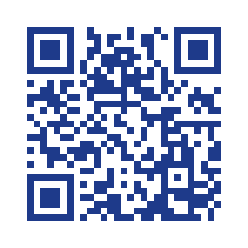

#### Module and Finder Pattern Styles

`ModuleStyle` draws dark modules as circles or rounded squares. `ModuleScalePercent` shrinks modules within their cells. `FinderPatternStyle` sets finder patterns to circles or rounded squares independently of the module style, preserving their recognizable shape. Styled PNG and raw pixel output use antialiased edges with sixteen levels between the two colors. Styled PNG output is 4-bit.

```csharp
var styled = new SymbolImageOptions
{
    ModuleStyle = ModuleStyle.Circle,
    ModuleScalePercent = 90,
    FinderPatternStyle = FinderPatternStyle.RoundedSquareCircle,
    DarkColor = new SymbolColor(0x1E, 0x3A, 0x8A),
};
var svgStyled = SymbolImageWriter.GetSvgString(qr, styled);
var pngStyled = SymbolImageWriter.GetPngBytes(qr, styled);
```

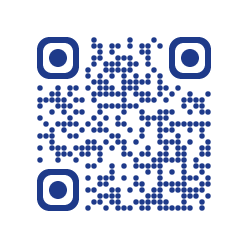

#### Icon Area

`IconSizeModules` reserves a centered square for an icon on a Standard QR code. `IconBorderModules` sets the surrounding light border. SVG output embeds `IconImage` as a data URI. PNG and raw pixel output leave this area light. Use `GetIconRectangle` to get the icon bounds in pixels. Draw the icon within those bounds.

Use `QREccLevel.H` because the icon obscures symbol data. The writer rejects an icon that reaches a finder pattern. It also rejects an icon whose side length, including the border, exceeds `MaxCoreOccupancyPercent` of the symbol's side length. This limit excludes the quiet zone.

```csharp
var qrH = QRCodeGenerator.Create("https://github.com/guitarrapc/FeatherQR", QREccLevel.H);  // version 5: 7 modules and a border fit under the 30 percent cap
var withIcon = new SymbolImageOptions { IconSizeModules = 7, IconImage = File.ReadAllBytes("logo.png") };
var svgWithLogo = SymbolImageWriter.GetSvgString(qrH, withIcon);                       // the logo embedded
var buffer = new byte[SymbolImageWriter.GetPixelBufferSize(qrH, PixelLayout.Rgba8888, withIcon)];
SymbolImageWriter.TryWritePixels(qrH, buffer, PixelLayout.Rgba8888, out var w, out var h, withIcon);
var (x, y, iconWidth, iconHeight) = SymbolImageWriter.GetIconRectangle(qrH, withIcon); // draw the logo here
```

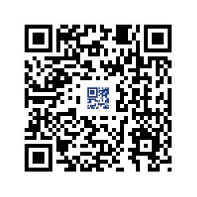

#### Terminal Text

`GetTerminalText` uses half-block characters to render two module rows per line.

```csharp
Console.OutputEncoding = System.Text.Encoding.UTF8;                  // a CJK code page prints some half blocks as ?
Console.Write(SymbolImageWriter.GetTerminalText(qr));                // dark modules drawn, for a light terminal
Console.Write(SymbolImageWriter.GetTerminalText(qr, invert: true));  // light modules drawn, for a dark terminal
```

#### Raw Pixels and Buffer Writers

`WriteSvg` and `WritePng` write to an `IBufferWriter<byte>` without allocations after warmup. `TryWritePixels` writes tightly packed rows to your buffer in `Gray8`, `Rgba8888`, `Bgra8888`, `Rgb888x`, `Bgr888x`, `Rgb24`, or `Bgr24` format. Pass a `Gray8` buffer directly to `TryDecodeImage`.

```csharp
var pixels = new byte[SymbolImageWriter.GetPixelBufferSize(qr, PixelLayout.Bgra8888)];
SymbolImageWriter.TryWritePixels(qr, pixels, PixelLayout.Bgra8888, out var width, out var height);
```

To write into memory that another image type owns, ask for the size first with `GetImageSize`, then pass that image's row stride. Rows start `rowBytes` bytes apart, and the bytes between a row's last pixel and the next row are left untouched. The same overload writes a symbol into a region of a larger buffer: slice the buffer at the region's first pixel and pass the larger image's stride.

```csharp
var (width, height) = SymbolImageWriter.GetImageSize(qr, options);                   // before any pixel is written
Span<byte> memory = ...;                                                             // your image's pixels, rows of rowBytes bytes
SymbolImageWriter.TryWritePixels(qr, memory, rowBytes, PixelLayout.Bgra8888, out _, out _, options);

var at = (top * canvasWidth + left) * 4;                                             // a region of a larger RGBA canvas
SymbolImageWriter.TryWritePixels(micro, canvas.AsSpan(at), canvasWidth * 4, PixelLayout.Rgba8888, out _, out _);
```

#### Web and UI Apps

`SymbolImageWriter` performs no I/O and has no async methods. ASP.NET Core disables synchronous response writes by default. Return the image bytes, or write to the response's `PipeWriter` and flush asynchronously. At the default 8 pixels per module, even a version 40 symbol renders in well under one frame. UI applications can render on the UI thread and await the file write.

```csharp
app.MapGet("/qr.png", (string text) =>
    Results.File(SymbolImageWriter.GetPngBytes(QRCodeGenerator.Create(text, QREccLevel.M)), "image/png"));

app.MapGet("/qr.svg", (string text) =>
    Results.Text(SymbolImageWriter.GetSvgString(QRCodeGenerator.Create(text, QREccLevel.M)), "image/svg+xml"));

// WritePng writes directly to the PipeWriter without a copy. Cancellation applies only to the flush.
app.MapGet("/qr-pipe.png", async (string text, HttpResponse response, CancellationToken cancellationToken) =>
{
    response.ContentType = "image/png";
    SymbolImageWriter.WritePng(QRCodeGenerator.Create(text, QREccLevel.M), response.BodyWriter);
    await response.BodyWriter.FlushAsync(cancellationToken);
});

// A UI app awaits only the file write
await File.WriteAllBytesAsync("qrcode.png", SymbolImageWriter.GetPngBytes(qr), cancellationToken);
```

### Styled Images with FeatherQR.SkiaSharp

`QRCodeImageBuilder`, `MicroQRCodeImageBuilder`, and `RmQRCodeImageBuilder` render through SkiaSharp. They provide static helper methods and a fluent API for colors, gradients, module shapes, formats, and output size. All three support custom finder patterns. Only Standard QR supports icons. See the [Micro QR](#micro-qr) and [rMQR](#rmqr) examples.

```csharp
using FeatherQR;
using FeatherQR.SkiaSharp;

var qrCode = new QRCodeImageBuilder("https://example.com")
    .WithSize(800, 800)
    .WithErrorCorrection(QREccLevel.H);

var pngBytes = qrCode.ToByteArray();
File.WriteAllBytes("qrcode.png", pngBytes);
```

#### Choosing Image Size

| Goal | API | Notes |
|---|---|---|
| Keep module edges sharp / logo aligned | `WithModulePixelSize(n)` | Output side = `QR matrix size * n`. Best default when using logos. |
| Also fit a fixed UI frame | `WithModulePixelSize(n)` + `WithSize(w, h)` | Canvas must be `>=` content size. Too-small canvas throws. |
| Only need a fixed pixel box | `WithSize(w, h)` | Simple, but module size may become fractional when QR version changes. |

The builder centers the symbol at a uniform scale, keeping modules square at any canvas aspect ratio. Allow enough pixels per module to keep the image readable. In tests with clean images, FeatherQR's decoder starts failing below about 1.5 pixels per module. Phone cameras need a larger margin.

Unused canvas space uses the background color, or the clear color if specified. Use `WithClearColor(SKColors.Transparent)` for transparent space around an opaque symbol.

Use module-based sizing when sharp edges and logo alignment matter:

```csharp
using FeatherQR;
using FeatherQR.SkiaSharp;

var qrCode = new QRCodeImageBuilder("https://example.com")
    .WithModulePixelSize(10) // content = (QR matrix size in modules) * 10
    .WithErrorCorrection(QREccLevel.H)
    .WithQuietZone(4);

var pngBytes = qrCode.ToByteArray();
```

#### Custom Colors

The clear color fills canvas space outside the symbol. It is visible only when the canvas is larger than the content. With `WithSize` alone, a square symbol fills a square canvas.

```csharp
using SkiaSharp;
using FeatherQR;
using FeatherQR.SkiaSharp;

new QRCodeImageBuilder("https://example.com")
    .WithModulePixelSize(16)                       // content size follows the modules
    .WithSize(800, 800)                            // larger canvas with space for the clear color
    .WithColors(
        codeColor: SKColor.Parse("#000080"),       // Navy
        backgroundColor: SKColor.Parse("#FFE4B5")) // Moccasin
    .WithClearColor(SKColors.Transparent)
    .ToByteArray();
```

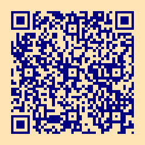

#### Custom Module Shapes

```csharp
using SkiaSharp;
using FeatherQR.SkiaSharp;

var qrCode = new QRCodeImageBuilder("https://example.com")
    .WithSize(800, 800)
    .WithModuleShape(CircleModuleShape.Default, sizePercent: 0.95f)
    .WithCodeColor(SKColors.DarkBlue);

var pngBytes = qrCode.ToByteArray();
```

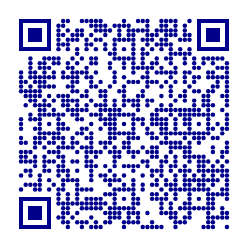

#### Custom Finder Pattern

```csharp
var qrCode = new QRCodeImageBuilder("https://example.com")
    .WithSize(512, 512)
    .WithFinderPatternShape(RoundedRectangleFinderPatternShape.Default);

var pngBytes = qrCode.ToByteArray();
```

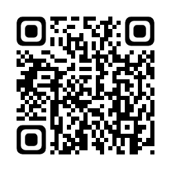

#### Gradient QR code

```csharp
using SkiaSharp;
using FeatherQR;
using FeatherQR.SkiaSharp;

var gradient = new GradientOptions(
    [SKColors.Blue, SKColors.Purple, SKColors.Pink],
    GradientDirection.TopLeftToBottomRight,
    [0f, 0.5f, 1f]);

var qrCode = new QRCodeImageBuilder("https://example.com")
    .WithSize(512, 512)
    .WithErrorCorrection(QREccLevel.H)
    .WithGradient(gradient)
    .WithModuleShape(RoundedRectangleModuleShape.Default, sizePercent: 0.9f);

var pngBytes = qrCode.ToByteArray();
```


#### QR code with Logo (icon only)

Prefer module-based sizing so the logo sits on the QR grid. See [Choosing Image Size](#choosing-image-size). This example uses version 5 to fit a 7-module icon with a 2-module border on each side. The total width stays within 30% of the core width, the default limit.

```csharp
using SkiaSharp;
using FeatherQR;
using FeatherQR.SkiaSharp;

using var logo = SKBitmap.Decode(File.ReadAllBytes("logo.png"));

// Percent/pixel sizing (existing)
var iconByPercent = IconData.FromImage(logo, iconSizePercent: 15, iconBorderWidth: 10);

// Module-based sizing (recommended with WithModulePixelSize)
var iconByModules = IconData.FromImageByModules(logo, iconSizeModules: 7, iconBorderModules: 2);

var qrCode = new QRCodeImageBuilder("https://example.com")
    .WithVersion(5)
    .WithModulePixelSize(12)
    // .WithSize(512, 512) // optional: larger canvas with centered padding
    .WithErrorCorrection(QREccLevel.H) // High ECC recommended for icons
    .WithColors(codeColor: SKColors.DarkGreen, backgroundColor: SKColors.LightYellow)
    .WithIcon(iconByModules);

var pngBytes = qrCode.ToByteArray();
```


#### QR code with Logo (icon and text)

```csharp
using SkiaSharp;
using FeatherQR;
using FeatherQR.SkiaSharp;

using var logo = SKBitmap.Decode(File.ReadAllBytes("logo.png"));
using var font = new SKFont
{
    Size = 18,
    Typeface = SKTypeface.FromFamilyName("sans-serif", SKFontStyle.Bold)
};
var icon = new IconData
{
    // Default text is placed below the icon image, centered
    Icon = new ImageTextIconShape(logo, "FooBar", SKColors.Black, font, textPadding: 2),
    IconSizePercent = 13,
    IconBorderWidth = 18,
};
var qrCode = new QRCodeImageBuilder("https://example.com")
    .WithSize(800, 800)
    .WithErrorCorrection(QREccLevel.H) // High ECC recommended for icons
    .WithIcon(icon);

var pngBytes = qrCode.ToByteArray();
```

#### Raster Output (PNG / JPEG / WebP)

The default format is PNG. Use `WithFormat()` to change it. Quality (0–100) applies to lossy JPEG and WebP output.

```csharp
using SkiaSharp;
using FeatherQR;
using FeatherQR.SkiaSharp;

// PNG (default)
var pngBytes = new QRCodeImageBuilder("https://example.com")
    .WithSize(512, 512)
    .ToByteArray();

// JPEG
var jpegBytes = new QRCodeImageBuilder("https://example.com")
    .WithSize(512, 512)
    .WithFormat(SKEncodedImageFormat.Jpeg, quality: 90)
    .ToByteArray();

// WebP
var webpBytes = new QRCodeImageBuilder("https://example.com")
    .WithSize(512, 512)
    .WithFormat(SKEncodedImageFormat.Webp, quality: 80)
    .ToByteArray();

// Or one-liner helpers
var bytes = QRCodeImageBuilder.GetImageBytes(
    "https://example.com", SKEncodedImageFormat.Jpeg, QREccLevel.M, size: 512, quality: 90);
```

#### SVG Output (Vector)

SVG output uses vector shapes that scale without quality loss for print and web use. All builder styling options apply, including colors, module shapes, gradients, finder patterns, icons, and background alpha.

```csharp
using SkiaSharp;
using FeatherQR;
using FeatherQR.SkiaSharp;

// One-liner: save to stream
using var stream = File.Create("qrcode.svg");
QRCodeImageBuilder.SaveSvg("https://example.com", stream);

// One-liner: SVG document string, e.g. for inline HTML embedding
var svg = QRCodeImageBuilder.GetSvgString("https://example.com");

// Builder: full styling support
var svgString = new QRCodeImageBuilder("https://example.com")
    .WithModulePixelSize(10)
    .WithErrorCorrection(QREccLevel.H)
    .WithCodeColor(SKColor.Parse("1B9CFC"))
    .ToSvgString(); // or SaveToSvg(stream) / SaveToSvg(bufferWriter) / GetSvgBytes(...)
```

Size options define the SVG viewport rather than pixels. `WithFormat()` does not apply to SVG output.

> [!TIP]
> SVG output includes a `viewBox` and scales to any display size. Default rectangular modules produce compact SVGs with sharp edges. Custom shapes and gradients increase the document size. SVG output embeds icons directly.

#### Request Version

"abc" fits in Version 1. Request Version 10 for more modules, which can help when adding a logo to a short payload.

```csharp
using SkiaSharp;
using FeatherQR;
using FeatherQR.SkiaSharp;

new QRCodeImageBuilder("abc")
    .WithSize(512, 512)
    .WithVersion(10)
    .ToByteArray();
```

### Drawing into Your Own SKCanvas

`SymbolRenderer` renders `QRCodeData`, `MicroQRCodeData`, or `RmQRCodeData` to an existing `SKCanvas`. Use it to place a symbol inside other SkiaSharp graphics. The renderer centers the symbol in `area` with square modules. The background fills the rest of `area`.

```csharp
using SkiaSharp;
using FeatherQR;
using FeatherQR.SkiaSharp;

var qrData = QRCodeGenerator.Create("content", QREccLevel.M);
using var surface = SKSurface.Create(new SKImageInfo(400, 400));
var canvas = surface.Canvas;

// The symbol fills a square area and is centered in a wider or taller area.
var area = SKRect.Create(50, 50, 300, 300);
SymbolRenderer.Render(canvas, area, qrData, SKColors.Black, SKColors.White);
```

Pattern 15 in [samples/ConsoleApp](samples/ConsoleApp) uses this API to render a symbol inside a frame with text.


## Platform-Specific Considerations

### NativeAOT Support

FeatherQR supports NativeAOT. The library sets `IsAotCompatible`. CI publishes a NativeAOT analysis project that includes the entire library and treats trimming and AOT warnings as errors. Include platform-specific native assets when using SkiaSharp.

```xml
<PropertyGroup>
  <PublishAot>true</PublishAot>
  <PublishTrimmed>true</PublishTrimmed>
  <InvariantGlobalization>true</InvariantGlobalization>
</PropertyGroup>
```

> [!WARNING]
> When using `PublishTrimmed`, check that your content and rendering code does not rely on reflection or dynamic code affected by trimming.

### SkiaSharp support

`FeatherQR.SkiaSharp` requires native dependencies for the target platform.

#### Linux

Option 1: Font support (recommended for text rendering). Requires `libfontconfig1`.

```bash
sudo apt update && apt install -y libfontconfig1
```

```xml
<PackageReference Include="FeatherQR.SkiaSharp" Version="2.0.0-preview.8" />
<PackageReference Include="SkiaSharp.NativeAssets.Linux" Version="4.148.0" />
```

Option 2: Without font dependencies. Use this for QR codes without advanced font operations.

```xml
<PackageReference Include="FeatherQR.SkiaSharp" Version="2.0.0-preview.8" />
<PackageReference Include="SkiaSharp.NativeAssets.Linux.NoDependencies" Version="4.148.0" />
```

> [!TIP]
> `NoDependencies` can still draw text but cannot search fonts based on characters or use system fonts. See [SkiaSharp Issue #964](https://github.com/mono/SkiaSharp/issues/964#issuecomment-549385484)

#### Windows

```xml
<PackageReference Include="FeatherQR.SkiaSharp" Version="2.0.0-preview.8" />
<PackageReference Include="SkiaSharp.NativeAssets.Win32" Version="4.148.0" />
```

#### macOS

```xml
<PackageReference Include="FeatherQR.SkiaSharp" Version="2.0.0-preview.8" />
<PackageReference Include="SkiaSharp.NativeAssets.macOS" Version="4.148.0" />
```

## FAQ

### Can I use this in ASP.NET Core?

Yes. ASP.NET Core disables synchronous response I/O by default. Write the image asynchronously or return its bytes:

```csharp
app.MapGet("/qr", async (string url, HttpResponse response, CancellationToken cancellationToken) =>
{
    response.ContentType = "image/png";
    await QRCodeImageBuilder.SavePngAsync(url, response.Body, cancellationToken: cancellationToken);
});

app.MapGet("/qr.png", (string url) =>
{
    var pngBytes = QRCodeImageBuilder.GetPngBytes(url);
    return Results.File(pngBytes, "image/png");
});

app.MapGet("/qr.svg", (string url) =>
{
    var svgBytes = QRCodeImageBuilder.GetSvgBytes(url);
    return Results.File(svgBytes, "image/svg+xml");
});
```

With `SymbolImageWriter`, return the bytes or write to the response's `PipeWriter`. See [Plain Images with FeatherQR](#plain-images-with-featherqr). For uploaded images, see [Async and stream I/O](#async-and-stream-io). Span-based APIs let you use slices of memory without additional allocations.

### Does it support WebAssembly?

Yes. FeatherQR supports Blazor WebAssembly and standalone WebAssembly.

- See the [samples/BlazorWasm](samples/BlazorWasm) folder for a Blazor WebAssembly example.
- See [src/FeatherQR.Playground](src/FeatherQR.Playground) for standalone WebAssembly usage.

### Can I use it with System.Drawing, WPF, or ImageSharp?

Yes, `FeatherQR` supports those. `SymbolImageWriter.TryWritePixels` writes the pixel layouts these libraries use, and `LuminanceConverter` turns their pixels into the luminance `TryDecodeImage` reads. Each sample makes a symbol in the library's own image type and decodes it back. To draw shapes instead of pixels, use [module rectangles](#module-rectangles-for-your-renderer).

Pick the `PixelLayout` by the order of the bytes in memory, which a format's name does not always say:

| Library | Pixel format | `PixelLayout` |
|---|---|---|
| System.Drawing | `Format32bppArgb` | `Bgra8888` |
| System.Drawing | `Format32bppRgb` | `Bgr888x` |
| System.Drawing | `Format24bppRgb` | `Bgr24` |
| WPF | `PixelFormats.Bgra32` | `Bgra8888` |
| WPF | `PixelFormats.Bgr32` | `Bgr888x` |
| WPF | `PixelFormats.Bgr24`, `PixelFormats.Rgb24` | `Bgr24`, `Rgb24` |
| ImageSharp | `Rgba32`, `Bgra32` | `Rgba8888`, `Bgra8888` |
| ImageSharp | `Rgb24`, `Bgr24` | `Rgb24`, `Bgr24` |

A 24-bit row is often padded to a multiple of four bytes. Pass the row stride the library reports, not width × 3. The fourth byte of `Format32bppRgb` and `Bgr32` is no alpha, and a file from another tool may hold 0 there. Read as `Bgra8888`, a 0 is a transparent pixel and the image turns white, so read those formats as `Bgr888x`.

- See [samples/Dotfiles/SystemDrawing.cs](samples/Dotfiles/SystemDrawing.cs) for System.Drawing usage.
- See [samples/Dotfiles/Wpf.cs](samples/Dotfiles/Wpf.cs) for WPF usage, including a WPF Window to input text and read QR codes from images.
- See [samples/Dotfiles/ImageSharp.cs](samples/Dotfiles/ImageSharp.cs) for ImageSharp usage. ImageSharp 3.2.0 and later need a Six Labors license key for Release builds.

### What about NativeAOT and trimming?

Yes. The library sets `IsAotCompatible`. CI publishes [tests/FeatherQR.AotAnalysis](tests/FeatherQR.AotAnalysis) for every change and treats trimming and AOT warnings as errors. See [Platform-Specific Considerations](#platform-specific-considerations) for required native assets.

On x64, a default NativeAOT build runs slower than the JIT. See [x64 SIMD on NativeAOT](#x64-simd-on-nativeaot) for when to target `x86-64-v3`.

### Are ISO-8859-2 and other encodings supported?

FeatherQR encodes and decodes ISO-8859-1, UTF-8, and Japanese text in Kanji mode (JIS X 0208). It does not directly encode text as ISO-8859-2 or Shift JIS Byte segments under ECI 20. Text encoding focuses on UTF-8 because most QR code use cases support it and rarely require legacy encodings.

To use another encoding, pass pre-encoded bytes to `QRCodeGenerator.Create` or `RmQRCodeGenerator.Create`. Set `eciAssignment` to identify the encoding, such as 4 for ISO-8859-2 or 20 for Shift JIS.

The decoder reads Shift JIS text with ECI 20 or detects it from the bytes when no ECI header is present. Unsupported text encodings, such as ISO-8859-2, return `UnsupportedContent` and report the encoding in `EciAssignment`. Use `TryDecodeBytes` to get the bytes for conversion. See [Binary data](#binary-data).

| Supported | Encoding Mode | Encoding |
| --- | --- | --- |
| Supported | Numeric | ISO-8859-1 |
| Supported | Alphanumeric | ISO-8859-1 |
| Supported | Byte | UTF-8 |
| Supported (written with `AllowKanji`) | Kanji | Shift JIS (JIS X 0208) |

### Does it read QR codes from images?

Yes. `QRCodeDecoder`, `MicroQRCodeDecoder`, and `RmQRCodeDecoder` read module matrices, screenshots, rendered symbols, scans, and camera photographs, including rotated, mirrored, or tilted symbols. Image input can be an `SKBitmap`, a luminance span, or an encoded image stream. Each decoder can read one or all symbols of its type. `SymbolDecoder` reads all three types in one call.

Photographs with glare, damage, blur, curved surfaces, steep angles, or strong lens distortion are less reliable. Failed decodes return a status identifying the failure stage. See [Decoders](#decoders).

### What QR code style provides the best scan reliability?

For reliable scanning:

- **Use rectangular modules (default)**: `RectangleModuleShape` provides the lowest scan error rate.
- **Avoid gaps between modules**: Smaller modules and shapes such as `Circle` or `RoundRect` create gaps that increase scan errors.
- **Use `QREccLevel.H` for custom shapes**: The High level (~30% recovery capacity) helps compensate for reduced readability with `Circle`, `RoundRect`, and other custom shapes.
- **Use `QREccLevel.H` with icons or logos**: Icons obscure symbol data, so use the highest error correction level.

**Example:**

```csharp
using SkiaSharp;
using FeatherQR;
using FeatherQR.SkiaSharp;

// Best reliability - default settings with rectangular modules
var pngBytes = QRCodeImageBuilder.GetPngBytes("https://example.com");

// If using Circle or RoundRect - use High error correction
var qrCode = new QRCodeImageBuilder("https://example.com")
    .WithSize(800, 800)
    .WithErrorCorrection(QREccLevel.H) // Use High for custom shapes
    .WithErrorCorrectionBoost()
    .WithModuleShape(CircleModuleShape.Default);

// When using icons/logos - always use High error correction
using var logo = SKBitmap.Decode(File.ReadAllBytes("logo.png"));
var icon = IconData.FromImage(logo, iconSizePercent: 15);

var qrCodeWithIcon = new QRCodeImageBuilder("https://example.com")
    .WithSize(800, 800)
    .WithErrorCorrection(QREccLevel.H) // Use High for icons
    .WithErrorCorrectionBoost()
    .WithIcon(icon);

// Or request M as the minimum and boost to the highest level that fits.
var qrCodeBoosted = new QRCodeImageBuilder("https://example.com")
    .WithSize(800, 800)
    .WithErrorCorrection(QREccLevel.M)
    .WithErrorCorrectionBoost()
    .WithIcon(icon);
```

### How can I display QR codes in LINQPad?

Call `Dump()` to display a QR code in LINQPad's Results pane:

```csharp
Bitmap.FromStream(new MemoryStream(QRCodeImageBuilder.GetPngBytes("WIFI:T:WPA;S:mynetwork;P:mypass;;"))).Dump();
```

### x64 SIMD on NativeAOT

On x64, NativeAOT targets the OS's minimum instruction set by default, which excludes AVX. .NET reports AVX2, BMI2, and 256-bit vectors as unavailable even on CPUs that support them. FeatherQR therefore uses its 128-bit SIMD paths instead of AVX2.

Compared with the JIT on the same machine, a default NativeAOT build takes 1.0–2.0 times as long. Standard QR encoding takes about 2 times as long. Image decoding takes 1.3–1.5 times as long. If every target machine supports `x86-64-v3`, enable it with `<IlcInstructionSet>`. Supported CPUs include Intel Core since Haswell and AMD since Excavator.

```xml
<PropertyGroup>
  <IlcInstructionSet>x86-64-v3</IlcInstructionSet>
</PropertyGroup>
```

With this setting, FeatherQR runs 10% slower than the JIT at the median. On CPUs without AVX2, including some Pentium, Celeron, and Atom models, the app exits at startup. It reports "The required instruction sets are not supported by the current CPU." ARM64 needs no additional setting because its default target enables all required SIMD paths.

## Standard QR Specifications

### ECC Level (Error Correction Levels)

QR codes support four error correction levels for recovering data from partially damaged or obscured symbols:

> [!TIP]
> Use ECC Level H for icons to help recover data obscured by the icon.

| ECC Level | Error Correction Capability | Use Case |
|-----------|----------------------------|----------|
| **L (Low)** | ~7% recovery | Clean environments, maximum data capacity |
| **M (Medium)** | ~15% recovery | General purpose (default recommended) |
| **Q (Quartile)** | ~25% recovery | Outdoor use, moderate damage expected |
| **H (High)** | ~30% recovery | Use for logos/icons and harsh environments |

### Encoding Modes

QR codes support different encoding modes optimized for specific character types. FeatherQR automatically selects the most efficient mode for your content.

> [!NOTE]
> Enable `AllowKanji` to encode Kanji segments. By default, generators encode Japanese text as UTF-8 in Byte mode. Decoders read Kanji segments from any encoder. See [Kanji mode for Japanese text](#kanji-mode-for-japanese-text).
>
> Kanji mode uses JIS X 0208. Microsoft CP932 maps seven cells differently: wave dash, minus sign, cent sign, pound sign, not sign, reverse solidus, and double vertical line. CP932 also adds 83 characters within the Kanji-mode range in NEC row 13, including circled digits, roman numerals, and unit ligatures. Kanji segments containing any of those 83 characters fail with `UnmappedCharacter` rather than being silently converted. This differs from `UnsupportedContent`, which indicates an unsupported feature.

| Mode | Character Set | Bits per Character | Example |
|------|--------------|-------------------|---------|
| **Numeric** | 0-9 | ~3.3 bits | Phone numbers, postal codes |
| **Alphanumeric** | 0-9, A-Z, space, $ % * + - . / : | ~5.5 bits | URLs (uppercase), product codes |
| **Byte** | ISO-8859-1, UTF-8 | 8 bits | Text, mixed-case URLs, non-ASCII text |
| **Kanji** | Shift JIS (JIS X 0208) characters | 13 bits | Japanese text, with `AllowKanji` |

### Version and Size

QR codes come in 40 versions (sizes), from Version 1 (21×21 modules) to Version 40 (177×177 modules). Each version adds 4 modules per side.

- **Version 1**: 21×21 modules
- **Version 2**: 25×25 modules
- ...
- **Version 40**: 177×177 modules

The library automatically selects the minimum version that can fit your content based on the selected ECC level.

See [Data Capacity Reference](docs/data-capacity.md) for practical capacities and full tables by version and ECC level.

## Micro QR and rMQR

Micro QR and rMQR have their own generators, image builders, and decoders. Standard QR examples are in [Advanced](#advanced).

### Micro QR

Use Micro QR for short data that needs a smaller square symbol. The generator selects the smallest compatible version from M1–M4. See [Data Capacity](docs/data-capacity.md) for version and error-correction limits.

#### One-liner (PNG)

```csharp
using FeatherQR;
using FeatherQR.SkiaSharp;

var pngBytes = MicroQRCodeImageBuilder.GetPngBytes("01234567", MicroQREccLevel.L, size: 256);
File.WriteAllBytes("microqr.png", pngBytes);
```


#### Builder (colors, module shape, gradient)

```csharp
using SkiaSharp;
using FeatherQR;
using FeatherQR.SkiaSharp;

var gradient = new GradientOptions(
    [SKColor.Parse("00B894"), SKColor.Parse("0984E3")],
    GradientDirection.TopLeftToBottomRight);

var pngBytes = new MicroQRCodeImageBuilder("SKU-42")
    .WithModulePixelSize(14)
    .WithErrorCorrection(MicroQREccLevel.M)
    .WithColors(codeColor: SKColor.Parse("2D3436"), backgroundColor: SKColors.White)
    .WithModuleShape(RoundedRectangleModuleShape.Default, sizePercent: 0.92f)
    .WithGradient(gradient)
    .ToByteArray();
```


#### Decode (matrix and image)

```csharp
using SkiaSharp;
using FeatherQR;
using FeatherQR.SkiaSharp;

var micro = MicroQRCodeGenerator.Create("01234567", MicroQREccLevel.L);
if (MicroQRCodeDecoder.TryDecode(micro, out var text, out var info))
{
    Console.WriteLine($"{text} ({info.Version}, ECC {info.EccLevel})"); // 01234567 (M2, ECC L)
}

// Decode an image with the Micro QR decoder
using var bitmap = SKBitmap.Decode("microqr.png");
var ok = MicroQRCodeDecoder.TryDecode(bitmap, out var scanned, out _);

// Or straight from a stream
await using var file = File.OpenRead("microqr.png");
var result = await MicroQRCodeDecoder.DecodeAsync(file);
```

Runnable examples: [ConsoleApp patterns 24–26](samples/ConsoleApp).

### rMQR

Use rMQR when a rectangular symbol fits the available space better than a square QR code. The generator selects the version with the smallest area by default. You can instead fix the height or prefer the shortest height. See [Data Capacity](docs/data-capacity.md) for version and error-correction limits.

#### One-liner (PNG)

```csharp
using FeatherQR;
using FeatherQR.SkiaSharp;

// size sets the width. The height follows the symbol's aspect ratio.
var pngBytes = RmQRCodeImageBuilder.GetPngBytes("https://example.com/r/12345", RmQREccLevel.M, size: 512);
File.WriteAllBytes("rmqr.png", pngBytes);
```

#### Builder (fixed height, fit strategy, styling)

```csharp
using SkiaSharp;
using FeatherQR;
using FeatherQR.SkiaSharp;

// Fix the symbol height. The generator selects the width automatically.
var pngBytes = new RmQRCodeImageBuilder("https://example.com/r/12345")
    .WithHeight(RmQRHeight.H9)
    .WithErrorCorrection(RmQREccLevel.H)
    .WithModulePixelSize(12)
    .WithColors(codeColor: SKColor.Parse("2D3436"), backgroundColor: SKColors.White)
    .WithModuleShape(RoundedRectangleModuleShape.Default, sizePercent: 0.9f)
    .ToByteArray();

// Prefer the shortest available height
var flat = RmQRCodeGenerator.Create("012345678901", RmQREccLevel.M, new RmQRCodeGeneratorOptions { FitStrategy = RmQRFitStrategy.MinimizeHeight });
Console.WriteLine(flat.Version); // R7x43
```


#### Fit a frame (largest modules)

To get the largest modules in a frame, find the narrowest version at each of the six heights. Then use the version with the largest modules. At a fixed height, a narrower symbol never has smaller modules. So these six calls find the best of all 32 versions.

Do not choose the version whose aspect ratio is closest to the frame's. For 9 characters in a 400 × 60 frame, that version is R17x139 with 2-pixel modules. The six calls choose R7x59, with 5-pixel modules.

```csharp
using FeatherQR;

const string text = "HELLO2026";
int frameWidth = 400, frameHeight = 60;
RmQRVersion? best = null;
var bestModule = 0;
foreach (var height in Enum.GetValues<RmQRHeight>())
{
    var fit = new RmQRCodeGeneratorOptions { Height = height, FitStrategy = RmQRFitStrategy.MinimizeWidth };
    if (!RmQRCodeGenerator.TryGetRequiredBufferSize(text, RmQREccLevel.M, out var size, fit))
        continue; // The text does not fit at this height.
    // size.Width and size.Height include the quiet zone, as the image does.
    // Whole pixels a module, as the image is written. With FillCanvas, divide as double.
    var module = Math.Min(frameWidth / size.Width, frameHeight / size.Height);
    if (module > bestModule)
        (best, bestModule) = (size.Version, module);
}
Console.WriteLine(best); // R7x59

var rmqr = RmQRCodeGenerator.Create(text, RmQREccLevel.M, new RmQRCodeGeneratorOptions { Version = best });
var png = SymbolImageWriter.GetPngBytes(rmqr, new SymbolImageOptions { Width = frameWidth, Height = frameHeight });
```

#### Mixed-mode segmentation (smaller symbols for mixed content)

Single-mode encoding uses one mode for the entire payload, so one lowercase letter forces otherwise numeric data into Byte mode. `RmQRSegmentation.Optimal`, the default, splits content into Numeric, Alphanumeric, and Byte segments to minimize the bit count. This often reduces symbol size and can fit content that exceeds every version's single-mode capacity. The result never has more core modules than single-mode output. If splitting does not reduce the core module count, the generator preserves the single-mode bit stream.

> `RmQRFitStrategy` ranks versions by core modules. The default quiet zone adds 4 modules to each dimension, so minimizing `height × width` does not minimize `(height + 4) × (width + 4)`. A symbol can have fewer core modules but a larger rendered grid. For example, 24 characters at ECC H change from R15x59 (885 core modules, 63×19 rendered) to R11x77 (847 core modules, 81×15 rendered). The rendered image can become wider. Pass the same `Segmentation` to `TryGetRequiredBufferSize` and the encoder to avoid an undersized buffer.

```csharp
using FeatherQR;
using FeatherQR.SkiaSharp;

const string content = "https://example.com/p/1234567890123456";

var optimal = RmQRCodeGenerator.Create(content, RmQREccLevel.M);
Console.WriteLine(optimal.Version); // R15x43 - Byte + Numeric, 249 bits

var single = RmQRCodeGenerator.Create(content, RmQREccLevel.M, new RmQRCodeGeneratorOptions { Segmentation = RmQRSegmentation.Single });
Console.WriteLine(single.Version);  // R11x77 - one Byte segment, 313 bits

// 200 characters is 50 over the largest Byte-mode capacity, but fits once split
var mixed = new string('a', 100) + new string('7', 100);
RmQRCodeGenerator.Create(mixed, RmQREccLevel.M);                                                                        // R17x139
RmQRCodeGenerator.Create(mixed, RmQREccLevel.M, new RmQRCodeGeneratorOptions { Segmentation = RmQRSegmentation.Single }); // throws: too long

// The image builder takes the same option
var pngBytes = new RmQRCodeImageBuilder(content)
    .WithSegmentation(RmQRSegmentation.Single)
    .ToByteArray();
```

`Optimal` minimizes the bit count. `RmQRFitStrategy` selects the best-ranked version that fits the resulting segments.

Segmentation planning allocates nothing and skips the search when splitting cannot help. `RmQRSegmentation.Single` preserves the behavior of releases before 2.0.0. Use it when you depend on the exact bit stream, the "too long" exception, or the rendered dimensions of single-mode output.

#### Decode (matrix and image)

```csharp
using SkiaSharp;
using FeatherQR;
using FeatherQR.SkiaSharp;

var rmqr = RmQRCodeGenerator.Create("012345678901", RmQREccLevel.M);
if (RmQRCodeDecoder.TryDecode(rmqr, out var text, out var info))
{
    Console.WriteLine($"{text} ({info.Version}, ECC {info.EccLevel})"); // 012345678901 (R11x27, ECC M)
}

// Decode an image with the rMQR decoder
using var bitmap = SKBitmap.Decode("rmqr.png");
var found = RmQRCodeDecoder.TryDecode(bitmap, out var scanned, out var scanInfo);

// Or straight from a stream
await using var file = File.OpenRead("rmqr.png");
var result = await RmQRCodeDecoder.DecodeAsync(file);
```

Runnable examples: [ConsoleApp patterns 27–29](samples/ConsoleApp).

## Release flow

To release a version:

1. (manual) From the repository root, update the versions in `.props` and `.md` files. The four packages (`FeatherQR`, `FeatherQR.SkiaSharp`, `FeatherQR.Gs1`, `SkiaSharp.QrCode`) share a version. The release workflow packs and publishes them together.

```sh
dotnet ./tools/bump_version.cs patch   # e.g. 0.1.0 → 0.1.1
dotnet ./tools/bump_version.cs minor   # e.g. 0.1.0 → 0.2.0
dotnet ./tools/bump_version.cs major   # e.g. 0.1.0 → 1.0.0
```

For prerelease versions such as `2.0.0-preview.1`, edit `Directory.Build.props` and the installation examples in this file manually. The tool only produces `X.Y.Z` versions.

2. (manual) Commit the version change with a message like `chore: Bump version to 0.1.1`. Push the commit to the main branch.
3. (manual) Create a version tag (e.g. `git tag 0.1.1`). Push the tag (`git push origin 0.1.1`).
4. (auto) GitHub Actions builds the release artifacts, publishes the Playground, and creates a draft release. It generates release notes from PRs merged since the previous release.
5. (manual) Review the draft on the [Releases page](https://github.com/guitarrapc/FeatherQR/releases). Publish the release.

## License

MIT

`FeatherQR.Gs1` includes [THIRD-PARTY-NOTICES.md](THIRD-PARTY-NOTICES.md). Its AI table is generated from the Apache-2.0-licensed GS1 Barcode Syntax Dictionary.
