[](https://github.com/guitarrapc/FeatherQR/actions/workflows/build.yaml)
[](https://github.com/guitarrapc/FeatherQR/actions/workflows/release.yaml)

[](LICENSE)
[](https://www.nuget.org/packages/FeatherQR)
[](https://www.nuget.org/packages/FeatherQR.SkiaSharp)
[](https://www.nuget.org/packages/SkiaSharp.QrCode)

# FeatherQR

[Migration](docs/migration.md) | [Data Capacity](docs/data-capacity.md) | [Design Docs](.github/docs)

FeatherQR is a lightweight QR Code, Micro QR and rMQR library for .NET. Lightweight means three things: the core package has no dependencies, the hot paths allocate nothing, and every build is trim and NativeAOT safe. It is not a claim about assembly bytes; the core carries three symbologies, decoders and SIMD paths.

Many existing QR code libraries rely on System.Drawing, which has well-known GDI+ limitations and cross-platform issues. FeatherQR was created to provide high performance, minimum memory allocation.

[Benchmark]((src/FeatherQR.Benchmark)) results comparing FeatherQR with other libraries, on .NET 10 with an AMD Ryzen 9 7950X3D CPU.

<div style="display: flex; align-items: flex-start;">
  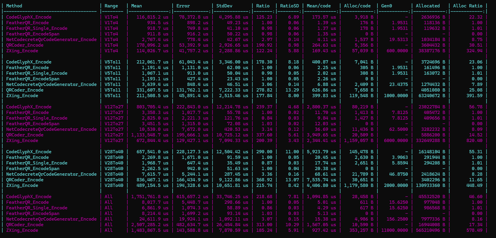
  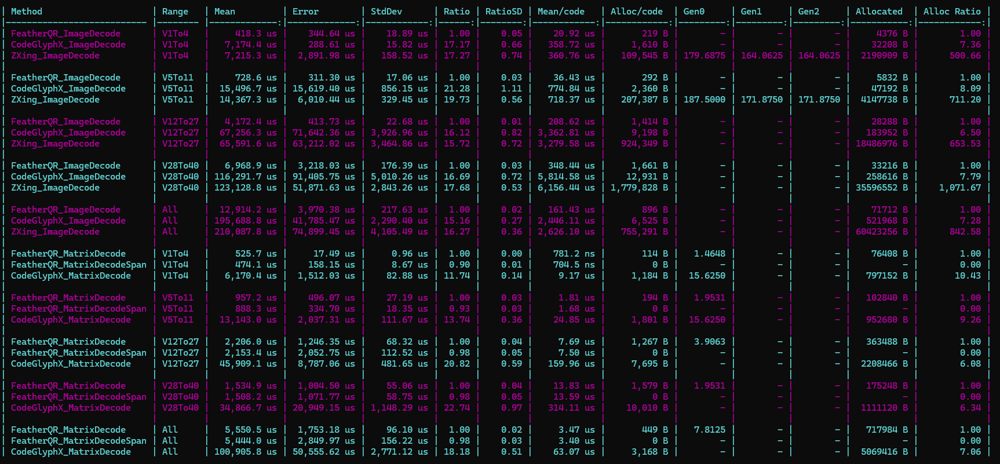
</div>

<div style="display: flex; align-items: flex-start;">
  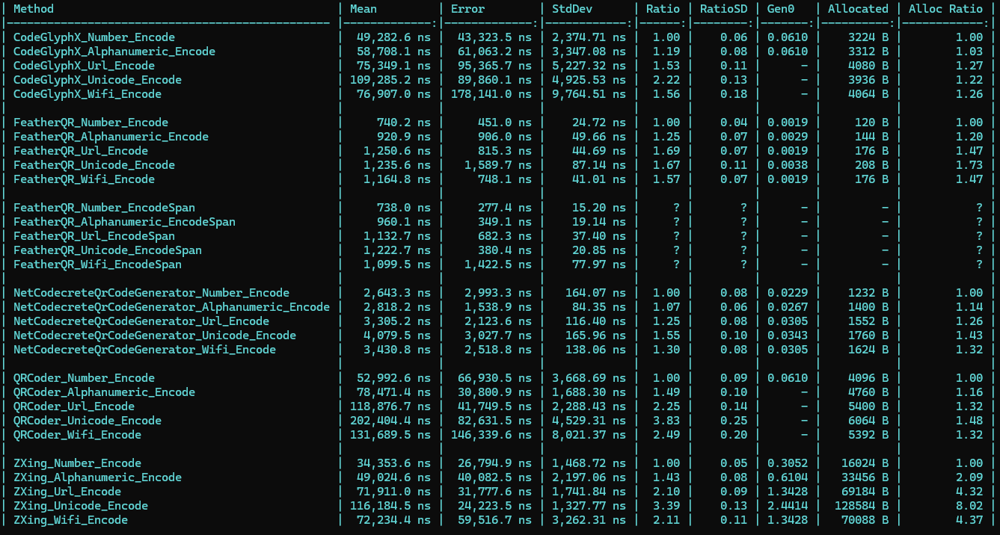
  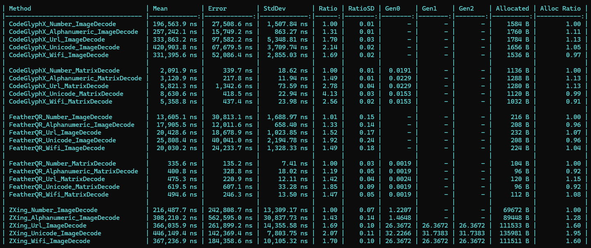
</div>


Create Standard QR, Micro QR, and rMQR images with a few lines of code.

<p float="left">
  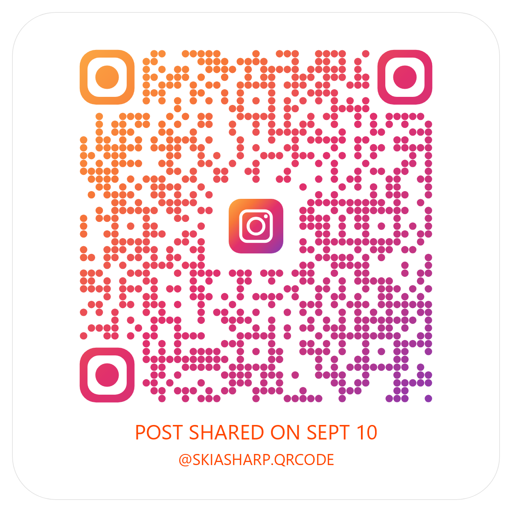
  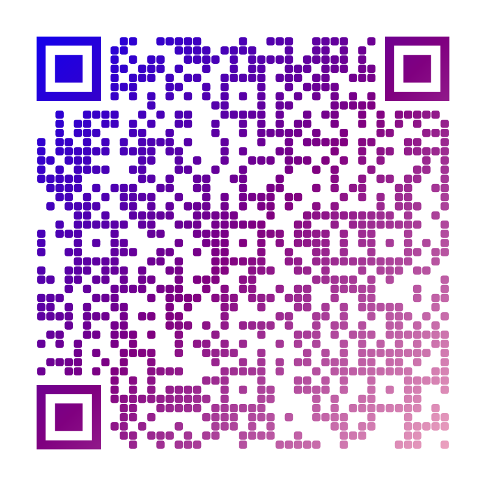
  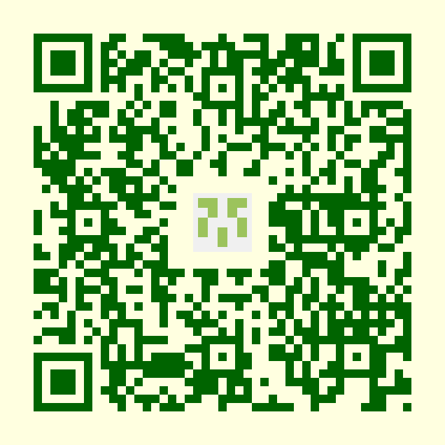
</p>

<p float="left">
  
  
</p>

<p float="left">
  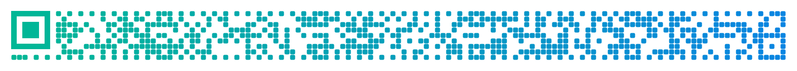
</p>

See [samples/ConsoleApp](samples/ConsoleApp) for code examples generating these styles.

## Migration

2.0.0 renames the packages and namespaces: `SkiaSharp.QrCode` and `SkiaSharp.QrCode.Image` become `FeatherQR` and `FeatherQR.SkiaSharp`. See the [Migration Guide](docs/migration.md) for the 2.0.0 changes and for older versions.

## Overview

FeatherQR is a modern, high-performance QR code library. It allocates memory only for the actual QR code data, with zero additional allocations during processing, and renders through SkiaSharp when you want images.

- **Simple API**: One-liner QR code generation with sensible defaults
- **High Performance**: Optimal speed and minimum memory allocation
- **Flexible Symbology Support**: Standard QR, Micro QR, and rMQR
- **GS1 Support**: Full support for GS1 QR Codes and GS1 Digital Link URIs
- **Highly Customizable**: Gradients, icons, custom shapes, colors, and more
- **Cross-Platform**: Windows, Linux, macOS, iOS, Android, WebAssembly
- **Zero Dependencies**: The `FeatherQR` core package depends on nothing on .NET 8+ (BCL shims only on .NET Standard)
- **No System.Drawing**: Avoids GDI+ issues and Windows dependencies
- **NativeAOT Ready**: Full support for .NET Native AOT compilation
- **Modern .NET**: .NET Standard 2.0, 2.1, .NET 8+

## Supported Symbologies

FeatherQR supports Standard QR, Micro QR, and rMQR. Examples use Standard QR unless noted otherwise.

| Symbology | Standard | Generate | Decode |
|---|---|---|---|
| Standard QR (versions 1–40) | ISO/IEC 18004 | ✅ | ✅ |
| Micro QR (M1–M4) | ISO/IEC 18004 | ✅ | ✅ |
| rMQR (R7x43–R17x139) | ISO/IEC 23941 | ✅ | ✅ |

<div style="display: flex; align-items: flex-start;">
  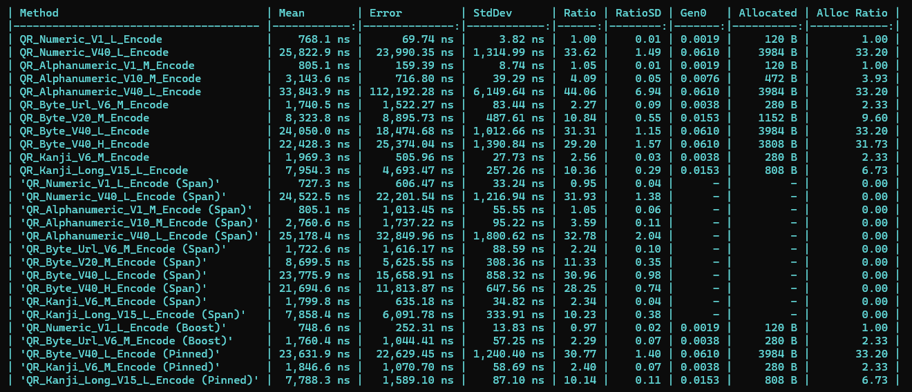
  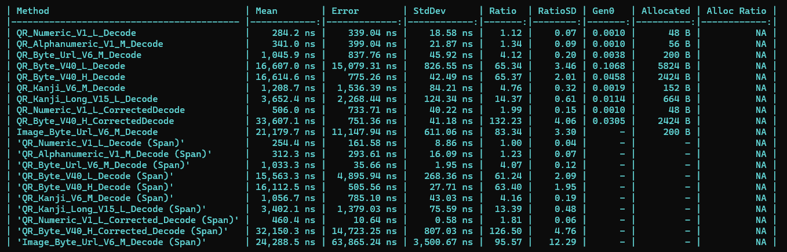
</div>

<div style="display: flex; align-items: flex-start;">
  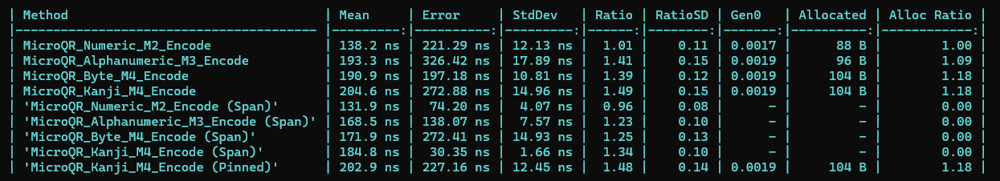
  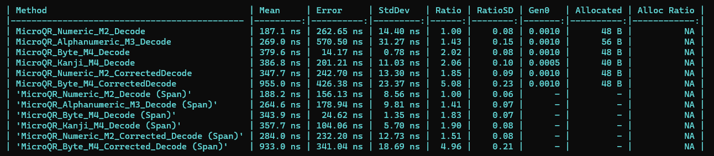
</div>

<div style="display: flex; align-items: flex-start;">
  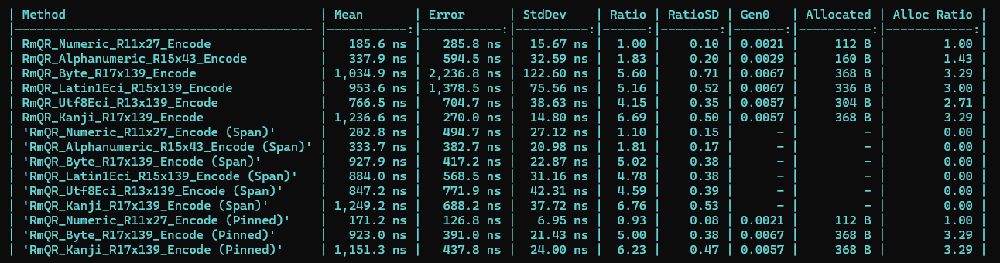
  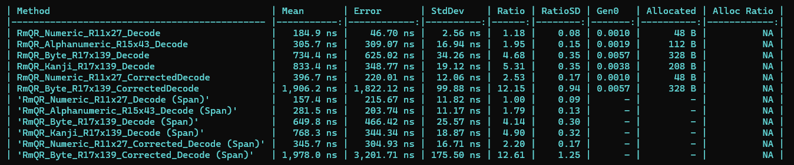
</div>


## Installation

There are 4 NuGet packages related to FeatherQR.

| Package | What |
|---|---|
| [FeatherQR](https://www.nuget.org/packages/FeatherQR) | Generates and decodes module matrices with zero dependencies. Whole Standard QR, Micro QR, and rMQR support. |
| [FeatherQR.Gs1](https://www.nuget.org/packages/FeatherQR.Gs1) | Writing a GS1 QR Code, GS1 Digital Link URI support. Standard QR and rMQR only. |
| [FeatherQR.SkiaSharp](https://www.nuget.org/packages/FeatherQR.SkiaSharp) | Renders and decodes images with SkiaSharp |
| [SkiaSharp.QrCode](https://www.nuget.org/packages/SkiaSharp.QrCode) | Empty package that depends on `FeatherQR.SkiaSharp`, for upgrading existing projects |

```bash
dotnet add package FeatherQR

# If you need image rendering with SkiaSharp
dotnet add package FeatherQR.SkiaSharp

# If you need GS1 support
dotnet add package FeatherQR.Gs1
```

`FeatherQR.SkiaSharp` needs a native asset package per platform on Linux and for NativeAOT, see [Platform-Specific Considerations](#platform-specific-considerations).

## Quick Start

Try [FeatherQR Playground](https://guitarrapc.github.io/FeatherQR/) in your browser, no install required.

The playground runs the actual library compiled to WebAssembly (GitHub Pages, fully static). Tune gradients, module shapes, finder patterns and logos in realtime, then download the PNG or SVG, or share your settings as a permalink. Every generated code is decoded back in-browser by the library's own decoder as a self-check, and the *Decode an image* panel reads QR codes from your own image files, one a file or every QR Code it holds.

### Simplest Example

Single line QR code generation:

```csharp
using FeatherQR.SkiaSharp;

// one-liner save to file
File.WriteAllBytes("qrcode.png", QRCodeImageBuilder.GetPngBytes("Hello"));

// Or get bytes
var pngBytes = QRCodeImageBuilder.GetPngBytes("https://example.com");
```

### Common Use Cases

Generate QR Codes for URL, WiFi, and SVG output.

```csharp
// QR Code for URL
File.WriteAllBytes("qrcode.png", QRCodeImageBuilder.GetPngBytes("https://example.com"));

// WiFi QR Code
File.WriteAllBytes("wifi-qr.png", QRCodeImageBuilder.GetPngBytes("WIFI:T:WPA;S:MyNetwork;P:MyPassword;;"));

// SVG (vector) output
File.WriteAllText("qrcode.svg", QRCodeImageBuilder.GetSvgString("https://example.com"));
```

Generate with Custom Settings.

```csharp
using FeatherQR;
using FeatherQR.SkiaSharp;

var qrCode = new QRCodeImageBuilder("https://example.com")
    .WithSize(512, 512)
    .WithErrorCorrection(QREccLevel.H)
    .ToByteArray();
```

Save Directly to Stream

```csharp
using FeatherQR;
using FeatherQR.SkiaSharp;

using var stream = File.OpenWrite("qrcode.png");
QRCodeImageBuilder.SavePng("Your content here", stream, QREccLevel.M, size: 512);

// Or asynchronously, where the thread must not wait on the write
await using var asyncStream = File.OpenWrite("qrcode-async.png");
await QRCodeImageBuilder.SavePngAsync("Your content here", asyncStream, QREccLevel.M, size: 512);
```

Boosting Error Correction is recommended whenever robustness matters more than an exact ECC level, and especially with icons. It raises the level as far as the capacity allows, without changing the symbol size.

```csharp
using FeatherQR;
using FeatherQR.SkiaSharp;

// Requests M as the minimum; the symbol may come out as Q or H at the same size.
var qrCode = new QRCodeImageBuilder("https://example.com")
    .WithErrorCorrection(QREccLevel.M)
    .WithErrorCorrectionBoost()
    .ToByteArray();

// Generator API equivalent
var qrData = QRCodeGenerator.Create("https://example.com", QREccLevel.M, new QRCodeGeneratorOptions { BoostEccLevel = true });
```

## API Overview

Start with an image builder for most applications. All generators and decoders also provide [zero-allocation APIs](#zero-allocation-apis) for caller-owned buffers.

| Task | Standard QR | Micro QR | rMQR |
| --- | --- | --- | --- |
| Create PNG, JPEG, WebP, or SVG | `QRCodeImageBuilder` | `MicroQRCodeImageBuilder` | `RmQRCodeImageBuilder` |
| Generate a module matrix | `QRCodeGenerator` | `MicroQRCodeGenerator` | `RmQRCodeGenerator` |
| Render a matrix to `SKCanvas` | `SymbolRenderer` | `SymbolRenderer` | `SymbolRenderer` |
| Decode a matrix or image | `QRCodeDecoder` | `MicroQRCodeDecoder` | `RmQRCodeDecoder` |

Every method that writes an image to a `Stream` has an `...Async` twin, and the decoders read an encoded image from a `Stream`, asynchronously or not. See [Async and stream I/O](#async-and-stream-io).


### Image Builders (Recommended)

Image builders provide one-line methods and a fluent API for colors, gradients, module shapes, image formats, and output size. Every symbology supports custom finder patterns, icons are Standard QR only. See the [Standard QR](#standard-qr), [Micro QR](#micro-qr), and [rMQR](#rmqr) examples for each builder.

```csharp
var pngBytes = QRCodeImageBuilder.GetPngBytes("content");
```

### SymbolRenderer (Advanced)

`SymbolRenderer` renders `QRCodeData`, `MicroQRCodeData`, or `RmQRCodeData` to an existing `SKCanvas`. Use it to place a symbol inside other SkiaSharp graphics. The symbol is centered in `area` with square modules, and the background fills the rest of `area`.

```csharp
using SkiaSharp;
using FeatherQR;
using FeatherQR.SkiaSharp;

var qrData = QRCodeGenerator.Create("content", QREccLevel.M);
using var surface = SKSurface.Create(new SKImageInfo(400, 400));
var canvas = surface.Canvas;

// A square area is filled edge to edge; a wider or taller one gets the symbol centered in it.
var area = SKRect.Create(50, 50, 300, 300);
SymbolRenderer.Render(canvas, area, qrData, SKColors.Black, SKColors.White);
```

### Generators (Low-Level)

Generators create module matrices, no rendering. Use them for custom output such as ASCII art or LED displays, or as input to `SymbolRenderer`.

```csharp
using FeatherQR;

var qrData = QRCodeGenerator.Create("content", QREccLevel.M);
var isDark = qrData[row, col];
```

`GetModuleRectangles` returns the dark modules as merged rectangles in module coordinates (same coordinate space as the indexer, quiet zone included), it's useful for vector output or draw-call based graphics APIs. Scale by your pixel-per-module factor, or emit them directly into an SVG path with a module-unit `viewBox`.

```csharp
var sb = new StringBuilder();
sb.Append($"<svg xmlns=\"http://www.w3.org/2000/svg\" viewBox=\"0 0 {qrData.Size} {qrData.Size}\" shape-rendering=\"crispEdges\">");
sb.Append("<rect width=\"100%\" height=\"100%\" fill=\"#fff\"/><path fill=\"#000\" d=\"");
foreach (var r in qrData.GetModuleRectangles())
    sb.Append(CultureInfo.InvariantCulture, $"M{r.X},{r.Y}h{r.Width}v{r.Height}h{-r.Width}z");
sb.Append("\"/></svg>");
```
> [!TIP]
> `MicroQRCodeData` and `RmQRCodeData` expose the same members (use `Width`/`Height` instead of `Size` for rMQR). For allocation-free use, size a pooled buffer with `GetModuleRectanglesMaxCount()` and call `TryGetModuleRectangles(Span<ModuleRect>, out int)`.

### Generator options

Every generator entrypoint has an overload taking an options. Use it to customize encoding parameters.

```csharp
var qrData = QRCodeGenerator.Create("content", QREccLevel.M, new QRCodeGeneratorOptions
{
    EciMode = EciMode.Utf8,
    QuietZoneSize = 0,
});

var rmqr = RmQRCodeGenerator.Create("content", RmQREccLevel.M, new RmQRCodeGeneratorOptions
{
    Height = RmQRHeight.H9,
    Segmentation = RmQRSegmentation.Single, // Need speed over size
});

// `Options.Default` and `default(Options)` are the same value, so these are equivalent:
QRCodeGenerator.Create("content", QREccLevel.M);                                  // short call
QRCodeGenerator.Create("content", QREccLevel.M, QRCodeGeneratorOptions.Default);  // same result

// use `with` to create variations of an existing options instance
var house = new QRCodeGeneratorOptions { EciMode = EciMode.Utf8, QuietZoneSize = 7 };

var borderless = house with { QuietZoneSize = 0 };   // EciMode stays Utf8, house is unchanged
var pinned     = house with { Version = 20 };

// starting from the defaults reads the same way
var opts = QRCodeGeneratorOptions.Default with { QuietZoneSize = 0 };   // reads as "start from defaults, but no quiet zone"

// Conditional modification of an options instance
var options = new QRCodeGeneratorOptions { EciMode = EciMode.Utf8 };
if (noQuietZone)
    options.QuietZoneSize = 0;   // changes this variable only
```

Defaults values for the options.

| Option | `QRCodeGeneratorOptions` | `MicroQRCodeGeneratorOptions` | `RmQRCodeGeneratorOptions` |
|---|---|---|---|
| `EciMode` | `Default` (auto-detect) | — | `Default` (auto-detect) |
| `Utf8Bom` | `false` | — | — |
| `Version` | `Any` (1-40) | `Any` (M1-M4) | `null` (fit automatically) |
| `QuietZoneSize` | `4` | `2` | `2` |
| `BoostEccLevel` | `false` | — | — |
| `MaskPattern` | `null` (automatic, 0-7) | `null` (automatic, 0-3) | — |
| `FitStrategy` | — | — | `MinimizeArea` |
| `Height` | — | — | `null` (any height) |
| `Segmentation` | `Optimal` | `Optimal` | `Optimal` |
| `Fnc1` | `None` | — | `None` |
| `AllowKanji` | `false` | `false` | `false` |

> [!TIP]
> The quiet zone defaults differ because the specifications, ISO/IEC 18004 requires 4 modules for Standard QR and 2 for Micro QR, ISO/IEC 23941 requires 2 for rMQR. `0` is a valid setting for all three.

#### Version ranges

Standard QR and Micro QR take a *range* of acceptable versions rather than a single one, which is what you want when the symbol has to reach a minimum physical size, or must not exceed one. The smallest version in the range that holds the content is used. If none does, `TryGetRequiredBufferSize` returns `false` and the `Create` overloads throw.

```csharp
new QRCodeGeneratorOptions { Version = 15 }                              // exactly version 15
new QRCodeGeneratorOptions { Version = new(10, 20) }                     // 10 to 20, both inclusive
new QRCodeGeneratorOptions { Version = QRVersionRange.AtLeast(10) }      // 10 or larger
new QRCodeGeneratorOptions { Version = configuredVersion }               // an int?; null means automatic
new QRCodeGeneratorOptions { }                                           // automatic
```

> [!TIP]
> rMQR has no version range, its 32 versions are not ordered by size (R7x43, R9x43 and R7x59 have no min/max relation), so it constrains fit with `FitStrategy` and `Height` instead.

#### Mask pattern pinning

The generator normally scores the data mask patterns the specification defines (eight for Standard QR, four for Micro QR) and applies the best one. `MaskPattern` pins a specific pattern instead. Pinning is the way to reproduce a symbol produced elsewhere byte-for-byte, or to exercise a scanner against every pattern.

```csharp
// Reproduce a symbol: decode reports the mask, encode accepts it back
QRCodeDecoder.TryDecode(scanned, out var text, out var info);
var identical = QRCodeGenerator.Create(text, info.EccLevel, new QRCodeGeneratorOptions { MaskPattern = info.MaskPattern });

// Builder equivalent, Micro QR alike
var png = new QRCodeImageBuilder("content").WithMaskPattern(3).ToByteArray();
var micro = new MicroQRCodeImageBuilder("12345").WithErrorCorrection(MicroQREccLevel.L).WithMaskPattern(1).ToByteArray();

// rMQR has a single fixed mask (ISO/IEC 23941), so there is nothing to pin.

// throw. Values outside the symbology's range (0-7 for Standard QR, 0-3 for Micro QR) are rejected.
QRCodeGenerator.Create(text, info.EccLevel, new QRCodeGeneratorOptions { MaskPattern = 10 });
```

#### Mixed-mode segmentation (smaller symbols for mixed content)

`QRSegmentation.Optimal`, the default since 2.0.0, splits the content into the Numeric, Alphanumeric, Byte runs that cost the fewest bits, which often drops the symbol by a version. `QRSegmentation.Single` encodes the whole content in one mode, so a URL prefix pushes an otherwise numeric payload into Byte mode.

```csharp
const string content = "https://example.com/item?id=123456789012345678901234567890";

// Default Optimal (Slower than single-mode up to x1.2)
var optimal = QRCodeGenerator.Create(content, QREccLevel.M);
Console.WriteLine(optimal.Version); // 3 - Byte + Numeric

// Single mode
var single = QRCodeGenerator.Create(content, QREccLevel.M, new QRCodeGeneratorOptions { Segmentation = QRSegmentation.Single });
Console.WriteLine(single.Version);  // 4 - one Byte segment

// 5,500 characters overflow Byte mode at every version (40-L holds 2,953), but fit once split
var mixed = new string('x', 1000) + new string('1', 4500);
QRCodeGenerator.Create(mixed, QREccLevel.L, new QRCodeGeneratorOptions { Segmentation = QRSegmentation.Optimal }); // version 40
QRCodeGenerator.Create(mixed, QREccLevel.L, new QRCodeGeneratorOptions { Segmentation = QRSegmentation.Single }); // throws: too long

// The image builder takes the same option
var pngBytes = new QRCodeImageBuilder(content)
    .WithSegmentation(QRSegmentation.Single)
    .ToByteArray();

// Span overloads also respect the segmentation option
var option = new QRCodeGeneratorOptions { Segmentation = QRSegmentation.Optimal };
var calculated = TryGetRequiredBufferSize(content, QREccLevel.M, option);
var moduleBuffer = ArrayPool<byte>.Shared.Rent(calculated.BufferSize);
QRCodeGenerator.Create(content, QREccLevel.M, moduleBuffer, option);
```

> [!TIP]
> v1.x, all content was encoded in single mode by default.

#### Kanji mode for Japanese text

By default Japanese text is written in Byte mode as UTF-8, if you want to use Kanji mode set `AllowKanji` to true. A symbol in Kanji mode holds about 1.85 times as many characters (see the Kanji columns of the [Data Capacity Reference](docs/data-capacity.md)).

It is off by default because not every reader handles Kanji mode, readers actually tested.

| Reader | Kanji Mode Support |
|--------|------------------|
| Android (QR scanner, Google Lens, Android 17) | No |
| iPhone Camera | Yes |
| ZXing | Yes |
| zxing-cpp | Yes |
| Denso Wave | Yes |

Sample usage.

```csharp
// utf8 fit in version 2. 24 bits for a kana or a kanji, plus a 12-bit ECI header for wider compatibility
var utf8  = QRCodeGenerator.Create("日本語のテキスト", QREccLevel.M);
// kanji fit in version 1. 13 bits a character and no ECI header
var kanji = QRCodeGenerator.Create("日本語のテキスト", QREccLevel.M, new QRCodeGeneratorOptions { AllowKanji = true });
// M3 instead of M4
var micro = MicroQRCodeGenerator.Create("こんにちは", MicroQREccLevel.L, new MicroQRCodeGeneratorOptions { AllowKanji = true });
```

Here's the list of examples showing which text is written in Kanji mode, with the option set:

```csharp
var kanji = new QRCodeGeneratorOptions { AllowKanji = true };

// Every character is in JIS X 0208 (kana, kanji, and the Greek, Cyrillic and symbols it holds): Kanji mode
QRCodeGenerator.Create("日本語のテキスト", QREccLevel.M, kanji);   // Kanji, version 1 (UTF-8 needs 2)
QRCodeGenerator.Create("Привет", QREccLevel.M, kanji);             // Kanji

// One character outside JIS X 0208 keeps the whole text in UTF-8
QRCodeGenerator.Create("日本語のテキスト😀", QREccLevel.M, kanji); // UTF-8, version 3: emoji
QRCodeGenerator.Create("日本語のテキスト①", QREccLevel.M, kanji); // UTF-8, version 3: ① is an NEC special character
QRCodeGenerator.Create("ﾆﾎﾝｺﾞ", QREccLevel.M, kanji);             // UTF-8: halfwidth katakana
QRCodeGenerator.Create("日本語～", QREccLevel.M, kanji);           // UTF-8: one Kanji cell reads as ～ on Windows (CP932) and 〜 in JIS X 0208, so neither is written

// A charset you choose is kept
QRCodeGenerator.Create("日本語のテキスト", QREccLevel.M, kanji with { EciMode = EciMode.Utf8 }); // UTF-8, version 2
QRCodeGenerator.Create("日本語のテキスト", QREccLevel.M, kanji with { Utf8Bom = true });          // UTF-8 with a byte order mark, version 3

// ASCII in the text: the default Single keeps it UTF-8, Optimal writes Kanji runs beside the ASCII
QRCodeGenerator.Create("東京タワー333m", QREccLevel.M, kanji);                                                 // UTF-8, version 2
QRCodeGenerator.Create("東京タワー333m", QREccLevel.M, kanji with { Segmentation = QRSegmentation.Optimal }); // Kanji + ASCII runs, version 1
```

#### Structured Append (one message across several symbols)

Structured Append allows splitting a long message across multiple QR symbols. When a message is too long for the largest symbol you can print, `CreateStructuredAppend` splits it across up to sixteen Standard QR symbols that a reader joins back into one message. The version range says how large a symbol may be, the set uses the fewest symbols within it, all at one version, and text that fits one symbol comes back as that single symbol.

```csharp
var symbols = QRCodeGenerator.CreateStructuredAppend(longText, QREccLevel.M, new QRCodeGeneratorOptions { Version = QRVersionRange.AtMost(10) });
// symbols.Length is 1 to 16; render each one as usual
```

Each symbol decodes to its own part of the text, and `QRCodeDecodeInfo.StructuredAppend` tells you where that part goes (index, count and parity). The rules for putting a set back together are on `QRStructuredAppend`.

### Zero-allocation APIs

All three generators can write a module matrix to a caller-provided `Span<byte>`, and all three decoders can read a module span and write text to a caller-provided `Span<char>`. Use these overloads when you want to pool or reuse buffers.

Size the generation buffer with `TryGetRequiredBufferSize`.

```csharp
using System.Buffers;
using FeatherQR;

// false means the content does not fit a QR symbol at this ECC level
// Invalid arguments (an undefined ECC level, a `Version` and `Height` that disagree, a negative quiet zone) always throw
if (!QRCodeGenerator.TryGetRequiredBufferSize("content", QREccLevel.M, out var calculated))
    return "Content does not fit a QR symbol at this ECC level.";

var buffer = ArrayPool<byte>.Shared.Rent(calculated.BufferSize);
try
{
    var written = QRCodeGenerator.Create("content", QREccLevel.M, buffer);
    var matrix = buffer.AsSpan(0, written);
}
finally
{
    ArrayPool<byte>.Shared.Return(buffer);
}
```

The resolved version composes into the encode, so no length error can follow:

```csharp
if (!RmQRCodeGenerator.TryGetRequiredBufferSize(userInput, RmQREccLevel.M, out var size))
    return "Content does not fit an rMQR symbol.";

var buffer = ArrayPool<byte>.Shared.Rent(size.BufferSize);
try
{
    // Passing the resolved version back removes the fit, so no length error can follow.
    var written = RmQRCodeGenerator.Create(userInput, RmQREccLevel.M, buffer, new RmQRCodeGeneratorOptions { Version = size.Version });
    var matrix = buffer.AsSpan(0, written);
}
finally
{
    ArrayPool<byte>.Shared.Return(buffer);
}
```

### Decoders

Use the decoder that matches the expected symbol type. Each decoder in `FeatherQR` accepts generated data, a byte-per-module matrix, or a grayscale luminance span.

Image decoding reads screenshots, generated images, scans and camera photographs, including a rotated, mirrored or tilted symbol and one under a shading gradient or a soft-edged shadow. It is less reliable on photographs with glare, damage, blur, a curved surface, a steep tilt or strong lens distortion.

```csharp
using FeatherQR;

var qrData = QRCodeGenerator.Create("content", QREccLevel.M);
if (QRCodeDecoder.TryDecode(qrData, out var text))
{
    Console.WriteLine(text);
}
```

`FeatherQR.SkiaSharp` adds decoding from an `SKBitmap`.

```csharp
using SkiaSharp;
using FeatherQR;
using FeatherQR.SkiaSharp;

// Decode from an SKBitmap
using var bitmap = SKBitmap.Decode("qr.png");
if (QRCodeImageDecoder.TryDecode(bitmap, out text, out var info))
{
    Console.WriteLine($"{text} (version {info.Version}, ECC {info.EccLevel})");

    // Where the symbol sits in the image: its four corners in pixel coordinates,
    // named in the symbol's own frame, so a rotated or mirrored capture reports as such.
    var corners = info.Corners;
    Console.WriteLine($"top-left at ({corners.TopLeft.X}, {corners.TopLeft.Y})");
}
```
To decode from any other image source, convert the pixels to 8-bit luminance yourself, compositing transparent pixels against white, and call `TryDecodeImage(luminance, width, height, ...)` on the decoder.

```csharp
using FeatherQR;

// Example of decoding from a raw luminance array
byte[] luminance = ...; // 8-bit grayscale pixels
int width = ...;
int height = ...;
if (QRCodeDecoder.TryDecodeImage(luminance, width, height, out var text, out var info))
{
    Console.WriteLine($"{text} (version {info.Version}, ECC {info.EccLevel})");
}
```

The returned decode information includes a status when decoding fails. When an image decode succeeds it also carries `Corners`, the symbol's module-area corners (quiet zone excluded) in the image's continuous pixel coordinates. `TopLeft` is the corner beside the symbol's top-left finder wherever it landed, so the four points draw an outline that follows rotation, reverse their winding for a mirrored capture, and form a general quadrilateral under perspective. Matrix-level decodes have no image and report `Corners.IsEmpty`. See [samples/Dotfiles/DecodeCorners.cs](samples/Dotfiles/DecodeCorners.cs), which decodes a flat, a rotated, a mirrored and a keystoned capture and writes each one with the reported outline drawn on it.

To read every QR code of an image at once, call `DecodeSymbols` on an `SKBitmap` or a stream, or `DecodeImageSymbols` on luminance. Each symbol is returned once, with its corners, and only symbols that decode are returned: a symbol whose content cannot be given as text is left out, and so is one inside a symbol already read. The span overload of `DecodeImageSymbols` writes into a room you provide and stops once it is full, so a caller who expects a number of symbols pays for no more. Micro QR and rMQR read one symbol a call.

```csharp
using SkiaSharp;
using FeatherQR;
using FeatherQR.SkiaSharp;

using var sheet = SKBitmap.Decode("sheet.jpg");
foreach (var result in QRCodeImageDecoder.DecodeSymbols(sheet))
{
    var corner = result.Info.Corners.TopLeft;
    Console.WriteLine($"{result.Text} at ({corner.X}, {corner.Y})");
}
```

### Async and stream I/O

Every method that writes an image to a `Stream` has an `...Async` twin, `SaveToAsync` and `SaveToSvgAsync` on the builders, and `SavePngAsync` and `SaveSvgAsync` on each builder. The decoders read an encoded image, a PNG, JPEG or WebP among others, from a `Stream`: `DecodeAsync` on the three, `DecodeSymbolsAsync` for every Standard QR code, and `Decode` and `DecodeSymbols` where the thread may wait.

The calls pair up as below. Micro QR and rMQR write and read one symbol the same way, through their own builders and `MicroQRCodeDecoder` and `RmQRCodeDecoder`.

| What | Synchronous | Asynchronous |
|---|---|---|
| Write an image to a stream | `builder.SaveTo(stream)`, `builder.SaveToSvg(stream)` | `builder.SaveToAsync(stream, ct)`, `builder.SaveToSvgAsync(stream, ct)` |
| Write a code to a stream in one call | `QRCodeImageBuilder.SavePng(content, stream)`, `SaveSvg(content, stream)` | `QRCodeImageBuilder.SavePngAsync(content, stream, cancellationToken: ct)`, `SaveSvgAsync(content, stream, cancellationToken: ct)` |
| Read one code from a stream | `QRCodeDecoder.Decode(stream)` | `QRCodeDecoder.DecodeAsync(stream, ct)` |
| Read every code from a stream | `QRCodeDecoder.DecodeSymbols(stream)` | `QRCodeDecoder.DecodeSymbolsAsync(stream, ct)` |
| Read a stream under limits of your own | `Decode(stream, limits)`, `DecodeSymbols(stream, limits)` | `DecodeAsync(stream, limits, ct)`, `DecodeSymbolsAsync(stream, limits, ct)` |
| Write to memory or a buffer writer | `ToByteArray()`, `ToSvgString()`, `SaveTo(IBufferWriter<byte>)`, `GetPngBytes(content)` and the other helpers | None, since there is no I/O to wait on |
| Read from memory | `TryDecode(bitmap, out text)`, `TryDecodeImage(luminance, width, height, out text, out info)`, `DecodeSymbols(bitmap)`, `DecodeImageSymbols(luminance, width, height)` | None, since there is no I/O to wait on |

With C# 14 the stream reads are reachable as `QRCodeDecoder.DecodeAsync(stream)`, as above. On older language versions, such as the C# 12 a net8.0 project uses by default, call them on `QRCodeImageDecoder`, `MicroQRCodeImageDecoder` and `RmQRCodeImageDecoder`.

Sample usage of asynchronous stream I/O.

```csharp
// Writes to a stream asynchronously
// The image is rendered whole, then sent in one async write, so a render that fails writes nothing
// The call does not flush, as SaveTo does not
await builder.SaveToSvgAsync(file, cancellationToken);
await file.FlushAsync(cancellationToken);

// Reads from a stream asynchronously
// The stream is read from its position to its end and left open, where SKBitmap.Decode(stream) disposes it
// The pixels are read as encoded: the EXIF orientation is not applied, as SKBitmap.Decode does not apply it
await using var photo = File.OpenRead("photo.jpg");
var result = await QRCodeDecoder.DecodeAsync(photo, cancellationToken);
// A read for one symbol returns a result in every case
if (result.Success)
    Console.WriteLine(result.Text);
else
    Console.WriteLine(result.Info.Status);   // why it failed, with Text empty

// Cancellation is handled via the provided CancellationToken
using var timeout = new CancellationTokenSource(TimeSpan.FromSeconds(5));
try
{
    // Stops before the render and during the write. A write stopped part way leaves part of the image in the stream
    await QRCodeImageBuilder.SavePngAsync(text, output, cancellationToken: timeout.Token);

    // Stops before the decode, during the reads, and between the symbols it tries, never inside one symbol's read
    var symbols = await QRCodeDecoder.DecodeSymbolsAsync(input, timeout.Token);
}
catch (OperationCanceledException)
{
}

// Arguments are checked at the call and throw there. Every other error comes through the task
try
{
    await new QRCodeImageBuilder(text).WithSize(64, 64).WithModulePixelSize(10).SaveToAsync(output);
}
catch (InvalidOperationException)
{
    // The layout does not fit
}
```

ASP.NET Core refuses synchronous reads and writes of the request and response bodies by default, so use the async methods for them, or write to the response's PipeWriter.

```csharp
using FeatherQR;
using FeatherQR.SkiaSharp;

// On an ASP.NET Core request, which has no context, the call stays on its thread
app.MapGet("/qr", async (string text, HttpResponse response, CancellationToken cancellationToken) =>
{
    response.ContentType = "image/png";
    await QRCodeImageBuilder.SavePngAsync(text, response.Body, cancellationToken: cancellationToken);
});

app.MapPost("/scan", async (HttpRequest request, CancellationToken cancellationToken) =>
{
    try
    {
        var result = await QRCodeDecoder.DecodeAsync(request.Body, cancellationToken);
        return result.Success
            ? Results.Text(result.Text)
            : Results.Text(result.Info.Status.ToString(), statusCode: StatusCodes.Status422UnprocessableEntity);
    }
    catch (InvalidDataException)
    {
        // The body is not an image, or is over a limit
        return Results.BadRequest();
    }
});

// The response's PipeWriter takes the buffer-writer overload as it is. The token reaches only the flush
app.MapGet("/qr-pipe", async (string text, HttpResponse response, CancellationToken cancellationToken) =>
{
    response.ContentType = "image/png";
    new QRCodeImageBuilder(text).SaveTo(response.BodyWriter);
    await response.BodyWriter.FlushAsync(cancellationToken);
});
```

UI applications should use the async methods to avoid blocking the UI thread. The render or the decode runs on the thread pool, so the UI stays free.

```csharp
await builder.SaveToAsync(file, cancellationToken);
var result = await QRCodeDecoder.DecodeAsync(input, cancellationToken);

Task SaveAsync(string url, Stream output)
{
    using var logo = SKBitmap.Decode("logo.png");
    var builder = new QRCodeImageBuilder(url).WithIcon(IconData.FromImage(logo));
    var task = builder.SaveToAsync(output);

    // The call has taken what it reads, so changing the builder or disposing the icon now is safe
    builder.WithSize(1024, 1024);
    return task;
}

// A shape class of your own is not copied, so keep it usable until the task completes
await new QRCodeImageBuilder(url)
    .WithModuleShape(myShape)
    .SaveToAsync(output);
```

A stream read refuses, by default, a stream of more than 64 MiB or an image of more than 16,777,216 pixels (4,096 × 4,096), which holds a 12-megapixel photograph, to prevent excessive memory usage and very large images from being processed.

```csharp
try
{
    // An interlaced PNG of 16 bits a channel took 192 MiB to decode at the default limit
    var upload = await QRCodeDecoder.DecodeAsync(request.Body, cancellationToken);
}
catch (InvalidDataException)
{
    // Not an image, or past a limit, refused before any pixel is allocated. The message names the limit to raise
}

// A larger image, such as a 200-megapixel photograph, is read with raised limits
// The same kind of PNG took 3,078 MiB to decode at 16,384 × 16,384
var photoLimits = new ImageStreamReadLimits { MaxPixels = 16_384L * 16_384, MaxBytes = 256 * 1024 * 1024 };
var large = await QRCodeDecoder.DecodeAsync(photo, photoLimits, cancellationToken);
```

### GS1 data

The `FeatherQR.Gs1` package handles GS1 data. the GS1 application identifier (AI) table, the checks the GS1 General Specifications define, `(AI)` text and GS1 Digital Link URIs. It adds GS1 methods to the Standard QR and rMQR generators.

```bash
dotnet add package FeatherQR.Gs1
```

GS1 uses two QR carriers, and which one to write depends on where the symbol is scanned:

| Carrier | Used for | The symbol holds | Generator method |
|---|---|---|---|
| QR Code with a GS1 Digital Link URI | Retail, at the point of sale | A web URI, as plain QR with no FNC1 | `CreateGs1DigitalLink` |
| GS1 QR Code | Healthcare, logistics, assets and other uses away from the point of sale | An element string behind FNC1 in first position | `CreateGs1` |

Both methods take `(AI)` text or an element string, run every check and set the FNC1 mode themselves:

```csharp
using FeatherQR;
using FeatherQR.Gs1;
using FeatherQR.SkiaSharp;

// GS1 QR Code: the separators are placed and FNC1 is set in first position.
var gs1 = QRCodeGenerator.CreateGs1("(01)09520123456788(17)251231(10)ABC123", QREccLevel.M);
File.WriteAllBytes("label.png", new QRCodeImageBuilder(gs1).ToByteArray());

// A QR code that holds https://id.gs1.org/01/09520123456788/10/ABC123?17=251231
var link = QRCodeGenerator.CreateGs1DigitalLink("(01)09520123456788(17)251231(10)ABC123", QREccLevel.M);

// Your own domain in place of id.gs1.org: https://brand.example/01/09520123456788
var branded = QRCodeGenerator.CreateGs1DigitalLink("(01)09520123456788", QREccLevel.M, stem: "https://brand.example");
```

Text that starts with `(` is read as `(AI)` text, and any other text as an element string, where U+001D ends each variable-length value that is not the last. Data that fails a check throws `Gs1FormatException`, a `FormatException` whose `Error` says what is wrong (`Kind`) and where in your text (`Offset` and `Length`):

```csharp
try
{
    QRCodeGenerator.CreateGs1("(01)09520123456789", QREccLevel.M);
}
catch (Gs1FormatException ex)
{
    // "InvalidCheckDigit at 17 (1 character): the check digit is wrong."
    Console.WriteLine(ex.Message);
}
```

To read GS1 data, pass the decoded text and its FNC1 mode to `TryRead`, which gives the `(AI)` text from either carrier. `TryRead` checks only what it needs to split the data, so a wrong check digit still reads.

```csharp
using SkiaSharp;
using FeatherQR;
using FeatherQR.Gs1;
using FeatherQR.SkiaSharp;

using var bitmap = SKBitmap.Decode("label.png");
if (QRCodeDecoder.TryDecode(bitmap, out var text, out var info)
    && Gs1ElementString.TryRead(text, info.Fnc1, out var hri, out _))
{
    Console.WriteLine(hri); // (01)09520123456788(17)251231(10)ABC123
}
```

Use `TryValidate` when the data must be valid. The decoded text itself under FNC1 in first position, or the element string `TryFromDigitalLink` gives for a URI. `EnumerateElements` walks the AIs and values of an element string. The conversions also work on their own, with no symbol.

```csharp
// (AI) text to an element string, with every check: "0109520123456788" + "10ABC123\u001D" + "17251231"
if (Gs1ElementString.TryFromHri("(01)09520123456788(10)ABC123(17)251231", out var elementString, out var error))
{
    Gs1ElementString.TryToHri(elementString, out var hri, out error);         // back to (AI) text, for a label
    Gs1ElementString.TryToDigitalLink(elementString, out var uri, out error); // https://id.gs1.org/01/09520123456788/10/ABC123?17=251231
}

// Every check: each value's length, characters and rules such as check digits and dates,
// and which AIs must or must not appear together.
if (!Gs1ElementString.TryValidate("0109520123456789", out var invalid))
{
    Console.WriteLine(invalid); // InvalidCheckDigit at 15 (1 character): the check digit is wrong.
}
```

None of these throws for its input. Each returns `false` with a `Gs1Error`, and each has a span form that writes into your buffer and allocates nothing.

> [!NOTE]
> - Leave `EciMode` at its default. GS1 does not support ECI in a GS1 QR Code, and with the default the encoder writes no ECI header for GS1 data, which is ASCII.
> - The default quiet zone of Standard QR, 4 modules, is the one GS1 asks for.
> - `RmQRCodeGenerator` has the same methods, but GS1 does not list rMQR as a carrier (General Specifications Release 26.0), so a GS1 scanner may not accept it. Micro QR has no FNC1 mode, and GS1 excludes it.
> - The AI table is generated from the GS1 Barcode Syntax Dictionary, and `Gs1ElementString.DictionaryRelease` names the release it came from. An AI newer than that release is refused as `UnknownAi` when data is built, until a newer package brings it.

## Platform-Specific Considerations

### NativeAOT Support

FeatherQR fully supports NativeAOT. The library is marked `IsAotCompatible`, and CI publishes a NativeAOT gate project that roots the whole library and fails on any trim/AOT analysis warning. You need to include platform-specific native assets.

```xml
<PropertyGroup>
  <PublishAot>true</PublishAot>
  <PublishTrimmed>true</PublishTrimmed>
  <InvariantGlobalization>true</InvariantGlobalization>
</PropertyGroup>
```

> [!WARNING]
>  When using `PublishTrimmed`, ensure that your QR code content and rendering logic doesn't rely on reflection or dynamic code that might be trimmed.

### SkiaSharp support

If you are using `FeatherQR.SkiaSharp`, you need to ensure the native dependencies are available.

#### Linux

Option 1: With Font Support (Recommended for text rendering), requires `libfontconfig1`.

```bash
sudo apt update && apt install -y libfontconfig1
```

```xml
<PackageReference Include="FeatherQR.SkiaSharp" Version="2.0.0-preview.6" />
<PackageReference Include="SkiaSharp.NativeAssets.Linux" Version="4.148.0" />
```

Option 2: No Dependencies (QR code only), if you don't need advanced font operations.

```xml
<PackageReference Include="FeatherQR.SkiaSharp" Version="2.0.0-preview.6" />
<PackageReference Include="SkiaSharp.NativeAssets.Linux.NoDependencies" Version="4.148.0" />
```

> [!TIP]
> `NoDependencies` can still draw text but cannot search fonts based on characters or use system fonts. See [SkiaSharp Issue #964](https://github.com/mono/SkiaSharp/issues/964#issuecomment-549385484)

#### Windows

```xml
<PackageReference Include="FeatherQR.SkiaSharp" Version="2.0.0-preview.6" />
<PackageReference Include="SkiaSharp.NativeAssets.Win32" Version="4.148.0" />
```

#### macOS

```xml
<PackageReference Include="FeatherQR.SkiaSharp" Version="2.0.0-preview.6" />
<PackageReference Include="SkiaSharp.NativeAssets.macOS" Version="4.148.0" />
```

## FAQ

### Can I use this in ASP.NET Core?

Yes. ASP.NET Core refuses synchronous I/O on a response by default, so write the image with an async call, or return its bytes:

```csharp
app.MapGet("/qr", async (string url, HttpResponse response, CancellationToken cancellationToken) =>
{
    response.ContentType = "image/png";
    await QRCodeImageBuilder.SavePngAsync(url, response.Body, cancellationToken: cancellationToken);
});

app.MapGet("/qr.png", (string url) =>
{
    var pngBytes = QRCodeImageBuilder.GetPngBytes(url);
    return Results.File(pngBytes, "image/png");
});

app.MapGet("/qr.svg", (string url) =>
{
    var svgBytes = QRCodeImageBuilder.GetSvgBytes(url);
    return Results.File(svgBytes, "image/svg+xml");
});
```

To read an uploaded image, see [Async and stream I/O](#async-and-stream-io). Span-based APIs are supported for efficient memory usage, allowing you to work with slices of memory without additional allocations.

### Does it support Blazor WebAssembly?

Yes, FeatherQR works in Blazor WebAssembly & Pure WebAssembly.

- See the [samples/BlazorWasm](samples/BlazorWasm) folder for a Blazor WebAssembly example.
- See [src/FeatherQR.Playground](src/FeatherQR.Playground) for Pure WebAssembly usage.

### What about NativeAOT and trimming?

Yes, fully supported. The library sets `IsAotCompatible`, and every change publishes a NativeAOT analysis gate ([tests/FeatherQR.AotAnalysis](tests/FeatherQR.AotAnalysis)) that treats trim/AOT warnings as errors. See the [Platform-Specific Considerations](#platform-specific-considerations) section for details on required native assets.

On x64, a default publish runs slower than the JIT, and [x64 SIMD on NativeAOT](#x64-simd-on-nativeaot) advises when to target `x86-64-v3`.

### Are ISO-8859-2 and other encodings supported?

FeatherQR writes/reads ISO-8859-1 and UTF-8, and Japanese text in Kanji mode (JIS X 0208). Other encodings (e.g. ISO-8859-2, or Shift JIS in Byte mode under ECI 20) are not written, mainly because almost all QR code use cases are UTF-8 compatible nowadays and other legacy encodings are rarely used in practice.

| Supported | Encoding Mode | Encoding |
| --- | --- | --- |
| Supported | Numeric | ISO-8859-1 |
| Supported | Alphanumeric | ISO-8859-1 |
| Supported | Byte | UTF-8 |
| Supported (written with `AllowKanji`) | Kanji | Shift JIS (JIS X 0208) |

### Does SVG output require SkiaSharp.Svg or other packages?

No. SVG output uses `SKSvgCanvas` from the core SkiaSharp package, no additional dependencies. Note that FeatherQR outputs SVG only, it does not read or render existing SVG files.

### Does it read QR codes from images?

Yes. `QRCodeDecoder` decodes QR codes from module matrices and from images (see [API Overview](#decoders)), screenshots, rendered QR codes, scans and camera photographs, rotated, mirrored or tilted. It reads an `SKBitmap`, a luminance span or an encoded image in a stream, one symbol a call or every Standard QR code of the image at once. Photographs are where it fails most often: glare, damage, blur, a curved surface, a steep tilt or strong lens distortion. A failed decode reports a status that says where it stopped.

### What QR code style provides the best scan reliability?

For optimal scan reliability, we recommend.

- **Use rectangular modules (default)**: Rectangle-shaped modules (`RectangleModuleShape`) provide the lowest error rate when scanning QR codes.
- **Avoid gaps between modules**: Using smaller module sizes or shapes like `Circle` or `RoundRect` creates gaps between modules, which increases scan error rates.
- **Use `QREccLevel.H` for non-standard styles**: If you need to use `Circle`, `RoundRect`, or other custom module shapes, we strongly recommend setting the error correction level to `QREccLevel.H` (High - 30% recovery capacity) to compensate for the reduced readability.
- **Always use `QREccLevel.H` with icons/logos**: When embedding icons or logos using `IconData`, `QREccLevel.H` is required to ensure the QR code remains scannable even when the center is partially obscured.

**Example:**

```csharp
using SkiaSharp;
using FeatherQR;
using FeatherQR.SkiaSharp;

// Best reliability - default settings with rectangular modules
var pngBytes = QRCodeImageBuilder.GetPngBytes("https://example.com");

// If using Circle or RoundRect - use High error correction
var qrCode = new QRCodeImageBuilder("https://example.com")
    .WithSize(800, 800)
    .WithErrorCorrection(QREccLevel.H) // Required for custom shapes
    .WithErrorCorrectionBoost() // Recommended to boost error correction when possible
    .WithModuleShape(CircleModuleShape.Default);

// When using icons/logos - always use High error correction
using var logo = SKBitmap.Decode(File.ReadAllBytes("logo.png"));
var icon = IconData.FromImage(logo, iconSizePercent: 15);

var qrCodeWithIcon = new QRCodeImageBuilder("https://example.com")
    .WithSize(800, 800)
    .WithErrorCorrection(QREccLevel.H) // Required for icons
    .WithErrorCorrectionBoost() // Recommended to boost error correction when possible
    .WithIcon(icon);

// Or let the symbol absorb the icon with whatever capacity it has to spare,
// requests M as the floor and raises the level to fill the chosen version.
var qrCodeBoosted = new QRCodeImageBuilder("https://example.com")
    .WithSize(800, 800)
    .WithErrorCorrection(QREccLevel.M)
    .WithErrorCorrectionBoost() // Recommended to boost error correction when possible
    .WithIcon(icon);
```

### How can I display QR codes in LINQPad?

Following shows how to display a QRCode inside a LINQPad Results pane.

```csharp
Bitmap.FromStream(new MemoryStream(QRCodeImageBuilder.GetPngBytes("WIFI:T:WPA;S:mynetwork;P:mypass;;"))).Dump();
```

### x64 SIMD on NativeAOT

On x64, a default NativeAOT publish targets the minimum instruction set the OS requires, which has no AVX. .NET then reports AVX2, BMI2 and 256-bit vectors as unavailable even on CPUs that have them, so FeatherQR runs its 128-bit SIMD paths instead of its AVX2 ones.

Measured against the JIT on the same machine, a default publish takes 1.0 to 2.0 times as long depending on the operation: about 2 times for a Standard QR encode, and 1.3 to 1.5 times for an image decode. If every machine your app runs on supports AVX2 (the `x86-64-v3` level: Intel Core since Haswell, AMD since Excavator), target it by setting the `<IlcInstructionSet>` property as shown below:

```xml
<PropertyGroup>
  <IlcInstructionSet>x86-64-v3</IlcInstructionSet>
</PropertyGroup>
```

FeatherQR then runs close to the JIT's speed, 10 % slower at the median. The trade-off is that on a CPU without AVX2, such as some Pentium, Celeron and Atom models, the app exits at startup with "The required instruction sets are not supported by the current CPU." On ARM64 nothing needs setting, the default target loses no SIMD path there.

## Standard QR Specifications

### ECC Level (Error Correction Levels)

QR codes support four levels of error correction, which allow the code to remain readable even when partially damaged or obscured:

> [!TIP]
> Use ECC Level H when embedding icons in QR codes to ensure readability even when the center is obscured.

| ECC Level | Error Correction Capability | Use Case |
|-----------|----------------------------|----------|
| **L (Low)** | ~7% recovery | Clean environments, maximum data capacity |
| **M (Medium)** | ~15% recovery | General purpose (default recommended) |
| **Q (Quartile)** | ~25% recovery | Outdoor use, moderate damage expected |
| **H (High)** | ~30% recovery | Required when adding logos/icons, harsh environments |

### Encoding Modes

QR codes support different encoding modes optimized for specific character types. FeatherQR automatically selects the most efficient mode for your content.

> [!NOTE]
> Kanji mode is written only when you ask for it (`AllowKanji`, see [Kanji mode for Japanese text](#kanji-mode-for-japanese-text)); by default the generators write Japanese text in Byte mode as UTF-8. The decoders read Kanji segments from any encoder.
>
> The mapping is JIS X 0208, not Microsoft CP932. They disagree on seven cells (wave dash, minus sign, the cent / pound / not signs, reverse solidus and the double vertical line), and, within the Kanji-mode range, CP932 additionally defines 83 characters the standard does not: the NEC row 13 block (circled digits, roman numerals, unit ligatures). A symbol whose Kanji segment contains one of those 83 fails to decode with `UnmappedCharacter` rather than being silently rewritten. That status is distinct from `UnsupportedContent`, so you can tell "a CP932 reader would read this" from "this uses a feature the library does not implement".

| Mode | Character Set | Bits per Character | Example |
|------|--------------|-------------------|---------|
| **Numeric** | 0-9 | ~3.3 bits | Phone numbers, postal codes |
| **Alphanumeric** | 0-9, A-Z, space, $ % * + - . / : | ~5.5 bits | URLs (uppercase), product codes |
| **Byte** | ISO-8859-1, UTF-8 | 8 bits | Text, mixed-case URLs, non-ASCII text |
| **Kanji** | Shift JIS (JIS X 0208) characters | 13 bits | Japanese text, with `AllowKanji` |

### Version and Size

QR codes come in 40 versions (sizes), from Version 1 (21×21 modules) to Version 40 (177×177 modules). Each version adds 4 modules per side.

- **Version 1**: 21×21 modules
- **Version 2**: 25×25 modules
- ...
- **Version 40**: 177×177 modules

The library automatically selects the minimum version that can fit your content based on the selected ECC level.

See [Data Capacity Reference](docs/data-capacity.md) for practical capacities and full tables by version and ECC level.

## Usage Examples

Each symbology has its own API surface, see [Supported Symbologies](#supported-symbologies). Examples below are grouped by symbology.

### Standard QR

#### Image Builder

```csharp
using FeatherQR;
using FeatherQR.SkiaSharp;

var qrCode = new QRCodeImageBuilder("https://example.com")
    .WithSize(800, 800)
    .WithErrorCorrection(QREccLevel.H);

var pngBytes = qrCode.ToByteArray();
File.WriteAllBytes("qrcode.png", pngBytes);
```

#### Raster Output (PNG / JPEG / WebP)

Default format is PNG. Switch with `WithFormat()`, quality (0–100) applies to lossy formats (JPEG, WebP).

```csharp
using SkiaSharp;
using FeatherQR;
using FeatherQR.SkiaSharp;

// PNG (default)
var pngBytes = new QRCodeImageBuilder("https://example.com")
    .WithSize(512, 512)
    .ToByteArray();

// JPEG
var jpegBytes = new QRCodeImageBuilder("https://example.com")
    .WithSize(512, 512)
    .WithFormat(SKEncodedImageFormat.Jpeg, quality: 90)
    .ToByteArray();

// WebP
var webpBytes = new QRCodeImageBuilder("https://example.com")
    .WithSize(512, 512)
    .WithFormat(SKEncodedImageFormat.Webp, quality: 80)
    .ToByteArray();

// Or one-liner helpers
var bytes = QRCodeImageBuilder.GetImageBytes(
    "https://example.com", SKEncodedImageFormat.Jpeg, QREccLevel.M, size: 512, quality: 90);
```

#### SVG Output (Vector)

SVG output draws the QR code as vector shapes, so it scales to any size without quality loss, ideal for print and web embedding. All builder options (colors, module shapes, gradients, finder patterns, icons) apply to SVG as well, on a background of any alpha.

```csharp
using SkiaSharp;
using FeatherQR;
using FeatherQR.SkiaSharp;

// One-liner: save to stream
using var stream = File.Create("qrcode.svg");
QRCodeImageBuilder.SaveSvg("https://example.com", stream);

// One-liner: SVG document string, e.g. for inline HTML embedding
var svg = QRCodeImageBuilder.GetSvgString("https://example.com");

// Builder: full styling support
var svgString = new QRCodeImageBuilder("https://example.com")
    .WithModulePixelSize(10)
    .WithErrorCorrection(QREccLevel.H)
    .WithCodeColor(SKColor.Parse("1B9CFC"))
    .ToSvgString(); // or SaveToSvg(stream) / SaveToSvg(bufferWriter) / GetSvgBytes(...)
```

Size options define the SVG viewport rather than pixels. `WithFormat()` does not apply to SVG output.

> [!TIP]
> SVG output includes a viewBox and scales to any display size. Default rectangular modules produce compact, crisp-edged SVGs. Custom shapes and gradients increase the document size, and icons are embedded directly in the SVG.

#### Choosing Image Size

| Goal | API | Notes |
|---|---|---|
| Keep module edges sharp / logo aligned | `WithModulePixelSize(n)` | Output side = `QR matrix size * n`. Best default when using logos. |
| Also fit a fixed UI frame | `WithModulePixelSize(n)` + `WithSize(w, h)` | Canvas must be `>=` content size. Too-small canvas throws. |
| Only need a fixed pixel box | `WithSize(w, h)` | Simple, but module size may become fractional when QR version changes. |

The symbol is centered in the canvas at one uniform module scale, so modules stay square whatever aspect ratio you ask for. Aspect ratio is the part that is taken care of: a canvas too small to give the symbol a few pixels per module still produces something nothing can read, so leave the shorter side enough pixels per module: our own decoder starts failing below about 1.5 of them on a clean file, and a phone camera needs more headroom than that. Leftover canvas is padded with the background color, or with the clear color when you set one. Call `WithClearColor(SKColors.Transparent)` for transparent surroundings around an opaque symbol.

Use module-based sizing when sharp edges and logo alignment matter:

```csharp
using FeatherQR;
using FeatherQR.SkiaSharp;

var qrCode = new QRCodeImageBuilder("https://example.com")
    .WithModulePixelSize(10) // content = (QR matrix size in modules) * 10
    .WithErrorCorrection(QREccLevel.H)
    .WithQuietZone(4);

var pngBytes = qrCode.ToByteArray();
```

#### Request Version

"abc" can fit in Version 1, but we request Version 10 to show more dots. This can be useful for adding logo with short content.

```csharp
using SkiaSharp;
using FeatherQR;
using FeatherQR.SkiaSharp;

new QRCodeImageBuilder("abc")
    .WithSize(512, 512)
    .WithVersion(10)
    .ToByteArray();
```

#### Custom Colors

The clear color paints the canvas the symbol does not reach, so it needs a canvas larger than the content: with `WithSize` alone a square symbol fills a square canvas and there is nothing to paint.

```csharp
using SkiaSharp;
using FeatherQR;
using FeatherQR.SkiaSharp;

new QRCodeImageBuilder("https://example.com")
    .WithModulePixelSize(16)                       // content size follows the modules
    .WithSize(800, 800)                            // larger canvas, so there is a pad to clear
    .WithColors(
        codeColor: SKColor.Parse("#000080"),       // Navy
        backgroundColor: SKColor.Parse("#FFE4B5")) // Moccasin
    .WithClearColor(SKColors.Transparent)
    .ToByteArray();
```

#### Gradient QR code

```csharp
using SkiaSharp;
using FeatherQR.SkiaSharp;

var gradient = new GradientOptions(
    [
        SKColor.Parse("FCAF45"),  // Orange
        SKColor.Parse("F77737"),  // Orange-Red
        SKColor.Parse("E1306C"),  // Pink or SKColors.Pink
        SKColor.Parse("C13584"),  // Purple or SKColors.Purple
        SKColor.Parse("833AB4")   // Deep Purple
    ],
    GradientDirection.TopLeftToBottomRight,
    [0f, 0.25f, 0.5f, 0.75f, 1f]);

var qrCode = new QRCodeImageBuilder("https://example.com")
    .WithSize(512, 512)
    .WithBackgroundColor(SKColors.White)
    .WithClearColor(SKColors.White)
    .WithModuleShape(CircleModuleShape.Default, sizePercent: 0.95f)
    .WithFinderPatternShape(RoundedRectangleCircleFinderPatternShape.Default)
    .WithGradient(gradient);

var pngBytes = qrCode.ToByteArray();
```

#### QR code with Logo (icon only)

Prefer module-based sizing so the logo sits on the QR grid. See [Choosing Image Size](#choosing-image-size).

```csharp
using SkiaSharp;
using FeatherQR;
using FeatherQR.SkiaSharp;

using var logo = SKBitmap.Decode(File.ReadAllBytes("logo.png"));

// Percent/pixel sizing (existing)
var iconByPercent = IconData.FromImage(logo, iconSizePercent: 15, iconBorderWidth: 10);

// Module-based sizing (recommended with WithModulePixelSize)
var iconByModules = IconData.FromImageByModules(logo, iconSizeModules: 7, iconBorderModules: 1);

var qrCode = new QRCodeImageBuilder("https://example.com")
    .WithModulePixelSize(12)
    // .WithSize(512, 512) // optional: larger canvas with centered padding
    .WithErrorCorrection(QREccLevel.H) // High ECC recommended for icons
    .WithIcon(iconByModules);

var pngBytes = qrCode.ToByteArray();
```

#### QR code with Logo (icon and text)

```csharp
using SkiaSharp;
using FeatherQR;
using FeatherQR.SkiaSharp;

using var logo = SKBitmap.Decode(File.ReadAllBytes("logo.png"));
using var font = new SKFont
{
    Size = 18,
    Typeface = SKTypeface.FromFamilyName("sans-serif", SKFontStyle.Bold)
};
var icon = new IconData
{
    // Default text is placed below the icon image, centered
    Icon = new ImageTextIconShape(logo, "FooBar", SKColors.Black, font, textPadding: 2),
    IconSizePercent = 13,
    IconBorderWidth = 18,
};
var qrCode = new QRCodeImageBuilder("https://example.com")
    .WithSize(800, 800)
    .WithErrorCorrection(QREccLevel.H) // High ECC recommended for icons
    .WithIcon(icon);

var pngBytes = qrCode.ToByteArray();
```

#### Custom Module Shapes

```csharp
using SkiaSharp;
using FeatherQR.SkiaSharp;

var qrCode = new QRCodeImageBuilder("https://example.com")
    .WithSize(800, 800)
    .WithModuleShape(CircleModuleShape.Default, sizePercent: 0.95f)
    .WithCodeColor(SKColors.DarkBlue);

var pngBytes = qrCode.ToByteArray();
```

#### Custom Finder Pattern

```csharp
var qrCode = new QRCodeImageBuilder("https://example.com")
    .WithSize(512, 512)
    .WithFinderPatternShape(RoundedRectangleFinderPatternShape.Default)
    .WithCodeColor(SKColors.DarkBlue);

var pngBytes = qrCode.ToByteArray();
```

### Micro QR

Use Micro QR for short data that needs a smaller square symbol. The generator selects the smallest compatible version from M1–M4. See [Data Capacity](docs/data-capacity.md) for version and error-correction limits.

#### One-liner (PNG)

```csharp
using FeatherQR;
using FeatherQR.SkiaSharp;

var pngBytes = MicroQRCodeImageBuilder.GetPngBytes("01234567", MicroQREccLevel.L, size: 256);
File.WriteAllBytes("microqr.png", pngBytes);
```

#### Builder (colors, module shape, gradient)

```csharp
using SkiaSharp;
using FeatherQR;
using FeatherQR.SkiaSharp;

var gradient = new GradientOptions(
    [SKColor.Parse("00B894"), SKColor.Parse("0984E3")],
    GradientDirection.TopLeftToBottomRight);

var pngBytes = new MicroQRCodeImageBuilder("SKU-42")
    .WithModulePixelSize(14)
    .WithErrorCorrection(MicroQREccLevel.M)
    .WithColors(codeColor: SKColor.Parse("2D3436"), backgroundColor: SKColors.White)
    .WithModuleShape(RoundedRectangleModuleShape.Default, sizePercent: 0.92f)
    .WithGradient(gradient)
    .ToByteArray();
```

#### Decode (matrix and image)

```csharp
using SkiaSharp;
using FeatherQR;
using FeatherQR.SkiaSharp;

var micro = MicroQRCodeGenerator.Create("01234567", MicroQREccLevel.L);
if (MicroQRCodeDecoder.TryDecode(micro, out var text, out var info))
{
    Console.WriteLine($"{text} ({info.Version}, ECC {info.EccLevel})"); // 01234567 (M2, ECC L)
}

// Decode an image with the Micro QR decoder
using var bitmap = SKBitmap.Decode("microqr.png");
var ok = MicroQRCodeDecoder.TryDecode(bitmap, out var scanned, out _);

// Or straight from a stream
await using var file = File.OpenRead("microqr.png");
var result = await MicroQRCodeDecoder.DecodeAsync(file);
```

Runnable examples: [ConsoleApp patterns 24–26](samples/ConsoleApp).

### rMQR

Use rMQR when a rectangular symbol fits the available space better than a square QR code. The generator selects the version with the smallest area by default. You can instead fix the height or prefer the shortest height. See [Data Capacity](docs/data-capacity.md) for version and error-correction limits.

#### One-liner (PNG)

```csharp
using FeatherQR;
using FeatherQR.SkiaSharp;

// size sets the width; the height follows the symbol's aspect ratio
var pngBytes = RmQRCodeImageBuilder.GetPngBytes("https://example.com/r/12345", RmQREccLevel.M, size: 512);
File.WriteAllBytes("rmqr.png", pngBytes);
```

#### Builder (fixed height, fit strategy, styling)

```csharp
using SkiaSharp;
using FeatherQR;
using FeatherQR.SkiaSharp;

// Fix the symbol height; the width is selected automatically
var pngBytes = new RmQRCodeImageBuilder("https://example.com/r/12345")
    .WithHeight(RmQRHeight.H9)
    .WithErrorCorrection(RmQREccLevel.H)
    .WithModulePixelSize(12)
    .WithColors(codeColor: SKColor.Parse("2D3436"), backgroundColor: SKColors.White)
    .WithModuleShape(RoundedRectangleModuleShape.Default, sizePercent: 0.9f)
    .ToByteArray();

// Prefer the shortest available height
var flat = RmQRCodeGenerator.Create("012345678901", RmQREccLevel.M, new RmQRCodeGeneratorOptions { FitStrategy = RmQRFitStrategy.MinimizeHeight });
Console.WriteLine(flat.Version); // R7x43
```

#### Mixed-mode segmentation (smaller symbols for mixed content)

By default the whole content is encoded in one mode, so a single lowercase letter pushes an otherwise numeric payload into Byte mode. `RmQRSegmentation.Optimal` splits the content into the Numeric / Alphanumeric / Byte runs that cost the fewest bits, which often drops the symbol by a version or more and can even encode content that no single mode fits at any version. The symbol never has more core modules than the default, and whenever splitting would not shrink it the default bit stream is emitted unchanged.

> **Core modules, not the rendered grid.** `RmQRFitStrategy` ranks by core modules while the quiet zone adds a fixed 4 modules to each dimension, so minimizing `height × width` does not minimize `(height + 4) × (width + 4)`. A flatter, wider symbol can therefore have fewer core modules but a *larger* rendered grid: 24 characters at ECC H go from R15x59 (885 core, 63×19 rendered) to R11x77 (847 core, 81×15 rendered). So a rendered image can get wider, and `TryGetRequiredBufferSize` must be passed the same `Segmentation` as the encode or the destination buffer can be too small.

```csharp
using FeatherQR;
using FeatherQR.SkiaSharp;

const string content = "https://example.com/p/1234567890123456";

var optimal = RmQRCodeGenerator.Create(content, RmQREccLevel.M);
Console.WriteLine(optimal.Version); // R15x43 - Byte + Numeric, 249 bits

var single = RmQRCodeGenerator.Create(content, RmQREccLevel.M, new RmQRCodeGeneratorOptions { Segmentation = RmQRSegmentation.Single });
Console.WriteLine(single.Version);  // R11x77 - one Byte segment, 313 bits

// 200 characters is 50 over the largest Byte-mode capacity, but fits once split
var mixed = new string('a', 100) + new string('7', 100);
RmQRCodeGenerator.Create(mixed, RmQREccLevel.M);                                                                        // R17x139
RmQRCodeGenerator.Create(mixed, RmQREccLevel.M, new RmQRCodeGeneratorOptions { Segmentation = RmQRSegmentation.Single }); // throws: too long

// The image builder takes the same option
var pngBytes = new RmQRCodeImageBuilder(content)
    .WithSegmentation(RmQRSegmentation.Single)
    .ToByteArray();
```

`Optimal` minimizes bits, not symbol dimensions: the version it lands on is still whichever one `RmQRFitStrategy` ranks best among those the plan fits.

Planning allocates nothing, and content no split can help is ruled out before the search starts. `RmQRSegmentation.Single` keeps the one-mode stream of the releases before 2.0.0, for callers that depend on those exact bits, on the "too long" exception, or on the rendered dimensions the single mode gave them.

#### Decode (matrix and image)

```csharp
using SkiaSharp;
using FeatherQR;
using FeatherQR.SkiaSharp;

var rmqr = RmQRCodeGenerator.Create("012345678901", RmQREccLevel.M);
if (RmQRCodeDecoder.TryDecode(rmqr, out var text, out var info))
{
    Console.WriteLine($"{text} ({info.Version}, ECC {info.EccLevel})"); // 012345678901 (R11x27, ECC M)
}

// Decode an image with the rMQR decoder
using var bitmap = SKBitmap.Decode("rmqr.png");
var found = RmQRCodeDecoder.TryDecode(bitmap, out var scanned, out var scanInfo);

// Or straight from a stream
await using var file = File.OpenRead("rmqr.png");
var result = await RmQRCodeDecoder.DecodeAsync(file);
```

Runnable examples: [ConsoleApp patterns 27–29](samples/ConsoleApp).

## Release flow

When releasing a new version, follow these steps:

1. (manual) From the repository root, bump version strings in `.props`, `.md` files. The four packages (`FeatherQR`, `FeatherQR.SkiaSharp`, `FeatherQR.Gs1`, `SkiaSharp.QrCode`) share one version and are packed and pushed together.

```sh
dotnet ./tools/bump_version.cs patch   # e.g. 0.1.0 → 0.1.1
dotnet ./tools/bump_version.cs minor   # e.g. 0.1.0 → 0.2.0
dotnet ./tools/bump_version.cs major   # e.g. 0.1.0 → 1.0.0
```

Prerelease versions such as `2.0.0-preview.1` are edited by hand in `Directory.Build.props` and the install lines in this file; the tool only produces `X.Y.Z`.

2. (manual) Commit the version bump with a message like `chore: Bump version to 0.1.1` and push to the main branch.
3. (manual) Create new tag with the new version (e.g. `git tag 0.1.1`) and push the tag (`git push origin 0.1.1`).
4. (auto) GitHub Actions will trigger on the new tag, build the release artifacts, publish new Playground, and create a draft release with the new version. The release notes will be auto-generated based on merged PRs since the last release.
5. (manual) Check draft release created by GitHub Actions in the [Releases page](https://github.com/guitarrapc/FeatherQR/releases). If the release notes look good, publish the release.

## License

MIT

`FeatherQR.Gs1` also carries [THIRD-PARTY-NOTICES.md](THIRD-PARTY-NOTICES.md), its AI table is generated from the GS1 Barcode Syntax Dictionary, which is Apache-2.0.
