[](https://github.com/guitarrapc/FeatherQR/actions/workflows/build.yaml)
[](https://github.com/guitarrapc/FeatherQR/actions/workflows/release.yaml)

[](LICENSE)
[](https://www.nuget.org/packages/FeatherQR)
[](https://www.nuget.org/packages/FeatherQR.SkiaSharp)
[](https://www.nuget.org/packages/SkiaSharp.QrCode)

# FeatherQR

[Playground](https://guitarrapc.github.io/FeatherQR/) | [Migration](docs/migration.md) | [Data Capacity](docs/data-capacity.md) | [Design Docs](.github/docs)

FeatherQR generates and decodes QR Code, Micro QR, and rMQR symbols in .NET. Its hot paths allocate nothing, and it supports trimming and NativeAOT. The core package has no dependencies on .NET 10 and later, and uses only BCL compatibility packages on .NET Standard. It does not use System.Drawing.

|  | 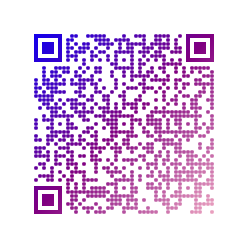 | 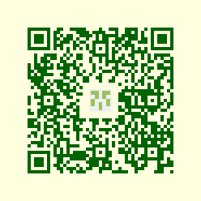 |
| --- | --- | --- |

| 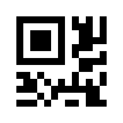 |  |
| --- | --- |

|  |
| --- |

[samples/ConsoleApp](samples/ConsoleApp) has the code for these images.

These [benchmarks](src/FeatherQR.Benchmark) compare FeatherQR with other libraries on .NET 10 with an AMD Ryzen 9 7950X3D CPU. [Benchmarks](#benchmarks) has the results for each symbology and for image output.

| 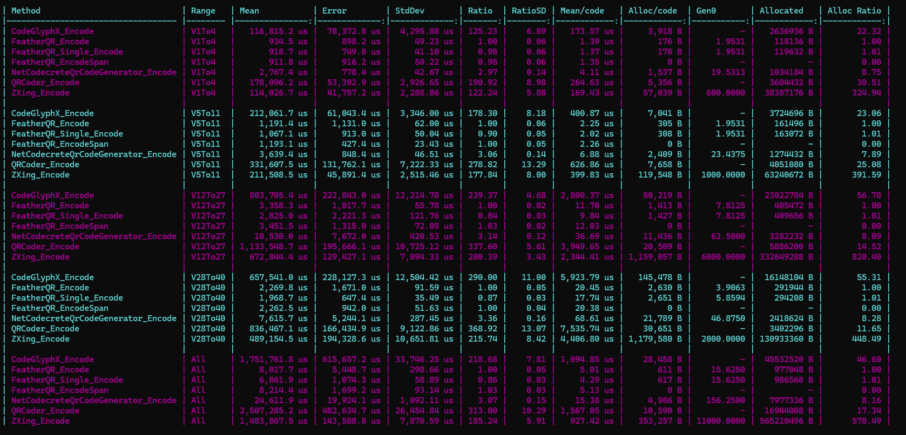 | 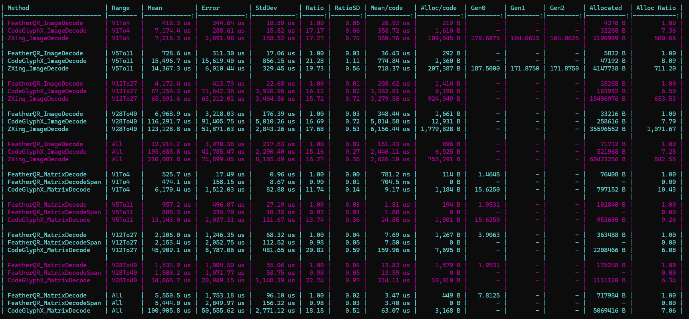 |
| --- | --- |

## Features

| Symbology | Standard | Generate | Decode |
|---|---|---|---|
| Standard QR (versions 1–40) | ISO/IEC 18004 | ✅ | ✅ |
| Micro QR (M1–M4) | ISO/IEC 18004 | ✅ | ✅ |
| rMQR (R7x43–R17x139) | ISO/IEC 23941 | ✅ | ✅ |

- Designed for speed and minimal memory allocation
- Get the dark modules as rectangles for your own renderer, or write SVG, small 1-bit PNG, raw pixels, and terminal text without additional dependencies.
- Render styled PNG, JPEG, WebP, and SVG images with gradients, shapes, and icons through SkiaSharp.
- Decode module matrices, pixels, image files, and streams, including every symbol in one image.
- Encode GS1 QR Codes, GS1 Digital Link URIs, binary data with any ECI, and Japanese text in Kanji mode.
- Run on Windows, Linux, macOS, iOS, Android, and WebAssembly.

## Installation

| Package | What |
|---|---|
| [FeatherQR](https://www.nuget.org/packages/FeatherQR) | Generates and decodes all three symbologies. Writes SVG, PNG, raw pixels, and terminal text. No dependencies. |
| [FeatherQR.SkiaSharp](https://www.nuget.org/packages/FeatherQR.SkiaSharp) | Renders styled images (shapes, gradients, icons, JPEG, WebP) and decodes image files with SkiaSharp. |
| [FeatherQR.Gs1](https://www.nuget.org/packages/FeatherQR.Gs1) | Generates and reads GS1 QR Codes and GS1 Digital Link URIs. |
| [SkiaSharp.QrCode](https://www.nuget.org/packages/SkiaSharp.QrCode) | Empty package that depends on `FeatherQR.SkiaSharp`, for upgrading existing projects. |

```bash
dotnet add package FeatherQR

# Styled images or image file decoding
dotnet add package FeatherQR.SkiaSharp

# GS1 data
dotnet add package FeatherQR.Gs1
```

`FeatherQR.SkiaSharp` needs SkiaSharp native assets on Linux, with NativeAOT, and in WebAssembly. See [SkiaSharp native assets](#skiasharp-native-assets).

> [!IMPORTANT]
> 2.0.0 renames `SkiaSharp.QrCode` to `FeatherQR` and `SkiaSharp.QrCode.Image` to `FeatherQR.SkiaSharp`, with new namespaces. See the [Migration Guide](docs/migration.md).

## Quick Start

The [Playground](https://guitarrapc.github.io/FeatherQR/) runs FeatherQR in your browser as WebAssembly. Style a symbol, download it as PNG or SVG, share the settings as a link, and decode QR codes from an uploaded image.

The examples use .NET 10 and C# 14. They leave out repeated `using` directives and assume inputs such as an image file, a `bitmap`, or an ASP.NET Core `app`.

```csharp
using FeatherQR;

var qr = QRCodeGenerator.Create("https://example.com", QREccLevel.M);
File.WriteAllBytes("qrcode.png", SymbolImageWriter.GetPngBytes(qr));
File.WriteAllText("qrcode.svg", SymbolImageWriter.GetSvgString(qr));

if (QRCodeDecoder.TryDecode(qr, out var text))
    Console.WriteLine(text);
```

With `FeatherQR.SkiaSharp`:

```csharp
using SkiaSharp;
using FeatherQR;
using FeatherQR.SkiaSharp;

File.WriteAllBytes("qrcode.png", QRCodeImageBuilder.GetPngBytes("https://example.com"));

using var bitmap = SKBitmap.Decode("qrcode.png");
if (QRCodeDecoder.TryDecode(bitmap, out var text))
    Console.WriteLine(text);
```

Both packages write an image from the same symbol. With a 512 × 512 size, the builders' default, the two packages give the same PNG pixels.

```csharp
var qr = QRCodeGenerator.Create("https://example.com", QREccLevel.M);
var options = new SymbolImageOptions { Width = 512, Height = 512 };
```

| Output | `FeatherQR` | `FeatherQR.SkiaSharp` |
| --- | --- | --- |
| PNG | `SymbolImageWriter.GetPngBytes(qr, options)` | `QRCodeImageBuilder.GetPngBytes(qr)` |
| SVG | `SymbolImageWriter.GetSvgString(qr, options)` | `QRCodeImageBuilder.GetSvgString(qr)` |
| Stream | `stream.Write(SymbolImageWriter.GetPngBytes(qr, options))` | `QRCodeImageBuilder.SavePng(qr, stream)` |
| Stream, async | `await stream.WriteAsync(SymbolImageWriter.GetPngBytes(qr, options))` | `await QRCodeImageBuilder.SavePngAsync(qr, stream)` |
| Buffer writer | `SymbolImageWriter.WritePng(qr, bufferWriter, options)` | `QRCodeImageBuilder.WritePng(qr, bufferWriter)` |

## API Overview

`FeatherQR` generates and decodes symbols and writes plain images.

| What | Standard QR | Micro QR | rMQR |
| --- | --- | --- | --- |
| Generate a module matrix | `QRCodeGenerator` | `MicroQRCodeGenerator` | `RmQRCodeGenerator` |
| [Get dark modules as rectangles](#module-rectangles-for-your-renderer) for your own renderer | `GetModuleRectangles` | `GetModuleRectangles` | `GetModuleRectangles` |
| Write SVG, PNG, raw pixels, or terminal text | `SymbolImageWriter` | `SymbolImageWriter` | `SymbolImageWriter` |
| Decode a matrix or grayscale pixels | `QRCodeDecoder` | `MicroQRCodeDecoder` | `RmQRCodeDecoder` |
| Decode all symbol types from grayscale pixels | `SymbolDecoder` | `SymbolDecoder` | `SymbolDecoder` |
| Convert pixels to grayscale for decoding | `LuminanceConverter` | `LuminanceConverter` | `LuminanceConverter` |

`FeatherQR.SkiaSharp` adds gradients, custom shapes, icons drawn into raster images, JPEG and WebP output, drawing to an `SKCanvas`, and decoding from `SKBitmap` objects and image files.

| What | Standard QR | Micro QR | rMQR |
| --- | --- | --- | --- |
| Create styled PNG, JPEG, WebP, or SVG | `QRCodeImageBuilder` | `MicroQRCodeImageBuilder` | `RmQRCodeImageBuilder` |
| Render a matrix to `SKCanvas` | `SymbolRenderer` | `SymbolRenderer` | `SymbolRenderer` |
| Decode an `SKBitmap` or an image file | `QRCodeDecoder` | `MicroQRCodeDecoder` | `RmQRCodeDecoder` |
| Decode all symbol types from an `SKBitmap` or an image file | `SymbolDecoder` | `SymbolDecoder` | `SymbolDecoder` |

Both packages use the same image settings. The core takes them in `SymbolImageOptions`, and the builders take them as methods. With default colors and square modules, both give the same pixels for the same size.

| What | `FeatherQR` | `FeatherQR.SkiaSharp` |
| --- | --- | --- |
| Size, equal modules | `Width = 512, Height = 512` | `.WithSize(512, 512)` |
| Size, filled | `Width = 512, Height = 512, FillCanvas = true` | `.WithSize(512, 512).WithFillCanvas()` |
| Modules | `ModuleStyle = ModuleStyle.Circle, ModuleScalePercent = 92` | `.WithModuleStyle(ModuleStyle.Circle, scalePercent: 92)` |
| Finder patterns | `FinderPatternStyle = FinderPatternStyle.Circle` | `.WithFinderPatternStyle(FinderPatternStyle.Circle)` |
| Colors | `DarkColor = new SymbolColor(30, 58, 138), LightColor = new SymbolColor(255, 255, 255, 0)` | `.WithColors(new SKColor(30, 58, 138), SKColors.Transparent)` |
| Icon | `IconSizeModules = 7, IconImage = File.ReadAllBytes("logo.png")` | `.WithIcon(IconData.FromImageByModules(logo, 7))` |
| SVG | `SymbolImageWriter.GetSvgString(qr, options)` | `.ToSvgString()` |
| PNG | `SymbolImageWriter.GetPngBytes(qr, options)` | `.ToByteArray()` |
| Raw pixels | `SymbolImageWriter.TryWritePixels(qr, buffer, PixelLayout.Rgba8888, premultipliedAlpha: false, out var width, out var height, options)` | `.ToBitmap()` |
| Read an image | `QRCodeDecoder.TryDecodeImage(gray, width, height, out string text, out _)` | `QRCodeDecoder.TryDecode(bitmap, out string text)` |

For small PNG files, use the core. It writes a plain symbol as a 1-bit PNG, and `FeatherQR.SkiaSharp` writes 8-bit RGB. For the same 512 × 512 image, the core's file is about a quarter to half the size. A styled symbol needs antialiased edges, so the core writes it as a 4-bit PNG, which is larger than the 1-bit file.

## Generate

### Error Correction

The error correction level sets how much of a damaged or covered symbol a reader can recover.

| Level | Recovers | Use for |
|---|---|---|
| `L` | About 7% | Clean environments, maximum capacity |
| `M` | About 15% | General purpose |
| `Q` | About 25% | Outdoor use, some damage expected |
| `H` | About 30% | Icons, custom module shapes, harsh environments |

Error correction boosting treats the level as a minimum. The generator selects the highest level that fits without a larger symbol.

```csharp
var wifi = QRCodeGenerator.Create("WIFI:T:WPA;S:MyNetwork;P:MyPassword;;", QREccLevel.M);

// M is the minimum. Q or H may fit at the same symbol size.
var robust = QRCodeGenerator.Create("https://example.com", QREccLevel.M, new QRCodeGeneratorOptions { BoostEccLevel = true });

// The builders take the content and the level directly.
var pngBytes = new QRCodeImageBuilder("https://example.com")
    .WithErrorCorrection(QREccLevel.M)
    .WithErrorCorrectionBoost()
    .ToByteArray();
```

Default square modules scan best. Circles, rounded squares, and smaller modules leave gaps that cause more scan errors. Icons cover symbol data. Use `H`, or boosting, with any of them.

### Generator Options

Each generator has an overload that takes options. The options are record structs. `default(QRCodeGeneratorOptions)` is the same as `QRCodeGeneratorOptions.Default`, and the same holds for the other two. `with` makes a changed copy.

```csharp
var options = new QRCodeGeneratorOptions { EciMode = EciMode.Utf8, QuietZoneSize = 0 };
var qr = QRCodeGenerator.Create("content", QREccLevel.M, options);
var pinned = options with { Version = 20 }; // options does not change

var rmqr = RmQRCodeGenerator.Create("content", RmQREccLevel.M, new RmQRCodeGeneratorOptions
{
    Height = RmQRHeight.H9,
    Segmentation = RmQRSegmentation.Single, // Prefer speed over symbol size
});
```

| Option | `QRCodeGeneratorOptions` | `MicroQRCodeGeneratorOptions` | `RmQRCodeGeneratorOptions` |
|---|---|---|---|
| `EciMode` | `Default` (auto-detect) | — | `Default` (auto-detect) |
| `Utf8Bom` | `false` | — | — |
| `Version` | `Any` (1-40) | `Any` (M1-M4) | `null` (fit automatically) |
| `QuietZoneSize` | `4` | `2` | `2` |
| `BoostEccLevel` | `false` | — | — |
| `MaskPattern` | `null` (automatic, 0-7) | `null` (automatic, 0-3) | — |
| `FitStrategy` | — | — | `MinimizeArea` |
| `Height` | — | — | `null` (any height) |
| `Segmentation` | `Optimal` | `Optimal` | `Optimal` |
| `Fnc1` | `None` | — | `None` |
| `AllowKanji` | `false` | `false` | `false` |

> [!TIP]
> The default quiet zones follow the standards: 4 modules for Standard QR and 2 for Micro QR (ISO/IEC 18004), and 2 for rMQR (ISO/IEC 23941). All three accept `0`.

### Version and Mask

Version 1 is 21 × 21 modules. Each version adds 4 modules per side, up to 177 × 177 at version 40. The generator selects the smallest version that fits the content at the requested level. The [Data Capacity Reference](docs/data-capacity.md) lists the capacity of each version.

For Standard QR and Micro QR, set `Version` to one version or a range. If no version in the range fits, `TryGetRequiredBufferSize` returns `false` and `Create` throws.

```csharp
var exact = new QRCodeGeneratorOptions { Version = 15 };                          // exactly version 15
var range = new QRCodeGeneratorOptions { Version = new(10, 20) };                  // 10 to 20, inclusive
var minimum = new QRCodeGeneratorOptions { Version = QRVersionRange.AtLeast(10) }; // 10 or larger
```

rMQR versions have no single size order. R7x43, R9x43, and R7x59 differ in width and height. So rMQR uses `FitStrategy` and `Height` instead. See [rMQR](#rmqr).

The generator scores each mask pattern and applies the best one. Set `MaskPattern` to reproduce a symbol byte for byte, or to test a scanner with each pattern. `QRCodeData` and `MicroQRCodeData` report the final `EccLevel` and `MaskPattern`, including a boost. rMQR has one fixed mask.

```csharp
// Encode again with the level and mask that the decoder read
if (QRCodeDecoder.TryDecode(bitmap, out var text, out var info))
{
    var identical = QRCodeGenerator.Create(text, info.EccLevel, new QRCodeGeneratorOptions { MaskPattern = info.MaskPattern });
}

var png = new QRCodeImageBuilder("content").WithMaskPattern(3).ToByteArray();
```

### Mixed-Mode Segmentation

The default `Optimal` segmentation splits the content into Numeric, Alphanumeric, and Byte segments to use the fewest bits. This often gives a smaller symbol, and can fit content that is too long for one mode. `Single` encodes all content in one mode, as 1.x did. rMQR has the same option as `RmQRSegmentation`.

```csharp
const string content = "https://example.com/item?id=123456789012345678901234567890";

var optimal = QRCodeGenerator.Create(content, QREccLevel.M);
Console.WriteLine(optimal.Version); // 3: Byte + Numeric

var single = QRCodeGenerator.Create(content, QREccLevel.M, new QRCodeGeneratorOptions { Segmentation = QRSegmentation.Single });
Console.WriteLine(single.Version);  // 4: one Byte segment
```

### Encoding Modes

The generator selects the mode of each segment.

| Mode | Characters | Bits per character |
|---|---|---|
| Numeric | 0–9 | About 3.3 |
| Alphanumeric | 0–9, A–Z, space, `$ % * + - . / :` | About 5.5 |
| Byte | ISO-8859-1 or UTF-8 | 8 |
| Kanji | JIS X 0208, with `AllowKanji` | 13 |

The generators write text as ISO-8859-1, UTF-8, or Kanji mode. For another encoding, such as ISO-8859-2 or Shift JIS in Byte segments, encode the text yourself. Then pass the bytes with an `eciAssignment` that names the encoding, such as 4 for ISO-8859-2 or 20 for Shift JIS. See [Binary data](#binary-data). The decoders read Shift JIS with ECI 20, or detect it when there is no ECI header. For other encodings, they return `UnsupportedContent` and report the encoding in `EciAssignment`. Then read the bytes with `TryDecodeBytes`.

### Kanji Mode for Japanese Text

By default, the generators write Japanese text as UTF-8 in Byte mode. With `AllowKanji`, text in JIS X 0208 uses Kanji mode, which holds about 1.85 times as many characters. The decoders read Kanji mode from any encoder.

Kanji mode is off by default because some readers cannot read it. In tests, the QR scanner of an Android 17 phone and Google Lens could not read it. The iPhone camera and the dedicated readers tested could.

```csharp
var kanji = new QRCodeGeneratorOptions { AllowKanji = true };

QRCodeGenerator.Create("日本語のテキスト", QREccLevel.M);        // UTF-8, version 2
QRCodeGenerator.Create("日本語のテキスト", QREccLevel.M, kanji); // Kanji, version 1
QRCodeGenerator.Create("東京タワー333m", QREccLevel.M, kanji);   // Kanji and ASCII segments, version 1
MicroQRCodeGenerator.Create("こんにちは", MicroQREccLevel.L, new MicroQRCodeGeneratorOptions { AllowKanji = true }); // M3, where UTF-8 needs M4
```

Even with `AllowKanji`, the text stays UTF-8 in these cases:

- A character is outside JIS X 0208, such as an emoji, ①, or halfwidth katakana.
- A character is one of the seven that Windows (CP932) reads differently, such as the wave dash 〜.
- You set `EciMode` to a charset, or set `Utf8Bom`.
- `Single` segmentation is set and the text mixes Japanese with ASCII.

### Binary Data

The generators accept raw bytes, and the decoders return bytes without text conversion.

```csharp
byte[] payload = [0x00, 0x01, 0x7F, 0x80, 0xFF];
var qrData = QRCodeGenerator.Create(payload, QREccLevel.M);                        // no ECI header
var declared = QRCodeGenerator.Create(payload, QREccLevel.M, eciAssignment: 899); // declared as binary data

if (QRCodeDecoder.TryDecodeBytes(qrData, out var bytes, out var info))
    Console.WriteLine($"{bytes.Length} bytes, ECI {info.EciAssignment?.ToString() ?? "none"}");
```

- `eciAssignment` writes an ECI header from 0 to 999999. Without it, the symbol has no header, which is usual for binary data.
- `RmQRCodeGenerator` has the same overloads. Micro QR has no ECI, so `MicroQRCodeGenerator` has no `eciAssignment`.
- `TryDecodeBytes` reads a symbol, a matrix, or an `SKBitmap`. `TryDecodeImageBytes` reads luminance data. Both return Byte segments unchanged, digits and letters as ASCII, and Kanji as Shift JIS byte pairs.
- The text-only options `EciMode`, `Utf8Bom`, `AllowKanji`, and `Fnc1` throw with byte input.

> [!NOTE]
> Phone cameras may not show binary data. In tests, an iPhone camera found a binary symbol but showed no content. A QR reader app could not read it. Both happened with and without ECI 899. Use binary data with readers your app controls. For other readers, encode the data as text. Base45 in Alphanumeric mode adds about 3% to the raw bytes, and Base64 in Byte mode adds 33%.

### Structured Append: One Message Across Several Symbols

`CreateStructuredAppend` splits one message across up to 16 Standard QR symbols for a reader to join. It uses the fewest symbols in the version range, all at one version. Text that fits in one symbol gives one symbol.

```csharp
var symbols = QRCodeGenerator.CreateStructuredAppend(longText, QREccLevel.M, new QRCodeGeneratorOptions { Version = QRVersionRange.AtMost(10) });
// symbols.Length is 1 to 16. Render each symbol as usual.
```

Each symbol decodes to one part. `QRCodeDecodeInfo.StructuredAppend` gives its index, count, and parity. `QRStructuredAppend` describes how to join the parts. Bytes split the same way: decode each part as bytes and join them in index order.

### GS1 Data

`FeatherQR.Gs1` adds GS1 methods to the Standard QR and rMQR generators. It validates data against the GS1 General Specifications and converts between `(AI)` text, element strings, and GS1 Digital Link URIs.

| Carrier | Used for | Method |
|---|---|---|
| QR Code with a GS1 Digital Link URI | Retail point of sale | `CreateGs1DigitalLink` |
| GS1 QR Code (FNC1 in first position) | Healthcare, logistics, assets, and other uses away from the point of sale | `CreateGs1` |

```csharp
using FeatherQR.Gs1;

// GS1 QR Code. The generator places the separators and sets FNC1.
var gs1 = QRCodeGenerator.CreateGs1("(01)09520123456788(17)251231(10)ABC123", QREccLevel.M);

// https://id.gs1.org/01/09520123456788/10/ABC123?17=251231
var link = QRCodeGenerator.CreateGs1DigitalLink("(01)09520123456788(17)251231(10)ABC123", QREccLevel.M);

// Your own domain: https://brand.example/01/09520123456788
var branded = QRCodeGenerator.CreateGs1DigitalLink("(01)09520123456788", QREccLevel.M, stem: "https://brand.example");

// (AI) text from a decoded symbol of either carrier
if (QRCodeDecoder.TryDecode(bitmap, out var text, out var info) && Gs1ElementString.TryRead(text, info.Fnc1, out var hri, out _))
    Console.WriteLine(hri); // (01)09520123456788(17)251231(10)ABC123
```

Input that starts with `(` is `(AI)` text. Other input is an element string, with U+001D after each variable-length value. Invalid data throws `Gs1FormatException`, and its `Error` gives the kind of failure and its position. `TryRead` checks only the structure and accepts a wrong check digit.

`Gs1ElementString` also works without a symbol. `TryValidate` checks lengths, characters, check digits, dates, and AI combinations. `TryFromHri`, `TryToHri`, `TryToDigitalLink`, and `TryFromDigitalLink` convert between the forms, and `EnumerateElements` lists the AIs and values. The `Try` methods return a `Gs1Error` instead of throwing, and the conversions have span overloads that do not allocate.

> [!NOTE]
> - Leave `EciMode` at its default. GS1 QR Code does not support ECI.
> - The default Standard QR quiet zone of 4 modules meets the GS1 requirement.
> - GS1 General Specifications Release 26.0 does not list rMQR as a carrier, so a GS1 scanner may not accept it. GS1 excludes Micro QR, which has no FNC1 mode.
> - The AI table comes from the GS1 Barcode Syntax Dictionary release in `Gs1ElementString.DictionaryRelease`. Newer AIs fail with `UnknownAi` until a package update includes them.

### Zero-Allocation APIs

All three generators can write the module matrix to your `Span<byte>`, and all three decoders can write text to your `Span<char>`. Use these overloads to pool or reuse buffers. Get the buffer size from `TryGetRequiredBufferSize`, with the same options you encode with.

```csharp
using System.Buffers;

// false means the content does not fit. Invalid arguments always throw.
if (!QRCodeGenerator.TryGetRequiredBufferSize("content", QREccLevel.M, out var calculated))
    return;

var buffer = ArrayPool<byte>.Shared.Rent(calculated.BufferSize);
try
{
    var written = QRCodeGenerator.Create("content", QREccLevel.M, buffer);
    var matrix = buffer.AsSpan(0, written);
}
finally
{
    ArrayPool<byte>.Shared.Return(buffer);
}
```

For rMQR, pass the resolved `Version` from `TryGetRequiredBufferSize` back to `Create` to skip version selection.

## Draw and Write Images

[samples/ConsoleAppCore](samples/ConsoleAppCore) and [samples/ConsoleApp](samples/ConsoleApp) make the images in this section at 248 × 248.

### Module Rectangles for Your Renderer

`GetModuleRectangles` returns the dark modules as merged rectangles. An app that draws with a GPU or its own graphics API draws them directly, with no image to encode, decode, or upload as a texture. The edges stay sharp at any scale.

The coordinates are in modules, include the quiet zone, and match the `qr[row, col]` indexer. Multiply them by the pixels per module, or scale them in a shader or an SVG `viewBox`. The rectangles cover exactly the dark modules and do not overlap, so a translucent color stays even.

```csharp
using System.Globalization;
using System.Text;
using FeatherQR;

var qr = QRCodeGenerator.Create("https://example.com", QREccLevel.M);

// GPU: one quad per rectangle, in pixels
const float scale = 8; // pixels per module
foreach (var r in qr.GetModuleRectangles())
    batch.AddQuad(r.X * scale, r.Y * scale, r.Width * scale, r.Height * scale); // your sprite batch or vertex buffer

// SVG: one path in module units
var sb = new StringBuilder();
sb.Append($"<svg xmlns=\"http://www.w3.org/2000/svg\" viewBox=\"0 0 {qr.Size} {qr.Size}\" shape-rendering=\"crispEdges\">");
sb.Append("<rect width=\"100%\" height=\"100%\" fill=\"#fff\"/><path fill=\"#000\" d=\"");
foreach (var r in qr.GetModuleRectangles())
    sb.Append(CultureInfo.InvariantCulture, $"M{r.X},{r.Y}h{r.Width}v{r.Height}h{-r.Width}z");
sb.Append("\"/></svg>");
```

If you anti-alias each rectangle separately, a faint seam shows where two rectangles meet inside a pixel. Fill them as one path, or align the edges to whole pixels. See Pattern 30 in [samples/ConsoleApp](samples/ConsoleApp) and `ToDrawingImage` in [samples/Dotfiles/Wpf.cs](samples/Dotfiles/Wpf.cs).

`MicroQRCodeData` and `RmQRCodeData` have the same members. rMQR uses `Width` and `Height` instead of `Size`. To avoid allocation, size a pooled buffer with `GetModuleRectanglesMaxCount()` and call `TryGetModuleRectangles(Span<ModuleRect>, out int)`.

### Plain Images with FeatherQR

`SymbolImageWriter` writes SVG, PNG, raw pixels, and terminal text from any symbol with only the core package. A symbol gives the same bytes on every target framework.

```csharp
File.WriteAllText("qrcode.svg", SymbolImageWriter.GetSvgString(qr));
File.WriteAllBytes("qrcode.png", SymbolImageWriter.GetPngBytes(qr));
```

Each module is a sharp square of `ModulePixelSize` pixels, 8 by default. The image includes the quiet zone. To remove it, copy the symbol with `new QRCodeData(qr.GetRawData(), quietZoneSize: 0)`. PNG output is 1-bit, which keeps the file small, or 4-bit when styled. Black on white is grayscale, and other colors use a palette.

#### Image Size

Set `ModulePixelSize`, or set `Width` and `Height` for a fixed image size. In a fixed size, every module gets the same whole number of pixels, the largest that fits. The writer centers the symbol and fills the rest with the light color. A dimension of `0` follows the symbol's aspect ratio.

`FillCanvas = true` makes the symbol fill the image, at a fractional scale where neighboring modules can differ by one pixel. Use it when the symbol must fill a fixed area while the content length changes. Without it, dense symbols are smaller: in 512 × 512, version 10 fills 89% of each side and version 40 fills 72%.

```csharp
var png10 = SymbolImageWriter.GetPngBytes(qr, new SymbolImageOptions { ModulePixelSize = 10 });
var png512 = SymbolImageWriter.GetPngBytes(qr, new SymbolImageOptions { Width = 512, Height = 512 });
var filled = SymbolImageWriter.GetPngBytes(qr, new SymbolImageOptions { Width = 512, Height = 512, FillCanvas = true });
var svg300 = SymbolImageWriter.GetSvgString(qr, new SymbolImageOptions { Width = 300 }); // height follows the aspect ratio
```

`GetSymbolRectangle` returns the symbol's pixel rectangle without the quiet zone. Use it to draw a frame or to check the module size. The writer rounds the edges to whole pixels, so do not calculate them from the scale.

```csharp
var options = new SymbolImageOptions { Width = 400, Height = 300 };
var (x, y, width, height) = SymbolImageWriter.GetSymbolRectangle(qr, options);
```

#### Colors, Styles, and Icons

Colors support alpha. A fully transparent light color leaves out the background. `ModuleStyle` draws modules as circles or rounded squares, and `ModuleScalePercent` shrinks them in their cells. `FinderPatternStyle` styles the finder patterns separately and keeps them recognizable. `ModuleCornerRadiusPercent` and `FinderPatternCornerRadiusPercent` set the corner radius, 30 percent by default. Styled PNG and raw pixels have antialiased edges with sixteen levels.

`IconSizeModules` keeps a centered square free for an icon on a Standard QR code, and `IconBorderModules` sets its light border. SVG output embeds `IconImage`. PNG and raw pixel output leave the area light, and `GetIconRectangle` returns where to draw the icon. Use `QREccLevel.H`. The writer rejects an icon that reaches a finder pattern. It also rejects an icon whose side, with its border, exceeds `MaxCoreOccupancyPercent` of the symbol's side without the quiet zone.

```csharp
var navyOnClear = new SymbolImageOptions
{
    DarkColor = new SymbolColor(0x1E, 0x3A, 0x8A),
    LightColor = new SymbolColor(0, 0, 0, 0), // transparent background
};

var styled = new SymbolImageOptions
{
    ModuleStyle = ModuleStyle.Circle,
    ModuleScalePercent = 90,
    FinderPatternStyle = FinderPatternStyle.RoundedSquareCircle,
    DarkColor = new SymbolColor(0x1E, 0x3A, 0x8A),
};

// Version 5 fits a 7-module icon and its border under the 30 percent limit
var qrH = QRCodeGenerator.Create("https://github.com/guitarrapc/FeatherQR", QREccLevel.H);
var withIcon = new SymbolImageOptions { IconSizeModules = 7, IconImage = File.ReadAllBytes("logo.png") };
var svgWithLogo = SymbolImageWriter.GetSvgString(qrH, withIcon);                       // the logo embedded
var (x, y, iconWidth, iconHeight) = SymbolImageWriter.GetIconRectangle(qrH, withIcon); // draw the logo here in PNG or pixels
```

| 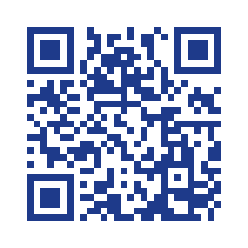 | 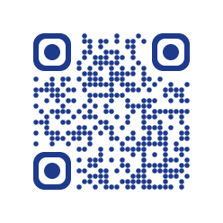 | 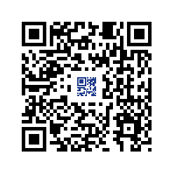 |
| --- | --- | --- |

#### Raw Pixels, Buffer Writers, and Terminal Text

`WriteSvg` and `WritePng` write to an `IBufferWriter<byte>` without allocations after warmup. `TryWritePixels` writes to your buffer in `Gray8`, `Rgba8888`, `Bgra8888`, `Rgb888x`, `Bgr888x`, `Rgb24`, or `Bgr24`. Pass a `Gray8` buffer directly to `TryDecodeImage`. Pass `premultipliedAlpha: true` when the target surface expects premultiplied alpha. It changes only colors with an alpha below 255.

To write into memory that another image type owns, get the size with `GetImageSize` and pass that image's row stride. The bytes between rows stay untouched. To write into a region of a larger image, slice the buffer at the region's first pixel and pass the larger image's stride.

```csharp
var pixels = new byte[SymbolImageWriter.GetPixelBufferSize(qr, PixelLayout.Bgra8888)];
SymbolImageWriter.TryWritePixels(qr, pixels, PixelLayout.Bgra8888, premultipliedAlpha: false, out var width, out var height);

var at = (top * canvasWidth + left) * 4; // a region of a larger RGBA canvas
SymbolImageWriter.TryWritePixels(qr, canvas.AsSpan(at), canvasWidth * 4, PixelLayout.Rgba8888, premultipliedAlpha: false, out _, out _);
```

`GetTerminalText` draws two module rows per line with half-block characters, including the quiet zone.

```csharp
Console.OutputEncoding = System.Text.Encoding.UTF8;                 // a CJK code page prints some half blocks as ?
Console.Write(SymbolImageWriter.GetTerminalText(qr));               // for a light terminal
Console.Write(SymbolImageWriter.GetTerminalText(qr, invert: true)); // for a dark terminal
```

### Styled Images with FeatherQR.SkiaSharp

`QRCodeImageBuilder`, `MicroQRCodeImageBuilder`, and `RmQRCodeImageBuilder` render through SkiaSharp. They have one-call static helpers and a fluent builder for size, colors, gradients, shapes, icons, and format. All three support custom finder patterns. Only Standard QR supports icons.

| Goal | API | Notes |
|---|---|---|
| An exact module size | `WithModulePixelSize(n)` | Output side = `QR matrix size * n`. |
| An exact module size in a fixed UI frame | `WithModulePixelSize(n)` + `WithSize(w, h)` | Canvas must be `>=` content size. Too-small canvas throws. |
| A fixed pixel box | `WithSize(w, h)` | Equal modules, the largest whole number of pixels that fits. The symbol can be smaller than the box. |
| A fixed pixel box the symbol fills | `WithSize(w, h)` + `WithFillCanvas()` | Neighboring modules can differ by one pixel. |

The builder centers the symbol and keeps modules square. Give each module enough pixels. On clean images, FeatherQR's decoder starts to fail below about 1.5 pixels per module, and phone cameras need more. Space outside the symbol uses the background color, or the clear color if you set one.

```csharp
using SkiaSharp;
using FeatherQR.SkiaSharp;

var colors = new QRCodeImageBuilder("https://example.com")
    .WithModulePixelSize(16)
    .WithSize(800, 800) // a larger canvas, so the clear color shows
    .WithColors(codeColor: SKColor.Parse("#000080"), backgroundColor: SKColor.Parse("#FFE4B5"))
    .WithClearColor(SKColors.Transparent)
    .ToByteArray();

var circles = new QRCodeImageBuilder("https://example.com")
    .WithModuleShape(CircleModuleShape.Default, sizePercent: 0.95f)
    .WithCodeColor(SKColors.DarkBlue)
    .ToByteArray();

var roundedFinders = new QRCodeImageBuilder("https://example.com")
    .WithFinderPatternShape(RoundedRectangleFinderPatternShape.Default)
    .ToByteArray();
```

| 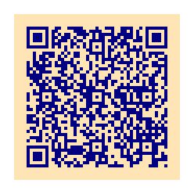 | 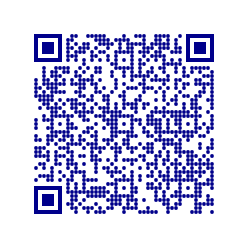 | 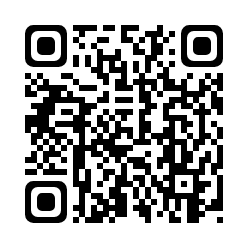 |
| --- | --- | --- |

#### Gradients and Icons

Use `QREccLevel.H` with an icon. Size the icon in modules so that it sits on the grid. This example uses version 5 to fit a 7-module icon with a 2-module border inside the default limit of 30% of the symbol width. For a short payload, `WithVersion` requests a larger version with more room for an icon.

```csharp
var gradient = new QRCodeImageBuilder("https://example.com")
    .WithErrorCorrection(QREccLevel.H)
    .WithGradient(new GradientOptions([SKColors.Blue, SKColors.Purple, SKColors.Pink], GradientDirection.TopLeftToBottomRight, [0f, 0.5f, 1f]))
    .WithModuleShape(RoundedRectangleModuleShape.Default, sizePercent: 0.9f)
    .ToByteArray();

using var logo = SKBitmap.Decode(File.ReadAllBytes("logo.png"));
var withLogo = new QRCodeImageBuilder("https://example.com")
    .WithVersion(5)
    .WithModulePixelSize(12)
    .WithErrorCorrection(QREccLevel.H)
    .WithColors(codeColor: SKColors.DarkGreen, backgroundColor: SKColors.LightYellow)
    .WithIcon(IconData.FromImageByModules(logo, iconSizeModules: 7, iconBorderModules: 2))
    .ToByteArray();

// Size the icon by percent and pixels instead
var byPercent = IconData.FromImage(logo, iconSizePercent: 15, iconBorderWidth: 10);

// Text below the icon
using var font = new SKFont { Size = 18, Typeface = SKTypeface.FromFamilyName("sans-serif", SKFontStyle.Bold) };
var withText = new IconData
{
    Icon = new ImageTextIconShape(logo, "FooBar", SKColors.Black, font, textPadding: 2),
    IconSizePercent = 13,
    IconBorderWidth = 18,
};
```

|  |  |
| --- | --- |

#### Image Formats

PNG is the default. `WithFormat` selects JPEG or WebP with a quality from 0 to 100. SVG output is vector, takes every styling option, and uses the size as its viewport. Square modules give compact SVGs. Custom shapes and gradients make them larger.

```csharp
var jpeg = new QRCodeImageBuilder("https://example.com").WithFormat(SKEncodedImageFormat.Jpeg, quality: 90).ToByteArray();
var webp = QRCodeImageBuilder.GetImageBytes("https://example.com", SKEncodedImageFormat.Webp, QREccLevel.M, size: 512, quality: 80);
var svg = new QRCodeImageBuilder("https://example.com").WithCodeColor(SKColor.Parse("1B9CFC")).ToSvgString();
```

### Drawing into Your Own SKCanvas

`SymbolRenderer` draws `QRCodeData`, `MicroQRCodeData`, or `RmQRCodeData` on an existing `SKCanvas`, so you can place a symbol inside other SkiaSharp graphics. It centers the symbol in `area` with square modules and fills the rest of `area` with the background.

```csharp
var qrData = QRCodeGenerator.Create("content", QREccLevel.M);
using var surface = SKSurface.Create(new SKImageInfo(400, 400));
SymbolRenderer.Render(surface.Canvas, SKRect.Create(50, 50, 300, 300), qrData, SKColors.Black, SKColors.White);
```

Pattern 15 in [samples/ConsoleApp](samples/ConsoleApp) uses it to draw a symbol in a card with text.


### System.Drawing, WPF, and ImageSharp

`SymbolImageWriter.TryWritePixels` writes the pixel layouts these libraries use, and `LuminanceConverter` turns their pixels into luminance for `TryDecodeImage`. Choose the `PixelLayout` by the byte order in memory. A format's name does not always show it.

| Library | Pixel format | `PixelLayout` |
|---|---|---|
| System.Drawing | `Format32bppArgb` | `Bgra8888` |
| System.Drawing | `Format32bppPArgb` | `Bgra8888`, premultiplied |
| System.Drawing | `Format32bppRgb` | `Bgr888x` |
| System.Drawing | `Format24bppRgb` | `Bgr24` |
| WPF | `PixelFormats.Bgra32` | `Bgra8888` |
| WPF | `PixelFormats.Pbgra32` | `Bgra8888`, premultiplied |
| WPF | `PixelFormats.Bgr32` | `Bgr888x` |
| WPF | `PixelFormats.Bgr24`, `PixelFormats.Rgb24` | `Bgr24`, `Rgb24` |
| ImageSharp | `Rgba32`, `Bgra32` | `Rgba8888`, `Bgra8888` |
| ImageSharp | `Rgb24`, `Bgr24` | `Rgb24`, `Bgr24` |

- For a premultiplied format, pass `premultipliedAlpha: true` to both `TryWritePixels` and `LuminanceConverter.Convert`.
- A 24-bit row is often padded to a multiple of four bytes. Pass the row stride that the library reports, not width × 3.
- The fourth byte of `Format32bppRgb` and `Bgr32` is not alpha, and files from other tools may hold 0 there. Read as `Bgra8888`, a 0 is a transparent pixel and the image turns white. Use `Bgr888x`.

Each sample makes a symbol in the library's own image type and decodes it back: [System.Drawing](samples/Dotfiles/SystemDrawing.cs), [WPF](samples/Dotfiles/Wpf.cs) (with a window that reads QR codes from images), and [ImageSharp](samples/Dotfiles/ImageSharp.cs). ImageSharp 3.2.0 and later need a Six Labors license key for Release builds.

## Decoders

The decoders read module matrices, screenshots, generated images, scans, and camera photos. They handle rotated, mirrored, and tilted symbols, gradual shading, and soft-edged shadows. Glare, damage, blur, curved surfaces, steep angles, and strong lens distortion make reads less reliable. Use the decoder for the symbol type you expect, or `SymbolDecoder` for all three.

```csharp
// A generated symbol or a byte-per-module matrix
if (QRCodeDecoder.TryDecode(qrData, out var text))
    Console.WriteLine(text);

// An image file, with FeatherQR.SkiaSharp
using var bitmap = SKBitmap.Decode("qr.png");
if (QRCodeDecoder.TryDecode(bitmap, out text, out var info))
    Console.WriteLine($"{text} (version {info.Version}, ECC {info.EccLevel})");

// Pixels from any other source, here RGBA with rows of rowBytes bytes
var luminance = new byte[width * height];
LuminanceConverter.Convert(rgba, width, height, rowBytes, PixelLayout.Rgba8888, premultipliedAlpha: false, luminance);
if (QRCodeDecoder.TryDecodeImage(luminance, width, height, out text, out info))
    Console.WriteLine(text);
```

The core decodes luminance (grayscale) pixels. `LuminanceConverter` converts the layouts that `TryWritePixels` writes, with any row stride, and composites transparent pixels on white to match the quiet zone. A camera frame in NV12, NV21, or I420 has its luminance in the Y plane. Convert that plane as `Gray8`.

`FeatherQR.SkiaSharp` adds the `SKBitmap` overloads as C# 14 extension members. On C# 13 or earlier, call `QRCodeDecoderExtensions`, `MicroQRCodeDecoderExtensions`, `RmQRCodeDecoderExtensions`, or `SymbolDecoderExtensions` directly.

A failed decode reports a status that names the failed stage. A successful image decode also returns `Corners`: the corners of the module area without the quiet zone, in image pixel coordinates. `TopLeft` is the corner next to the symbol's top-left finder pattern, wherever that is in the image. So the outline follows rotation, mirroring, and perspective. Matrix decodes report `Corners.IsEmpty`. [samples/Dotfiles/DecodeCorners.cs](samples/Dotfiles/DecodeCorners.cs) draws the outlines over sample images.

### Several Symbols in One Image

`DecodeSymbols` reads an `SKBitmap` or a stream with `FeatherQR.SkiaSharp`, and `DecodeImageSymbols` reads luminance data with the core. Each returns every decodable symbol once, with its corners, and skips symbols inside a decoded symbol. The span overload of `DecodeImageSymbols` stops when your buffer is full. `SymbolDecoder` decodes Standard QR first, and then reads the remaining finder patterns as Micro QR and rMQR. Each result has `Symbology`, `Text`, `Corners`, and the detailed result in its `StandardQR`, `MicroQR`, or `RmQR` property.

```csharp
using var sheet = SKBitmap.Decode("sheet.jpg");
foreach (var result in QRCodeDecoder.DecodeSymbols(sheet))
    Console.WriteLine($"{result.Text} at ({result.Info.Corners.TopLeft.X}, {result.Info.Corners.TopLeft.Y})");

foreach (var symbol in SymbolDecoder.DecodeSymbols(sheet))
    Console.WriteLine($"{symbol.Symbology}: {symbol.Text}");
```

A search for every symbol takes longer than a decode of one, even with one symbol in the image. Images with many finder patterns of other codes can take several times longer. `SymbolDecoder` takes longer than one decoder, especially when it finds finder patterns but decodes nothing. Use a single-symbology decoder when you know the type.

## Async and Stream I/O

Each builder method that writes an image to a `Stream` has an async version: `SaveToAsync`, `SaveToSvgAsync`, `SavePngAsync`, and `SaveSvgAsync`. With `FeatherQR.SkiaSharp`, the decoders read an encoded image from a stream with `Decode` or `DecodeAsync` for one symbol, and `DecodeSymbols` or `DecodeSymbolsAsync` for all. The core has no stream overloads, because it reads pixels, not image files. Methods that work in memory, such as `ToByteArray`, `TryDecode(bitmap)`, and every `SymbolImageWriter` method, have no async version because they do no I/O.

- An async write renders the whole image first, so a rendering failure leaves the stream unchanged. It does not flush the stream.
- A stream read starts at the current position, reads to the end, and leaves the stream open. It does not apply EXIF orientation.
- A one-symbol read returns a result even when nothing decodes. Check `Success`, and read `Info.Status` for the reason.
- Cancellation is checked before rendering and while writing, so a canceled write may leave partial output. A read checks it before decoding, during reads, and between symbol attempts.
- Argument errors throw at the call. Other errors come through the task.
- An async call captures its inputs, so you can change the builder or dispose the icon right after the call. Custom shape objects are not copied. Keep them usable until the task completes.

ASP.NET Core disables synchronous I/O on request and response bodies by default. Use the async methods, return the bytes, or write to the response's `PipeWriter`.

```csharp
app.MapGet("/qr.png", async (string text, HttpResponse response, CancellationToken cancellationToken) =>
{
    response.ContentType = "image/png";
    await QRCodeImageBuilder.SavePngAsync(text, response.Body, cancellationToken: cancellationToken);
});

app.MapGet("/qr.svg", (string text) =>
    Results.Text(SymbolImageWriter.GetSvgString(QRCodeGenerator.Create(text, QREccLevel.M)), "image/svg+xml"));

// No copy. Cancellation applies only to the flush.
app.MapGet("/qr-pipe.png", async (string text, HttpResponse response, CancellationToken cancellationToken) =>
{
    response.ContentType = "image/png";
    SymbolImageWriter.WritePng(QRCodeGenerator.Create(text, QREccLevel.M), response.BodyWriter);
    await response.BodyWriter.FlushAsync(cancellationToken);
});

app.MapPost("/scan", async (HttpRequest request, CancellationToken cancellationToken) =>
{
    try
    {
        var result = await QRCodeDecoder.DecodeAsync(request.Body, cancellationToken);
        return result.Success
            ? Results.Text(result.Text)
            : Results.Text(result.Info.Status.ToString(), statusCode: StatusCodes.Status422UnprocessableEntity);
    }
    catch (InvalidDataException)
    {
        return Results.BadRequest(); // not an image, or over a limit
    }
});
```

In UI apps, the async methods render and decode on the thread pool, so the UI thread stays free. Without a synchronization context, as in ASP.NET Core, the work stays on the calling thread. `SymbolImageWriter` renders even a version 40 symbol in well under one frame at 8 pixels per module. A UI app can render on the UI thread and await only the file write.

A stream read rejects input over 64 MiB, or an image over 16,777,216 pixels (4,096 × 4,096), with `InvalidDataException` before it allocates pixels. The message names the limit. The defaults allow a 12-megapixel photo, but not a 24- or 48-megapixel photo from a recent phone. At these limits, an interlaced PNG with 16 bits per channel used 192 MiB to decode. For larger images, pass `ImageStreamReadLimits`.

```csharp
// A 200-megapixel photo. The same kind of PNG used 3,078 MiB at 16,384 × 16,384.
var limits = new ImageStreamReadLimits { MaxPixels = 16_384L * 16_384, MaxBytes = 256 * 1024 * 1024 };
var large = await QRCodeDecoder.DecodeAsync(photo, limits, cancellationToken);
```

## Micro QR and rMQR

Micro QR and rMQR have their own generators, image builders, and decoders, with the same shape as the Standard QR ones. See [Data Capacity](docs/data-capacity.md) for the versions and their limits.

### Micro QR

Micro QR is a smaller square symbol for short data. The generator selects the smallest version from M1 to M4 that fits.

```csharp
var pngBytes = MicroQRCodeImageBuilder.GetPngBytes("01234567", MicroQREccLevel.L, size: 256);

var styled = new MicroQRCodeImageBuilder("SKU-42")
    .WithModulePixelSize(14)
    .WithErrorCorrection(MicroQREccLevel.M)
    .WithColors(codeColor: SKColor.Parse("2D3436"), backgroundColor: SKColors.White)
    .WithModuleShape(RoundedRectangleModuleShape.Default, sizePercent: 0.92f)
    .WithGradient(new GradientOptions([SKColor.Parse("00B894"), SKColor.Parse("0984E3")], GradientDirection.TopLeftToBottomRight))
    .ToByteArray();

var micro = MicroQRCodeGenerator.Create("01234567", MicroQREccLevel.L);
if (MicroQRCodeDecoder.TryDecode(micro, out var text, out var info))
    Console.WriteLine($"{text} ({info.Version}, ECC {info.EccLevel})"); // 01234567 (M2, ECC L)
```

|  |  |
| --- | --- |

[ConsoleApp](samples/ConsoleApp) patterns 24–26 have runnable examples.

### rMQR

rMQR is a rectangular symbol for space where a square does not fit well. By default, the generator selects the version with the smallest area. You can fix the height instead, or prefer the shortest height.

```csharp
// size sets the width. The height follows the symbol's aspect ratio.
var pngBytes = RmQRCodeImageBuilder.GetPngBytes("https://example.com/r/12345", RmQREccLevel.M, size: 512);

// A fixed height. The generator selects the width.
var fixedHeight = new RmQRCodeImageBuilder("https://example.com/r/12345")
    .WithHeight(RmQRHeight.H9)
    .WithErrorCorrection(RmQREccLevel.H)
    .WithModulePixelSize(12)
    .WithColors(codeColor: SKColor.Parse("2D3436"), backgroundColor: SKColors.White)
    .WithModuleShape(RoundedRectangleModuleShape.Default, sizePercent: 0.9f)
    .ToByteArray();

// The shortest height
var flat = RmQRCodeGenerator.Create("012345678901", RmQREccLevel.M, new RmQRCodeGeneratorOptions { FitStrategy = RmQRFitStrategy.MinimizeHeight });
Console.WriteLine(flat.Version); // R7x43

var rmqr = RmQRCodeGenerator.Create("012345678901", RmQREccLevel.M);
if (RmQRCodeDecoder.TryDecode(rmqr, out var text, out var info))
    Console.WriteLine($"{text} ({info.Version}, ECC {info.EccLevel})"); // 012345678901 (R11x27, ECC M)
```


`RmQRFitStrategy` ranks versions by their modules without the quiet zone. With the quiet zone, a version with fewer modules can make a larger image. For example, 24 characters at ECC H go from R15x59 (63 × 19 with the quiet zone) under `Single` to R11x77 (81 × 15) under `Optimal`. Use `Single` if you depend on the exact bit stream or image size of releases before 2.0.0.

[ConsoleApp](samples/ConsoleApp) patterns 27–29 have runnable examples.

#### Fit a Frame with the Largest Modules

To get the largest modules in a frame, find the narrowest version at each of the six heights, and then take the one with the largest modules. At a fixed height, a narrower symbol never has smaller modules, so these six calls find the best of all 32 versions. The version whose aspect ratio is closest to the frame's is often worse. For 9 characters in a 400 × 60 frame, that is R17x139 with 2-pixel modules, and the six calls choose R7x59 with 5-pixel modules.

```csharp
const string text = "HELLO2026";
int frameWidth = 400, frameHeight = 60;
RmQRVersion? best = null;
var bestModule = 0;
foreach (var height in Enum.GetValues<RmQRHeight>())
{
    var fit = new RmQRCodeGeneratorOptions { Height = height, FitStrategy = RmQRFitStrategy.MinimizeWidth };
    if (!RmQRCodeGenerator.TryGetRequiredBufferSize(text, RmQREccLevel.M, out var size, fit))
        continue; // The text does not fit at this height.
    // size.Width and size.Height include the quiet zone, as the image does.
    // Whole pixels per module, as the image is written. With FillCanvas, divide as double.
    var module = Math.Min(frameWidth / size.Width, frameHeight / size.Height);
    if (module > bestModule)
        (best, bestModule) = (size.Version, module);
}
Console.WriteLine(best); // R7x59

var rmqr = RmQRCodeGenerator.Create(text, RmQREccLevel.M, new RmQRCodeGeneratorOptions { Version = best });
var png = SymbolImageWriter.GetPngBytes(rmqr, new SymbolImageOptions { Width = frameWidth, Height = frameHeight });
```

## Platforms

### SkiaSharp Native Assets

SkiaSharp brings its native assets for Windows, macOS, iOS, and Android by itself. Add a native asset package in these cases:

- Linux: add one of the two Linux packages below.
- NativeAOT: add the package for each runtime you publish, as [tests/FeatherQR.AotAnalysis](tests/FeatherQR.AotAnalysis) does.
- WebAssembly: add `SkiaSharp.NativeAssets.WebAssembly`, as the [Playground](src/FeatherQR.Playground) does.

```xml
<PackageReference Include="FeatherQR.SkiaSharp" Version="2.0.0-preview.9" />

<!-- Linux with font support. Needs libfontconfig1. -->
<PackageReference Include="SkiaSharp.NativeAssets.Linux" Version="4.148.0" />
<!-- Linux without font dependencies -->
<PackageReference Include="SkiaSharp.NativeAssets.Linux.NoDependencies" Version="4.148.0" />
<!-- NativeAOT on Windows or macOS -->
<PackageReference Include="SkiaSharp.NativeAssets.Win32" Version="4.148.0" />
<PackageReference Include="SkiaSharp.NativeAssets.macOS" Version="4.148.0" />
```

```bash
sudo apt update && sudo apt install -y libfontconfig1
```

`NoDependencies` can still draw text, but it cannot use system fonts or find fonts by character. See [SkiaSharp issue #964](https://github.com/mono/SkiaSharp/issues/964#issuecomment-549385484).

### NativeAOT and Trimming

The library sets `IsAotCompatible`. CI publishes [tests/FeatherQR.AotAnalysis](tests/FeatherQR.AotAnalysis), which includes the whole library, and treats trimming and AOT warnings as errors. With `PublishTrimmed`, check that your own content and rendering code does not depend on reflection or dynamic code.

```xml
<PropertyGroup>
  <PublishAot>true</PublishAot>
  <PublishTrimmed>true</PublishTrimmed>
  <InvariantGlobalization>true</InvariantGlobalization>
</PropertyGroup>
```

On x64, a default NativeAOT build targets the minimum instruction set of the OS, without AVX. .NET then reports AVX2, BMI2, and 256-bit vectors as unavailable on any CPU, so FeatherQR uses its 128-bit SIMD paths. It takes 1.0–2.0 times as long as with the JIT: about 2 times for Standard QR encoding and 1.3–1.5 times for image decoding.

If every target machine supports `x86-64-v3` (Intel Core since Haswell, AMD since Excavator), enable it. FeatherQR then runs 10% slower than with the JIT at the median. On a CPU without AVX2, such as some Pentium, Celeron, and Atom models, the app exits at startup. It reports "The required instruction sets are not supported by the current CPU." ARM64 needs no setting.

```xml
<PropertyGroup>
  <IlcInstructionSet>x86-64-v3</IlcInstructionSet>
</PropertyGroup>
```

### WebAssembly

FeatherQR runs in Blazor WebAssembly and standalone WebAssembly. See [samples/BlazorWasm](samples/BlazorWasm) for Blazor, and the [Playground source](src/FeatherQR.Playground) for standalone WebAssembly.

### LINQPad

Call `Dump()` to show a QR code in the Results pane. This example uses System.Drawing on Windows only to display the image. FeatherQR does not use it.

```csharp
Bitmap.FromStream(new MemoryStream(QRCodeImageBuilder.GetPngBytes("WIFI:T:WPA;S:mynetwork;P:mypass;;"))).Dump();
```

## Benchmarks

The [benchmarks](src/FeatherQR.Benchmark) run on .NET 10 with an AMD Ryzen 9 7950X3D CPU.

Each payload of the corpus:

| 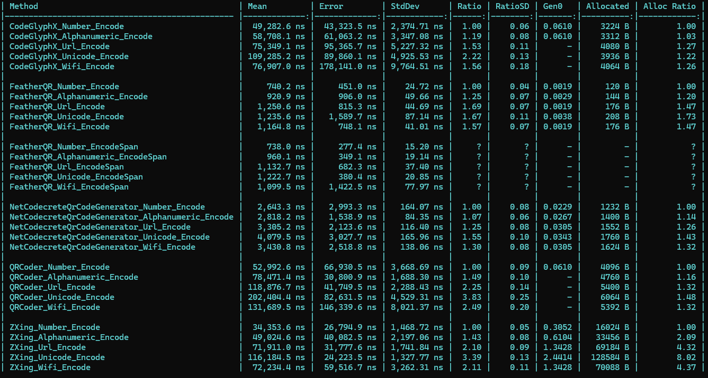 | 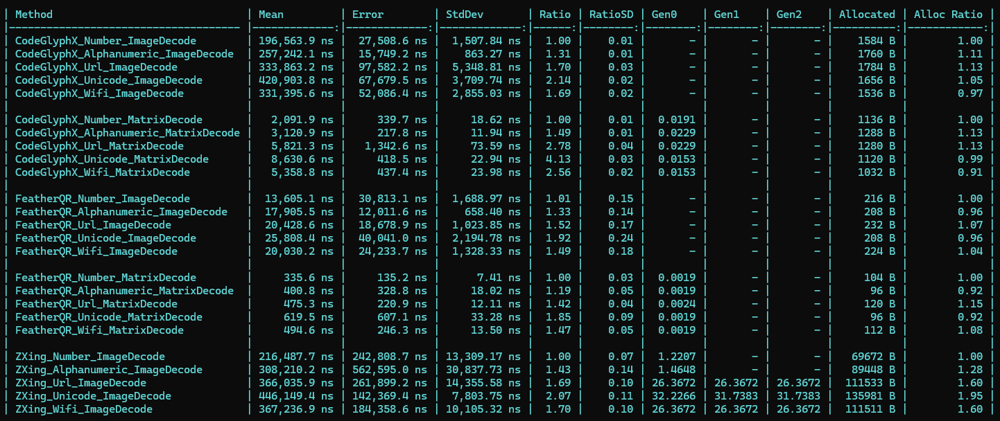 |
| --- | --- |

Each symbology:

| 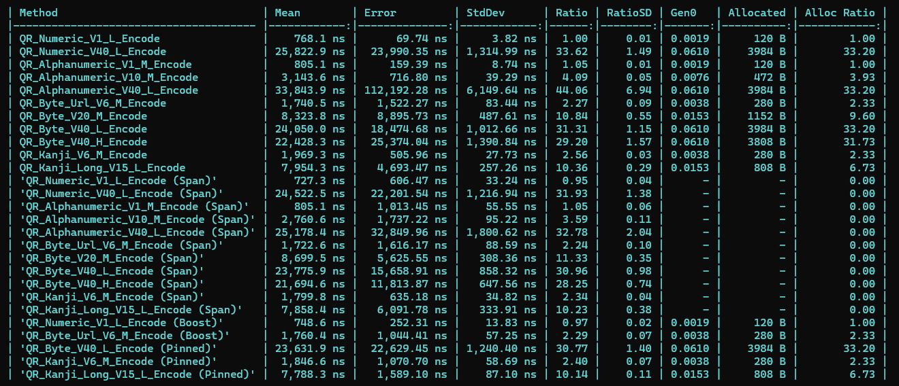 | 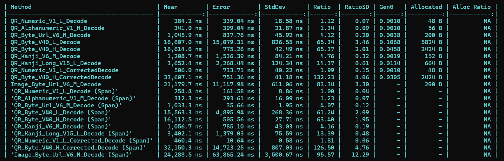 |
| --- | --- |

| 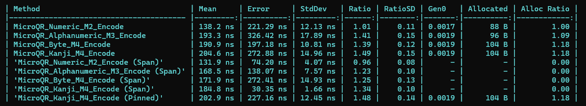 | 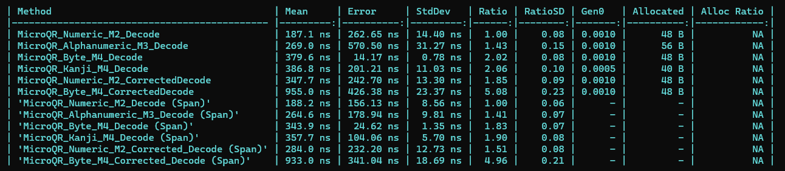 |
| --- | --- |

| 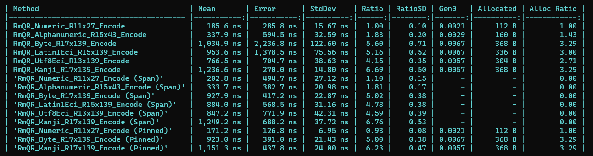 | 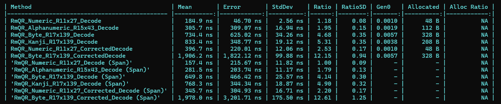 |
| --- | --- |

The same image from each package. The core `SymbolImageWriter` is faster and allocates less than `FeatherQR.SkiaSharp`.

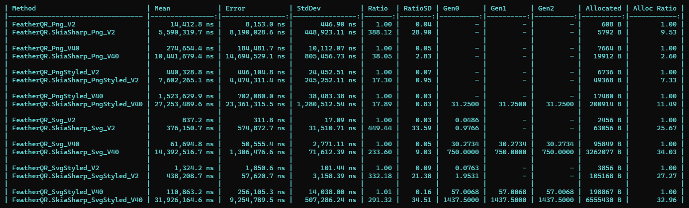

## License

MIT

`FeatherQR.Gs1` includes [THIRD-PARTY-NOTICES.md](THIRD-PARTY-NOTICES.md). Its AI table is generated from the Apache-2.0-licensed GS1 Barcode Syntax Dictionary.

## For maintainers

To release a version:

From the repository root, update the versions in `.props` and `.md` files. The four packages (`FeatherQR`, `FeatherQR.SkiaSharp`, `FeatherQR.Gs1`, `SkiaSharp.QrCode`) share a version. The release workflow packs and publishes them together.

```sh
dotnet ./tools/bump_version.cs patch   # e.g. 0.1.0 → 0.1.1
dotnet ./tools/bump_version.cs minor   # e.g. 0.1.0 → 0.2.0
dotnet ./tools/bump_version.cs major   # e.g. 0.1.0 → 1.0.0
```
