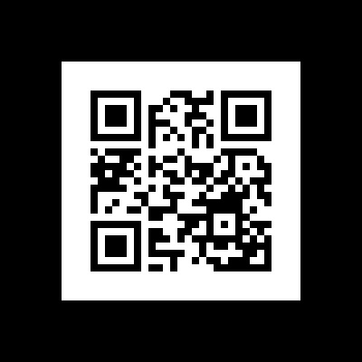
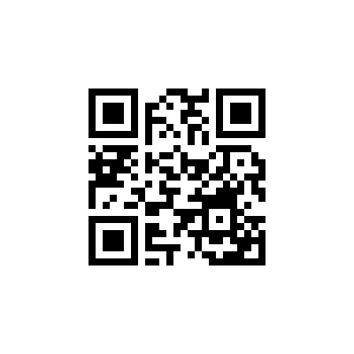
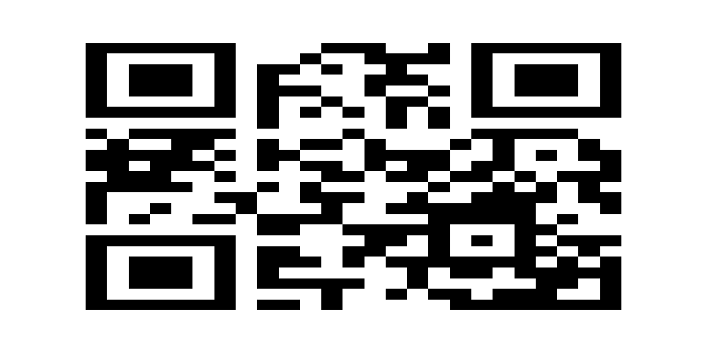
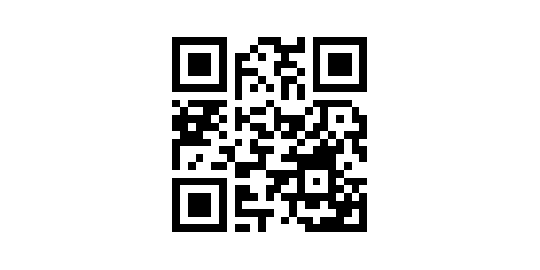

# Migration

Each section covers one release, newest first. Read every section between your current version and the version you upgrade to.

| Upgrading to | Impact |
|---|---|
| [2.0.0](#200) | Breaking. New package and namespace names, renamed types and members, removed overloads, and new default output for encoding and rendering |
| [1.2.0](#120) | Additive. Kanji segments now decode. Two `[Obsolete]` warnings |
| [1.1.0](#110) | Binary breaking. Recompile |
| [1.0.0](#100) | Breaking. The `QrCode` class is removed |
| [0.11.0](#0110) | `IconData.Icon` takes an `IconShape` |
| [0.9.0](#090) | Breaking. `QrCode` becomes `QRCodeImageBuilder` |

## 2.0.0

The single `SkiaSharp.QrCode` package is now a core package with no dependencies and a SkiaSharp rendering package. Most of the upgrade is mechanical. Some changes alter your output without a compiler error, so check the behavior changes too.

1. Update the package to 2.0.0. You can also switch it to `FeatherQR.SkiaSharp` ([Packages](#packages)).
2. Replace the namespaces ([Namespaces](#namespaces)).
3. Run the rename script ([Renames](#renames)).
4. Build, and fix each error ([Compile errors](#compile-errors)). On C# 13 or earlier, also read [Older C# versions](#older-c-versions).
5. Check the output that matters to you ([Behavior changes](#behavior-changes)).

This guide compares 2.0.0 with 1.2.0. If you used a 2.0.0 preview, also read [Upgrading from a 2.0.0 preview](#upgrading-from-a-200-preview).

### Packages

| Package | Contents | Depends on |
|---|---|---|
| `FeatherQR` | Generators, decoders, data types, options, `GetModuleRectangles`, `SymbolImageWriter` (SVG, PNG, raw pixels, terminal text) | Nothing on .NET 10. `System.Memory` and `System.Runtime.CompilerServices.Unsafe` on .NET Standard |
| `FeatherQR.SkiaSharp` | Image builders, `SymbolRenderer`, `SKCanvas` extensions, `IconData` and shapes, `SKBitmap` decoding | `FeatherQR`, `SkiaSharp` |
| `SkiaSharp.QrCode` | Nothing. A compatibility package | `FeatherQR.SkiaSharp` |
| `FeatherQR.Gs1` | New and optional. GS1 element strings and GS1 Digital Link URIs | `FeatherQR` |

`<PackageReference Include="SkiaSharp.QrCode" />` continues to work. It brings in `FeatherQR.SkiaSharp` and `FeatherQR`. Change the reference to `FeatherQR.SkiaSharp` when convenient. If you only write plain PNG or SVG, reference `FeatherQR` alone and drop the SkiaSharp native library ([Plain Images with FeatherQR](../README.md#plain-images-with-featherqr)). All packages ship with the same version.

### Target frameworks

The packages target net10.0, netstandard2.1 and netstandard2.0. The net8.0 target is removed. Apps on .NET 8 and .NET 9 now use the netstandard2.1 build, which encodes and decodes 1.5 to 7 times slower than the net8.0 build did. Move to .NET 10 for full speed.

### Namespaces

| 1.x | 2.0.0 |
|---|---|
| `using SkiaSharp.QrCode;` | `using FeatherQR;` |
| `using SkiaSharp.QrCode.Image;` | `using FeatherQR.SkiaSharp;` |

If your own code is in a `namespace FeatherQR.Something`, a bare `SkiaSharp` resolves to `FeatherQR.SkiaSharp`. Put `using SkiaSharp;` above the namespace declaration.

### Renames

A prefix names one symbology (`QR`, `MicroQR`, `RmQR`). No prefix means all three. Type names that contain `Code` do not change: `QRCodeData`, `QRCodeGenerator`, `QRCodeDecoder`, `QRCodeImageBuilder` and their Micro QR and rMQR versions keep their names.

| 1.x | 2.0.0 |
|---|---|
| `ECCLevel` | `QREccLevel` |
| `QRCodeSegmentation` | `QRSegmentation` |
| `QRCodeVersionRange` | `QRVersionRange` |
| `QRCodeDecodeStatus` | `DecodeStatus` |
| `QRCodeGenerator.CreateQrCode` | `QRCodeGenerator.Create` |
| `MicroQRCodeGenerator.CreateMicroQRCode` | `MicroQRCodeGenerator.Create` |
| `RmQRCodeGenerator.CreateRmQRCode` | `RmQRCodeGenerator.Create` |
| `QRCodeCalculatedSize.QrSize`, `MicroQRCodeCalculatedSize.QrSize` | `.Size` |
| `QRCodeGeneratorOptions.Utf8BOM` | `.Utf8Bom` |
| `QRCodeRenderer` | `SymbolRenderer` |
| `QRCodeImageBuilderBase<TSelf>` | `SymbolImageBuilderBase<TSelf>` |
| `QRCodeExtensions` | `SKCanvasExtensions` |

This script makes every rename as a whole-word replacement:

```shell
# bash, from your repository root
grep -rlZ --include='*.cs' -e ECCLevel -e QRCode -e CreateQrCode -e CreateMicroQRCode -e CreateRmQRCode -e QrSize -e Utf8BOM . \
  | xargs -0 sed -i \
    -e 's/\bCreateQrCode\b/Create/g' \
    -e 's/\bCreateMicroQRCode\b/Create/g' \
    -e 's/\bCreateRmQRCode\b/Create/g' \
    -e 's/\bQRCodeSegmentation\b/QRSegmentation/g' \
    -e 's/\bQRCodeVersionRange\b/QRVersionRange/g' \
    -e 's/\bQRCodeDecodeStatus\b/DecodeStatus/g' \
    -e 's/\bECCLevel\b/QREccLevel/g' \
    -e 's/\bQrSize\b/Size/g' \
    -e 's/\bUtf8BOM\b/Utf8Bom/g' \
    -e 's/\bQRCodeRenderer\b/SymbolRenderer/g' \
    -e 's/\bQRCodeImageBuilderBase\b/SymbolImageBuilderBase/g' \
    -e 's/\bQRCodeExtensions\b/SKCanvasExtensions/g'
```

- Review the diff before you commit. Other QR libraries also use `ECCLevel` and `CreateQrCode`, and `QrSize` and `Utf8BOM` can match your own code.
- On Windows, run it in Git Bash or WSL.
- On macOS and BSD, write `sed -i ''` or use `gsed`.
- The script does not change the namespaces or the removed overloads.

### Compile errors

| 1.x code | 2.0.0 code |
|---|---|
| `CreateQrCode(text, ecc, utf8BOM, eciMode, requestedVersion, quietZoneSize)` | `Create(text, ecc, new QRCodeGeneratorOptions { ... })` ([Generator options](#generator-options)) |
| `CreateMicroQRCode(text, ecc, requestedVersion, quietZoneSize)` | `Create(text, ecc, new MicroQRCodeGeneratorOptions { ... })` |
| `GetRequiredBufferSize(...)` | `TryGetRequiredBufferSize(..., out var size)` ([Buffer sizing](#buffer-sizing)) |
| `CreateQrCode("text", ...)` on .NET Framework or netstandard2.0 | The `string` overloads are removed. On C# 13 or earlier, write `Create("text".AsSpan(), ...)` with `using System;` ([Older C# versions](#older-c-versions)) |
| `Create(plainText: ...)` | `Create(textSpan: ...)` |
| `Compression` | Removed. Compress the bytes from `GetRawData()` yourself |
| `QRCodeDecoder.TryDecode(bitmap, ...)` on C# 13 or earlier (the net8.0 and net9.0 default) | `QRCodeDecoderExtensions.TryDecode(bitmap, ...)` ([Decoding an SKBitmap](#decoding-an-skbitmap)) |
| `icon.IconSizePercent = 20;` | `icon = icon with { IconSizePercent = 20 };`. Below C# 9, create a new `IconData` with the constructor and pass every setting again |
| `gradient.Colors` as an `SKColor[]` | `gradient.Colors.ToArray()` ([GradientOptions](#gradientoptions)) |
| `WithColors(...)` with one or three colors, or with only some named | `WithCodeColor(c)`, `WithBackgroundColor(b)`, `WithClearColor(x)`. `WithColors(c, b)` still sets both |
| `QRCodeRenderer.Render(canvas, area, data, null, null)` | `SymbolRenderer.Render(canvas, area, data, SKColors.Black, SKColors.White)` |
| A finder shape that overrides `Draw(..., backgroundPaint)` | Override `Draw(canvas, rect, paint)` and `RequiresAntialiasing` ([Custom finder shapes](#custom-finder-shapes)) |
| `new QRCodeData(version, quietZoneSize)`, and the same for Micro QR and rMQR | Removed. Create the data with a generator. For the side length of a Standard QR symbol, use `17 + 4 × version + 2 × quietZoneSize` |
| A class that derives from `QRCodeData`, `MicroQRCodeData`, `RmQRCodeData`, an image builder, `IconData` or `GradientOptions` | These types are sealed. `ModuleShape`, `FinderPatternShape` and `IconShape` stay open for custom drawing |
| `Vector2Slim` | Removed |

#### Older C# versions

`Create` and `TryGetRequiredBufferSize` take `ReadOnlySpan<char>` instead of `string`. `IconData` properties are `init`. Older compilers report these errors:

| Error | When | Fix |
|---|---|---|
| CS1503 on `Create("text", ...)` | .NET Framework or netstandard2.0, on C# 13 or earlier | `"text".AsSpan()` (with `using System;`) |
| CS0121 on `Create(default, ...)` or `Create(null, ...)` | On C# 12 or earlier, without options (Micro QR: with options too) | `""` for empty text, `ReadOnlySpan<byte>.Empty` for empty bytes |
| CS8370 or CS8400 on `new IconData { ... }` or `icon with { ... }` | Below C# 9 | `new IconData(shape, iconSizePercent: 15)` |
| CS0619 on `new IconData { ... }` | A compiler older than Roslyn 4.3 (.NET SDK 6.0.4xx, Visual Studio 2022 17.3) | Update the SDK, or use the constructor |
| An error on `options with { ... }` | Below C# 10 | Copy and assign: `var o = options; o.QuietZoneSize = 0;` |

You can also raise the language version. C# 14 needs the .NET 10 SDK.

```xml
<LangVersion>14</LangVersion>
```

The generator options use `set` accessors, so `new QRCodeGeneratorOptions { QuietZoneSize = 0 }` compiles on every version.

#### Generator options

The parameter list overloads are removed. Each argument is now a property of the options struct: `utf8BOM` is `Utf8Bom`, `eciMode` is `EciMode`, `requestedVersion` is `Version`, and `quietZoneSize` is `QuietZoneSize`.

```csharp
// 1.x
var data = QRCodeGenerator.CreateQrCode(text, ECCLevel.M, utf8BOM: true, eciMode: EciMode.Utf8, requestedVersion: 5, quietZoneSize: 0);

// 2.0.0
var data = QRCodeGenerator.Create(text, QREccLevel.M, new QRCodeGeneratorOptions
{
    Utf8Bom = true,
    EciMode = EciMode.Utf8,
    Version = 5,
    QuietZoneSize = 0,
});
```

- `requestedVersion: -1` meant automatic. `Version = -1` throws. Leave `Version` unset, or write `version == -1 ? QRVersionRange.Any : QRVersionRange.Exactly(version)`. For Micro QR, `null` still means automatic.
- A pinned version that is too small for the content throws `ArgumentException` naming the version. It used to fail inside the encoder with `ArgumentOutOfRangeException`.

#### Buffer sizing

`GetRequiredBufferSize` is removed. `QRCodeCalculatedSize` has no public constructor, no `IsValid` and no deconstruction:

```csharp
// 1.x
var (bufferSize, qrSize, version) = QRCodeGenerator.GetRequiredBufferSize(text, ECCLevel.M);

// 2.0.0
if (!QRCodeGenerator.TryGetRequiredBufferSize(text, QREccLevel.M, out var size))
    return; // the content does not fit
var buffer = new byte[size.BufferSize];
var written = QRCodeGenerator.Create(text, QREccLevel.M, buffer);
```

`bufferSize`, `qrSize` and `version` are now `size.BufferSize`, `size.Size` and `size.Version`. Pass the same options to `TryGetRequiredBufferSize` and `Create`.

#### Decoding an SKBitmap

`QRCodeDecoder`, `MicroQRCodeDecoder` and `RmQRCodeDecoder` are in the core package, which does not reference SkiaSharp. Their `SKBitmap` overloads are now C# 14 extension members in `FeatherQR.SkiaSharp`:

```csharp
using FeatherQR;
using FeatherQR.SkiaSharp;

// C# 14 (the net10.0 default): the 1.x code compiles.
QRCodeDecoder.TryDecode(bitmap, out var text, out var info);

// Any C# version: call the extension class.
QRCodeDecoderExtensions.TryDecode(bitmap, out text, out info);
```

The classes are `QRCodeDecoderExtensions`, `MicroQRCodeDecoderExtensions` and `RmQRCodeDecoderExtensions`. The luminance overloads, `TryDecodeImage(luminance, width, height, ...)`, stay on the decoders.

#### GradientOptions

`GradientOptions` is immutable. The constructor copies the colors, `Colors` and `ColorPositions` are `ReadOnlySpan<T>`, and equal colors compare equal.

```csharp
// 1.x
var colors = gradient.Colors;
var evenly = gradient.ColorPositions is null;
var recolored = gradient with { Colors = [SKColors.Red, SKColors.Blue] };

// 2.0.0
SKColor[] colors = gradient.Colors.ToArray();
var evenly = gradient.ColorPositions.IsEmpty;
var recolored = new GradientOptions([SKColors.Red, SKColors.Blue], gradient.Direction);
```

`with { Direction = ... }` still works. `ColorPositions` is never `null`. Test `IsEmpty` instead. To distribute colors evenly, omit `colorPositions`.

#### Custom finder shapes

`FinderPatternShape.Draw(canvas, rect, paint)` draws the dark modules only. The overloads that took a background color or paint are removed, and `RequiresAntialiasing` is abstract.

```csharp
public override bool RequiresAntialiasing => false;

public override void Draw(SKCanvas canvas, SKRect rect, SKPaint paint)
{
    var w = rect.Width / 7f;
    var h = rect.Height / 7f;
    using var builder = new SKPathBuilder { FillType = SKPathFillType.EvenOdd };
    builder.AddRect(rect);
    builder.AddRect(SKRect.Create(rect.Left + w, rect.Top + h, w * 5, h * 5));
    builder.AddRect(SKRect.Create(rect.Left + w * 2, rect.Top + h * 2, w * 3, h * 3));
    using var path = builder.Detach();
    canvas.DrawPath(path, paint);
}
```

- Leave the light ring undrawn. A solid 7 × 7 square makes a symbol that no reader can find, and nothing throws.
- You can change `paint`, but restore each property before you return. Do not dispose it.

### Behavior changes

The code in this section compiles without change, but the output is different or the call throws. The first three groups affect most users. [Less common changes](#less-common-changes) lists the rest.

#### Images

- Every builder image changes. Each module is now the same whole number of pixels, and the symbol is centered with padding around it. The image keeps its size.
  - This applies to `WithSize`, rMQR's `WithWidth`, the `size` of the static helpers, and the default 512.
  - At 512 pixels, a Standard QR symbol keeps 68 to 100 % of the side. At 256 pixels, versions 26 to 40 keep only 50 to 72 %.
  - `WithFillCanvas()` restores the 1.x fill.
  - Without `WithFillCanvas()`, a canvas too small for one pixel per module throws `InvalidOperationException`.
  - When rMQR's height follows from a width, it rounds up, so some rMQR images are one pixel taller.
- The padding around the symbol is the background color. It used to be transparent, which showed as black in JPEG. For transparent padding, call `.WithClearColor(SKColors.Transparent)`. The clear color is also painted under the symbol, so it shows through a translucent background.

  | 1.x | 2.0.0 |
  |---|---|
  |  |  |

- `WithModuleShape` styles the data modules only. The finder patterns stay solid. In 1.x a shrunk or round module also redrew the finder patterns, and no reader could find those symbols. To style the finders, call `WithFinderPatternShape`, now on all three builders.
- A non-square canvas fits the symbol instead of stretching it. Stretched symbols often fail to scan from about 1.25:1.

  | 1.x | 2.0.0 |
  |---|---|
  |  |  |
  | `WithSize(900, 450)`: stretched | 429 × 429, centered |

- `SymbolRenderer.Render` and the `SKCanvas.Render` extensions also fit the symbol into the area, centered, and paint the whole area with the background color. They do not round modules to whole pixels. `GetFinderPatternRect` and `GetIconRects` fit the same way. To stretch on purpose, scale the canvas: `canvas.Scale(2f, 1f)`, then render into a square.

#### Encoding

- `Optimal` segmentation is the default for all three generators. Mixed content, such as a URL with a long number, is split into Numeric, Alphanumeric and Byte runs.
  - The symbol can be smaller, and the bit stream can differ from 1.x. The symbol is never larger.
  - Content that overflowed in one mode can now fit.
  - An rMQR symbol can get a different shape.
  - To keep the 1.x output, set `Segmentation = QRSegmentation.Single` (or the Micro QR or rMQR equivalent), or call `.WithSegmentation(QRSegmentation.Single)` on a builder.
- `EciMode.Iso8859_1` with a character above U+00FF throws `ArgumentException`. Standard QR used to write a look-alike character, `?` or the low byte. Use `EciMode.Utf8` or `EciMode.Default`.
- Standard QR content that does not fit version 40 throws `ArgumentException`, as Micro QR and rMQR already did. It used to throw `InvalidOperationException`. Catch `ArgumentException`, or call `TryGetRequiredBufferSize` first, which returns `false` for such content.

#### Decoding

- Structured Append symbols, FNC1 symbols and Shift_JIS Byte segments under ECI 20 now decode. They used to fail with `UnsupportedContent` (FNC1 on rMQR with `InvalidBitstream`). If your code sends those statuses to another reader, these symbols no longer reach it. `QRCodeDecodeInfo.StructuredAppend` and `Fnc1` describe them.
- A Byte segment with no ECI header can now decode as Japanese. 1.x read such bytes as ISO-8859-1.
  - This happens when the bytes are not valid UTF-8, are well-formed Shift_JIS, and hold three half-width katakana in a row or a byte from 0x80 to 0x9F.
  - Three characters from U+00A1 to U+00DF in a row (`ÄÖÜ`) read as half-width katakana.
  - Windows-1252 text with a typographic apostrophe before a letter (`l’option`) can read as Japanese or fail with `UnmappedCharacter`.

#### Less common changes

Encoding:

- The segmentation enums changed values: `Optimal` is 0 and `Single` is 1. A stored integer from 1.x now reads as the other value.
- Standard QR checks its arguments first. An undefined `QREccLevel`, an `EciMode` other than `Default`, `Iso8859_1` and `Utf8`, or a quiet zone above 10,000 modules throws `ArgumentOutOfRangeException`.
- Micro QR writes some ISO-8859-1 text as UTF-8. This happens when the ISO-8859-1 bytes of the text would decode as UTF-8 or Shift_JIS. For example, 1.x wrote `é` as bytes that decode as `é`. Such text needs more bytes and can stop fitting M4.
- Under `Optimal`, content with a U+FEFF after the first character can get a smaller symbol. 1.2.0 fell back to one mode for it, or reported that it did not fit.
- Content that does not fit the versions you allowed reports `ParamName` `options` in all three generators: a version, a version range or an rMQR height. Micro QR and rMQR used to report `requestedVersion` for a single version and nothing for a range. Content too long for every version reports no `ParamName`. An undefined `RmQRVersion` reports `version`, as an undefined height reports `height`, where it reported `requestedVersion`.

Decoding:

- The matrix span overloads of `TryDecode` set `charsWritten` to 0 when they return `false`. They used to report the characters read before the failure. To decode a symbol that is too long for your buffer, resize the buffer and decode again:

  ```csharp
  if (!QRCodeDecoder.TryDecode(modules, size, buffer, out var written, out var info)
      && info.Status == DecodeStatus.DestinationTooSmall)
  {
      buffer = new char[QRCodeDecoder.GetMaxDecodedLength(info.Version)];
      QRCodeDecoder.TryDecode(modules, size, buffer, out written, out info);
  }
  ```

- `TryDecodeImage` with a width or height below one throws `ArgumentOutOfRangeException` naming `width` or `height`. It used to name `luminance`.
- The matrix overloads of `TryDecode` and `TryDecodeBytes` do the same for a size below one, naming `size`, or `width` or `height` for rMQR. They used to report a buffer too small. The exception derives from `ArgumentException`, so an existing `catch` still takes it.

Rendering:

- `SymbolRenderer.Render(canvas, area, data, default, default)` draws nothing visible. `default` was a `null` `SKColor?`, which meant black on white. It is now a transparent `SKColor`. Search for `default` in the color arguments and write the colors.
- `WithModuleShape(null)` and `WithFinderPatternShape(null)` throw `ArgumentNullException`. The compiler reports at most a nullable warning. To keep the default shape, do not call the setter.
- Finder shapes now leave the light ring transparent. A styled SVG on a transparent or translucent background used to lose its finder patterns, and it now scans. Styled raster images differ by about 1 % of pixels on the finder edges.
- `QRCodeImageBuilder` created from a `QRCodeData` throws `InvalidOperationException` on `WithErrorCorrection` and `WithEciMode`. 1.x ignored them. `QRCodeData.EccLevel` tells you the level of the data.
- The renderer and the shapes reject arguments that used to draw something wrong:

  | Argument | Exception |
  |---|---|
  | An inverted area, a negative width or height | `ArgumentException`, `ArgumentOutOfRangeException` |
  | `moduleSizePercent` of `NaN` | `ArgumentOutOfRangeException` |
  | A `GradientDirection` outside the enum | `ArgumentOutOfRangeException` |
  | A `null` canvas | `ArgumentNullException` |
  | A rounded shape with a `NaN` corner radius | `ArgumentOutOfRangeException` |

  An inverted area used to draw a mirrored symbol. To mirror on purpose, flip the canvas: `canvas.Translate(area.Left + area.Right, 0); canvas.Scale(-1f, 1f);`.

Data types:

- The `QRCodeData`, `MicroQRCodeData` and `RmQRCodeData` restore constructors throw `InvalidDataException` when the format information is not what a generator writes. Bytes from `GetRawData` of a generated symbol always restore.
- `GetRawData(IBufferWriter<byte>)` throws `ArgumentNullException` for a null writer. It throws `InvalidOperationException` when the writer returns a span shorter than `GetRawDataSize()`.
- `new GradientOptions(null, ...)` throws `ArgumentException`. It used to throw `ArgumentNullException`.

### New in 2.0.0

These need no migration.

- Plain SVG, PNG, raw pixels and terminal text from the core package ([Plain Images with FeatherQR](../README.md#plain-images-with-featherqr)).
- Bytes in and bytes out, with any ECI assignment ([Binary data](../README.md#binary-data)).
- Async writes and stream reads ([Async and stream I/O](../README.md#async-and-stream-io)).
- Symbol corners, several symbols in one image, all symbologies in one call, and `LuminanceConverter` for any pixel format ([Decoders](../README.md#decoders)).
- Kanji mode with `AllowKanji` ([Kanji mode for Japanese text](../README.md#kanji-mode-for-japanese-text)).
- Structured Append ([Structured Append](../README.md#structured-append-one-message-across-several-symbols)).
- FNC1 and GS1 data ([GS1 data](../README.md#gs1-data)).
- `EccLevel` and `MaskPattern` on the data types.

### Upgrading from a 2.0.0 preview

- Update all FeatherQR packages together and recompile. Up to preview.5 the generator options used `init` accessors. Code compiled against them throws `MissingMethodException`.
- The options constructors of preview.3 to preview.5 are removed. Use an object initializer: `new QRCodeGeneratorOptions { QuietZoneSize = 2 }`.
- `Optimal` is the default from preview.6. Whole-pixel modules in the builders are new after preview.8. Check the [behavior changes](#behavior-changes) against the preview you used.

## 1.2.0

Additive, except for one decoder behavior change.

### Kanji mode decoding

The decoders read Kanji mode segments. A symbol with a Kanji segment used to fail with `UnsupportedContent`. If your code sends that status to another reader, these symbols no longer reach it.

- The mapping is JIS X 0208, not CP932. Seven characters differ from a CP932 reader: the reverse solidus, wave dash, double vertical line, minus sign, cent, pound and not signs.
- A character that exists only in CP932, such as a circled digit, fails the symbol with the new `UnmappedCharacter` status.
- Shift_JIS Byte segments under ECI 20 still fail with `UnsupportedContent`. 2.0.0 decodes them.

### Try-only buffer sizing

`GetRequiredBufferSize` is `[Obsolete]` on `QRCodeGenerator` and `MicroQRCodeGenerator`. Use `TryGetRequiredBufferSize` on all three generators.

```csharp
// before
var size = MicroQRCodeGenerator.GetRequiredBufferSize(userInput, MicroQREccLevel.L, quietZoneSize: 2);

// after
if (!MicroQRCodeGenerator.TryGetRequiredBufferSize(userInput, MicroQREccLevel.L, out var size, new MicroQRCodeGeneratorOptions { QuietZoneSize = 2 }))
    return "Content does not fit a Micro QR symbol.";
```

- `false` means only that the content does not fit. Invalid arguments still throw.
- Pass the same `Segmentation` that you encode with. The two modes can select different versions.

### Options overloads

`QRCodeGenerator` and `MicroQRCodeGenerator` have overloads that take an options struct. The parameter list overloads do not change. New options are added only to the struct.

```csharp
var data = QRCodeGenerator.CreateQrCode("https://example.com", ECCLevel.M, new QRCodeGeneratorOptions
{
    EciMode = EciMode.Utf8,
    QuietZoneSize = 0,
});
```

- `CreateQrCode(text, ecc, default)` now binds to the options overload. The symbol is the same.
- The options parameter has no default value on these two generators. Pass `QRCodeGeneratorOptions.Default` explicitly.
- `Version` is a range: `Version = 15`, `Version = new(10, 20)` (both ends inclusive) or `QRCodeVersionRange.AtLeast(10)`. `-1` is not accepted. Leave `Version` unset for automatic selection.
- A pinned version that is too small throws `ArgumentException`. This applies to the options overloads and to the image builders' `WithVersion(n)`.
- `BoostEccLevel` raises the ECC level as far as the chosen version allows. `MaskPattern` pins the mask. Both are off by default and change nothing until you set them.

### rMQR

rMQR is new. Its generator takes only an options struct, and the options parameter is optional. rMQR has no version range: use `Height` and `FitStrategy`.

```csharp
var data = RmQRCodeGenerator.CreateRmQRCode("https://example.com", RmQREccLevel.M, new RmQRCodeGeneratorOptions
{
    Height = RmQRHeight.H9,
});
```

### Other changes

- `Segmentation = Optimal` on all three generators splits mixed content into the cheapest runs. It is opt-in in 1.2.0.
- `Compression` is `[Obsolete]`. No API used it.
- `EciModeExtensions` is internal. It had no public members.
- XML documentation ships in the package.

## 1.1.0

`QRCodeImageBuilder` and `MicroQRCodeImageBuilder` derive from `QRCodeImageBuilderBase<TSelf>`, which holds the shared options and the output methods.

- Source compatible. Fluent chains compile unchanged.
- Binary breaking. Recompile assemblies built against an older version.
- `WithQuietZone()` without an argument no longer compiles. Remove the call, because the builder already uses the default.

## 1.0.0

The `QrCode` class is removed. Use `QRCodeImageBuilder`.

`QrCode.GenerateImage()` used `ECCLevel.L` by default. `QRCodeImageBuilder` uses `ECCLevel.M`. To keep L, call `WithErrorCorrection(ECCLevel.L)` or pass `eccLevel` to the static methods.

### Write to a stream

```csharp
// before
var qrCode = new QrCode(content, new Vector2Slim(256, 256), SKEncodedImageFormat.Png);
using var stream = File.OpenWrite(path);
qrCode.GenerateImage(stream);

// after
using var stream = File.OpenWrite(path);
QRCodeImageBuilder.SavePng(content, stream, ECCLevel.L, size: 256);

// after, with the builder
new QRCodeImageBuilder(content)
    .WithSize(256, 256)
    .WithErrorCorrection(ECCLevel.L)
    .SaveTo(stream);
```

### Format and quality

```csharp
// before
var qrCode = new QrCode(content, new Vector2Slim(512, 512), SKEncodedImageFormat.Jpeg, quality: 90);
qrCode.GenerateImage(stream);

// after
new QRCodeImageBuilder(content)
    .WithSize(512, 512)
    .WithFormat(SKEncodedImageFormat.Jpeg, quality: 90)
    .SaveTo(stream);
```

### Get bytes

```csharp
var bytes = QRCodeImageBuilder.GetPngBytes(content, ECCLevel.L, size: 256);
var jpeg = QRCodeImageBuilder.GetImageBytes(content, SKEncodedImageFormat.Jpeg, ECCLevel.L, size: 256);
```

### Stream position

`QrCode.GenerateImage()` rewound a seekable stream before writing. `QRCodeImageBuilder` does not. Rewind it yourself:

```csharp
if (stream.CanSeek)
    stream.Seek(0, SeekOrigin.Begin);

QRCodeImageBuilder.SavePng(content, stream, size: 256);
```

### Draw on a base image

`QrCode` could draw onto an existing image. Use a SkiaSharp canvas:

```csharp
using var baseBitmap = SKBitmap.Decode(baseImageBytes);
using var surface = SKSurface.Create(new SKImageInfo(canvasWidth, canvasHeight));
var canvas = surface.Canvas;
canvas.DrawBitmap(baseBitmap, 0, 0);

using (var qrBitmap = new QRCodeImageBuilder(content).WithSize(qrWidth, qrHeight).ToBitmap())
{
    canvas.DrawBitmap(qrBitmap, x, y);
}

using var image = surface.Snapshot();
using var data = image.Encode(SKEncodedImageFormat.Png, 100);
using var output = File.OpenWrite(path);
data.SaveTo(output);
```

## 0.11.0

`IconData.Icon` takes an `IconShape` instead of an `SKBitmap`. Icons can show an image, or an image with text. See [Release 0.11.0](https://github.com/guitarrapc/FeatherQR/releases/tag/0.11.0).

```csharp
using var bitmap = SKBitmap.Decode(File.ReadAllBytes(iconPath));

// before
var icon = new IconData { Icon = bitmap, IconSizePercent = 15, IconBorderWidth = 10 };

// after
var fromImage = IconData.FromImage(bitmap, iconSizePercent: 15, iconBorderWidth: 10);
var image = new IconData { Icon = new ImageIconShape(bitmap), IconSizePercent = 15, IconBorderWidth = 10 };
var imageAndText = new IconData { Icon = new ImageTextIconShape(bitmap, "Text", SKColors.Black, font), IconSizePercent = 15, IconBorderWidth = 10 };
```

## 0.9.0

See [Release 0.9.0](https://github.com/guitarrapc/FeatherQR/releases/tag/0.9.0).

- `QrCode` is `[Obsolete]`. Use `QRCodeImageBuilder` ([1.0.0](#100) shows the replacements).
- `QRCodeData` and `QRCodeRenderer` are no longer `IDisposable`, and `QRCodeRenderer.Render` is static.
- `IconData` is in the `SkiaSharp.QrCode.Image` namespace.

```csharp
// before
using var qrCodeData = QRCodeGenerator.CreateQrCode("Hello", ECCLevel.L);
using var renderer = new QRCodeRenderer();
renderer.Render(...);

// after
var qrCodeData = QRCodeGenerator.CreateQrCode("Hello", ECCLevel.L);
QRCodeRenderer.Render(...);
```

These features are removed:

- `forceUtf8`. The library selects UTF-8 when the text needs it.
- ISO-8859-2 and Kanji encoding. Use UTF-8. Kanji segments from other encoders decode from 1.2.0.
- Compression. Compress the bytes yourself:

```csharp
var qrCodeData = QRCodeGenerator.CreateQrCode("Hello", ECCLevel.L);
var compressed = Compress(qrCodeData.GetRawData());   // any compressor

var restored = new QRCodeData(Decompress(compressed), 4);
var pngBytes = QRCodeImageBuilder.GetPngBytes(restored, 512);
```
